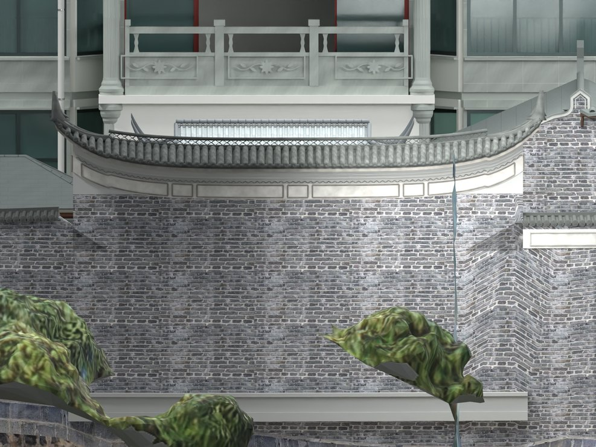
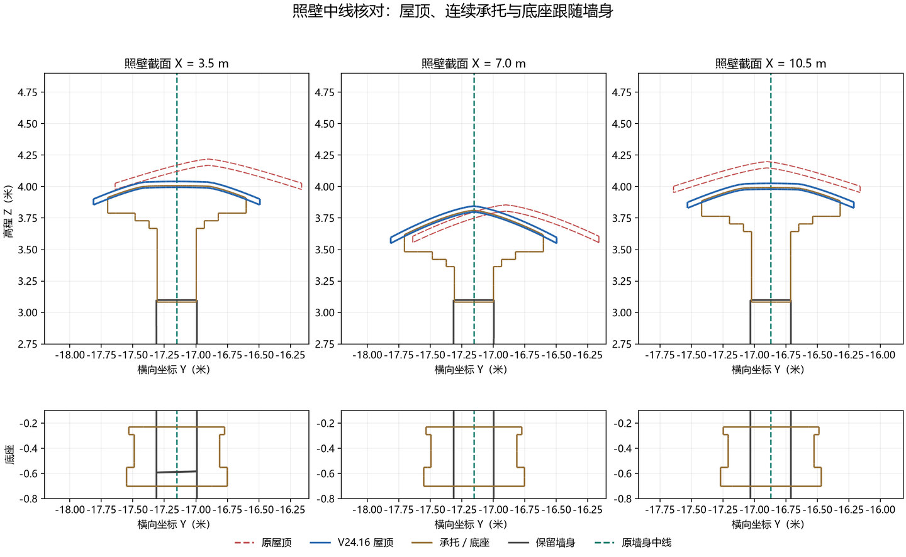

# V24.16 · 由墙身截面中点重建弧形照壁的同轴构造

[逐版目录](README.md) · [建筑重建台账](../../reconstruction.md) · [阶段方法汇总](../v24-v24-21.md) · [上一篇 V24.15](v24-15.md) · [下一篇 V24.17](v24-17.md)

## 摘要

入口柱外移并补白灰侧墙。按墙身中线重建照壁底座、叠涩、瓦面及分叉脊。

## 1. 问题与输入

V24.15 的照壁屋面以固定直线布置，墙身有缓弯，最大偏离约 0.305 m。入口柱与白墙是另一个局部修订区。

## 2. 实现方法

1. 在墙身 Z = 1.0 m 的水平截面按站点取两侧交点，求其平均作为墙中线。沿中线重建石底座、承托、叠涩、瓦面和分叉脊，两侧等挑。
2. 沿新弧线延长分叉段，横向扇铺端瓦，长檐瓦当逐一对应 60 道筒瓦排。入口圆柱和柱础外移 0.57 m，柱后补白灰侧墙。
3. 独立重开保存网格，分屋顶、承托和底座取 459 个截面，以各自中点到原墙中线的距离判断对中。

对于某一站点，取原墙两侧的平面交点 L 与 R，中线点为 (L+R)/2。保存后的屋顶、承托和底座也按同一站点截取，比较各自中心与这条基准线的差。对比沿墙全长的最大差，避免只看中间的一个正视机位。

## 3. 过程图

*图 1 · 按墙身中线重建的照壁。过程文件 `Rebuild_V24_16/Reports/V24_16_Screen_Outside.png`。*

*图 2 · V24.16 原墙中线、承托与瓦顶的截面核对。过程文件 `Rebuild_V24_16/Reports/V24_16_Screenwall_Alignment_Sections.png`。*

## 4. 验证与适用范围

截面报告最大偏差为 0.17 mm。该数字是保存模型与同一墙身基准的内部一致性，入口白墙可见深度约 0.82 m 是影像拟合值。

| 过程报告 | 原报告读数 |
| --- | --- |
| `Rebuild_V24_16/Reports/V24_16_Fresh_Blend_QA.json` | 状态 `PASS_FRESH_NATIVE_QA`，检查条目 7,916，失败记录 0。 |
| `Rebuild_V24_16/Reports/V24_16_Independent_Solid_QA.json` | 状态 `PASS_INDEPENDENT_SAVED_SOLIDS`，实体条目 45。 |

### 原记录中的关键检查

| 检查项 | 结果与读数 | 原记录位置 |
| --- | --- | --- |
| Preserved parent / CANOPY_CENTER_0 | 通过 | `V24_16_Fresh_Blend_QA.json` 的 `checks[783]` |
| Preserved hide_render / CANOPY_CENTER_0 | 通过 | `V24_16_Fresh_Blend_QA.json` 的 `checks[784]` |
| Preserved animation / CANOPY_CENTER_0 | 通过 | `V24_16_Fresh_Blend_QA.json` 的 `checks[785]` |

## 5. 复现入口与出处

过程路径以本地 `JIA` 项目为根，`work/` 指重建项目的历史工作目录。复核时按交付记录打开本轮输入与保存成果，再依方法中的截面、对象或动作采样对照原报告。

- **交付与参考记录**。`Rebuild_V24_16/README_V24_16.md`

- **原实现脚本**。`Rebuild_V24_16/Source/v24_16_analyse.py` · `Rebuild_V24_16/Source/v24_16_alignment_plot.py` · `Rebuild_V24_16/Source/v24_16_screen.py` · `Rebuild_V24_16/Source/v24_16_build.py` · `Rebuild_V24_16/Source/v24_16_probe.py`

过程图校验值

| 图 | 原过程图 SHA-256 | 发布方式 |
| --- | --- | --- |
| 1 | `29c13c3b5c49d3d55295f6f211cd366cca1743479be9eb1b0c4c6edded849357` | 台账发布图，按原图缩放及压缩 |
| 2 | `8df4dd9e82b17fd3a6249a9f4d5dc47c4358ecc11527151ed800fdcf31a8086e` | 已有过程图的发布副本 |

