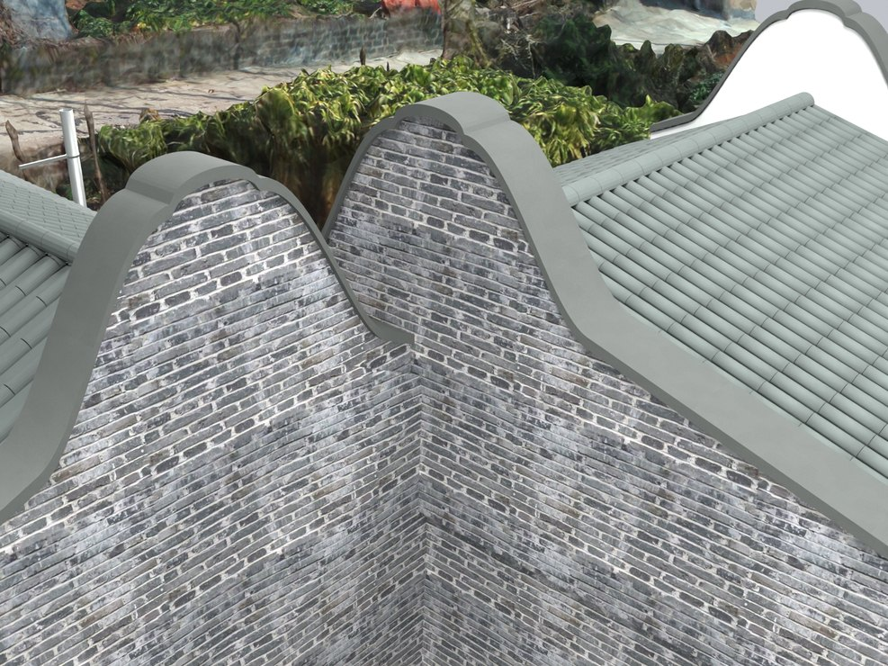
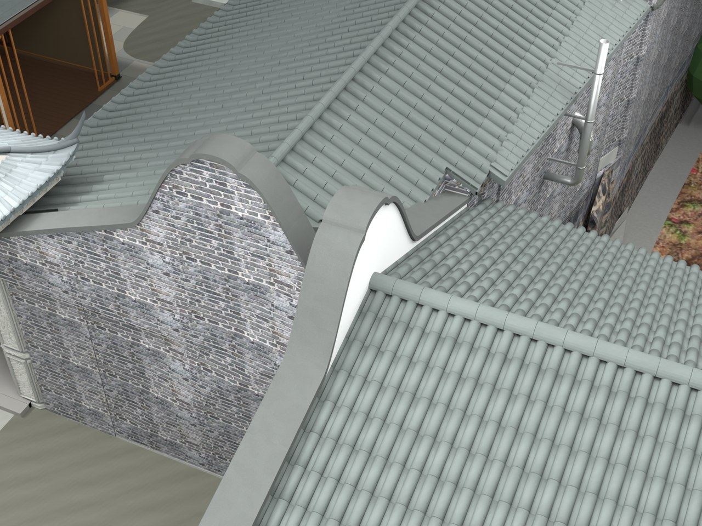

# V24.17 · 把青砖山墙、镬耳和瓦基层错位逐项修正

[逐版目录](README.md) · [建筑重建台账](../../reconstruction.md) · [阶段方法汇总](../v24-v24-21.md) · [上一篇 V24.16](v24-16.md) · [下一篇 V24.18](v24-18.md)

## 摘要

青砖封齐储藏房与厨房山墙，修镬耳及瓦面交接，清理导致闪烁的叠面。

## 1. 问题与输入

V24.16 已校正照壁轴线。储藏房与厨房外侧仍可见梁头穿墙、镬耳偏小、板瓦与基层争面三类问题。

## 2. 实现方法

1. 按外墙界面截断外露木基层和梁端，使用连续青砖山墙封齐。重塑约 2.36 m 宽的镬耳肩部，储藏房砖体耳峰约由 4.79 m 升至 5.25 m。
2. 把木基层下移，建立筒瓦、板瓦和基层的独立层位，清除屋面相交处旧短瓦檐。局部删除次照壁原合并瓦帽的 18,031 个重复三角面，重做瓦顶与承托。
3. 从保存网格读出瓦与基层最小间隔并看多角度原过程帧。同步撤去主照壁被标出的凸底条。

## 3. 过程图

*图 1 · 储藏房西侧青砖封边。过程文件 `Rebuild_V24_17/Reports/V24_17_Storage_West_Gable.png`。*

*图 2 · V24.17 屋面分层和厨房、储藏房交接。过程文件 `Rebuild_V24_17/Reports/V24_17_Roof_Junction.png`。*

## 4. 验证与适用范围

可见瓦面至基层最小约 10.2 mm，复开记录 7,940 项检查。此轮镬耳比例在后续实景反馈中继续修订。

| 过程报告 | 原报告读数 |
| --- | --- |
| `Rebuild_V24_17/Reports/V24_17_Fresh_Blend_QA.json` | 状态 `PASS_FRESH_NATIVE_QA`，检查条目 7,940，失败记录 0。 |
| `Rebuild_V24_17/Reports/V24_17_Video_QA.json` | 状态 `PASS_ENCODED_72_FRAME_PREVIEW`。 |

### 原记录中的关键检查

| 检查项 | 结果与读数 | 原记录位置 |
| --- | --- | --- |
| Preserved parent / V24_09_Screenwall_Solid_Fork_and_Ridge_Seats | 通过 | `V24_17_Fresh_Blend_QA.json` 的 `checks[6736]` |
| Preserved hide_render / V24_09_Screenwall_Solid_Fork_and_Ridge_Seats | 通过 | `V24_17_Fresh_Blend_QA.json` 的 `checks[6737]` |
| Preserved animation / V24_09_Screenwall_Solid_Fork_and_Ridge_Seats | 通过 | `V24_17_Fresh_Blend_QA.json` 的 `checks[6738]` |

## 5. 复现入口与出处

过程路径以本地 `JIA` 项目为根，`work/` 指重建项目的历史工作目录。复核时按交付记录打开本轮输入与保存成果，再依方法中的截面、对象或动作采样对照原报告。

- **交付与参考记录**。`Rebuild_V24_17/README_V24_17.md`

- **原实现脚本**。`Rebuild_V24_17/Source/v24_17_coping_probe.py` · `Rebuild_V24_17/Source/v24_17_prepare.py` · `Rebuild_V24_17/Source/v24_17_build.py` · `Rebuild_V24_17/Source/v24_17_probe.py` · `Rebuild_V24_17/Source/v24_17_gate_probe.py`

过程图校验值

| 图 | 原过程图 SHA-256 | 发布方式 |
| --- | --- | --- |
| 1 | `9f3bba76cb4b0da7e9a1d3c83a83c9451ffe486705836c884484316277a2dba1` | 台账发布图，按原图缩放及压缩 |
| 2 | `13fa6d84deafba5fb870ee63d8ce8f6b1cf4952f597731fcfa44786aa835efad` | 保留原画面，发布用 JPEG |

