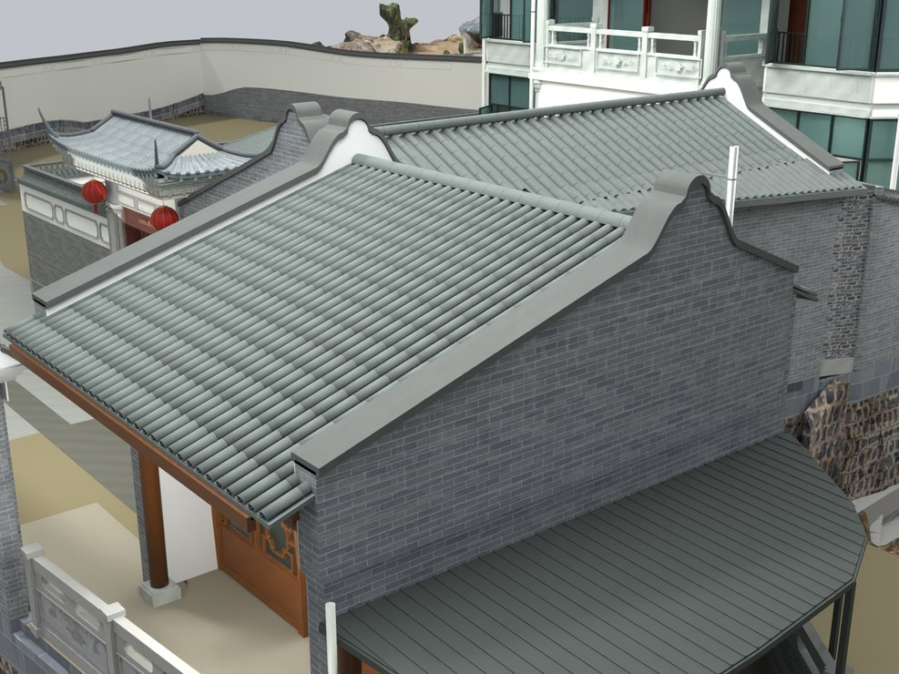
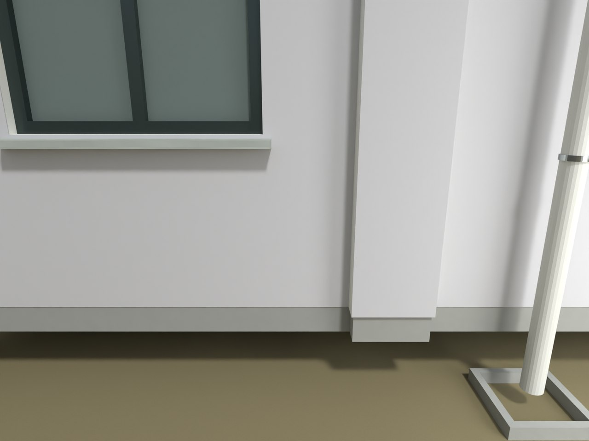

# V24.18 · 以保存模型的板底和地坪高差定位透空

[逐版目录](README.md) · [建筑重建台账](../../reconstruction.md) · [阶段方法汇总](../v24-v24-21.md) · [上一篇 V24.17](v24-17.md) · [下一篇 V24.19](v24-19.md)

## 摘要

补建筑与地坪之间的接地基座，收窄镬耳，修凹照壁和外开窗。

## 1. 问题与输入

读 V24.17 保存网格，首层楼板底约 −0.150024 m，周围地坪约 −0.462 至 −0.480 m。垂向差给出约 0.312–0.330 m 的可见透空。

## 2. 实现方法

1. 沿原楼板外轮廓生成封闭勒脚，顶接板底、底到 −0.720 m。内退 8 mm 的舌口嵌板 12 mm，减少侧面争面。
2. 按照片将四处镬耳的根部从 2.36 m 收至 1.24 m，复查凹照壁及外开窗的实体位置和开向。
3. 以同机位同照明对照原透空与补建后状态，按 22 处地面取样核对接地，并分开验证窗运动。

## 3. 过程图

*图 1 · 收窄的镬耳山墙。过程文件 `Rebuild_V24_18/Reports/V24_18_Narrow_Ears.png`。*

*图 2 · V24.17 原模型的楼板下透空，作为 V24.18 同机位基线。过程文件 `Rebuild_V24_18/Reports/V24_18_House_Grade_Before_V17.png`。*

## 4. 验证与适用范围

模型中 22 处接地样本通过；本轮可见砖纹基座后来按实景改为 V24.19 的地坪顺接。保留两版可用于理解相同高差的两种实际迭代。

| 过程报告 | 原报告读数 |
| --- | --- |
| `Rebuild_V24_18/Reports/V24_18_Fresh_Blend_QA.json` | 状态 `PASS_FRESH_NATIVE_QA`，检查条目 8,119，失败记录 0，窗体条目 12。 |
| `Rebuild_V24_18/Reports/V24_18_Independent_Solid_QA.json` | 状态 `PASS_INDEPENDENT_NATIVE_SOLIDS`，检查条目 57，实体条目 33。 |

### 原记录中的关键检查

| 检查项 | 结果与读数 | 原记录位置 |
| --- | --- | --- |
| Unstretched vertical metre coordinates / SITE_PERIMETER_JOINED_RETAINING_WALL_0_Geometry | 通过，`maximum_vertical_uv_error_m=0` | `V24_18_Fresh_Blend_QA.json` 的 `checks[8085]` |
| UV subdivision retains surface area / SITE_PERIMETER_JOINED_RETAINING_WALL_0_Geometry | 通过，`absolute_area_change_m2=0` | `V24_18_Fresh_Blend_QA.json` 的 `checks[8086]` |
| Unstretched horizontal metre coordinates / SITE_PERIMETER_JOINED_RETAINING_WALL_0_Geometry | 通过，`horizontal_metric_scale_min=0.999762`，`horizontal_metric_scale_max=1.00021` | `V24_18_Fresh_Blend_QA.json` 的 `checks[8087]` |

## 5. 复现入口与出处

过程路径以本地 `JIA` 项目为根，`work/` 指重建项目的历史工作目录。复核时按交付记录打开本轮输入与保存成果，再依方法中的截面、对象或动作采样对照原报告。

- **交付与参考记录**。`Rebuild_V24_18/README_V24_18.md`

- **原实现脚本**。`Rebuild_V24_18/Source/v24_18_detail_probe.py` · `Rebuild_V24_18/Source/v24_18_prepare.py` · `Rebuild_V24_18/Source/v24_18_build.py` · `Rebuild_V24_18/Source/v24_18_probe.py` · `Rebuild_V24_18/Source/v24_18_extra_probe.py`

过程图校验值

| 图 | 原过程图 SHA-256 | 发布方式 |
| --- | --- | --- |
| 1 | `fa71312a5b63b8c7b28b23486372c6e391e8dd14b54043c33c4c89f3a85cd098` | 台账发布图，按原图缩放及压缩 |
| 2 | `32925562088b7628bb34a8e4a77563464aeb9717076a4f4a82f6a5d3c3c43b1d` | 保留原画面，发布用 JPEG |

