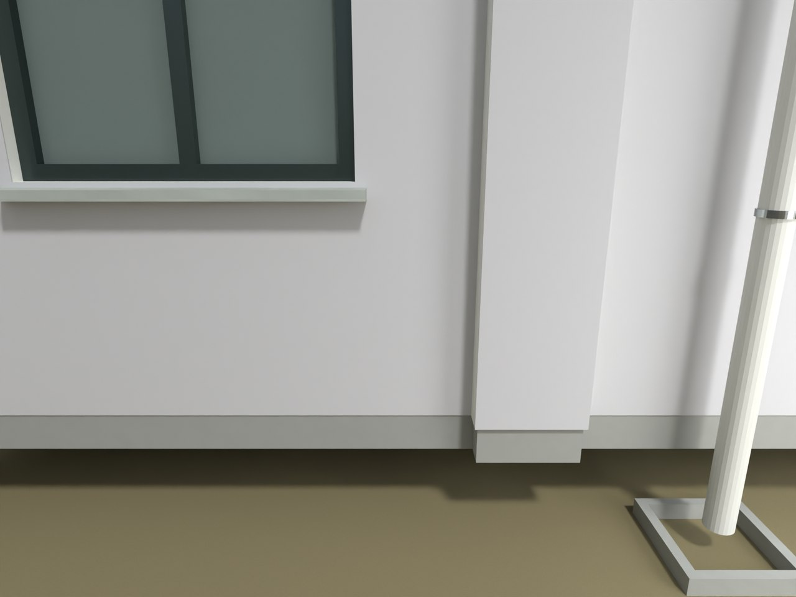
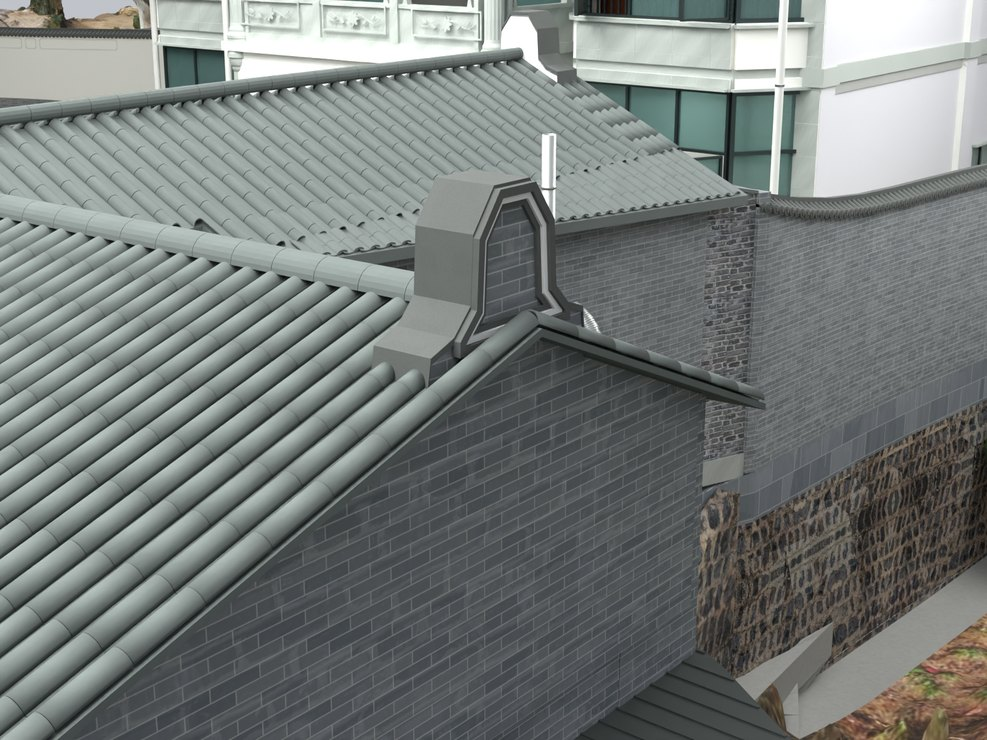

# V24.19 · 追到早期地坪基准并按实景收接墙脚

[逐版目录](README.md) · [建筑重建台账](../../reconstruction.md) · [阶段方法汇总](../v24-v24-21.md)

## 摘要

复核首层悬空的高程成因并修墙脚，调整实景山墙瓦挑檐，处理基座与外墙交界。

## 1. 问题与输入

V24.18 的新增砖纹勒脚可封闭透空，外观经核对与实景不符。本轮追溯到 V16 约 −0.48 m 的地坪假定和首层板底约 −0.150 m 之间缺少过渡。

## 2. 实现方法

1. 撤去整栋外加砖基，墙边局部顺接到 −0.060 m。约 0.10 m 接触带之外用 1.65 m 过渡至既有场地，保留入口台阶前的控制高程。

2. 直接编辑原土体和铺地网格的局部高程及底面，保留面域、UV 和材料。依实景调整山墙瓦挑檐。

3. 保存后读 138 处墙边、7 处远地坪和入口周边的标高，再检查地坪实体厚度。

### 实现链与源码定位

以下按诊断、处理、保存与复核组织阅读。调用和文件引用来自原脚本，输入输出方向由对应读写调用判断；辅助文件是否在本轮运行，以报告为准。

**1. 定位与诊断** · [`v24_19_probe.py`](../source-code/v24-19/project/Source/v24_19_probe.py#L6)

打开保存的 Blender [`bpy.ops.wm.open_mainfile`](../source-code/v24-19/project/Source/v24_19_probe.py#L6)。

文件引用：[`Architecture_Complete_V24_18.blend`](../source-code/v24-19/project/Source/v24_19_probe.py#L5) · [`Before_Snapshot.json`](../source-code/v24-19/project/Source/v24_19_probe.py#L7) · [`Inventory.json`](../source-code/v24-19/project/Source/v24_19_probe.py#L16)。

**2. 参数与几何处理** · [`v24_19_prepare.py`](../source-code/v24-19/project/Source/v24_19_prepare.py#L52)

截面提取 [`section`](../source-code/v24-19/project/Source/v24_19_prepare.py#L52)；网格与实体转换 [`m.to_mesh64`](../source-code/v24-19/project/Source/v24_19_prepare.py#L52)；叉积／面法线 [`np.cross`](../source-code/v24-19/project/Source/v24_19_prepare.py#L64)。

**3. 构建或写入** · [`v24_19_build.py`](../source-code/v24-19/project/Source/v24_19_build.py#L8)

打开保存的 Blender [`bpy.ops.wm.open_mainfile`](../source-code/v24-19/project/Source/v24_19_build.py#L8)；写入网格拓扑 [`me.from_pydata`](../source-code/v24-19/project/Source/v24_19_build.py#L14)；UV 继承或投影 [`uv_metres`](../source-code/v24-19/project/Source/v24_19_build.py#L30)。

文件引用：[`Architecture_Complete_V24_19.blend`](../source-code/v24-19/project/Source/v24_19_build.py#L7) · [`Source.json`](../source-code/v24-19/project/Source/v24_19_build.py#L7) · [`Prepared_Geometry.json`](../source-code/v24-19/project/Source/v24_19_build.py#L7)。

**4. 辅助实现** · [`v24_19_common.py`](../source-code/v24-19/project/Source/v24_19_common.py#L10)

截面提取 [`section`](../source-code/v24-19/project/Source/v24_19_common.py#L10)；图像或几何变换 [`m.transform`](../source-code/v24-19/project/Source/v24_19_common.py#L11)。

文件引用：[`Inventory.json`](../source-code/v24-19/project/Source/v24_19_common.py#L5)。

**5. 过程出图** · [`v24_19_render.py`](../source-code/v24-19/project/Source/v24_19_render.py#L5)

打开保存的 Blender [`bpy.ops.wm.open_mainfile`](../source-code/v24-19/project/Source/v24_19_render.py#L5)。

文件引用：[`Architecture_Complete_V24_19.blend`](../source-code/v24-19/project/Source/v24_19_render.py#L4) · [`_State.json`](../source-code/v24-19/project/Source/v24_19_render.py#L14)。

**6. 辅助实现** · [`v24_19_solids.py`](../source-code/v24-19/project/Source/v24_19_solids.py#L28)

判据与回归检查 [`checks.append`](../source-code/v24-19/project/Source/v24_19_solids.py#L5)；叉积／面法线 [`np.cross`](../source-code/v24-19/project/Source/v24_19_solids.py#L28)。

文件引用：[`Solid_Export_Index.json`](../source-code/v24-19/project/Source/v24_19_solids.py#L4) · [`Prepared_Geometry.json`](../source-code/v24-19/project/Source/v24_19_solids.py#L4) · [`V24_19_Independent_Geometry_QA.json`](../source-code/v24-19/project/Source/v24_19_solids.py#L43)。

**7. 交付封装** · [`v24_19_package.py`](../source-code/v24-19/project/Source/v24_19_package.py#L4)

文件引用：[`Architecture_Complete_V24_19.blend`](../source-code/v24-19/project/Source/v24_19_package.py#L3) · [`V24_19_Build.json`](../source-code/v24-19/project/Source/v24_19_package.py#L7) · [`V24_19_Fresh_Native_QA.json`](../source-code/v24-19/project/Source/v24_19_package.py#L7)。

[方法原理：局部实体、接合与保护域](../methodology.md#4-局部改模如何限定影响范围) · [本版完整过程索引](process/v24-19.md)

本版索引汇合 26 幅已归档过程图、29 份交付及历史目录中的报告／说明／中间记录和全部 16 个源码附件。继承文件和本轮新增文件按来源保留，实际完成范围以第 4 节及原报告为准。

## 3. 过程图

 

**图 1** · V24.19 报告引用的 V24.17 透空基线 
**图 2** · 山墙瓦挑檐与收口

## 4. 验证与适用范围

独立报告给铺地最小厚度约 133 mm，局部厚度最大变化约 32 mm。−0.060 m 是与板边接合的模型控制值。

- **Fresh Native QA** 
  状态 `PASS_FRESH_NATIVE_QA`，检查条目 8,585，失败记录 0。

- **独立几何核验** 
  状态 `PASS_INDEPENDENT_NATIVE_GEOMETRY`，检查条目 22，实体条目 30。

### 原记录中的关键检查

- **Ground meets original slab without added skirt / (-0.26, 3)** 
  通过，`before_grade_z` = `-0.462416`，`new_grade_z` = `-0.0628275`，`slab_underside_z` = `-0.150024` 
  原记录 `V24_19_Fresh_Native_QA.json` 的 `checks[8384]`

- **Prepared geometry survives save / V24_03_Kitchen_Rear_Gable_Wall** 
  通过，`nearest_surface_witness_error_m` = `5.52518e-05` 
  原记录 `V24_19_Fresh_Native_QA.json` 的 `checks[8548]`

- **North gable UV subdivisions retain solid geometry** 
  通过，`symmetric_difference_m3` = `3.74554e-06` 
  原记录 `V24_19_Independent_Geometry_QA.json` 的 `checks[12]`

## 5. 复现入口与出处

过程路径以本地 `JIA` 项目为根，`work/` 指重建项目的历史工作目录。复核时按交付记录打开本轮输入与保存成果，再依方法中的截面、对象或动作采样对照原报告。

交付与参考记录（1 项）

~~~text
Rebuild_V24_19/README_V24_19.md
~~~

### 原实现脚本附件

[浏览本版全部 16 个文件](../source-code/v24-19/README.md) · [原件与公开副本校验值](../source-code/v24-19/manifest.json)

- [`v24_19_probe.py`](../source-code/v24-19/project/Source/v24_19_probe.py)
- [`v24_19_prepare.py`](../source-code/v24-19/project/Source/v24_19_prepare.py)
- [`v24_19_build.py`](../source-code/v24-19/project/Source/v24_19_build.py)
- [`v24_19_common.py`](../source-code/v24-19/project/Source/v24_19_common.py)
- [`v24_19_render.py`](../source-code/v24-19/project/Source/v24_19_render.py)

原脚本本地路径

~~~text
Rebuild_V24_19/Source/v24_19_probe.py
Rebuild_V24_19/Source/v24_19_prepare.py
Rebuild_V24_19/Source/v24_19_build.py
Rebuild_V24_19/Source/v24_19_common.py
Rebuild_V24_19/Source/v24_19_render.py
~~~

核验报告路径（2 项）

**Fresh Native QA**

~~~text
Rebuild_V24_19/Reports/V24_19_Fresh_Native_QA.json
~~~

**独立几何核验**

~~~text
Rebuild_V24_19/Reports/V24_19_Independent_Geometry_QA.json
~~~

图源与 SHA-256（2 张）

### 图 1 · V24.19 报告引用的 V24.17 透空基线

~~~text
Rebuild_V24_19/Reports/V24_17_Original_Air_Gap_Before.png
~~~

**原过程图 SHA-256**

~~~text
32925562088b7628bb34a8e4a77563464aeb9717076a4f4a82f6a5d3c3c43b1d
~~~

保留原画面，发布用 JPEG。

### 图 2 · 山墙瓦挑檐与收口

~~~text
Rebuild_V24_19/Reports/V24_19_Gable_Detail.png
~~~

**原过程图 SHA-256**

~~~text
c7be22c32d4613b9ca165cdd54ecca75dd7941598200070552c9d0e6447fa2b4
~~~

台账发布图，按原图缩放及压缩。

---

上一篇 [V24.18 · 以保存模型的板底和地坪高差定位透空](v24-18.md) 
下一篇 [V24.20 · 统一实景砖纹并按平面修卫生间与厨房](v24-20.md)
