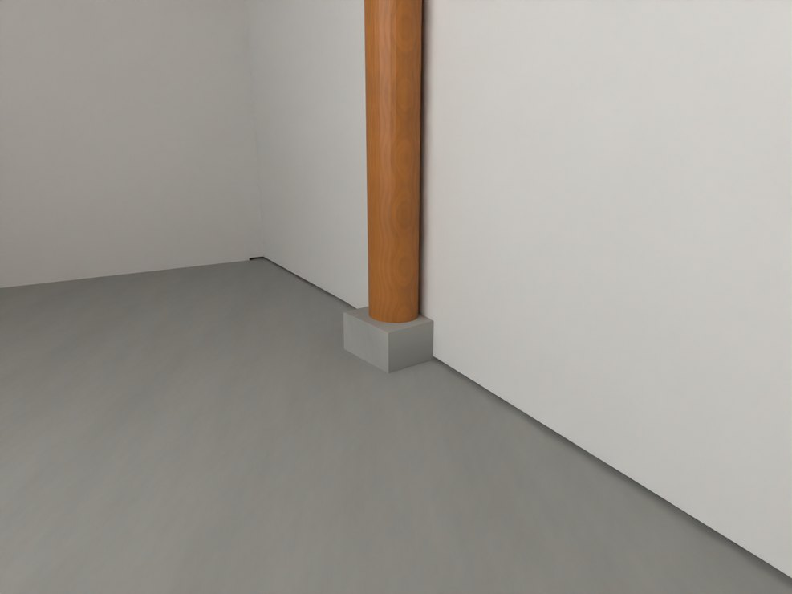
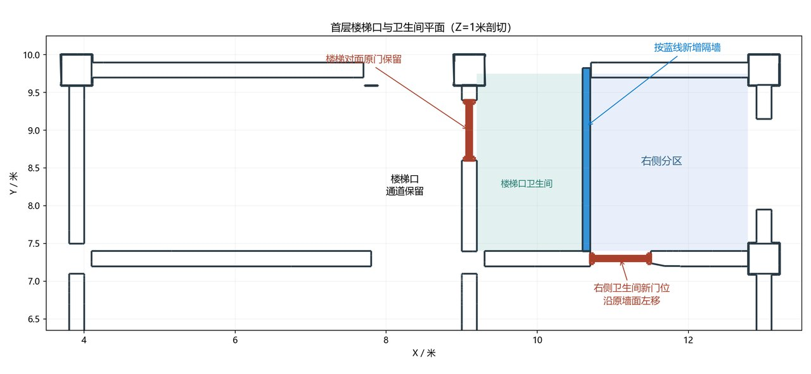

# V24.20 · 统一实景砖纹并按平面修卫生间与厨房

[逐版目录](README.md) · [建筑重建台账](../../reconstruction.md) · [阶段方法汇总](../v24-v24-21.md) · [上一篇 V24.19](v24-19.md) · [下一篇 V24.21](v24-21.md)

## 摘要

统一外围墙实景砖纹，修首层卫生间及厨储交接，按参考改厨房灰色地砖。

## 1. 问题与输入

侧墙与后墙使用不同砖图造成色差，旧共面接口带来闪烁。另有首层卫生间蓝线分隔、厨房柱脚、灰石铺和厨储屋缝的现场证据。

## 2. 实现方法

1. 侧后墙统一用原侧墙灰砖，以沿墙累计周长及高度建立米制 UV。砖石可见分界随墙脚路面，拟合高约 0.20 m。合并共面砌体面，材质分界用属性表达。
2. 按蓝线设 100 mm 隔墙接后墙并保留入口通道。分段修厨房柱脚、灰地砖、排水件及两屋瓦缝。
3. 保存后比较新旧墙表面距离，读取四处柱脚地面接触和改动实体；转角瓦顶单独查闭合。

## 3. 过程图

*图 1 · 厨房灰色地砖。过程文件 `Rebuild_V24_20/Reports/V24_20_Kitchen_Floor.png`。*

*图 2 · V24.20 首层平面与卫生间通行分隔。过程文件 `Rebuild_V24_20/Reports/V24_20_F1_Plan.png`。*

## 4. 验证与适用范围

原说明记录墙外表面至旧模型最大距离小于 1 mm。8,488 项复开检查与 66 项独立几何检查均记录空失败清单。

| 过程报告 | 原报告读数 |
| --- | --- |
| `Rebuild_V24_20/Reports/V24_20_Fresh_Native_QA.json` | 状态 `PASS_FRESH_NATIVE_QA`，检查条目 8,488，失败记录 0。 |
| `Rebuild_V24_20/Reports/V24_20_Independent_Geometry_QA.json` | 状态 `PASS_INDEPENDENT_GEOMETRY_QA`，检查条目 66，失败记录 0，实体条目 26。 |

### 原记录中的关键检查

| 检查项 | 结果与读数 | 原记录位置 |
| --- | --- | --- |
| Kitchen inside wall is white | 通过，`faces=208`，`wrong_finish=0` | `V24_20_Fresh_Native_QA.json` 的 `checks[8367]` |
| Photo UV vertical metre scale / SITE_PERIMETER_JOINED_RETAINING_WALL_0_Geometry | 通过，`error_m=0` | `V24_20_Fresh_Native_QA.json` 的 `checks[8413]` |
| Photo UV horizontal metre scale / SITE_PERIMETER_JOINED_RETAINING_WALL_0_Geometry | 通过，`minimum=0.99987`，`maximum=1.00011` | `V24_20_Fresh_Native_QA.json` 的 `checks[8414]` |

## 5. 复现入口与出处

过程路径以本地 `JIA` 项目为根，`work/` 指重建项目的历史工作目录。复核时按交付记录打开本轮输入与保存成果，再依方法中的截面、对象或动作采样对照原报告。

- **交付与参考记录**。`Rebuild_V24_20/README_V24_20.md`

- **原实现脚本**。`Rebuild_V24_20/Source/v24_20_plans.py` · `Rebuild_V24_20/Source/v24_20_probe.py` · `Rebuild_V24_20/Source/v24_20_prepare.py` · `Rebuild_V24_20/Source/v24_20_build.py` · `work/v24_20_plan.py`

过程图校验值

| 图 | 原过程图 SHA-256 | 发布方式 |
| --- | --- | --- |
| 1 | `6dc561330771355994c05b8850c3876db7c6c3916cd7561dd2cdc5f46bcda083` | 台账发布图，按原图缩放及压缩 |
| 2 | `9788bb631688d5293dd0b4efbcfc72c455caf938d1c00b61584a49fcf732dae3` | 保留原画面，发布用 JPEG |

