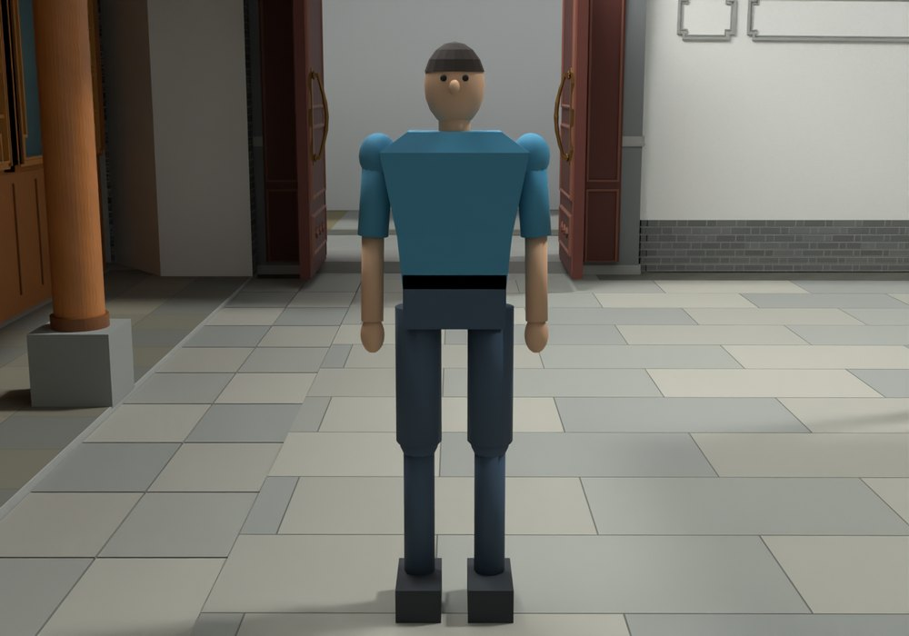
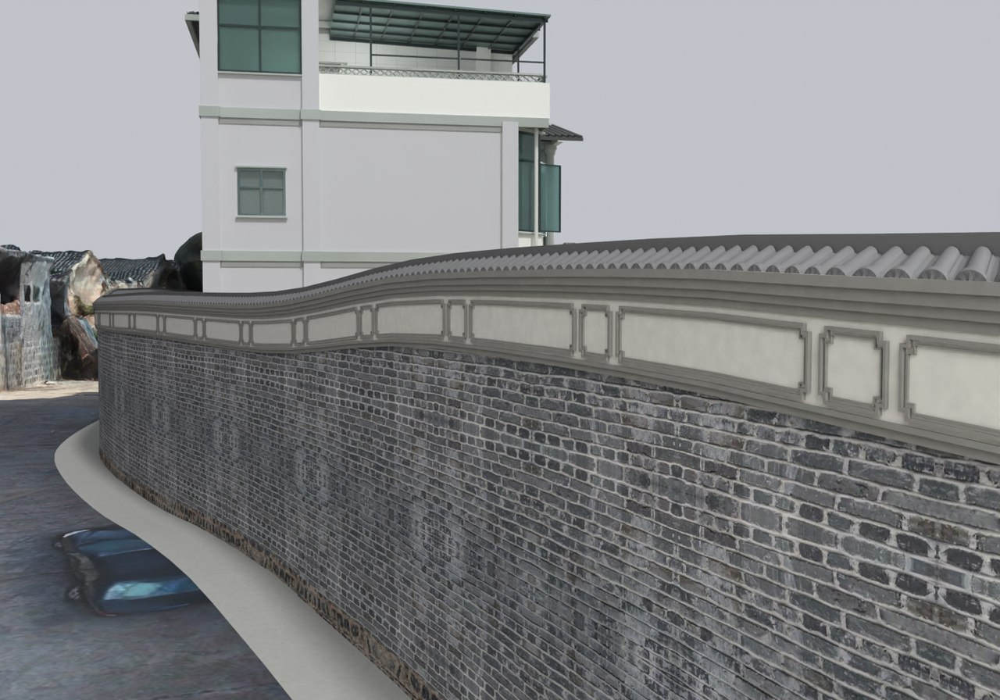

# V24.21 · 从保存三角面建立人物胶囊漫游

[逐版目录](README.md) · [建筑重建台账](../../reconstruction.md) · [阶段方法汇总](../v24-v24-21.md)

## 摘要

新增 1.65 m 人物、碰撞、台阶与第一/第三人称漫游。按实景补外围墙白饰带和长短框。

## 1. 问题与输入

V24.20 的保存建筑作为可走模型。为检查实际通道、楼梯和门洞，在 Blender 端加入第一、第三人称共用的碰撞几何。

## 2. 实现方法

1. 由实际建筑三角面建立地面和阻挡。人物胶囊高 1.65 m、半径 0.215 m，按重力、踏步抬升和墙体阻挡求解行走；跟随视角沿相机路径检查避墙。

2. 用约 1.85 m/s 行走和 3.10 m/s 快走测试一至三楼，分别检查门洞、跳跃和落地。围墙白饰带及长短框另按实景建模。

3. 在原生保存版回读建筑及门扇，在物理 QA 中读取路径样本、台阶通过和相机避障。

## 3. 过程图

**图 1** · 人物漫游与场地碰撞

**图 2** · V24.21 补齐后的外围墙白饰带和长短框

## 4. 验证与适用范围

原生报告列 1,625 项检查，物理报告列 12 项且失败清单为空。速度、身高和跳跃量都是软件参数。

- **原生模型核验** 
  状态 `PASS_FRESH_NATIVE_PRESERVATION_AND_CONTROLLER`，检查条目 1,625，失败记录 0。

- **人物通行核验** 
  状态 `PASS_ACTUAL_MODEL_ROAM_PHYSICS`，检查条目 12，失败记录 0。

### 原记录中的关键检查

- **Original object completely preserved / V24_09_Screenwall_Solid_Fork_and_Ridge_Seats** 
  通过 
  原记录 `V24_21_Native_QA.json` 的 `checks[1096]`

- **Walk up actual two-flight stair to floor 2** 
  通过，`expected_floor_z` = `3.90002` 
  原记录 `V24_21_Physics_QA.json` 的 `checks[5]`

- **Walk up actual two-flight stair to floor 3** 
  通过，`expected_floor_z` = `7.5` 
  原记录 `V24_21_Physics_QA.json` 的 `checks[6]`

## 5. 复现入口与出处

过程路径以本地 `JIA` 项目为根，`work/` 指重建项目的历史工作目录。复核时按交付记录打开本轮输入与保存成果，再依方法中的截面、对象或动作采样对照原报告。

交付与参考记录（1 项）

~~~text
Rebuild_V24_21/README_漫游使用说明.md
~~~

### 原实现脚本附件

[浏览本版全部 20 个文件](../source-code/v24-21/README.md) · [原件与公开副本校验值](../source-code/v24-21/manifest.json)

- [`v24_21_build.py`](../source-code/v24-21/project/Source/v24_21_build.py)
- [`v24_21_verify.py`](../source-code/v24-21/project/Source/v24_21_verify.py)
- [`v24_21_probe.py`](../source-code/v24-21/project/Source/v24_21_probe.py)
- [`v24_21_render.py`](../source-code/v24-21/project/Source/v24_21_render.py)
- [`v24_21_details.py`](../source-code/v24-21/project/Source/v24_21_details.py)

原脚本本地路径

~~~text
Rebuild_V24_21/Source/v24_21_build.py
Rebuild_V24_21/Source/v24_21_verify.py
Rebuild_V24_21/Source/v24_21_probe.py
Rebuild_V24_21/Source/v24_21_render.py
Rebuild_V24_21/Source/v24_21_details.py
~~~

核验报告路径（2 项）

**原生模型核验**

~~~text
Rebuild_V24_21/Reports/V24_21_Native_QA.json
~~~

**人物通行核验**

~~~text
Rebuild_V24_21/Reports/V24_21_Physics_QA.json
~~~

图源与 SHA-256（2 张）

### 图 1 · 人物漫游与场地碰撞

~~~text
Rebuild_V24_21/Reports/V24_21_Person.png
~~~

**原过程图 SHA-256**

~~~text
0c93b4f15a5b92b7bb7eb135cc3ef6a9841f88ff3519b5dfd1604066de6bc7c5
~~~

台账发布图，按原图缩放及压缩。

### 图 2 · V24.21 补齐后的外围墙白饰带和长短框

~~~text
Rebuild_V24_21/Reports/V24_21_Exterior_Frieze_Close.png
~~~

**原过程图 SHA-256**

~~~text
f14c0887bef937b00f13997e732cfadaf86ce32fbbfd43a1d1ca7dc8baafe9e9
~~~

保留原画面，发布用 JPEG。

---

上一篇 [V24.20 · 统一实景砖纹并按平面修卫生间与厨房](v24-20.md) 
下一篇 [V24.22 · 用定高和定向剖面识别厨房叠墙](v24-22.md)
