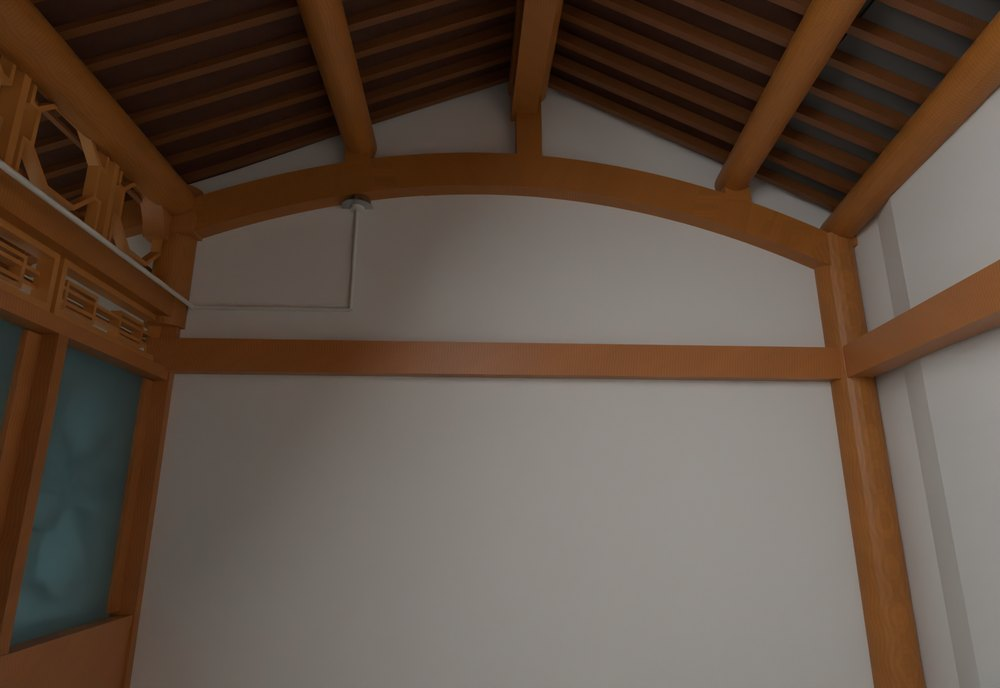
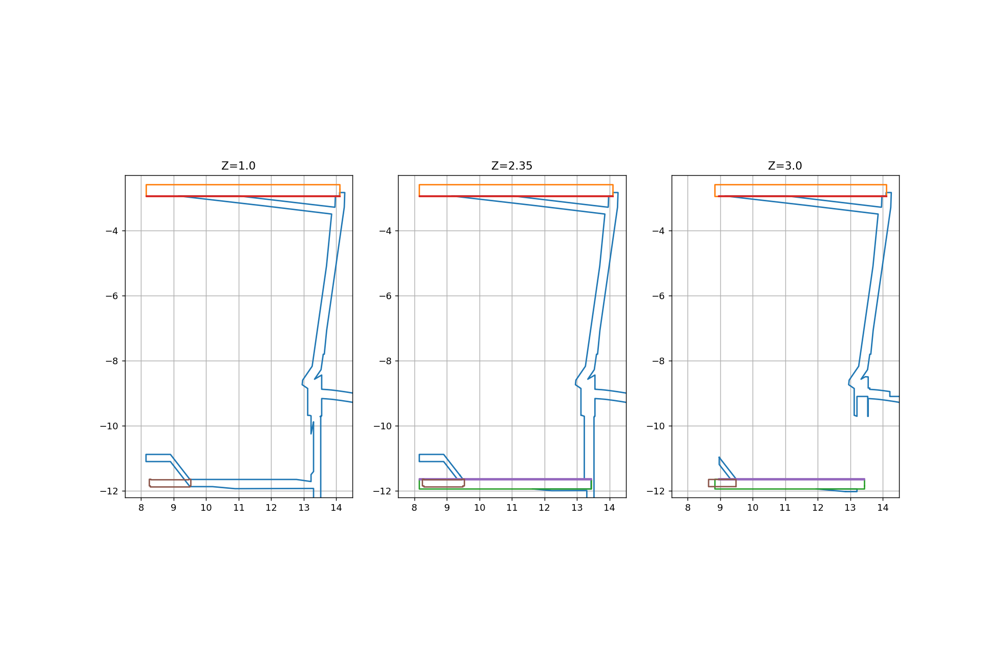
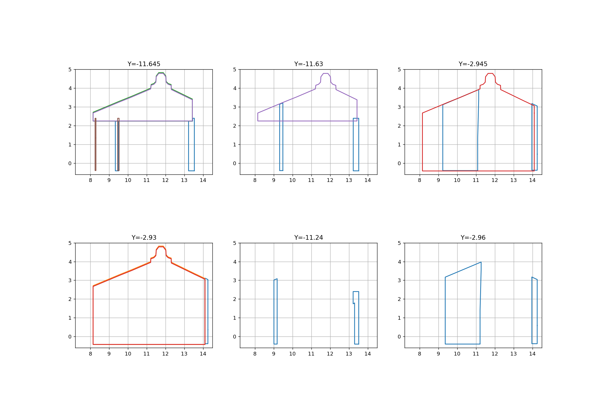

# V24.22 · 用定高和定向剖面识别厨房叠墙

[逐版目录](README.md) · [建筑重建台账](../../reconstruction.md) · [阶段方法汇总](../v24-22-v25.md)

## 摘要

通过定高与定向剖面辨认叠墙，重组厨房两端曲线山墙与封檐，再调整圆檩、木架、廊梁及墙拉结。

## 1. 问题与输入

V24.21 的厨房两端有连体砌体、旧山墙片和饰面相叠。先辨认哪个轮廓来自墙芯、白灰层或封口，再确定局部替换范围。

## 2. 实现方法

1. 提取六个墙体对象，沿 Z = 1.0、2.35、3.0 m 切 XY 平面。求定 Y 的 XZ 截面时，绕 X 转 −90°，再在转后 Z = −Y 取切片。

2. 把各对象轮廓写入原轮廓记录，用对象顺序分色和等比例绘图。比较六处 Y 切片中旧山墙与墙芯的重合，按实际屋面底线重组封口。

3. 分别调整圆檩、廊梁和墙拉结。保存后读回墙体及构件差异，独立检查修改实体和空间接合。

水平切片比较 XY 轮廓；绕 X 轴转 −90° 后 (x,y,z) 变为 (x,z,−y)，因此取新坐标 z=−y₀ 就能比较原 y=y₀ 的 XZ 截面。两组截面由同一对象顺序着色，保留原尺寸比例。

### 实现链与源码定位

以下按诊断、处理、保存与复核组织阅读。调用和文件引用来自原脚本，输入输出方向由对应读写调用判断；辅助文件是否在本轮运行，以报告为准。

**1. 定位与诊断** · [`v24_22_analyze.py`](../source-code/v24-22/history/v24_22_analyze.py#L6)

定高剖切 [`slice`](../source-code/v24-22/history/v24_22_analyze.py#L6)；坐标或构件旋转 [`m.rotate`](../source-code/v24-22/history/v24_22_analyze.py#L6)；网格与实体转换 [`c.to_mesh64`](../source-code/v24-22/history/v24_22_analyze.py#L13)。

文件引用：[`Wall_Contours_Before.json`](../source-code/v24-22/history/v24_22_analyze.py#L9) · [`_Components.json`](../source-code/v24-22/history/v24_22_analyze.py#L14)。

**2. 定位与诊断** · [`v24_22_probe.py`](../source-code/v24-22/history/v24_22_probe.py#L5)

打开保存的 Blender [`bpy.ops.wm.open_mainfile`](../source-code/v24-22/history/v24_22_probe.py#L5)。

文件引用：[`Architecture_Complete_V24_21.blend`](../source-code/v24-22/history/v24_22_probe.py#L4) · [`Before_Snapshot.json`](../source-code/v24-22/history/v24_22_probe.py#L6) · [`Inventory.json`](../source-code/v24-22/history/v24_22_probe.py#L15)。

**3. 参数与几何处理** · [`v24_22_geometry.py`](../source-code/v24-22/history/v24_22_geometry.py#L14)

定高剖切 [`slice`](../source-code/v24-22/history/v24_22_geometry.py#L14)；坐标或构件旋转 [`m.rotate`](../source-code/v24-22/history/v24_22_geometry.py#L14)；截面提取 [`section`](../source-code/v24-22/history/v24_22_geometry.py#L26)。

**4. 构建或写入** · [`v24_22_build.py`](../source-code/v24-22/history/v24_22_build.py#L9)

打开保存的 Blender [`bpy.ops.wm.open_mainfile`](../source-code/v24-22/history/v24_22_build.py#L9)；空间加速结构 [`BVHTree.FromPolygons`](../source-code/v24-22/history/v24_22_build.py#L25)；最小二乘求解 [`np.linalg.lstsq`](../source-code/v24-22/history/v24_22_build.py#L27)。

文件引用：[`Architecture_Complete_V24_22.blend`](../source-code/v24-22/history/v24_22_build.py#L7) · [`Source.json`](../source-code/v24-22/history/v24_22_build.py#L8) · [`Prepared_Geometry.json`](../source-code/v24-22/history/v24_22_build.py#L8)。

**5. 过程出图** · [`v24_22_plot.py`](../source-code/v24-22/history/v24_22_plot.py#L7)

文件引用：[`Wall_Contours_Before.json`](../source-code/v24-22/history/v24_22_plot.py#L7) · [`_Before.png`](../source-code/v24-22/history/v24_22_plot.py#L17)。

**6. 保存后核验** · [`v24_22_verify.py`](../source-code/v24-22/history/v24_22_verify.py#L8)

判据与回归检查 [`checks.append`](../source-code/v24-22/history/v24_22_verify.py#L7)；打开保存的 Blender [`bpy.ops.wm.open_mainfile`](../source-code/v24-22/history/v24_22_verify.py#L8)；空间加速结构 [`BVHTree.FromPolygons`](../source-code/v24-22/history/v24_22_verify.py#L21)。

文件引用：[`Architecture_Complete_V24_22.blend`](../source-code/v24-22/history/v24_22_verify.py#L6) · [`Before_Snapshot.json`](../source-code/v24-22/history/v24_22_verify.py#L6) · [`Prepared_Geometry.json`](../source-code/v24-22/history/v24_22_verify.py#L6)。

**7. 保存后核验** · [`v24_22_solid_qa.py`](../source-code/v24-22/history/v24_22_solid_qa.py#L2)

判据与回归检查 [`checks.append`](../source-code/v24-22/history/v24_22_solid_qa.py#L3)。

文件引用：[`Saved_Geometry_Index.json`](../source-code/v24-22/history/v24_22_solid_qa.py#L2) · [`V24_22_Solid_QA.json`](../source-code/v24-22/history/v24_22_solid_qa.py#L16)。

[方法原理：圈画、对象与剖切定位](../methodology.md#3-从截图圈画定位到对象与剖面) · [本版完整过程索引](process/v24-22.md)

本版索引汇合 13 幅已归档过程图、32 份交付及历史目录中的报告／说明／中间记录和全部 19 个源码附件。继承文件和本轮新增文件按来源保留，实际完成范围以第 4 节及原报告为准。

## 3. 过程图

**图 1** · 厨房山墙和木架

**图 2** · 三个定高 XY 截面中的旧墙和封口

**图 3** · 六处定 Y 截面中的墙芯和山墙轮廓

## 4. 验证与适用范围

变更表记录修改 11、增加 15、移除 14 个对象。原生核验列 1,727 项，实体报告列 29 项，失败清单均为空。剖面表达修改前网格的拓扑关系。

- **构件变更记录** 
  修改项 11，新增项 15，移除项 14。

- **原生模型核验** 
  状态 `PASS_NATIVE_PRESERVATION_AND_KITCHEN`，检查条目 1,727，失败记录 0。

- **实体核验** 
  状态 `PASS_SAVED_SOLIDS_AND_SUPPORTS`，检查条目 29，失败记录 0。

### 原记录中的关键检查

- **Saved closed solid / SITE_KITCHEN_V12_LONGITUDINAL_ROUND_PURLINS_Geometry** 
  通过，`bodies` = `5`，`volume_m3` = `1.56449`，`volume_error_m3` = `0` 
  原记录 `V24_22_Solid_QA.json` 的 `checks[8]`

- **Geometry stored within 0.03mm / SITE_KITCHEN_V12_LONGITUDINAL_ROUND_PURLINS_Geometry** 
  通过 
  原记录 `V24_22_Native_QA.json` 的 `checks[1647]`

- **Shared gable received kitchen-only white finish** 
  通过 
  原记录 `V24_22_Native_QA.json` 的 `checks[1721]`

## 5. 复现入口与出处

该版使用说明文件为空；本次依据变更清单、原脚本和保存后 QA 解释实现，不补写未经记录的操作。

过程路径以本地 `JIA` 项目为根，`work/` 指重建项目的历史工作目录。复核时按交付记录打开本轮输入与保存成果，再依方法中的截面、对象或动作采样对照原报告。

交付与参考记录（1 项）

~~~text
Rebuild_V24_22/Reports/V24_22_Changes.json
~~~

### 原实现脚本附件

[浏览本版全部 19 个文件](../source-code/v24-22/README.md) · [原件与公开副本校验值](../source-code/v24-22/manifest.json)

- [`v24_22_analyze.py`](../source-code/v24-22/history/v24_22_analyze.py)
- [`v24_22_plot.py`](../source-code/v24-22/history/v24_22_plot.py)
- [`v24_22_geometry.py`](../source-code/v24-22/history/v24_22_geometry.py)
- [`v24_22_build.py`](../source-code/v24-22/history/v24_22_build.py)
- [`v24_22_probe.py`](../source-code/v24-22/history/v24_22_probe.py)

原脚本本地路径

~~~text
work/v24_22_analyze.py
work/v24_22_plot.py
work/v24_22_geometry.py
work/v24_22_build.py
work/v24_22_probe.py
~~~

核验报告路径（3 项）

**构件变更记录**

~~~text
Rebuild_V24_22/Reports/V24_22_Changes.json
~~~

**原生模型核验**

~~~text
Rebuild_V24_22/Reports/V24_22_Native_QA.json
~~~

**实体核验**

~~~text
Rebuild_V24_22/Reports/V24_22_Solid_QA.json
~~~

图源与 SHA-256（3 张）

### 图 1 · 厨房山墙和木架

~~~text
Rebuild_V24_22/Reports/V24_22_Interior_Gable.png
~~~

**原过程图 SHA-256**

~~~text
ecf6a5e3848bbe85822ad7f3fba0832399251bf7921ff79d4d1605108957cd6e
~~~

台账发布图，按原图缩放及压缩。

### 图 2 · 三个定高 XY 截面中的旧墙和封口

~~~text
work/v24_22/Wall_plans_Before.png
~~~

**原过程图 SHA-256**

~~~text
41eb375b2d481c1d96968d40cffd88fc47e4ff4d3e3d7f587f7eac6d9ed129fa
~~~

原文件。

### 图 3 · 六处定 Y 截面中的墙芯和山墙轮廓

~~~text
work/v24_22/Wall_sections_Before.png
~~~

**原过程图 SHA-256**

~~~text
e8f181b2bfcc6c6696787d1a8514595c06c2a66b63095a30cc5ee85c58eff021
~~~

原文件。

---

上一篇 [V24.21 · 从保存三角面建立人物胶囊漫游](v24-21.md) 
下一篇 [V24.23 · 按三处独立探针修厨房端柱、门柱和储藏房](v24-23.md)
