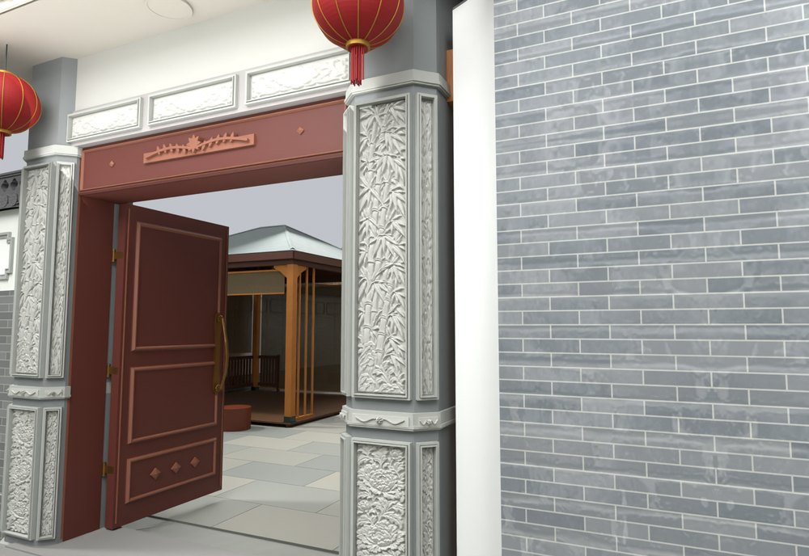
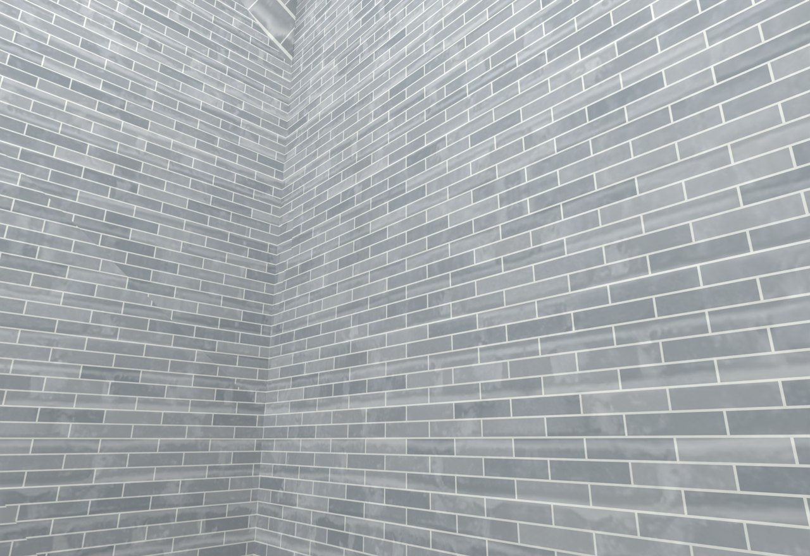

# V24.23 · 按三处独立探针修厨房端柱、门柱和储藏房

[逐版目录](README.md) · [建筑重建台账](../../reconstruction.md) · [阶段方法汇总](../v24-22-v25.md)

## 摘要

调整厨房端柱、内大门和储藏房接口，继续保留漫游入口及活动构件。

## 1. 问题与输入

上轮完成厨房端部山墙和木架，现场标记分别指出檐廊端的支承、门柱被收边遮住以及储藏房上下墙错位。

## 2. 实现方法

1. 由端柱与檐廊标高测出落地点，补木柱、柱础、柱头和支撑。端墙退到木立面后，按走行净空回查。

2. 以雕花门柱的侧面和后缘为界，把砖墙及灰收边接在柱后。储藏房墙面和旧凸砖带按各自平面收齐，木封边接外挑瓦檐。

3. 补厨储屋顶转角实体和墙脚过渡，按既有漫游路径回放门洞、楼梯与新接合处。

## 3. 过程图

**图 1** · 内大门石柱细部

**图 2** · V24.23 储藏房上下墙和外挑屋檐接口

## 4. 验证与适用范围

保存文件 1,698 项核对，另有 20 项实体检查及 15 项物理检查。端柱和门柱各以独立探针判断，避免把一个统一偏移套到三处接头。

- **原生模型核验** 
  状态 `PASS_NATIVE_PRESERVATION_AND_KITCHEN`，检查条目 1,698，失败记录 0。

- **实体核验** 
  状态 `PASS_SAVED_SOLIDS_AND_GATE_CLEARANCE`，检查条目 20，失败记录 0。

- **人物通行核验** 
  状态 `PASS_ACTUAL_MODEL_ROAM_PHYSICS`，检查条目 15，失败记录 0。

### 原记录中的关键检查

- **Triangular roof wall joint closed 13.1,-11.82** 
  通过，`roof_underside_z` = `4.12198` 
  原记录 `V24_23_Native_QA.json` 的 `checks[1681]`

- **Triangular roof wall joint closed 13.18,-11.9** 
  通过，`roof_underside_z` = `4.15592` 
  原记录 `V24_23_Native_QA.json` 的 `checks[1682]`

- **Triangular roof wall joint closed 13.3,-11.76** 
  通过，`roof_underside_z` = `4.09652` 
  原记录 `V24_23_Native_QA.json` 的 `checks[1683]`

## 5. 复现入口与出处

过程路径以本地 `JIA` 项目为根，`work/` 指重建项目的历史工作目录。复核时按交付记录打开本轮输入与保存成果，再依方法中的截面、对象或动作采样对照原报告。

交付与参考记录（1 项）

~~~text
Rebuild_V24_23/使用说明.txt
~~~

原实现脚本（5 项）

~~~text
Rebuild_V24_23/Sources/v24_23_probe.py
work/v24_23_ground_probe.py
Rebuild_V24_23/Sources/v24_23_geometry.py
Rebuild_V24_23/Sources/v24_23_build.py
Rebuild_V24_23/Sources/v24_23_common.py
~~~

核验报告路径（3 项）

**原生模型核验**

~~~text
Rebuild_V24_23/Reports/V24_23_Native_QA.json
~~~

**实体核验**

~~~text
Rebuild_V24_23/Reports/V24_23_Solid_QA.json
~~~

**人物通行核验**

~~~text
Rebuild_V24_23/Reports/V24_23_Physics_QA.json
~~~

图源与 SHA-256（2 张）

### 图 1 · 内大门石柱细部

~~~text
Rebuild_V24_23/Reports/V24_23_Gate_Pier.png
~~~

**原过程图 SHA-256**

~~~text
3ea350d302cad0eaf32901069602320e31f18222511f5ee9f6ea5f8b1bd60a8f
~~~

台账发布图，按原图缩放及压缩。

### 图 2 · V24.23 储藏房上下墙和外挑屋檐接口

~~~text
Rebuild_V24_23/Reports/V24_23_Storage_Joint.png
~~~

**原过程图 SHA-256**

~~~text
4bb60d9c4bc0fa708252c644e8053fb0b853f303c205b385a76f0a5bcb832a80
~~~

保留原画面，发布用 JPEG。

---

上一篇 [V24.22 · 用定高和定向剖面识别厨房叠墙](v24-22.md) 
下一篇 [V24.24 · 厨房端封墙、内门退墙与院坪同材补铺](v24-24.md)
