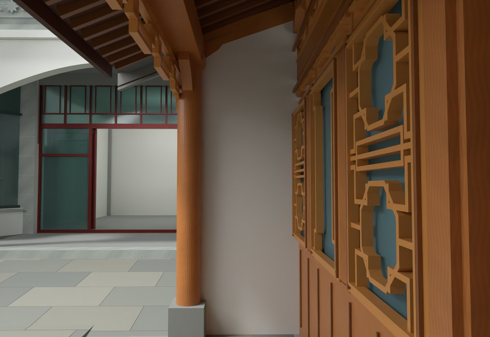
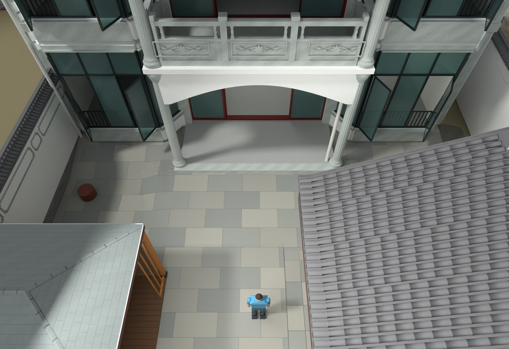

# V24.24 · 厨房端封墙、内门退墙与院坪同材补铺

[逐版目录](README.md) · [建筑重建台账](../../reconstruction.md) · [阶段方法汇总](../v24-22-v25.md) · [上一篇 V24.23](v24-23.md) · [下一篇 V24.25](v24-25.md)

## 摘要

做厨房封墙、门前退墙和院落补铺，逐处核对门背及屋檐接合。

## 1. 问题与输入

V24.23 将厨房端墙退入檐廊，标记要求封实柱与木立面间的缺面，同时将内门正面侧墙退到既有白墙平面。

## 2. 实现方法

1. 从地面至斜梁生成白色封墙，露出落地柱和柱础。以内门前旧白墙为平面基准，将侧砖墙与灰收边后退约 0.21 m，补前侧屋檐收口。
2. 在黄线内以 1.12 × 0.62 m 模数和同款灰石进行错缝补铺。处理与原较高地面相接的边界和旧铺地占位。
3. 用门背、屋檐交接及近地面视图核对遮挡，并复开保存模型查实体与通行。

## 3. 过程图

*图 1 · 厨房封墙。过程文件 `Rebuild_V24_24/Reports/V24_24_Kitchen_Closure.png`。*

*图 2 · V24.24 主楼前同材石铺补齐的范围。过程文件 `Rebuild_V24_24/Reports/V24_24_Paving_Overview.png`。*

## 4. 验证与适用范围

1,781 项原生检查、17 项实体检查和 15 项物理检查的失败清单为空。0.21 m 是按既有白墙平面确定的局部模型退让。

| 过程报告 | 原报告读数 |
| --- | --- |
| `Rebuild_V24_24/Reports/V24_24_Native_QA.json` | 状态 `PASS_NATIVE_PRESERVATION_AND_CORRECTIONS`，检查条目 1,781，失败记录 0。 |
| `Rebuild_V24_24/Reports/V24_24_Solid_QA.json` | 状态 `PASS_SAVED_SOLIDS_AND_LOCAL_SCOPE`，检查条目 17，失败记录 0。 |
| `Rebuild_V24_24/Reports/V24_24_Physics_QA.json` | 状态 `PASS_ACTUAL_MODEL_ROAM_PHYSICS`，检查条目 15，失败记录 0。 |

### 原记录中的关键检查

| 检查项 | 结果与读数 | 原记录位置 |
| --- | --- | --- |
| Saved closed solid / V24_24_Kitchen_North_Veranda_White_Closure | 通过，`bodies=1`，`volume_error_m3=3.08145e-07` | `V24_24_Solid_QA.json` 的 `checks[0]` |
| Paving follows original grade 0.65,-3.3 | 通过，`surface_z=-0.448`，`source_z=-0.45`，`finish_rise_m=0.002` | `V24_24_Native_QA.json` 的 `checks[1734]` |
| Paving follows original grade 0.65,-2.3 | 通过，`surface_z=-0.448`，`source_z=-0.45`，`finish_rise_m=0.002` | `V24_24_Native_QA.json` 的 `checks[1735]` |

## 5. 复现入口与出处

过程路径以本地 `JIA` 项目为根，`work/` 指重建项目的历史工作目录。复核时按交付记录打开本轮输入与保存成果，再依方法中的截面、对象或动作采样对照原报告。

- **交付与参考记录**。`Rebuild_V24_24/使用说明.txt`

- **原实现脚本**。`work/v24_24_joint_probe.py` · `Rebuild_V24_24/Sources/v24_24_geometry.py` · `Rebuild_V24_24/Sources/v24_24_build.py` · `Rebuild_V24_24/Sources/v24_24_probe.py` · `work/v24_24_prepare_scripts.py`

过程图校验值

| 图 | 原过程图 SHA-256 | 发布方式 |
| --- | --- | --- |
| 1 | `0e60d3b03f53415a572ef7238e20091910496458f07045f1e35e7207453c5762` | 台账发布图，按原图缩放及压缩 |
| 2 | `3233a67c439d2d484b8d122670ac2356d70ce69a503a85172be6bde4a761c1ff` | 保留原画面，发布用 JPEG |

