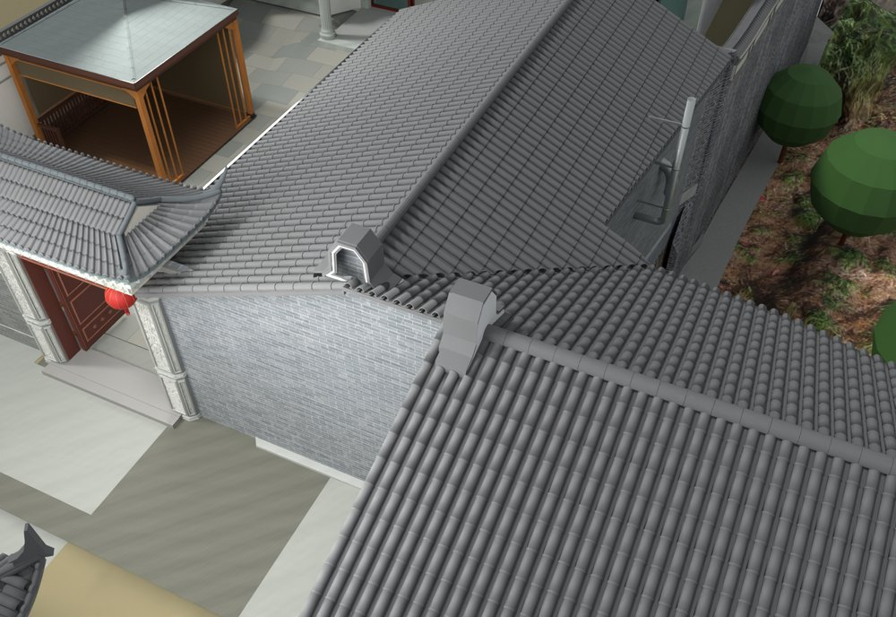
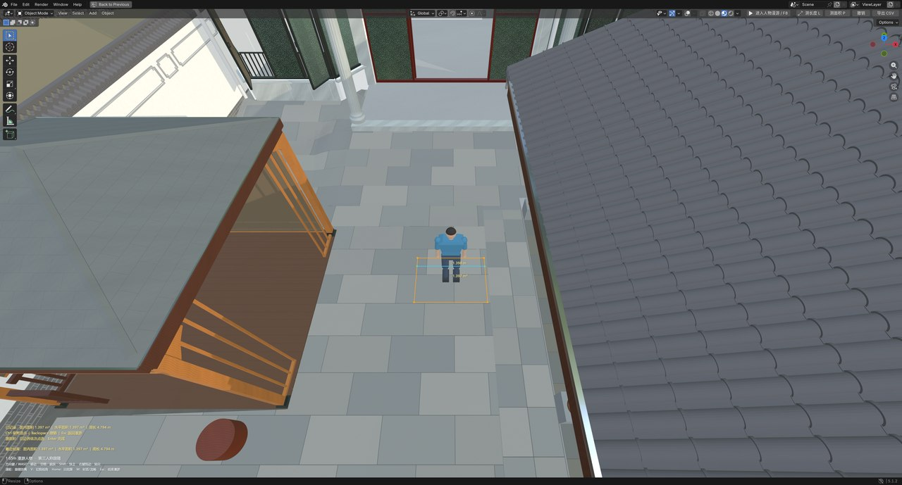

# V24.25 · 卫生间高窗修订与模型表面长度面积量测

[逐版目录](README.md) · [建筑重建台账](../../reconstruction.md) · [阶段方法汇总](../v24-22-v25.md) · [上一篇 V24.24](v24-24.md) · [下一篇 V24.26](v24-26.md)

## 摘要

修高窗、门墙接缝、厨房屋面和入口地面，增加长度与面积测量。

## 1. 问题与输入

在 V24.24 上调整五扇卫生间高窗、门墙和厨储接合，并把漫游射线命中的模型表面作为量测输入。

## 2. 实现方法

1. 五扇高窗窗台距各层完成面 1.80 m、窗高 0.80 m，保留中竖框。窗口、墙洞与外饰面一并裁切，另修门墙、厨房屋面与入口。
2. 取射线命中的两个表面点，长度为两点欧氏距离乘单位尺度。多点量测先用边向量叉积累积法线，投影到局部平面检查自交，三角剖分后回到原三维点求各三角形面积之和。
3. 用 XY 投影求水平面积，并计算周长和最大平面偏差。记录可保存在模型并导出 CSV，操作保留顶点吸附。

三角面面积用 ‖(b−a)×(c−a)‖/2。平面投影用于确定边界内的三角拓扑，面积仍在原三维点上计算。水平投影面积用 XY 边界独立求和。曲面上的两点读数是直线距离。

## 3. 过程图

*图 1 · 厨房屋面谷缝。过程文件 `Rebuild_V24_25/Reports/V24_25_Roof_Valley.png`。*

*图 2 · V24.25 漫游中选取模型表面测点的界面。过程文件 `Rebuild_V24_25/Reports/V24_25_Measure_UI.png`。*

## 4. 验证与适用范围

原生报告列 1,767 项，独立实体报告列 44 项检查。量测以当前模型几何为准，凹边界通过三角剖分处理，坐标精度随模型数据。

| 过程报告 | 原报告读数 |
| --- | --- |
| `Rebuild_V24_25/Reports/V24_25_Native_QA.json` | 状态 `PASS_NATIVE_PRESERVATION_AND_CORRECTIONS`，检查条目 1,767，失败记录 0。 |
| `Rebuild_V24_25/Reports/V24_25_Solid_QA.json` | 状态 `PASS_SAVED_SOLIDS_AND_LOCAL_SCOPE`，检查条目 44，失败记录 0。 |
| `Rebuild_V24_25/Reports/V24_25_Measure_Math_QA.json` | 状态 `PASS_MEASUREMENT_MATH_AND_CSV`，检查条目 14，失败记录 0。 |

### 原记录中的关键检查

| 检查项 | 结果与读数 | 原记录位置 |
| --- | --- | --- |
| CSV stores metre length and square metre area | 通过 | `V24_25_Measure_Math_QA.json` 的 `checks[12]` |
| Length area undo and export operators register | 通过 | `V24_25_Measure_Math_QA.json` 的 `checks[13]` |
| Continuous straight west roof surface 7.7,-9.5 | 通过，`surface_z=2.53979`，`plane_z=2.53979` | `V24_25_Native_QA.json` 的 `checks[1734]` |

## 5. 复现入口与出处

过程路径以本地 `JIA` 项目为根，`work/` 指重建项目的历史工作目录。复核时按交付记录打开本轮输入与保存成果，再依方法中的截面、对象或动作采样对照原报告。

- **交付与参考记录**。`Rebuild_V24_25/使用说明.txt`

- **原实现脚本**。`Rebuild_V24_25/Sources/v24_25_probe.py` · `Rebuild_V24_25/Sources/v24_25_geometry.py` · `Rebuild_V24_25/Roam/measure_tools.py` · `Rebuild_V24_25/Sources/v24_25_build.py` · `Rebuild_V24_25/Sources/v24_25_probe_extra.py`

过程图校验值

| 图 | 原过程图 SHA-256 | 发布方式 |
| --- | --- | --- |
| 1 | `add2c23b43b860877e34213f9926a4785105aea261a2164278c4585dad8b82e3` | 台账发布图，按原图缩放及压缩 |
| 2 | `0a67b19b0f6797fdc4c802b64c3ea7d4536c3c433b2ef66c543be9662974c7ba` | 保留原画面，发布用 JPEG |

