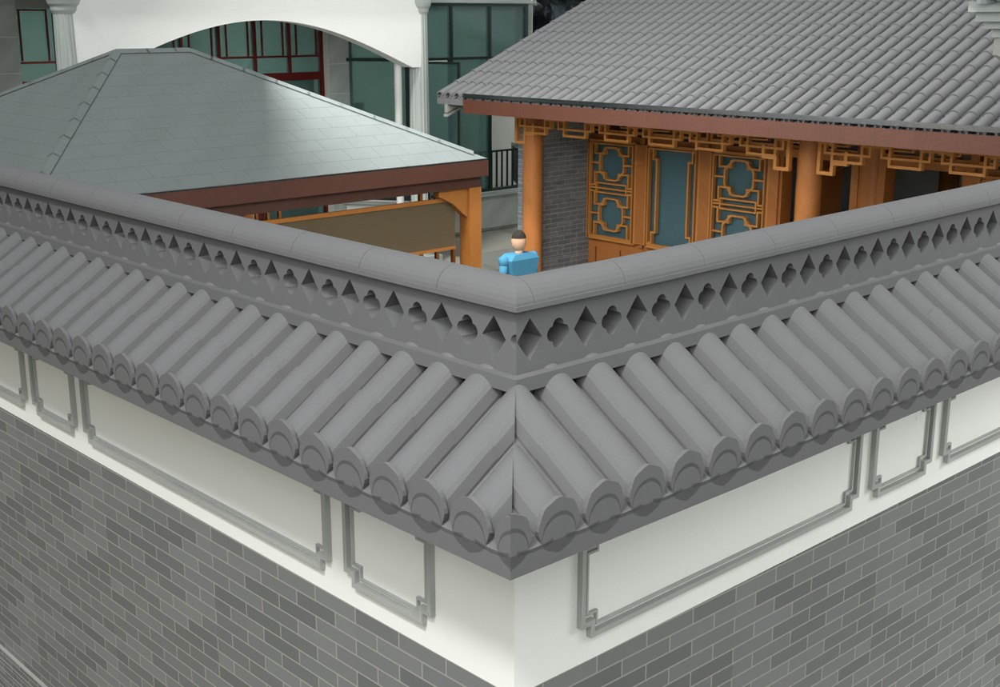
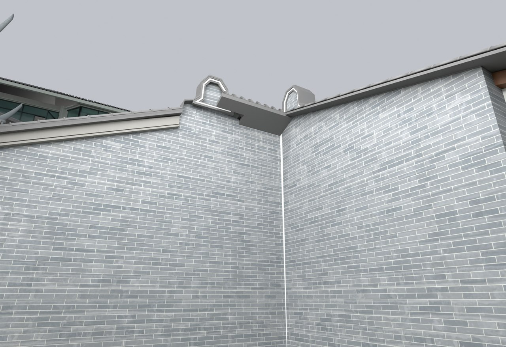

# V24.26 · 青砖封墙、厨房短出檐和 L 形瓦墙拼角

[逐版目录](README.md) · [建筑重建台账](../../reconstruction.md) · [阶段方法汇总](../v24-22-v25.md)

## 摘要

青砖封墙，收短厨房靠储藏房一侧出檐，加宽加厚内院 L 形墙瓦顶。

## 1. 问题与输入

厨房两端封合和内院 L 形墙瓦顶需要不同裁切域。以既有墙身与檐边截面定位，再用同版近景核对。

## 2. 实现方法

1. 北端白色封墙及窄转角改同一相邻青砖材质。南端靠储藏房的出檐从约 0.40 m 收到 0.12 m，瓦面、灰边和镬耳跟随端线。

2. 双坡围墙瓦顶加宽到约 0.90 m，250 mm 墙身两侧各约 0.325 m 出挑。建 65 mm 垫层、两排筒板瓦和镂空花脊，转角按 45° 拼角。

3. 在保存文件的檐边、青砖侧墙和 L 角三个局部读回网格，复核实体、材质和碰撞。

## 3. 过程图

**图 1** · 内院围墙瓦顶转角

**图 2** · V24.26 厨房靠储藏房一侧的短出檐

## 4. 验证与适用范围

原生检查 1,757 项、实体检查 25 项。瓦顶和出檐数字为模型几何；裁切用旧厨房坡面和墙芯作控制。

- **原生模型核验** 
  状态 `PASS_NATIVE_PRESERVATION_AND_CORRECTIONS`，检查条目 1,757，失败记录 0。

- **实体核验** 
  状态 `PASS_SAVED_SOLIDS_AND_LOCAL_SCOPE`，检查条目 25，失败记录 0。

### 原记录中的关键检查

- **Saved closed positive solid / SITE_COURTYARD_WEST_TILE_WALL_TILE_COPING_Geometry** 
  通过，`volume_m3` = `2.51712`，`volume_error_m3` = `3.40065e-07` 
  原记录 `V24_26_Solid_QA.json` 的 `checks[7]`

- **Saved geometry within 0.03mm / SITE_COURTYARD_WEST_TILE_WALL_TILE_COPING_Geometry** 
  通过，`maximum_vertex_error_m` = `4.62482e-07` 
  原记录 `V24_26_Native_QA.json` 的 `checks[1683]`

- **Roof bedding actually seats on unchanged wall crown 0.0,1.0** 
  通过，`wall_top_z` = `2.06224`，`cap_bottom_z` = `2.02217` 
  原记录 `V24_26_Native_QA.json` 的 `checks[1703]`

## 5. 复现入口与出处

过程路径以本地 `JIA` 项目为根，`work/` 指重建项目的历史工作目录。复核时按交付记录打开本轮输入与保存成果，再依方法中的截面、对象或动作采样对照原报告。

交付与参考记录（1 项）

~~~text
Rebuild_V24_26/使用说明.txt
~~~

原实现脚本（5 项）

~~~text
Rebuild_V24_26/Sources/v24_26_probe.py
Rebuild_V24_26/Sources/v24_26_geometry.py
Rebuild_V24_26/Sources/v24_26_build.py
Rebuild_V24_26/Sources/v24_26_probe_extra.py
Rebuild_V24_26/Sources/v24_26_common.py
~~~

核验报告路径（2 项）

**原生模型核验**

~~~text
Rebuild_V24_26/Reports/V24_26_Native_QA.json
~~~

**实体核验**

~~~text
Rebuild_V24_26/Reports/V24_26_Solid_QA.json
~~~

图源与 SHA-256（2 张）

### 图 1 · 内院围墙瓦顶转角

~~~text
Rebuild_V24_26/Reports/V24_26_Courtyard_Mitre.png
~~~

**原过程图 SHA-256**

~~~text
7c61a51cd134fa9fca57f3aa736eee7cd4c686e7fcdc6bcd11cd03cfe1cd94ad
~~~

台账发布图，按原图缩放及压缩。

### 图 2 · V24.26 厨房靠储藏房一侧的短出檐

~~~text
Rebuild_V24_26/Reports/V24_26_Kitchen_Short_Verge.png
~~~

**原过程图 SHA-256**

~~~text
861181d040490baa2ca26e227efd25d36b64ebba83203c81e5a79abc12984769
~~~

保留原画面，发布用 JPEG。

---

上一篇 [V24.25 · 卫生间高窗修订与模型表面长度面积量测](v24-25.md) 
下一篇 [V24.27 · 由分区标高剖面接续院坪、台阶与沟边](v24-27.md)
