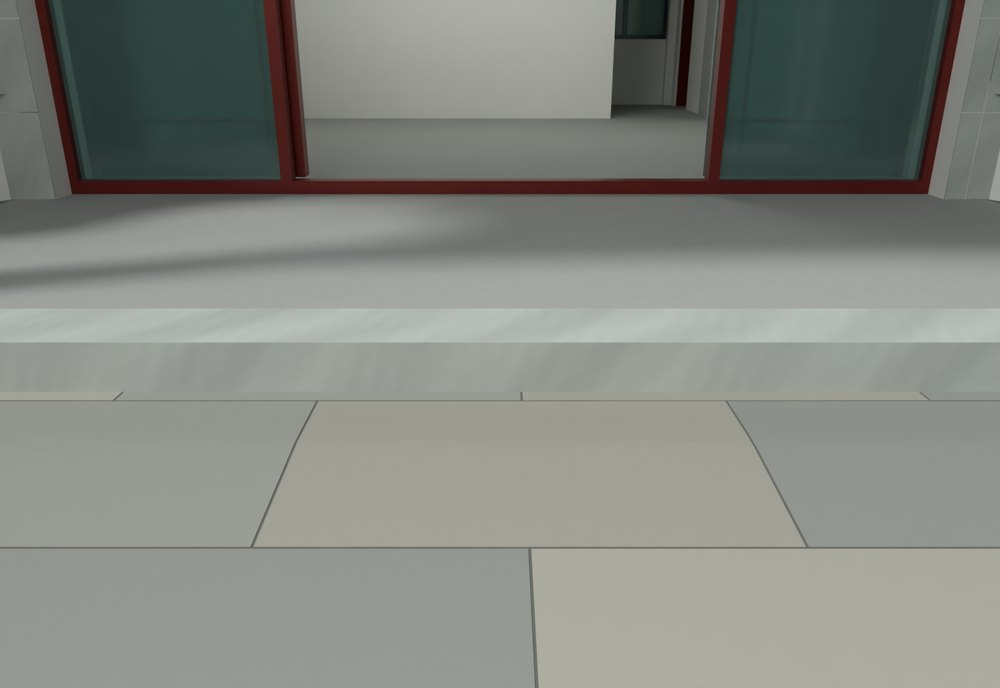
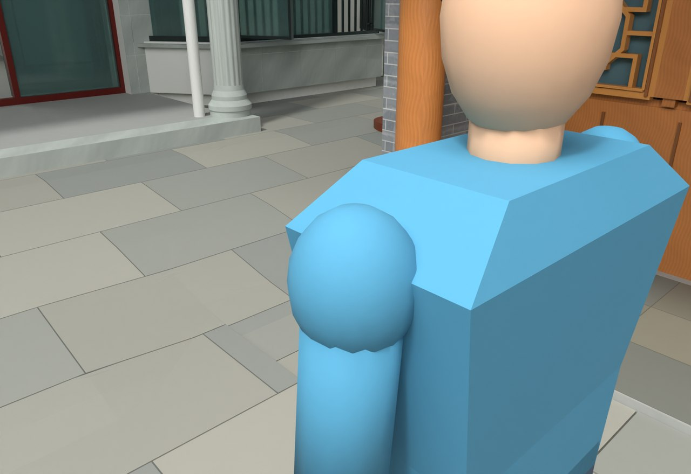

# V24.27 · 由分区标高剖面接续院坪、台阶与沟边

[逐版目录](README.md) · [建筑重建台账](../../reconstruction.md) · [阶段方法汇总](../v24-22-v25.md)

## 摘要

调整院坪、入口台阶和厨房沟边标高，更新漫游碰撞。保存模型有场地高程与保留核验。

## 1. 问题与输入

V24.26 的厨房短檐与内院瓦墙已完成。本轮处理院坪靠楼脚接合和西侧外地形，入口、厨房沟边与原场地分别提供控制高程。

## 2. 实现方法

1. 从保存模型采院坪和墙脚剖面。近楼院坪接到 −0.15 m，外围院坪取 −0.45 m，厨房既有地坪约 −0.40 m。保留入口 0.15 m 单阶。

2. 按前院与西侧分别生成折线高程连接面，路基顶面在可见饰面下约 8 mm。接触面延到板边下方，保留厨房沟边。

3. 以新地形更新碰撞，分别复测出入路径和院坪剖面，并读取受保护对象的验证记录。

## 3. 过程图

**图 1** · 主楼入口台阶和院坪

**图 2** · V24.27 厨房沟边与院坪高程过渡

## 4. 验证与适用范围

高程报告 31 项、原生报告 1,771 项，失败清单均为空。这些标高取自项目模型，并用于本轮院内地坪协调。

- **Corrections** 
  记录本轮参数、对象和处理结果。

- **场地高程核验** 
  状态 `PASS_LOCAL_GRADE_TOPOLOGY_AND_SLOPES`，检查条目 31，失败记录 0。

- **原生模型核验** 
  状态 `PASS_NATIVE_PRESERVATION_AND_GRADE`，检查条目 1,771，失败记录 0。

### 原记录中的关键检查

- **No resolvable surface area reversed during grading / SITE_V16_GRADED_INTERIOR_SOIL_Geometry** 
  通过，`projected_double_area_resolution_m2` = `1e-06` 
  原记录 `V24_27_Grade_QA.json` 的 `checks[0]`

- **Affine subdivision covers every original triangle exactly / SITE_V16_GRADED_INTERIOR_SOIL_Geometry** 
  通过，`maximum_double_area_error_m2` = `3.23297e-13` 
  原记录 `V24_27_Grade_QA.json` 的 `checks[2]`

- **West yard grade no longer has the short steep mound** 
  通过，`maximum_grade` = `0.0604002`，`median_grade` = `0.0602553`，`triangles` = `8400` 
  原记录 `V24_27_Grade_QA.json` 的 `checks[4]`

## 5. 复现入口与出处

过程路径以本地 `JIA` 项目为根，`work/` 指重建项目的历史工作目录。复核时按交付记录打开本轮输入与保存成果，再依方法中的截面、对象或动作采样对照原报告。

交付与参考记录（1 项）

~~~text
Rebuild_V24_27/Reports/V24_27_Changes.json
~~~

原实现脚本（5 项）

~~~text
work/v24_27_surface_probe.py
work/v24_27_grade.py
work/v24_27_verify.py
work/v24_27_build.py
work/v24_27_probe.py
~~~

核验报告路径（3 项）

**Corrections**

~~~text
Rebuild_V24_27/Reports/V24_27_Corrections.json
~~~

**场地高程核验**

~~~text
Rebuild_V24_27/Reports/V24_27_Grade_QA.json
~~~

**原生模型核验**

~~~text
Rebuild_V24_27/Reports/V24_27_Native_QA.json
~~~

图源与 SHA-256（2 张）

### 图 1 · 主楼入口台阶和院坪

~~~text
Rebuild_V24_27/Reports/V24_27_House_Step_Close.png
~~~

**原过程图 SHA-256**

~~~text
9dee354cde897a9d582cd63cb1b29a5dd073c67872031ef2f9c0d0c866f4fc5d
~~~

台账发布图，按原图缩放及压缩。

### 图 2 · V24.27 厨房沟边与院坪高程过渡

~~~text
Rebuild_V24_27/Reports/V24_27_Kitchen_Gutter_Grade.png
~~~

**原过程图 SHA-256**

~~~text
a97555984c447c9a274dbbee827536cc0e6fb5de3bdc346db18079d3e62d652c
~~~

保留原画面，发布用 JPEG。

---

上一篇 [V24.26 · 青砖封墙、厨房短出檐和 L 形瓦墙拼角](v24-26.md) 
下一篇 [V24.28 · 按厨房廊边布置直线台阶并闭合墙角](v24-28.md)
