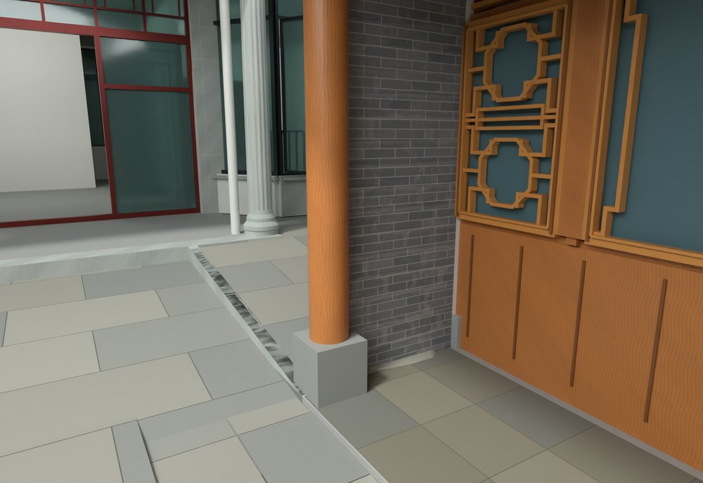
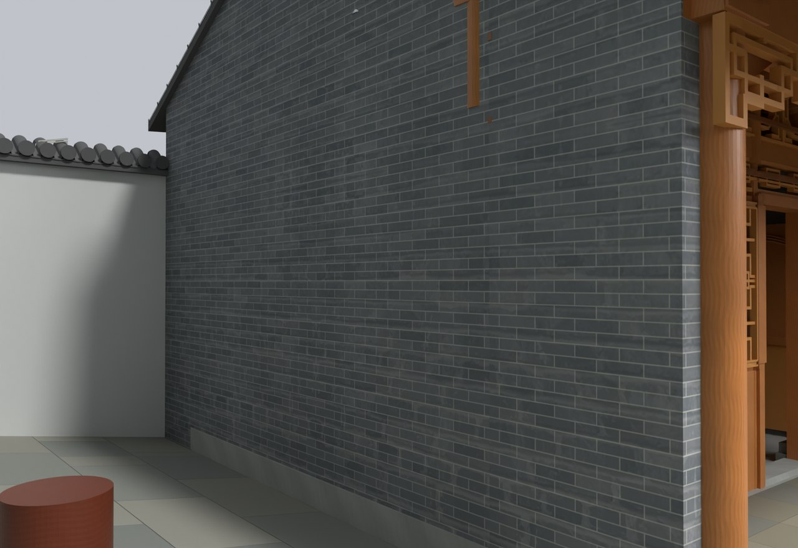

# V24.28 · 按厨房廊边布置直线台阶并闭合墙角

[逐版目录](README.md) · [建筑重建台账](../../reconstruction.md) · [阶段方法汇总](../v24-22-v25.md)

## 摘要

外墙旁地坪收平，内侧台阶沿厨房廊边直线接入口，修厨房端墙及平直白墙。

## 1. 问题与输入

V24.27 处理高程后，标注要求去掉外墙旁鼓坡和院内斜台阶，厨房端墙需与内侧白墙以直角接合。

## 2. 实现方法

1. 将标记对应到院坪平面，外地面分段收平；沿厨房檐廊外缘生成直线台阶并接主楼入口，以两端既有标高定高低侧。

2. 厨房北山墙退回封墙面，檐、灰边和耳部同步收正，窗边墙以 180 mm 收口。白墙保持水平檐线，与青砖墙按 90° 合成闭合体。

3. 回读院坪标高、墙角封合和门窗状态，沿新台阶正反方向模拟通行。

### 实现链与源码定位

以下按诊断、处理、保存与复核组织阅读。调用和文件引用来自原脚本，输入输出方向由对应读写调用判断；辅助文件是否在本轮运行，以报告为准。

**1. 定位与诊断** · [`v24_28_mark_probe.py`](../source-code/v24-28/project/Sources/v24_28_mark_probe.py#L4)

打开保存的 Blender [`bpy.ops.wm.open_mainfile`](../source-code/v24-28/project/Sources/v24_28_mark_probe.py#L4)；射线命中检查 [`o.ray_cast`](../source-code/v24-28/project/Sources/v24_28_mark_probe.py#L10)。

文件引用：[`Architecture_Complete_V24_28.blend`](../source-code/v24-28/project/Sources/v24_28_mark_probe.py#L4)。

**2. 参数与几何处理** · [`v24_28_prepare.py`](../source-code/v24-28/project/Sources/v24_28_prepare.py#L60)

叉积／面法线 [`np.cross`](../source-code/v24-28/project/Sources/v24_28_prepare.py#L60)；截面提取 [`section`](../source-code/v24-28/project/Sources/v24_28_prepare.py#L252)；交集限域 [`poly.intersection`](../source-code/v24-28/project/Sources/v24_28_prepare.py#L266)。

文件引用：[`Source.json`](../source-code/v24-28/project/Sources/v24_28_prepare.py#L14) · [`Before_Snapshot.json`](../source-code/v24-28/project/Sources/v24_28_prepare.py#L14) · [`Inventory.json`](../source-code/v24-28/project/Sources/v24_28_prepare.py#L16)。

**3. 构建或写入** · [`v24_28_build.py`](../source-code/v24-28/project/Sources/v24_28_build.py#L10)

打开保存的 Blender [`bpy.ops.wm.open_mainfile`](../source-code/v24-28/project/Sources/v24_28_build.py#L10)；空间加速结构 [`BVHTree.FromPolygons`](../source-code/v24-28/project/Sources/v24_28_build.py#L29)；最小二乘求解 [`np.linalg.lstsq`](../source-code/v24-28/project/Sources/v24_28_build.py#L34)。

文件引用：[`Architecture_Complete_V24_28.blend`](../source-code/v24-28/project/Sources/v24_28_build.py#L7) · [`Source.json`](../source-code/v24-28/project/Sources/v24_28_build.py#L8) · [`Prepared_Geometry.json`](../source-code/v24-28/project/Sources/v24_28_build.py#L8)。

**4. 辅助实现** · [`v24_28_extra.py`](../source-code/v24-28/project/Sources/v24_28_extra.py#L4)

打开保存的 Blender [`bpy.ops.wm.open_mainfile`](../source-code/v24-28/project/Sources/v24_28_extra.py#L4)。

文件引用：[`Architecture_Complete_V24_26.blend`](../source-code/v24-28/project/Sources/v24_28_extra.py#L4) · [`Extra_Files.json`](../source-code/v24-28/project/Sources/v24_28_extra.py#L10)。

**5. 过程出图** · [`v24_28_render.py`](../source-code/v24-28/project/Sources/v24_28_render.py#L6)

打开保存的 Blender [`bpy.ops.wm.open_mainfile`](../source-code/v24-28/project/Sources/v24_28_render.py#L6)。

文件引用：[`Architecture_Complete_V24_28.blend`](../source-code/v24-28/project/Sources/v24_28_render.py#L4) · [`Architecture_Complete_V24_26.blend`](../source-code/v24-28/project/Sources/v24_28_render.py#L5) · [`Views.json`](../source-code/v24-28/project/Sources/v24_28_render.py#L15)。

**6. 保存后核验** · [`v24_28_verify.py`](../source-code/v24-28/project/Sources/v24_28_verify.py#L14)

判据与回归检查 [`checks.append`](../source-code/v24-28/project/Sources/v24_28_verify.py#L8)；空间加速结构 [`BVHTree.FromPolygons`](../source-code/v24-28/project/Sources/v24_28_verify.py#L14)；射线命中检查 [`ray_cast`](../source-code/v24-28/project/Sources/v24_28_verify.py#L17)。

文件引用：[`Architecture_Complete_V24_28.blend`](../source-code/v24-28/project/Sources/v24_28_verify.py#L6) · [`Before_Snapshot.json`](../source-code/v24-28/project/Sources/v24_28_verify.py#L7) · [`Prepared_Geometry.json`](../source-code/v24-28/project/Sources/v24_28_verify.py#L7)。

**7. 保存后核验** · [`v24_28_grade_qa.py`](../source-code/v24-28/project/Sources/v24_28_grade_qa.py#L9)

判据与回归检查 [`checks.append`](../source-code/v24-28/project/Sources/v24_28_grade_qa.py#L5)；叉积／面法线 [`np.cross`](../source-code/v24-28/project/Sources/v24_28_grade_qa.py#L9)。

文件引用：[`Saved_Geometry_Index.json`](../source-code/v24-28/project/Sources/v24_28_grade_qa.py#L4) · [`Inventory.json`](../source-code/v24-28/project/Sources/v24_28_grade_qa.py#L4) · [`Prepared_Geometry.json`](../source-code/v24-28/project/Sources/v24_28_grade_qa.py#L4)。

[方法原理：圈画、对象与剖切定位](../methodology.md#3-从截图圈画定位到对象与剖面) · [本版完整过程索引](process/v24-28.md)

本版索引汇合 22 幅已归档过程图、34 份交付及历史目录中的报告／说明／中间记录和全部 22 个源码附件。继承文件和本轮新增文件按来源保留，实际完成范围以第 4 节及原报告为准。

## 3. 过程图

**图 1** · 沿厨房廊边接续的台阶

**图 2** · V24.28 退回端墙平面的厨房北山墙

## 4. 验证与适用范围

原生报告 1,794 项、高程报告 31 项。台阶中间形状依据标注拟合，主楼各层楼板仍取本轮输入标高。

- **原生模型核验** 
  状态 `PASS_PRESERVATION_LEVELS_STEP_WALL_AND_ROOF`，检查条目 1,794，失败记录 0。

- **场地高程核验** 
  状态 `PASS_FOOTPRINT_LEVEL_EXTERIOR_AND_CLIPPED_STEP`，检查条目 31，失败记录 0。

- **人物通行核验** 
  状态 `PASS_ACTUAL_MODEL_ROAM_PHYSICS`，检查条目 24，失败记录 0。

### 原记录中的关键检查

- **Saved geometry within 0.03mm / SITE_PERIMETER_JOINED_RETAINING_WALL_0_Geometry** 
  通过，`maximum_vertex_error_m` = `1.08223e-07` 
  原记录 `V24_28_Native_QA.json` 的 `checks[1681]`

- **Facing white wall has horizontal top / V24_28_Continuous_White_Courtyard_Wall_Face** 
  通过，`top_z_m` = `2.4472` 
  原记录 `V24_28_Native_QA.json` 的 `checks[1759]`

- **Visible exterior ground is a horizontal plane** 
  通过，`maximum_grade` = `0`，`triangles` = `22759` 
  原记录 `V24_28_Grade_QA.json` 的 `checks[5]`

## 5. 复现入口与出处

过程路径以本地 `JIA` 项目为根，`work/` 指重建项目的历史工作目录。复核时按交付记录打开本轮输入与保存成果，再依方法中的截面、对象或动作采样对照原报告。

交付与参考记录（1 项）

~~~text
Rebuild_V24_28/使用说明.txt
~~~

### 原实现脚本附件

[浏览本版全部 22 个文件](../source-code/v24-28/README.md) · [原件与公开副本校验值](../source-code/v24-28/manifest.json)

- [`v24_28_mark_probe.py`](../source-code/v24-28/project/Sources/v24_28_mark_probe.py)
- [`v24_28_prepare.py`](../source-code/v24-28/project/Sources/v24_28_prepare.py)
- [`v24_28_build.py`](../source-code/v24-28/project/Sources/v24_28_build.py)
- [`v24_28_extra.py`](../source-code/v24-28/project/Sources/v24_28_extra.py)
- [`v24_28_render.py`](../source-code/v24-28/project/Sources/v24_28_render.py)

原脚本本地路径

~~~text
Rebuild_V24_28/Sources/v24_28_mark_probe.py
Rebuild_V24_28/Sources/v24_28_prepare.py
Rebuild_V24_28/Sources/v24_28_build.py
Rebuild_V24_28/Sources/v24_28_extra.py
Rebuild_V24_28/Sources/v24_28_render.py
~~~

核验报告路径（3 项）

**原生模型核验**

~~~text
Rebuild_V24_28/Reports/V24_28_Native_QA.json
~~~

**场地高程核验**

~~~text
Rebuild_V24_28/Reports/V24_28_Grade_QA.json
~~~

**人物通行核验**

~~~text
Rebuild_V24_28/Reports/V24_28_Physics_QA.json
~~~

图源与 SHA-256（2 张）

### 图 1 · 沿厨房廊边接续的台阶

~~~text
Rebuild_V24_28/Reports/V24_28_Continuous_Step_Eye.png
~~~

**原过程图 SHA-256**

~~~text
bcbe9ab734259510b03e810a8990d93c02c72e2c5b60d225c3848a1f5885dc8a
~~~

台账发布图，按原图缩放及压缩。

### 图 2 · V24.28 退回端墙平面的厨房北山墙

~~~text
Rebuild_V24_28/Reports/V24_28_Kitchen_End_Recessed.png
~~~

**原过程图 SHA-256**

~~~text
7c13327cbaf4fc794b7fa34fa8ad297a8d114b2541b87aec273deaf2426261c1
~~~

保留原画面，发布用 JPEG。

---

上一篇 [V24.27 · 由分区标高剖面接续院坪、台阶与沟边](v24-27.md) 
下一篇 [V24.29 · 以旧院坪为基准整体降低主楼 0.45 米](v24-29.md)
