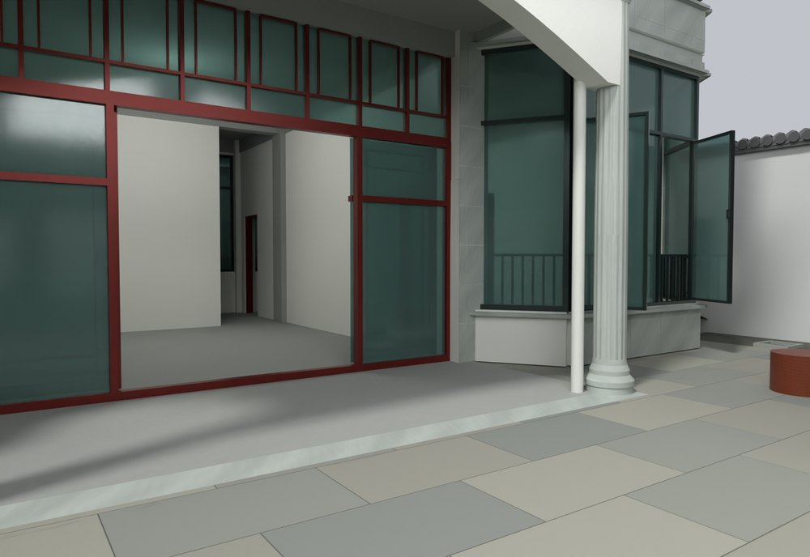
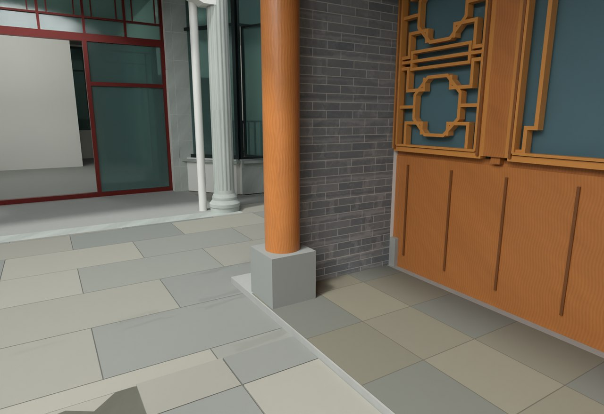

# V24.29 · 以旧院坪为基准整体降低主楼 0.45 米

[逐版目录](README.md) · [建筑重建台账](../../reconstruction.md) · [阶段方法汇总](../v24-22-v25.md) · [上一篇 V24.28](v24-28.md) · [下一篇 V24.30](v24-30.md)

## 摘要

三层楼整体下移 0.45 m，门前与原院坪齐平；墙、梁柱、楼梯、门窗及屋面一起移动。

## 1. 问题与输入

V24.28 使用室外台阶过渡，标注要求改为门前与原院坪齐平。依当前模型的 −0.45 m 院坪值确定主楼整体竖向位移。

## 2. 实现方法

1. 按主楼归属选择墙、楼板、梁柱、楼梯、门窗、阳台、屋面及附管，统一 Z 减 0.450 m，保持各构件相对位置和活动轴关系。
2. 移除门前抬高分界与贴楼横坡，清掉位移后穿入室内的旧土体。旧排水面转到可见铺装下方。
3. 从保存文件对比楼层、原门扇动作及门前地面，复测路线、几何测量和启动流程。

## 3. 过程图

*图 1 · 门前与原院坪齐平。过程文件 `Rebuild_V24_29/Reports/V24_29_Entry_Flush.png`。*

*图 2 · V24.29 主楼门前和原院坪齐平。过程文件 `Rebuild_V24_29/Reports/V24_29_Courtyard_Flush.png`。*

## 4. 验证与适用范围

交付报告记录主楼 Z 偏移 −0.450 m，原生、物理、量测和启动各子检查失败计数为 0。位移源于旧模型院坪值。

| 过程报告 | 原报告读数 |
| --- | --- |
| `Rebuild_V24_29/Reports/V24_29_Delivery_QA.json` | 状态 `PASS_FINAL_DELIVERY`，主楼竖向位移（m） -0.45。 |
| `Rebuild_V24_29/Reports/V24_29_Native_QA.json` | 状态 `PASS_RIGID_HOUSE_LOWERING_LEVEL_YARD_AND_FLUSH_COURT`，检查条目 1,991，失败记录 0。 |

### 原记录中的关键检查

| 检查项 | 结果与读数 | 原记录位置 |
| --- | --- | --- |
| F1 interior has no raised outdoor paving (1.5, 4.0) | 通过，`z_m=-0.45` | `V24_29_Native_QA.json` 的 `checks[1965]` |
| F1 interior has no raised outdoor paving (6.5, 3.0) | 通过，`z_m=-0.45` | `V24_29_Native_QA.json` 的 `checks[1967]` |
| F1 interior has no raised outdoor paving (10.5, 4.5) | 通过，`z_m=-0.45` | `V24_29_Native_QA.json` 的 `checks[1969]` |

## 5. 复现入口与出处

过程路径以本地 `JIA` 项目为根，`work/` 指重建项目的历史工作目录。复核时按交付记录打开本轮输入与保存成果，再依方法中的截面、对象或动作采样对照原报告。

- **交付与参考记录**。`Rebuild_V24_29/使用说明.txt`

- **原实现脚本**。`work/v24_29_pixel_probe.py` · `Rebuild_V24_29/Sources/v24_29_build.py` · `Rebuild_V24_29/Sources/v24_29_verify.py` · `work/v24_29_probe.py` · `Rebuild_V24_29/Sources/v24_29_render.py`

过程图校验值

| 图 | 原过程图 SHA-256 | 发布方式 |
| --- | --- | --- |
| 1 | `6a119cbe5bef5a7ccb335d078b9c9efa185a4956c7dabb0107c029a9cafac360` | 台账发布图，按原图缩放及压缩 |
| 2 | `d2fe8207c88635dec3eb7973f864b29d5e7f99b3d940ad3000c6f6902783a4a9` | 保留原画面，发布用 JPEG |

