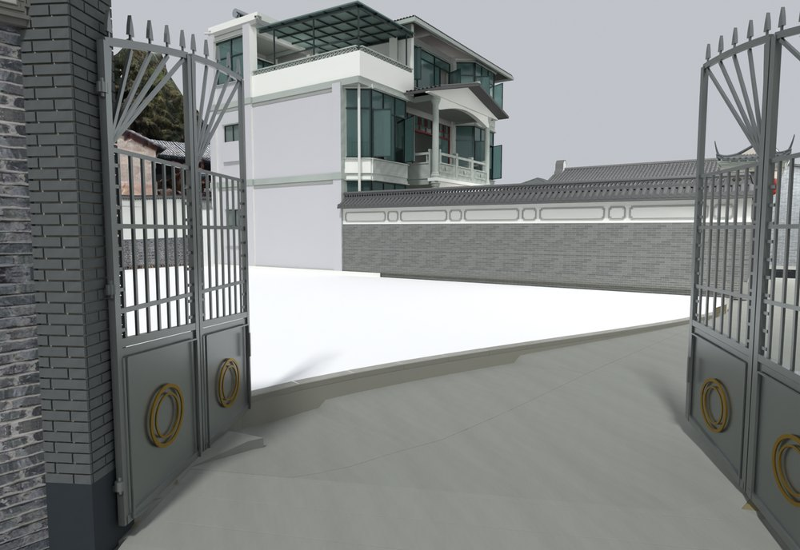
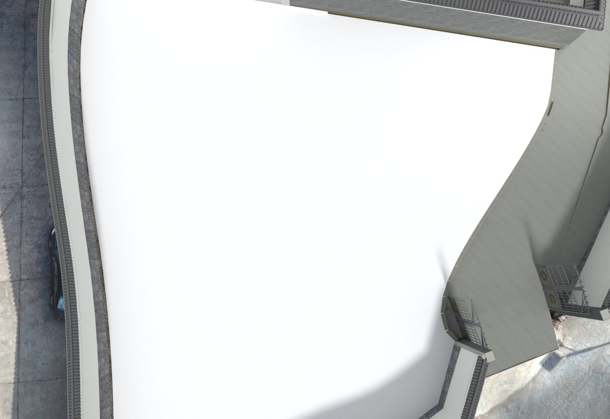

# V24.30 · 用错缝条石、分区标高与渐变路沿组织院落

[逐版目录](README.md) · [建筑重建台账](../../reconstruction.md) · [阶段方法汇总](../v24-22-v25.md)

## 摘要

统一内院灰石铺装，建立可编辑白色外院场地，修渐变路沿及墙厚。

## 1. 问题与输入

在 V24.29 后统一内院铺装并留出外院建模场地。标注提供路沿方向、分区边线和墙厚修正范围。

## 2. 实现方法

1. 灰色条石用 1.12 × 0.62 m 模数错缝布置，按边线裁剪并去除旧斜纹和重面。主院低区 −0.60 m，厨房北高区及后通道 −0.45 m。

2. 外院白色可编辑台地顶面 −0.60 m、约 399.24 m²。沿蓝线约 15.71 m 建路沿，露高按原道路坡度向内平台减小。

3. 将主楼入口的 0.15 m 台阶、两侧地坪和路沿接点作为原生读回及物理模拟的对照。

## 3. 过程图

**图 1** · 外门渐变路沿

**图 2** · V24.30 独立白色外院台地与路沿

## 4. 验证与适用范围

原生报告列 1,802 项。面积与长度均在保存模型的局部坐标量取，外院白场地作为建模预留面。

- **原生模型核验** 
  状态 `PASS_NATIVE_LEVELS_PAVING_WHITE_PAD_CURB_AND_ANCHORED_WALL`，检查条目 1,802，失败记录 0。

- **交付核验** 
  状态 `PASS_FINAL_DELIVERY`。

### 原记录中的关键检查

- **New native floor or curb mesh is closed / V24_30_Low_Main_Court_Joint_Base** 
  通过，`non_manifold_edges` = `0` 
  原记录 `V24_30_Native_QA.json` 的 `checks[1675]`

- **Indoor floor stays flat F1 (1.5, 4)** 
  通过，`z_m` = `-0.449999` 
  原记录 `V24_30_Native_QA.json` 的 `checks[1741]`

- **Indoor floor stays flat F1 (6.5, 3)** 
  通过，`z_m` = `-0.449999` 
  原记录 `V24_30_Native_QA.json` 的 `checks[1742]`

## 5. 复现入口与出处

过程路径以本地 `JIA` 项目为根，`work/` 指重建项目的历史工作目录。复核时按交付记录打开本轮输入与保存成果，再依方法中的截面、对象或动作采样对照原报告。

交付与参考记录（1 项）

~~~text
Rebuild_V24_30/使用说明.txt
~~~

原实现脚本（5 项）

~~~text
work/v24_30_plan.py
work/v24_30_prepare.py
work/v24_30_preview_plan.py
Rebuild_V24_30/Sources/v24_30_build.py
work/v24_30_gate_probe.py
~~~

核验报告路径（2 项）

**原生模型核验**

~~~text
Rebuild_V24_30/Reports/V24_30_Native_QA.json
~~~

**交付核验**

~~~text
Rebuild_V24_30/Reports/V24_30_Delivery_QA.json
~~~

图源与 SHA-256（2 张）

### 图 1 · 外门渐变路沿

~~~text
Rebuild_V24_30/Reports/V24_30_Outer_Gate_Curb.png
~~~

**原过程图 SHA-256**

~~~text
cf3fbf979d4ee34a4171f49dc5caf36a2a9fd62128f216417ff7606e93c54c9d
~~~

台账发布图，按原图缩放及压缩。

### 图 2 · V24.30 独立白色外院台地与路沿

~~~text
Rebuild_V24_30/Reports/V24_30_Outer_White_Pad.png
~~~

**原过程图 SHA-256**

~~~text
a43f4d39ab822226f2ed17978d96a61fdf8791c70fd9db979310d8d750395e2c
~~~

保留原画面，发布用 JPEG。

---

上一篇 [V24.29 · 以旧院坪为基准整体降低主楼 0.45 米](v24-29.md) 
下一篇 [V24.31 · 定位共面重叠并修窗下墙、白天花与木扶手](v24-31.md)
