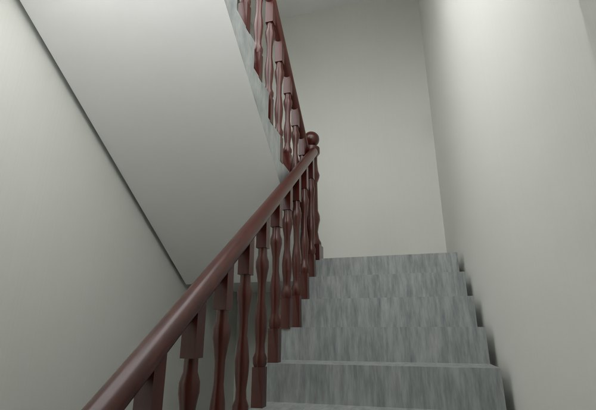
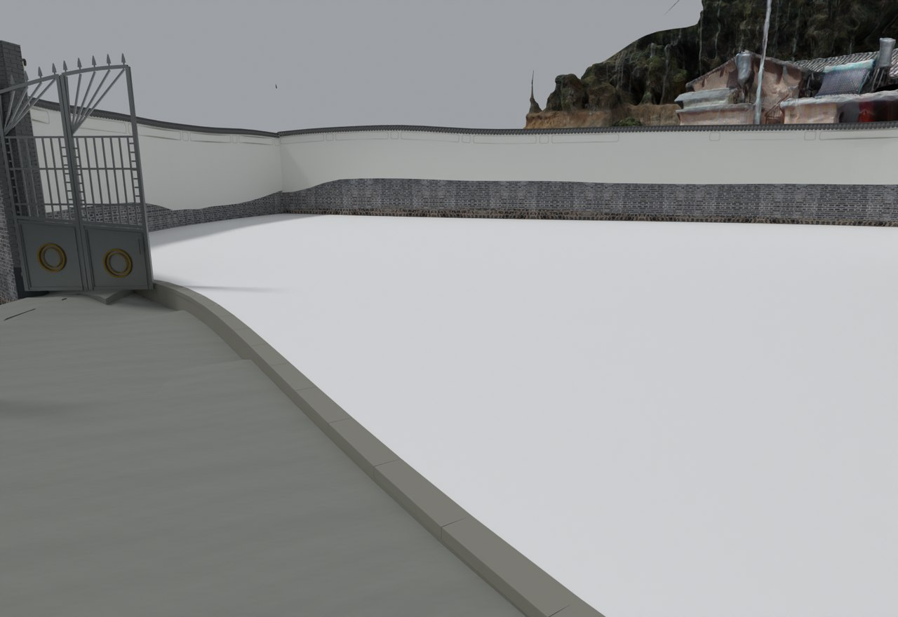

# V24.31 · 定位共面重叠并修窗下墙、白天花与木扶手

[逐版目录](README.md) · [建筑重建台账](../../reconstruction.md) · [阶段方法汇总](../v24-22-v25.md)

## 摘要

补地面和窗下实体，消除道路及路沿重面，统一白色天花，按实景重做木扶手。

## 1. 问题与输入

V24.30 后入口和路沿有重合顶面，窗下存在缺块。14 张参考图用于定位地面、窗套、楼梯墙和扶手。

## 2. 实现方法

1. 从路面、白场地和路沿读取近等高的面域，去掉约 2.38 m² 完全共面区域。补内门、厨房、储藏间前的缺地面，路沿床让出石材体积。

2. 五组飘窗下补闭合墙体并接楼板边，按实际下表面改白天花，室内地坪保持灰面。木扶手拆为车木栏杆、端柱和圆滑扶手，按踏步走向连续连接。

3. 用 2 mm 容差做表面检查，结合保存视口复核重面清理和窗下实体。

### 实现链与源码定位

以下按诊断、处理、保存与复核组织阅读。调用和文件引用来自原脚本，输入输出方向由对应读写调用判断；辅助文件是否在本轮运行，以报告为准。

**1. 定位与诊断** · [`v24_31_band_probe.py`](../source-code/v24-31/history/v24_31_band_probe.py#L3)

打开保存的 Blender [`bpy.ops.wm.open_mainfile`](../source-code/v24-31/history/v24_31_band_probe.py#L3)；射线命中检查 [`sc.ray_cast`](../source-code/v24-31/history/v24_31_band_probe.py#L5)。

文件引用：[`Architecture_Complete_V24_31.blend`](../source-code/v24-31/history/v24_31_band_probe.py#L3)。

**2. 定位与诊断** · [`v24_31_draw_plan.py`](../source-code/v24-31/history/v24_31_draw_plan.py#L4)

文件引用：[`Plan_Outlines.json`](../source-code/v24-31/history/v24_31_draw_plan.py#L4) · [`Plan.png`](../source-code/v24-31/history/v24_31_draw_plan.py#L18)。

**3. 定位与诊断** · [`v24_31_plan.py`](../source-code/v24-31/history/v24_31_plan.py#L9)

叉积／面法线 [`np.cross`](../source-code/v24-31/history/v24_31_plan.py#L9)。

文件引用：[`Geometry_Index.json`](../source-code/v24-31/history/v24_31_plan.py#L7) · [`Plan_Outlines.json`](../source-code/v24-31/history/v24_31_plan.py#L18)。

**4. 参数与几何处理** · [`v24_31_prepare.py`](../source-code/v24-31/project/Sources/v24_31_prepare.py#L19)

截面提取 [`section`](../source-code/v24-31/project/Sources/v24_31_prepare.py#L19)；网格与实体转换 [`m.to_mesh64`](../source-code/v24-31/project/Sources/v24_31_prepare.py#L24)；叉积／面法线 [`np.cross`](../source-code/v24-31/project/Sources/v24_31_prepare.py#L35)。

文件引用：[`Geometry_Index.json`](../source-code/v24-31/project/Sources/v24_31_prepare.py#L9) · [`Plan_Outlines.json`](../source-code/v24-31/project/Sources/v24_31_prepare.py#L10) · [`Prepared_Geometry.json`](../source-code/v24-31/project/Sources/v24_31_prepare.py#L254)。

**5. 构建或写入** · [`v24_31_build.py`](../source-code/v24-31/project/Sources/v24_31_build.py#L10)

打开保存的 Blender [`bpy.ops.wm.open_mainfile`](../source-code/v24-31/project/Sources/v24_31_build.py#L10)；写入网格拓扑 [`me.from_pydata`](../source-code/v24-31/project/Sources/v24_31_build.py#L26)；批量写入属性 [`me.polygons.foreach_set`](../source-code/v24-31/project/Sources/v24_31_build.py#L28)。

文件引用：[`Architecture_Complete_V24_31.blend`](../source-code/v24-31/project/Sources/v24_31_build.py#L5) · [`Architecture_Complete_V24_30.blend`](../source-code/v24-31/project/Sources/v24_31_build.py#L5) · [`Before_Snapshot.json`](../source-code/v24-31/project/Sources/v24_31_build.py#L11)。

**6. 保存后核验** · [`v24_31_verify.py`](../source-code/v24-31/project/Sources/v24_31_verify.py#L10)

判据与回归检查 [`checks.append`](../source-code/v24-31/project/Sources/v24_31_verify.py#L7)；打开保存的 Blender [`bpy.ops.wm.open_mainfile`](../source-code/v24-31/project/Sources/v24_31_verify.py#L10)；空间加速结构 [`BVHTree.FromPolygons`](../source-code/v24-31/project/Sources/v24_31_verify.py#L21)。

文件引用：[`Architecture_Complete_V24_31.blend`](../source-code/v24-31/project/Sources/v24_31_verify.py#L6) · [`Before_Snapshot.json`](../source-code/v24-31/project/Sources/v24_31_verify.py#L6) · [`V24_31_Changes.json`](../source-code/v24-31/project/Sources/v24_31_verify.py#L6)。

**7. 保存后核验** · [`v24_31_surface_qa.py`](../source-code/v24-31/project/Sources/v24_31_surface_qa.py#L12)

判据与回归检查 [`checks.append`](../source-code/v24-31/project/Sources/v24_31_surface_qa.py#L9)；叉积／面法线 [`np.cross`](../source-code/v24-31/project/Sources/v24_31_surface_qa.py#L12)；交集限域 [`p.intersection`](../source-code/v24-31/project/Sources/v24_31_surface_qa.py#L17)。

文件引用：[`Architecture_Complete_V24_31.blend`](../source-code/v24-31/project/Sources/v24_31_surface_qa.py#L3) · [`Final_Geometry_Index.json`](../source-code/v24-31/project/Sources/v24_31_surface_qa.py#L8) · [`Prepared_Geometry.json`](../source-code/v24-31/project/Sources/v24_31_surface_qa.py#L28)。

[方法原理：圈画、对象与剖切定位](../methodology.md#3-从截图圈画定位到对象与剖面) · [本版完整过程索引](process/v24-31.md)

本版索引汇合 46 幅已归档过程图、47 份交付及历史目录中的报告／说明／中间记录和全部 28 个源码附件。继承文件和本轮新增文件按来源保留，实际完成范围以第 4 节及原报告为准。

## 3. 过程图

**图 1** · 楼梯墙面及木扶手

**图 2** · V24.31 白色外场与独立路沿交界

## 4. 验证与适用范围

表面报告列 13 项、原生报告 179 项，失败清单为空。共面面积来自旧模型两个表面交集。

- **表面与接缝核验** 
  状态 `PASS_GROUND_SURFACE_OWNERSHIP_AND_NO_NEAR_COPLANAR_SKINS`，检查条目 13，失败记录 0，核验容差（m） 0.002。

- **原生模型核验** 
  状态 `PASS_NATIVE_REPAIRS_AND_PRESERVATION`，检查条目 179，失败记录 0。

### 原记录中的关键检查

- **No overlapping visible ground skins within 2mm / V24_30_Low_Main_Court_Running_Bond_Stone ／ V24_30_Low_Main_Court_Joint_Base** 
  通过，`near_coplanar_area_m2` = `0`，`triangle_pairs` = `0` 
  原记录 `V24_31_Surface_QA.json` 的 `checks[7]`

- **Repair mesh has closed two-face edges / V24_31_F1_Complete_Bay_Underwindow_Walls** 
  通过，`non_manifold_edges` = `0` 
  原记录 `V24_31_Native_QA.json` 的 `checks[35]`

- **Former hole or road edge has closed grey ground / (8.1, -12.5)** 
  通过，`z_m` = `-0.598419` 
  原记录 `V24_31_Native_QA.json` 的 `checks[96]`

## 5. 复现入口与出处

过程路径以本地 `JIA` 项目为根，`work/` 指重建项目的历史工作目录。复核时按交付记录打开本轮输入与保存成果，再依方法中的截面、对象或动作采样对照原报告。

交付与参考记录（1 项）

~~~text
Rebuild_V24_31/使用说明.txt
~~~

### 原实现脚本附件

[浏览本版全部 28 个文件](../source-code/v24-31/README.md) · [原件与公开副本校验值](../source-code/v24-31/manifest.json)

- [`v24_31_band_probe.py`](../source-code/v24-31/history/v24_31_band_probe.py)
- [`v24_31_draw_plan.py`](../source-code/v24-31/history/v24_31_draw_plan.py)
- [`v24_31_build.py`](../source-code/v24-31/project/Sources/v24_31_build.py)
- [`v24_31_prepare.py`](../source-code/v24-31/project/Sources/v24_31_prepare.py)
- [`v24_31_plan.py`](../source-code/v24-31/history/v24_31_plan.py)

原脚本本地路径

~~~text
work/v24_31_band_probe.py
work/v24_31_draw_plan.py
Rebuild_V24_31/Sources/v24_31_build.py
Rebuild_V24_31/Sources/v24_31_prepare.py
work/v24_31_plan.py
~~~

核验报告路径（2 项）

**表面与接缝核验**

~~~text
Rebuild_V24_31/Reports/V24_31_Surface_QA.json
~~~

**原生模型核验**

~~~text
Rebuild_V24_31/Reports/V24_31_Native_QA.json
~~~

图源与 SHA-256（2 张）

### 图 1 · 楼梯墙面及木扶手

~~~text
Rebuild_V24_31/Reports/V24_31_Stair_Lower_Reference.png
~~~

**原过程图 SHA-256**

~~~text
d08cc275683fc90630398dff3fe1e7ce0c84a6e5d7e4af8bf362d5df70058de7
~~~

台账发布图，按原图缩放及压缩。

### 图 2 · V24.31 白色外场与独立路沿交界

~~~text
Rebuild_V24_31/Reports/V24_31_Outer_Pad_Curb.png
~~~

**原过程图 SHA-256**

~~~text
d868df025b1ec7564eb589756483573468294801d04f95b095441f2139f6bab7
~~~

保留原画面，发布用 JPEG。

---

上一篇 [V24.30 · 用错缝条石、分区标高与渐变路沿组织院落](v24-30.md) 
下一篇 [V24.32 · 以外墙平面去重并联通四跑楼梯扶手](v24-32.md)
