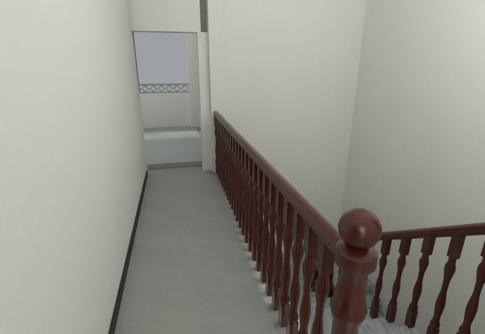
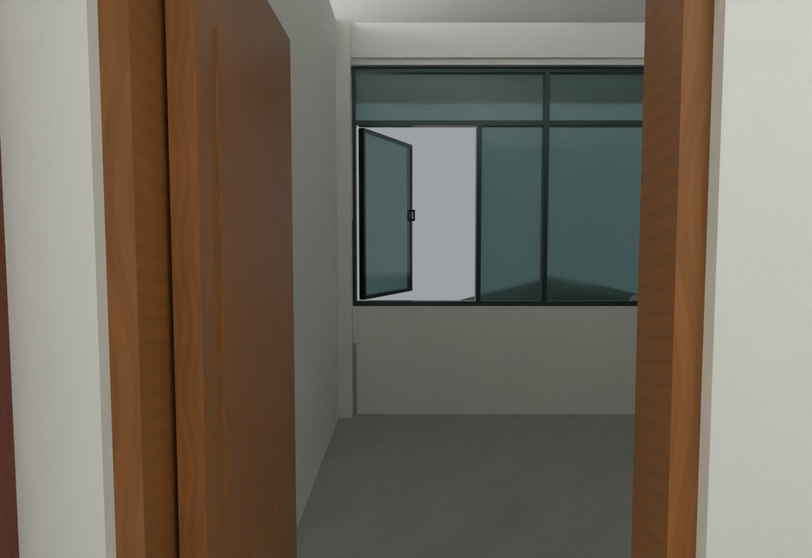

# V24.32 · 以外墙平面去重并联通四跑楼梯扶手

[逐版目录](README.md) · [建筑重建台账](../../reconstruction.md) · [阶段方法汇总](../v24-22-v25.md)

## 摘要

收平外立面，清窗下与铺地重叠，连通楼梯扶手并修三楼门开向。

## 1. 问题与输入

V24.31 补窗下墙后，五个高窗下仍有外凸饰面；另有飘窗交界叠面、扶手不连续和三楼门铰侧问题。

## 2. 实现方法

1. 以相邻原外饰面为目标平面裁去高窗下 112 mm 外凸量，清楼层饰带与梁板边凸块。飘窗下墙接原石材窗套，三个交接各清约 0.161 m² 重面。

2. 扶手按四跑及平台分段连续接合，二楼后侧保持去三楼的路径，三楼端柱脚收至楼板承托。指定木门改对侧铰接，继续向内开。

3. 用外墙平面偏差、局部重复面和门轴复开核验，并复测楼梯路线。

## 3. 过程图

**图 1** · 三楼连续栏杆

**图 2** · V24.32 三楼木门改铰后的位置

## 4. 验证与适用范围

表面报告 12 项和原生报告 134 项均记录空失败清单。窗下外凸量取自已保存模型相邻平面。

- **表面与接缝核验** 
  状态 `PASS_SAVED_VERTICAL_SURFACE_OWNERSHIP`，检查条目 12，失败记录 0。

- **原生模型核验** 
  状态 `PASS_NATIVE_FACADE_RAILING_DOOR_REPAIRS`，检查条目 134，失败记录 0。

- **人物通行核验** 
  状态 `PASS_ACTUAL_MODEL_ROAM_PHYSICS`，检查条目 30，失败记录 0。

### 原记录中的关键检查

- **Closed two-face edges / V24_31_F1_Complete_Bay_Underwindow_Walls** 
  通过，`bad_edges` = `0` 
  原记录 `V24_32_Native_QA.json` 的 `checks[22]`

- **Shared exterior bay joint face removed (2, 'L')** 
  通过，`before_duplicate_area_m2` = `0.160989`，`after_duplicate_area_m2` = `0` 
  原记录 `V24_32_Surface_QA.json` 的 `checks[0]`

- **Shared exterior bay joint face removed (2, 'R')** 
  通过，`before_duplicate_area_m2` = `0.160989`，`after_duplicate_area_m2` = `0` 
  原记录 `V24_32_Surface_QA.json` 的 `checks[1]`

## 5. 复现入口与出处

过程路径以本地 `JIA` 项目为根，`work/` 指重建项目的历史工作目录。复核时按交付记录打开本轮输入与保存成果，再依方法中的截面、对象或动作采样对照原报告。

交付与参考记录（1 项）

~~~text
Rebuild_V24_32/使用说明.txt
~~~

原实现脚本（5 项）

~~~text
Rebuild_V24_32/Sources/v24_32_probe.py
Rebuild_V24_32/Sources/v24_32_prepare.py
Rebuild_V24_32/Sources/v24_32_build.py
Rebuild_V24_32/Sources/v24_32_render.py
Rebuild_V24_32/Sources/v24_32_verify.py
~~~

核验报告路径（3 项）

**表面与接缝核验**

~~~text
Rebuild_V24_32/Reports/V24_32_Surface_QA.json
~~~

**原生模型核验**

~~~text
Rebuild_V24_32/Reports/V24_32_Native_QA.json
~~~

**人物通行核验**

~~~text
Rebuild_V24_32/Reports/V24_32_Physics_QA.json
~~~

图源与 SHA-256（2 张）

### 图 1 · 三楼连续栏杆

~~~text
Rebuild_V24_32/Reports/V24_32_F3_Front_Guard.png
~~~

**原过程图 SHA-256**

~~~text
8feed6750808d0dbb736b19168583d4137b1ebca530e9d875877ae4da736e977
~~~

台账发布图，按原图缩放及压缩。

### 图 2 · V24.32 三楼木门改铰后的位置

~~~text
Rebuild_V24_32/Reports/V24_32_F3_Opposite_Door.png
~~~

**原过程图 SHA-256**

~~~text
d9004ff7e949118a098301917ec91cc25054a239349cc74f458af11d144e42eb
~~~

保留原画面，发布用 JPEG。

---

上一篇 [V24.31 · 定位共面重叠并修窗下墙、白天花与木扶手](v24-31.md) 
下一篇 [V24.33 · 按楼板归属修楼梯口白带、露台找坡和瓦角](v24-33.md)
