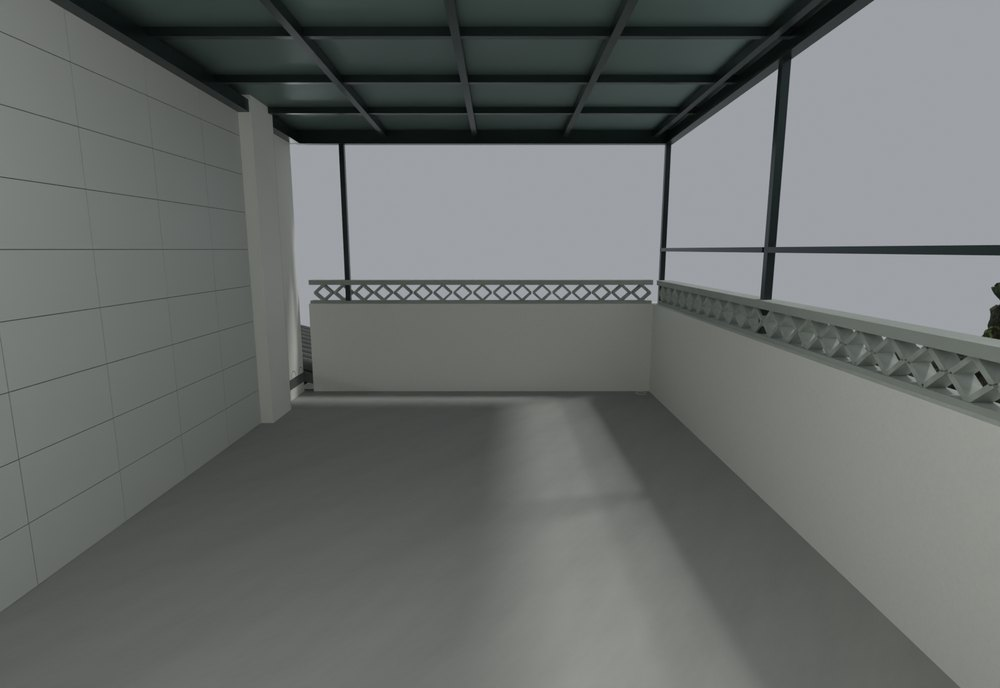
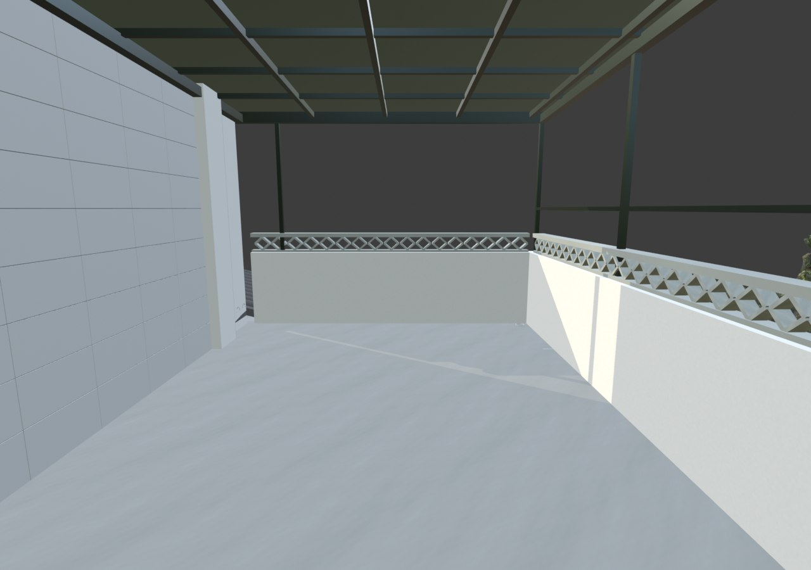

# V24.33 · 按楼板归属修楼梯口白带、露台找坡和瓦角

[逐版目录](README.md) · [建筑重建台账](../../reconstruction.md) · [阶段方法汇总](../v24-22-v25.md)

## 摘要

把楼梯口白带归回楼板，取消多余露台找坡层，裁穿出露台的瓦角并收平墙体。

## 1. 问题与输入

八张标记图对应 V24.32 的楼梯口、露台、厨房端部和储藏房通道。先按高度和对象归属定位白带及重叠面。

## 2. 实现方法

1. 将占据楼板带的下层白墙区域归并至灰色楼板，保持楼梯空洞。删最高约 80 mm 的旧露台找坡层，裁穿入露台的门廊瓦角，裁底低于楼面。

2. 清厨房北端悬挂旧柱头、饰条，恢复南侧原青砖材质。储藏间前廊去旧门槛，将高出 6 mm 的地面接回 −0.40 m 通道。

3. 按保存的局部剖面和视口复查楼板带、露台地面及厨储通行，连同上版已换铰的三楼门核对。

### 实现链与源码定位

以下按诊断、处理、保存与复核组织阅读。调用和文件引用来自原脚本，输入输出方向由对应读写调用判断；辅助文件是否在本轮运行，以报告为准。

**1. 定位与诊断** · [`v24_33_floor_probe.py`](../source-code/v24-33/project/Sources/v24_33_floor_probe.py#L4)

打开保存的 Blender [`bpy.ops.wm.open_mainfile`](../source-code/v24-33/project/Sources/v24_33_floor_probe.py#L4)；射线命中检查 [`sc.ray_cast`](../source-code/v24-33/project/Sources/v24_33_floor_probe.py#L6)。

文件引用：[`Architecture_Complete_V24_32.blend`](../source-code/v24-33/project/Sources/v24_33_floor_probe.py#L4) · [`Floor_Probes_Before.json`](../source-code/v24-33/project/Sources/v24_33_floor_probe.py#L16)。

**2. 定位与诊断** · [`v24_33_plan.py`](../source-code/v24-33/project/Sources/v24_33_plan.py#L6)

文件引用：[`Geometry_Index.json`](../source-code/v24-33/project/Sources/v24_33_plan.py#L6) · [`Wall_Plan_Z1.png`](../source-code/v24-33/project/Sources/v24_33_plan.py#L21)。

**3. 定位与诊断** · [`v24_33_wood_probe.py`](../source-code/v24-33/project/Sources/v24_33_wood_probe.py#L4)

打开保存的 Blender [`bpy.ops.wm.open_mainfile`](../source-code/v24-33/project/Sources/v24_33_wood_probe.py#L4)；射线命中检查 [`sc.ray_cast`](../source-code/v24-33/project/Sources/v24_33_wood_probe.py#L12)。

文件引用：[`Architecture_Complete_V24_32.blend`](../source-code/v24-33/project/Sources/v24_33_wood_probe.py#L4) · [`Geometry_Index.json`](../source-code/v24-33/project/Sources/v24_33_wood_probe.py#L5) · [`Inventory.json`](../source-code/v24-33/project/Sources/v24_33_wood_probe.py#L5)。

**4. 参数与几何处理** · [`v24_33_prepare.py`](../source-code/v24-33/project/Sources/v24_33_prepare.py#L16)

叉积／面法线 [`np.cross`](../source-code/v24-33/project/Sources/v24_33_prepare.py#L16)；网格与实体转换 [`m.to_mesh64`](../source-code/v24-33/project/Sources/v24_33_prepare.py#L62)。

文件引用：[`Geometry_Index.json`](../source-code/v24-33/project/Sources/v24_33_prepare.py#L8) · [`Prepared_Geometry.json`](../source-code/v24-33/project/Sources/v24_33_prepare.py#L58)。

**5. 构建或写入** · [`v24_33_build.py`](../source-code/v24-33/project/Sources/v24_33_build.py#L11)

打开保存的 Blender [`bpy.ops.wm.open_mainfile`](../source-code/v24-33/project/Sources/v24_33_build.py#L11)；空间加速结构 [`BVHTree.FromPolygons`](../source-code/v24-33/project/Sources/v24_33_build.py#L19)；最小二乘求解 [`np.linalg.lstsq`](../source-code/v24-33/project/Sources/v24_33_build.py#L21)。

文件引用：[`Architecture_Complete_V24_33.blend`](../source-code/v24-33/project/Sources/v24_33_build.py#L6) · [`Architecture_Complete_V24_32.blend`](../source-code/v24-33/project/Sources/v24_33_build.py#L6) · [`Before_Snapshot.json`](../source-code/v24-33/project/Sources/v24_33_build.py#L11)。

**6. 保存后核验** · [`v24_33_verify.py`](../source-code/v24-33/project/Sources/v24_33_verify.py#L11)

判据与回归检查 [`checks.append`](../source-code/v24-33/project/Sources/v24_33_verify.py#L8)；打开保存的 Blender [`bpy.ops.wm.open_mainfile`](../source-code/v24-33/project/Sources/v24_33_verify.py#L11)；空间加速结构 [`BVHTree.FromPolygons`](../source-code/v24-33/project/Sources/v24_33_verify.py#L23)。

文件引用：[`Architecture_Complete_V24_33.blend`](../source-code/v24-33/project/Sources/v24_33_verify.py#L6) · [`Before_Snapshot.json`](../source-code/v24-33/project/Sources/v24_33_verify.py#L7) · [`V24_33_Changes.json`](../source-code/v24-33/project/Sources/v24_33_verify.py#L7)。

**7. 保存后核验** · [`v24_33_surface_qa.py`](../source-code/v24-33/project/Sources/v24_33_surface_qa.py#L11)

判据与回归检查 [`checks.append`](../source-code/v24-33/project/Sources/v24_33_surface_qa.py#L9)；叉积／面法线 [`np.cross`](../source-code/v24-33/project/Sources/v24_33_surface_qa.py#L11)；交集限域 [`g.intersection`](../source-code/v24-33/project/Sources/v24_33_surface_qa.py#L18)。

文件引用：[`Architecture_Complete_V24_33.blend`](../source-code/v24-33/project/Sources/v24_33_surface_qa.py#L8) · [`Final_Geometry_Index.json`](../source-code/v24-33/project/Sources/v24_33_surface_qa.py#L8) · [`Geometry_Index.json`](../source-code/v24-33/project/Sources/v24_33_surface_qa.py#L8)。

[方法原理：圈画、对象与剖切定位](../methodology.md#3-从截图圈画定位到对象与剖面) · [本版完整过程索引](process/v24-33.md)

本版索引汇合 64 幅已归档过程图、52 份交付及历史目录中的报告／说明／中间记录和全部 31 个源码附件。继承文件和本轮新增文件按来源保留，实际完成范围以第 4 节及原报告为准。

## 3. 过程图

**图 1** · 取消多余找坡后的露台

**图 2** · V24.33 保存模型露台的连续灰色地面视口

## 4. 验证与适用范围

表面报告 15 项、原生报告 80 项，失败清单均为空。删除的找坡层和 6 mm 高差为原模型记录。

- **原生模型核验** 
  状态 `PASS_NATIVE_ANNOTATED_RESIDUAL_REPAIRS`，检查条目 80，失败记录 0。

- **表面与接缝核验** 
  状态 `PASS_SAVED_VERTICAL_SURFACE_OWNERSHIP`，检查条目 15，失败记录 0。

### 原记录中的关键检查

- **Every repaired solid has closed two-face edges / PARTITIONS_JOINED_F1_Geometry** 
  通过，`bad_edges` = `0` 
  原记录 `V24_33_Native_QA.json` 的 `checks[10]`

- **Shared exterior bay joint face removed (2, 'L')** 
  通过，`before_duplicate_area_m2` = `0`，`after_duplicate_area_m2` = `0` 
  原记录 `V24_33_Surface_QA.json` 的 `checks[0]`

- **Shared exterior bay joint face removed (2, 'R')** 
  通过，`before_duplicate_area_m2` = `0`，`after_duplicate_area_m2` = `0` 
  原记录 `V24_33_Surface_QA.json` 的 `checks[1]`

## 5. 复现入口与出处

过程路径以本地 `JIA` 项目为根，`work/` 指重建项目的历史工作目录。复核时按交付记录打开本轮输入与保存成果，再依方法中的截面、对象或动作采样对照原报告。

交付与参考记录（1 项）

~~~text
Rebuild_V24_33/使用说明.txt
~~~

### 原实现脚本附件

[浏览本版全部 31 个文件](../source-code/v24-33/README.md) · [原件与公开副本校验值](../source-code/v24-33/manifest.json)

- [`v24_33_floor_probe.py`](../source-code/v24-33/project/Sources/v24_33_floor_probe.py)
- [`v24_33_plan.py`](../source-code/v24-33/project/Sources/v24_33_plan.py)
- [`v24_33_build.py`](../source-code/v24-33/project/Sources/v24_33_build.py)
- [`v24_33_prepare.py`](../source-code/v24-33/project/Sources/v24_33_prepare.py)
- [`v24_33_wood_probe.py`](../source-code/v24-33/project/Sources/v24_33_wood_probe.py)

原脚本本地路径

~~~text
Rebuild_V24_33/Sources/v24_33_floor_probe.py
Rebuild_V24_33/Sources/v24_33_plan.py
Rebuild_V24_33/Sources/v24_33_build.py
Rebuild_V24_33/Sources/v24_33_prepare.py
Rebuild_V24_33/Sources/v24_33_wood_probe.py
~~~

核验报告路径（2 项）

**原生模型核验**

~~~text
Rebuild_V24_33/Reports/V24_33_Native_QA.json
~~~

**表面与接缝核验**

~~~text
Rebuild_V24_33/Reports/V24_33_Surface_QA.json
~~~

图源与 SHA-256（2 张）

### 图 1 · 取消多余找坡后的露台

~~~text
Rebuild_V24_33/Reports/V24_33_02_Terrace_Flush_Floor.png
~~~

**原过程图 SHA-256**

~~~text
bd07bed52a8898c03de2882e579b8b096eaaa72ca6d6c1cc3f42dd53ef409923
~~~

台账发布图，按原图缩放及压缩。

### 图 2 · V24.33 保存模型露台的连续灰色地面视口

~~~text
Rebuild_V24_33/Reports/V24_33_Viewport_02_Terrace_Flush_Floor_A.png
~~~

**原过程图 SHA-256**

~~~text
c0b9bb1043e1a0f19146a9327312576e3fd67bd28fbba270c02b582381dc56eb
~~~

保留原画面，发布用 JPEG。

---

上一篇 [V24.32 · 以外墙平面去重并联通四跑楼梯扶手](v24-32.md) 
下一篇 [V24.34 · 用正射特征与点到面配准补 MB7 缺失外景](v24-34.md)
