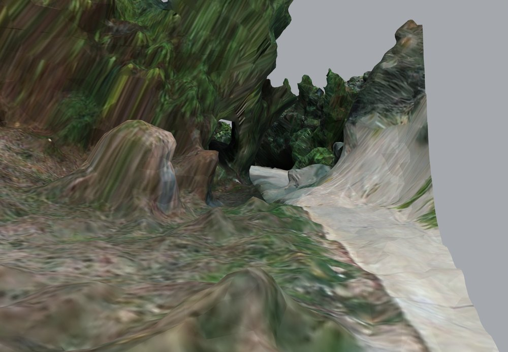
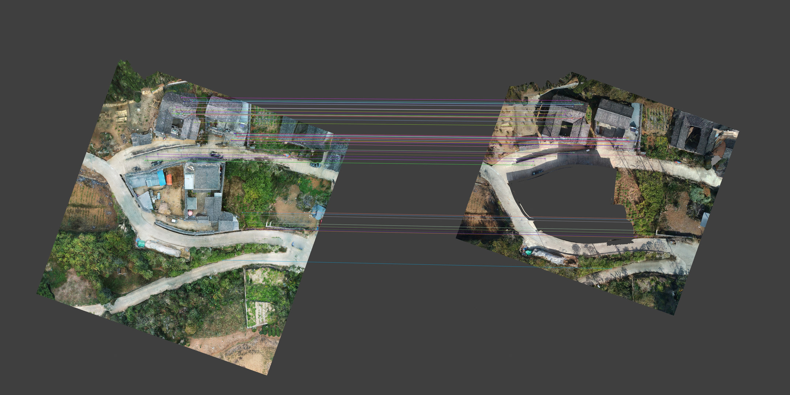

# V24.34 · 用正射特征与点到面配准补 MB7 缺失外景

[逐版目录](README.md) · [建筑重建台账](../../reconstruction.md) · [阶段方法汇总](../v24-22-v25.md)

## 摘要

从 MB7 选不重叠叶节点，配准后补缺失外景，刷新完整模型的碰撞与安全漫游。

## 1. 问题与输入

从 V24.33 读取原外景覆盖范围。MB7 分级 OSGB 需要选最高精度且互不重复的叶节点，将新旧三维表面统一后只补缺失处。

## 2. 实现方法

1. 用原坐标种子制作等尺度正射。SIFT 近邻比值设 0.90，RANSAC 重投影阈值 4 px。把匹配像点反投影到两侧局部 XY，沿 Z 方向射入网格，保留成对命中且法线 Z 分量绝对值大于 0.4 的地物。

2. 由三维同名点 SVD 求相似变换，0.40 m 门限选内点，固定尺度做刚性点到面 ICP。对新叶节点与旧覆盖求差，边缘插值原 UV，距旧覆盖 0.75 m 内过渡高程。

3. 用独立外景碰撞和室内碰撞验证连续走行，检查受保护原住宅及场地。

同名点 RMS 由配准后匹配点的三维距离统计。点到面迭代使用匹配面法线方向的残差，最后一轮的 RMS 与同名点 RMS 有各自的样本和定义。保存两者能分别复核配准地物与邻近面拟合。

## 3. 过程图

**图 1** · 新增南侧道路外景

**图 2** · 新旧正射底图的原特征匹配诊断图

## 4. 验证与适用范围

71 个同名内点的 RMS 约 0.132 m，末轮点到面 RMS 约 0.153 m。补入 154 块、454,334 个三角面、约 3,597.7 m² 平面覆盖。误差度量均来自摄影测量数据配准。

- **交付核验** 
  状态 `PASS_FINAL_DELIVERY`，检查总数 107。

- **原生模型核验** 
  状态 `PASS_NATIVE_PRESERVATION_AND_MB7_IMPORT`，检查条目 16，失败记录 0。

- **表面与接缝核验** 
  状态 `PASS_MISSING_EXTERIOR_ONLY_AND_NO_LOD_DUPLICATES`，检查条目 6，失败记录 0。

### 原记录中的关键检查

- **Added exterior actually expands site coverage** 
  通过，`added_ground_projection_m2` = `3597.69`，`existing_ground_projection_m2` = `6851.56` 
  原记录 `V24_34_Surface_QA.json` 的 `checks[1]`

- **Registration uses spatially distributed shared source features** 
  通过，`landmarks` = `71`，`rms_m` = `0.131668`，`p95_m` = `0.181931` 
  原记录 `V24_34_Surface_QA.json` 的 `checks[4]`

- **All 154 clipped exterior tiles read back with finite original indexed geometry** 
  通过，`triangles` = `454334`，`vertices` = `296942`，`maximum_float32_rounding_m` = `3.81462e-06` 
  原记录 `V24_34_Native_QA.json` 的 `checks[5]`

## 5. 复现入口与出处

过程路径以本地 `JIA` 项目为根，`work/` 指重建项目的历史工作目录。复核时按交付记录打开本轮输入与保存成果，再依方法中的截面、对象或动作采样对照原报告。

交付与参考记录（1 项）

~~~text
Rebuild_V24_34/使用说明.txt
~~~

### 原实现脚本附件

[浏览本版全部 38 个文件](../source-code/v24-34/README.md) · [原件与公开副本校验值](../source-code/v24-34/manifest.json)

- [`v24_34_match.py`](../source-code/v24-34/project/Sources/v24_34_match.py)
- [`v24_34_register.py`](../source-code/v24-34/project/Sources/v24_34_register.py) · 站点坐标脱敏
- [`v24_34_clip.py`](../source-code/v24-34/project/Sources/v24_34_clip.py)
- [`v24_34_build.py`](../source-code/v24-34/project/Sources/v24_34_build.py)
- [`v24_34_plan_routes.py`](../source-code/v24-34/project/Sources/v24_34_plan_routes.py)

本版 3 个文件含站点坐标，公开副本已标记脱敏位置并阻断直接执行，原字节保留在本机。其余附件与原件逐字节一致。

原脚本本地路径

~~~text
Rebuild_V24_34/Sources/v24_34_match.py
Rebuild_V24_34/Sources/v24_34_register.py
Rebuild_V24_34/Sources/v24_34_clip.py
Rebuild_V24_34/Sources/v24_34_build.py
Rebuild_V24_34/Sources/v24_34_plan_routes.py
~~~

核验报告路径（3 项）

**交付核验**

~~~text
Rebuild_V24_34/Reports/V24_34_Delivery_QA.json
~~~

**原生模型核验**

~~~text
Rebuild_V24_34/Reports/V24_34_Native_QA.json
~~~

**表面与接缝核验**

~~~text
Rebuild_V24_34/Reports/V24_34_Surface_QA.json
~~~

图源与 SHA-256（2 张）

### 图 1 · 新增南侧道路外景

~~~text
Rebuild_V24_34/Reports/V24_34_03_Added_South_Road.png
~~~

**原过程图 SHA-256**

~~~text
de9af39e05416f8f196289fb9849c1fd6edd547b689722912b7e1f05e0233ddf
~~~

台账发布图，按原图缩放及压缩。

### 图 2 · 新旧正射底图的原特征匹配诊断图

~~~text
work/v24_34/Registration_Matches.jpg
~~~

**原过程图 SHA-256**

~~~text
b023865cc0de2bee27db579c2ae2615f72058fb67d000b932bbfe9257573fd23
~~~

保留匹配线与两幅底图，缩放发布。

---

上一篇 [V24.33 · 按楼板归属修楼梯口白带、露台找坡和瓦角](v24-33.md) 
下一篇 [V24.35 · 用保护包络裁除厨储附近扫描残片](v24-35.md)
