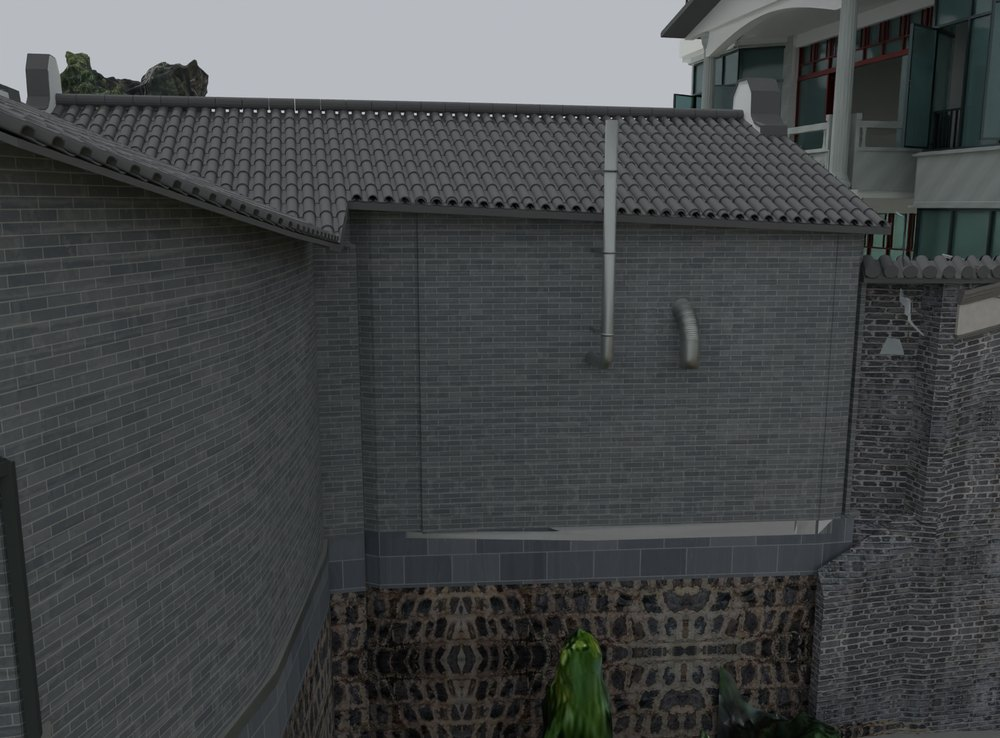
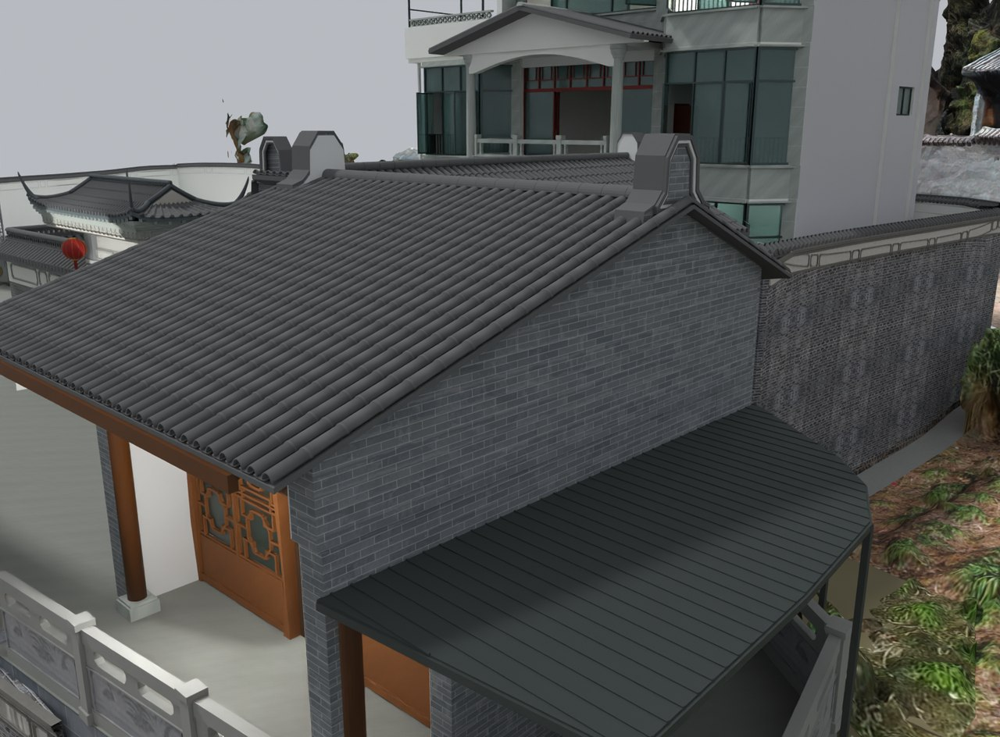

# V24.35 · 用保护包络裁除厨储附近扫描残片

[逐版目录](README.md) · [建筑重建台账](../../reconstruction.md) · [阶段方法汇总](../v24-22-v25.md)

## 摘要

在厨房附近局部裁切或移除覆盖屋檐及外墙的 MB7 扫描残片，核对原屋面、墙体和管道。

## 1. 问题与输入

V24.34 扩展外景后，圈画视角中少量 MB7 残片覆盖青砖墙、屋檐或管道。原生构件在修补时作为保护目标。

## 2. 实现方法

1. 用标记相机沿可见区域发射射线，读取遮挡的扫描对象和本应命中的原生部件。按整个对象冗余与局部相交两类处理。

2. 对局部相交使用屋面、墙体和管道保护包络裁切扫描三角面，保留有效外景和可用 UV，更新碰撞索引。

3. 在同一视角与几何射线复核原构件露出和接口，读取对象指纹。

### 实现链与源码定位

以下按诊断、处理、保存与复核组织阅读。调用和文件引用来自原脚本，输入输出方向由对应读写调用判断；辅助文件是否在本轮运行，以报告为准。

**1. 定位与诊断** · [`v24_35_probe.py`](../source-code/v24-35/history/v24_35_probe.py#L5)

打开保存的 Blender [`bpy.ops.wm.open_mainfile`](../source-code/v24-35/history/v24_35_probe.py#L5)。

文件引用：[`Architecture_Complete_V24_34.blend`](../source-code/v24-35/history/v24_35_probe.py#L5) · [`Before_Snapshot.json`](../source-code/v24-35/history/v24_35_probe.py#L5) · [`Source.json`](../source-code/v24-35/history/v24_35_probe.py#L7)。

**2. 构建或写入** · [`v24_35_export_envelope.py`](../source-code/v24-35/history/v24_35_export_envelope.py#L3)

打开保存的 Blender [`bpy.ops.wm.open_mainfile`](../source-code/v24-35/history/v24_35_export_envelope.py#L3)。

文件引用：[`Architecture_Complete_V24_34.blend`](../source-code/v24-35/history/v24_35_export_envelope.py#L3) · [`Envelope_Index.json`](../source-code/v24-35/history/v24_35_export_envelope.py#L10)。

**3. 构建或写入** · [`v24_35_build.py`](../source-code/v24-35/history/v24_35_build.py#L8)

打开保存的 Blender [`bpy.ops.wm.open_mainfile`](../source-code/v24-35/history/v24_35_build.py#L8)；写入网格拓扑 [`me.from_pydata`](../source-code/v24-35/history/v24_35_build.py#L10)；批量写入属性 [`me.polygons.foreach_set`](../source-code/v24-35/history/v24_35_build.py#L10)。

文件引用：[`Architecture_Complete_V24_35.blend`](../source-code/v24-35/history/v24_35_build.py#L4) · [`Architecture_Complete_V24_34.blend`](../source-code/v24-35/history/v24_35_build.py#L4) · [`Prepared_Geometry.json`](../source-code/v24-35/history/v24_35_build.py#L8)。

**4. 辅助实现** · [`v24_35_identify.py`](../source-code/v24-35/history/v24_35_identify.py#L4)

打开保存的 Blender [`bpy.ops.wm.open_mainfile`](../source-code/v24-35/history/v24_35_identify.py#L4)；射线命中检查 [`sc.ray_cast`](../source-code/v24-35/history/v24_35_identify.py#L8)。

文件引用：[`Architecture_Complete_V24_34.blend`](../source-code/v24-35/history/v24_35_identify.py#L4) · [`Visible_Artifact_Rays.json`](../source-code/v24-35/history/v24_35_identify.py#L12)。

**5. 保存后核验** · [`v24_35_repair_qa.py`](../source-code/v24-35/history/v24_35_repair_qa.py#L5)

打开保存的 Blender [`bpy.ops.wm.open_mainfile`](../source-code/v24-35/history/v24_35_repair_qa.py#L5)；判据与回归检查 [`checks.append`](../source-code/v24-35/history/v24_35_repair_qa.py#L6)；射线命中检查 [`sc.ray_cast`](../source-code/v24-35/history/v24_35_repair_qa.py#L16)。

文件引用：[`Before_Snapshot.json`](../source-code/v24-35/history/v24_35_repair_qa.py#L5) · [`Prepared_Geometry.json`](../source-code/v24-35/history/v24_35_repair_qa.py#L5) · [`Visible_Artifact_Rays.json`](../source-code/v24-35/history/v24_35_repair_qa.py#L12)。

[方法原理：配准与路线的分阶段验收](../methodology.md#6-外景配准为什么需要两种误差) · [本版完整过程索引](process/v24-35.md)

本版索引汇合 7 幅已归档过程图、14 份交付及历史目录中的报告／说明／中间记录和全部 13 个源码附件。继承文件和本轮新增文件按来源保留，实际完成范围以第 4 节及原报告为准。

## 3. 过程图

**图 1** · 厨房檐口去除扫描遮挡

**图 2** · V24.35 修复后的厨房南侧屋檐和墙体接口

## 4. 验证与适用范围

变更报告记录修改 5 个、移除 10 个对象，维修报告含 6 条回查射线及 13 项检查，失败清单为空。核验聚焦圈画区域。

- **构件变更记录** 
  修改项 5，移除项 10。

- **Repair QA** 
  状态 `PASS_ANNOTATED_WALL_AND_EAVE_REPAIR`，检查条目 13，失败记录 0，复核射线 6。

### 原记录中的关键检查

- **All original door and window actions and poses remain unchanged** 
  通过 
  原记录 `V24_35_Repair_QA.json` 的 `checks[3]`

- **All ten wholly redundant scanned wall fragments are removed** 
  通过 
  原记录 `V24_35_Repair_QA.json` 的 `checks[1]`

- **Marked ghost surface is replaced by native wall at pixel [1020, 430]** 
  通过 
  原记录 `V24_35_Repair_QA.json` 的 `checks[6]`

## 5. 复现入口与出处

过程路径以本地 `JIA` 项目为根，`work/` 指重建项目的历史工作目录。复核时按交付记录打开本轮输入与保存成果，再依方法中的截面、对象或动作采样对照原报告。

交付与参考记录（1 项）

~~~text
Rebuild_V24_35/Reports/V24_35_Changes.json
~~~

### 原实现脚本附件

[浏览本版全部 13 个文件](../source-code/v24-35/README.md) · [原件与公开副本校验值](../source-code/v24-35/manifest.json)

- [`v24_35_identify.py`](../source-code/v24-35/history/v24_35_identify.py)
- [`v24_35_export_envelope.py`](../source-code/v24-35/history/v24_35_export_envelope.py)
- [`v24_35_repair_qa.py`](../source-code/v24-35/history/v24_35_repair_qa.py)
- [`v24_35_build.py`](../source-code/v24-35/history/v24_35_build.py)
- [`v24_35_probe.py`](../source-code/v24-35/history/v24_35_probe.py)

原脚本本地路径

~~~text
work/v24_35_identify.py
work/v24_35_export_envelope.py
work/v24_35_repair_qa.py
work/v24_35_build.py
work/v24_35_probe.py
~~~

核验报告路径（2 项）

**构件变更记录**

~~~text
Rebuild_V24_35/Reports/V24_35_Changes.json
~~~

**Repair QA**

~~~text
Rebuild_V24_35/Reports/V24_35_Repair_QA.json
~~~

图源与 SHA-256（2 张）

### 图 1 · 厨房檐口去除扫描遮挡

~~~text
Rebuild_V24_35/Reports/V24_35_02_Kitchen_East_Close.png
~~~

**原过程图 SHA-256**

~~~text
98fdcb3d97c261f1045a680cec89db3797f3d8839f54419d4f8e4cff5acfd736
~~~

台账发布图，按原图缩放及压缩。

### 图 2 · V24.35 修复后的厨房南侧屋檐和墙体接口

~~~text
Rebuild_V24_35/Reports/V24_35_03_Kitchen_South_Join.png
~~~

**原过程图 SHA-256**

~~~text
71a42fc3c1b6f7c4fae1d5335f0c9650dcf675dba82e14b4e4e213ad07e6cad4
~~~

保留原画面，发布用 JPEG。

---

上一篇 [V24.34 · 用正射特征与点到面配准补 MB7 缺失外景](v24-34.md) 
下一篇 [V24.36 · PTJIA6 外景配准、道路格网与候选路线](v24-36.md)
