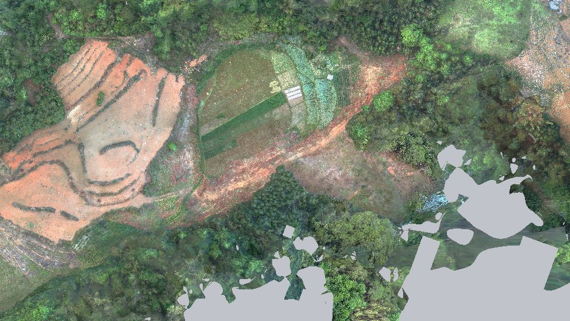
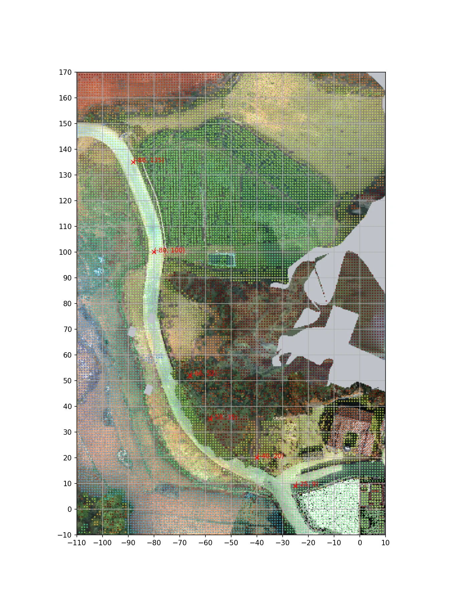

# V24.36 · PTJIA6 外景配准、道路格网与候选路线

[逐版目录](README.md) · [建筑重建台账](../../reconstruction.md) · [阶段方法汇总](../v24-22-v25.md)

## 摘要

增补 PTJIA6 外景，处理拼接高程，剔除落进受保护空隙的片段，更新漫游碰撞。

## 1. 问题与输入

在已有外景上加入 PTJIA6，目标是补覆盖、避开受保护的原模型空隙，并定位外侧道路的断点和可走边。

## 2. 实现方法

1. 配准 PTJIA6 后按旧覆盖裁切，在交界处理高程连续性。正射叠加局部 XY 网格和着色地面样本，以红叉标出要回查的候选路点。

2. 先在地面邻接网格剔除过陡边，再用人物胶囊以约 0.09 m 步进测试每条边。只有落地、净空和高程接续均满足时才加入候选路线。

3. 分别读覆盖核验、原生 QA 和局部修复射线报告。覆盖报告通过；原生 QA 标为 FAIL，记录旧打包照片一致性、61 个零面积面及扩展碰撞覆盖检查失败。

道路图的两个轴是模型局部坐标。每个路点先检索地面命中，再用胶囊在相邻节点间尝试移动。图上的红叉对应待查位置，路线是否通过取决于碰撞与落地样本。

### 实现链与源码定位

以下按诊断、处理、保存与复核组织阅读。调用和文件引用来自原脚本，输入输出方向由对应读写调用判断；辅助文件是否在本轮运行，以报告为准。

**1. 定位与诊断** · [`v24_36_register.py`](../source-code/v24-36/history/v24_36_register.py#L12)

奇异值分解 [`np.linalg.svd`](../source-code/v24-36/history/v24_36_register.py#L12)；叉积／面法线 [`np.cross`](../source-code/v24-36/history/v24_36_register.py#L23)；最小二乘求解 [`np.linalg.lstsq`](../source-code/v24-36/history/v24_36_register.py#L28)。

文件引用：[`Landmarks_3D.json`](../source-code/v24-36/history/v24_36_register.py#L10) · [`Registration_Clouds.npz`](../source-code/v24-36/history/v24_36_register.py#L21) · [`Coordinate_Seed.json`](../source-code/v24-36/history/v24_36_register.py#L30)。

该附件为站点坐标脱敏副本，恢复私有常量后方可执行；行号对应公开文件。

**2. 定位与诊断** · [`v24_36_plan_walkable_routes.py`](../source-code/v24-36/history/v24_36_plan_walkable_routes.py#L4)

打开保存的 Blender [`bpy.ops.wm.open_mainfile`](../source-code/v24-36/history/v24_36_plan_walkable_routes.py#L4)。

文件引用：[`Architecture_Complete_V24_36.blend`](../source-code/v24-36/history/v24_36_plan_walkable_routes.py#L4) · [`Final_Collision.npz`](../source-code/v24-36/history/v24_36_plan_walkable_routes.py#L4) · [`Roam_Ground_Grid.npz`](../source-code/v24-36/history/v24_36_plan_walkable_routes.py#L4)。

**3. 定位与诊断** · [`v24_36_probe_views.py`](../source-code/v24-36/history/v24_36_probe_views.py#L4)

打开保存的 Blender [`bpy.ops.wm.open_mainfile`](../source-code/v24-36/history/v24_36_probe_views.py#L4)。

文件引用：[`Architecture_Complete_V24_36.blend`](../source-code/v24-36/history/v24_36_probe_views.py#L4) · [`V24_36_Context_Top.png`](../source-code/v24-36/history/v24_36_probe_views.py#L15) · [`Top_Projection.json`](../source-code/v24-36/history/v24_36_probe_views.py#L15)。

**4. 构建或写入** · [`v24_36_build.py`](../source-code/v24-36/history/v24_36_build.py#L11)

打开保存的 Blender [`bpy.ops.wm.open_mainfile`](../source-code/v24-36/history/v24_36_build.py#L11)；空间加速结构 [`BVHTree.FromPolygons`](../source-code/v24-36/history/v24_36_build.py#L11)；写入网格拓扑 [`me.from_pydata`](../source-code/v24-36/history/v24_36_build.py#L21)。

文件引用：[`Architecture_Complete_V24_36.blend`](../source-code/v24-36/history/v24_36_build.py#L6) · [`Architecture_Complete_V24_35.blend`](../source-code/v24-36/history/v24_36_build.py#L6) · [`Before_Snapshot.json`](../source-code/v24-36/history/v24_36_build.py#L11)。

**5. 过程出图** · [`v24_36_route_debug_plot.py`](../source-code/v24-36/history/v24_36_route_debug_plot.py#L5)

文件引用：[`V24_36_Context_Top.png`](../source-code/v24-36/history/v24_36_route_debug_plot.py#L5) · [`Roam_Ground_Grid.npz`](../source-code/v24-36/history/v24_36_route_debug_plot.py#L5) · [`Top_Projection.json`](../source-code/v24-36/history/v24_36_route_debug_plot.py#L5)。

**6. 保存后核验** · [`v24_36_verify.py`](../source-code/v24-36/history/v24_36_verify.py#L7)

打开保存的 Blender [`bpy.ops.wm.open_mainfile`](../source-code/v24-36/history/v24_36_verify.py#L7)；判据与回归检查 [`checks.append`](../source-code/v24-36/history/v24_36_verify.py#L8)；叉积／面法线 [`np.cross`](../source-code/v24-36/history/v24_36_verify.py#L18)。

文件引用：[`Architecture_Complete_V24_36.blend`](../source-code/v24-36/history/v24_36_verify.py#L4) · [`Before_Snapshot.json`](../source-code/v24-36/history/v24_36_verify.py#L7) · [`Missing_Exterior_Index.json`](../source-code/v24-36/history/v24_36_verify.py#L13)。

**7. 保存后核验** · [`v24_36_surface_qa.py`](../source-code/v24-36/history/v24_36_surface_qa.py#L8)

叉积／面法线 [`np.cross`](../source-code/v24-36/history/v24_36_surface_qa.py#L8)；交集限域 [`shapely.intersection`](../source-code/v24-36/history/v24_36_surface_qa.py#L9)；判据与回归检查 [`checks.append`](../source-code/v24-36/history/v24_36_surface_qa.py#L14)。

文件引用：[`Architecture_Complete_V24_36.blend`](../source-code/v24-36/history/v24_36_surface_qa.py#L6) · [`Final_Exterior_Index.json`](../source-code/v24-36/history/v24_36_surface_qa.py#L6) · [`3MX_Inventory.json`](../source-code/v24-36/history/v24_36_surface_qa.py#L17)。

[方法原理：配准与路线的分阶段验收](../methodology.md#6-外景配准为什么需要两种误差) · [本版完整过程索引](process/v24-36.md)

本版索引汇合 6 幅已归档过程图、38 份交付及历史目录中的报告／说明／中间记录和全部 30 个源码附件。继承文件和本轮新增文件按来源保留，实际完成范围以第 4 节及原报告为准。

## 3. 过程图

**图 1** · 补齐后的外景网格局部

**图 2** · PTJIA6 北侧道路局部网格、地面采样和候选路点

## 4. 验证与适用范围

这轮保存了地面与路线诊断及部分成功的修复，整版原生验收存在上述三项失败。V24.37 记录后续清理及外景路径验收。

- **原生模型核验** 
  状态 `FAIL`，检查条目 15，失败记录 3。

- **表面与接缝核验** 
  状态 `PASS_MISSING_PTJIA6_ONLY_AND_COMPLETE_NATIVE_ENVELOPE`，检查条目 6，失败记录 0。

- **Repair QA** 
  状态 `PASS_ANNOTATED_WALL_AND_EAVE_REPAIR`，检查条目 13，失败记录 0，复核射线 6。

### 原记录中的关键检查

- **No zero-area visible imported faces remain** 
  未通过，`degenerate_faces` = `61` 
  原记录 `V24_36_Native_QA.json` 的 `checks[7]`

- **PTJIA6 adds collision throughout the expanded context** 
  未通过，`collision_triangles` = `2812708`，`batches` = `147` 
  原记录 `V24_36_Native_QA.json` 的 `checks[9]`

- **All existing packed photo images are unchanged** 
  未通过 
  原记录 `V24_36_Native_QA.json` 的 `checks[2]`

## 5. 复现入口与出处

过程路径以本地 `JIA` 项目为根，`work/` 指重建项目的历史工作目录。复核时按交付记录打开本轮输入与保存成果，再依方法中的截面、对象或动作采样对照原报告。

交付与参考记录（1 项）

~~~text
Rebuild_V24_36/Reports/V24_36_Changes.json
~~~

### 原实现脚本附件

[浏览本版全部 30 个文件](../source-code/v24-36/README.md) · [原件与公开副本校验值](../source-code/v24-36/manifest.json)

- [`v24_36_register.py`](../source-code/v24-36/history/v24_36_register.py) · 站点坐标脱敏
- [`v24_36_route_debug_plot.py`](../source-code/v24-36/history/v24_36_route_debug_plot.py)
- [`v24_36_plan_walkable_routes.py`](../source-code/v24-36/history/v24_36_plan_walkable_routes.py)
- [`v24_36_build.py`](../source-code/v24-36/history/v24_36_build.py)
- [`v24_36_probe_views.py`](../source-code/v24-36/history/v24_36_probe_views.py)

本版 3 个文件含站点坐标，公开副本已标记脱敏位置并阻断直接执行，原字节保留在本机。其余附件与原件逐字节一致。

原脚本本地路径

~~~text
work/v24_36_register.py
work/v24_36_route_debug_plot.py
work/v24_36_plan_walkable_routes.py
work/v24_36_build.py
work/v24_36_probe_views.py
~~~

核验报告路径（3 项）

**原生模型核验**

~~~text
Rebuild_V24_36/Reports/V24_36_Native_QA.json
~~~

**表面与接缝核验**

~~~text
Rebuild_V24_36/Reports/V24_36_Surface_QA.json
~~~

**Repair QA**

~~~text
Rebuild_V24_36/Reports/V24_36_Repair_QA.json
~~~

图源与 SHA-256（2 张）

### 图 1 · 补齐后的外景网格局部

~~~text
Rebuild_V24_36/Reports/V24_36_Context_Top.png
~~~

**原过程图 SHA-256**

~~~text
9e743cd280426389124804ff2332401cf221cf0cd57448f05e0368e8e1073b5b
~~~

台账发布图，按原图局部裁切及压缩。

### 图 2 · PTJIA6 北侧道路局部网格、地面采样和候选路点

~~~text
work/v24_36/Route_Local_Debug.png
~~~

**原过程图 SHA-256**

~~~text
f37d0919319be8fb4fcfd309aba81d7f6d3f7f61b6701eda4dab706d83d77abf
~~~

已有过程图的发布副本。

---

上一篇 [V24.35 · 用保护包络裁除厨储附近扫描残片](v24-35.md) 
下一篇 [V24.37 · 以连通覆盖清理外景并重建碰撞](v24-37.md)
