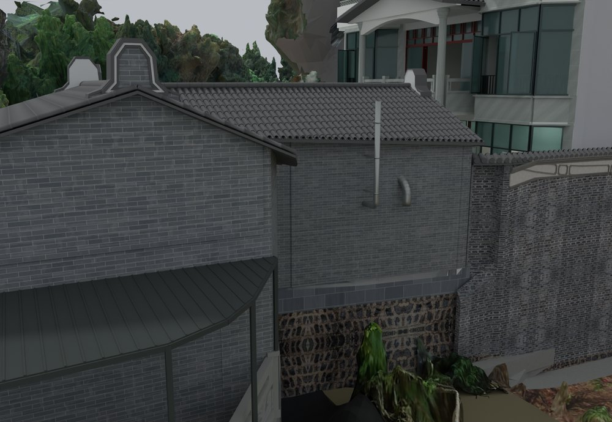
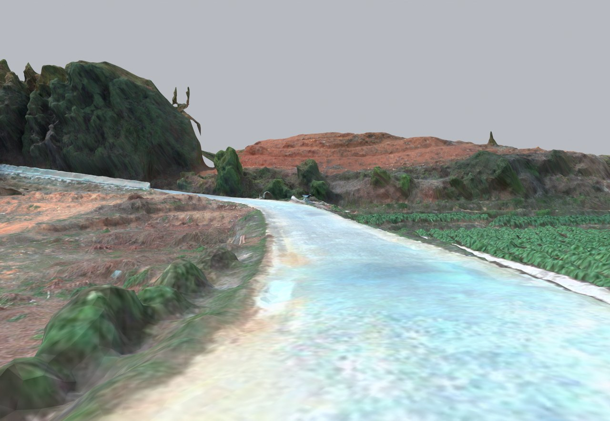

# V24.37 · 以连通覆盖清理外景并重建碰撞

[逐版目录](README.md) · [建筑重建台账](../../reconstruction.md) · [阶段方法汇总](../v24-22-v25.md) · [上一篇 V24.36](v24-36.md) · [下一篇 V25](v25.md)

## 摘要

清厨房青砖及檐口白色扫描残片，按覆盖边界保留连续 PTJIA6 外景，交付安全漫游。

## 1. 问题与输入

在已有建筑与 MB7 外景外补 PTJIA6，并处理标记中的厨房青砖墙和屋檐白色扫描残片。按外景连续性和遮挡范围取舍。

## 2. 实现方法

1. 选 PTJIA6 最高精度非重叠叶节点，裁到既有覆盖之外。剔除北部拉长幕片、破碎外缘和微小悬浮片，保留田块、道路、房屋和主要植被。
2. 保留有效摄影贴图和原 UV，边缘在三角面裁切时插值。用清理后的可见几何重建外景碰撞，按保存文件核对原生墙瓦和管道。
3. 在外部通道及地形边缘测试落地、阻挡和安全回退。报告记录内外部物理、原生和表面检查。

## 3. 过程图

*图 1 · 清理后的厨房青砖与檐口。过程文件 `Rebuild_V24_37/Reports/V24_37_Kitchen_Wall_Eave.png`。*

*图 2 · V24.37 清理后 PTJIA6 道路的原模型视图。过程文件 `Rebuild_V24_37/Reports/V24_37_PTJIA6_Road_Eye.png`。*

## 4. 验证与适用范围

移除 167 个残片对象，保留 2,065 个扫描部分和 6,412,786 个显示三角面，外景碰撞报告记录 2,685,383 个三角面。外部物理 22 项检查、7 组路线轨迹。

| 过程报告 | 原报告读数 |
| --- | --- |
| `Rebuild_V24_37/Reports/V24_37_Delivery_QA.json` | 状态 `PASS_FINAL_DELIVERY`，检查总数 133，碰撞三角面 2,685,383。 |
| `Rebuild_V24_37/Reports/V24_37_Exterior_Physics_QA.json` | 状态 `PASS_ALL_MODEL_EXTERIOR_SUPPORT_AND_EDGE_SAFETY`，检查条目 22，失败记录 0。 |
| `Rebuild_V24_37/Reports/V24_37_Native_QA.json` | 状态 `PASS_NATIVE_PRESERVATION_CLEANED_EXTERIOR_AND_ANNOTATED_REPAIR`，检查条目 22，失败记录 0。 |

### 原记录中的关键检查

| 检查项 | 结果与读数 | 原记录位置 |
| --- | --- | --- |
| Jump and land on new ground below minus twelve metres | 通过，`ground_z_m=-15.1876`，`jump_height_m=0.592332` | `V24_37_Exterior_Physics_QA.json` 的 `checks[11]` |
| All door and window poses and actions remain unchanged | 通过 | `V24_37_Native_QA.json` 的 `checks[4]` |
| Real capsule follows Existing_West_Road | 通过，`planned_length_m=37.4558`，`completed_points=31`，`planned_points=31` | `V24_37_Exterior_Physics_QA.json` 的 `checks[0]` |

## 5. 复现入口与出处

过程路径以本地 `JIA` 项目为根，`work/` 指重建项目的历史工作目录。复核时按交付记录打开本轮输入与保存成果，再依方法中的截面、对象或动作采样对照原报告。

- **交付与参考记录**。`Rebuild_V24_37/使用说明.txt`

- **原实现脚本**。`Rebuild_V24_37/Sources/v24_37_quality_probe.py` · `Rebuild_V24_37/Sources/v24_37_prepare.py` · `Rebuild_V24_37/Sources/v24_37_build.py` · `work/v24_37_prepare_qa.py` · `work/v24_37_quality_analysis.py`

过程图校验值

| 图 | 原过程图 SHA-256 | 发布方式 |
| --- | --- | --- |
| 1 | `20330b98de10011faf848eadac87f8e93dc27fe7b3cca271b94a0de2148d8882` | 台账发布图，按原图缩放及压缩 |
| 2 | `5c6a8223a337b1e36d3614bcf115e35b9fbcb084746e9d97645bb1fc7f223547` | 保留原画面，发布用 JPEG |

