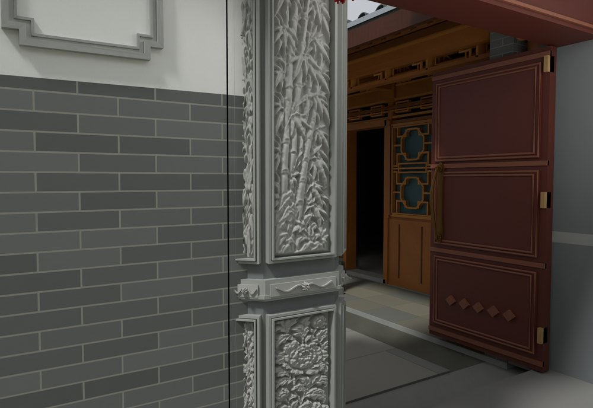
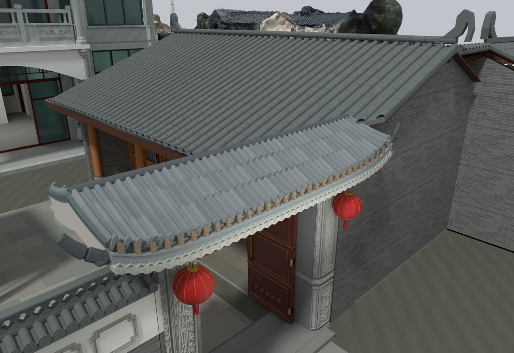

# V24 · 从灰度参考到可继续雕刻的门楼实体

[逐版目录](README.md) · [建筑重建台账](../../reconstruction.md) · [阶段方法汇总](../v24-v24-21.md)

## 摘要

以 V23 的 Blender 回读为源，将 15 块灰度图石画和翼角纹样做成实体网格，保留原材质。

## 1. 问题与输入

以 V23 的 Blender 原生读回为几何、材质和门运动基线。研究对象是柱、石画和翼角的浮雕表达。深度取自灰度控制与模型尺度。

## 2. 实现方法

1. 分取 15 块石画的图域，把灰度当作高度输入，按各自局部平面确定 UV 与浮起方向。正面网格带位移，封闭背面提供实体厚度。

2. 旧石材槽继续表达底色。把灰度源留在文件内，独立细分后可继续编辑；以原有雕花位置和相邻构件接触限制外包络。

3. 在保存后复查每块浮雕的顶点、可编辑细分和闭合状态。核对图像资源和既有门扇登记。

### 实现链与源码定位

以下按诊断、处理、保存与复核组织阅读。调用和文件引用来自原脚本，输入输出方向由对应读写调用判断；辅助文件是否在本轮运行，以报告为准。

**1. 定位与诊断** · [`v24_sculpt_probe.py`](../source-code/v24/history/v24_sculpt_probe.py#L9)

写入网格拓扑 [`me.from_pydata`](../source-code/v24/history/v24_sculpt_probe.py#L9)；批量写入属性 [`me.polygons.foreach_set`](../source-code/v24/history/v24_sculpt_probe.py#L12)。

文件引用：[`Native_Readback_Index_V23.json`](../source-code/v24/history/v24_sculpt_probe.py#L7)。

**2. 定位与诊断** · [`v24_roof_probe.py`](../source-code/v24/history/v24_roof_probe.py#L5)

打开保存的 Blender [`bpy.ops.wm.open_mainfile`](../source-code/v24/history/v24_roof_probe.py#L5)。

文件引用：[`Architecture_Complete_V24.blend`](../source-code/v24/history/v24_roof_probe.py#L5) · [`Roof_Audit.json`](../source-code/v24/history/v24_roof_probe.py#L13)。

**3. 定位与诊断** · [`v24_xieshan_probe.py`](../source-code/v24/history/v24_xieshan_probe.py#L6)

打开保存的 Blender [`bpy.ops.wm.open_mainfile`](../source-code/v24/history/v24_xieshan_probe.py#L6)。

文件引用：[`Architecture_Complete_V24_02.blend`](../source-code/v24/history/v24_xieshan_probe.py#L6)。

**4. 参数与几何处理** · [`v24_relief_blender.py`](../source-code/v24/project/Source/v24_relief_blender.py#L104)

叉积／面法线 [`np.cross`](../source-code/v24/project/Source/v24_relief_blender.py#L104)；写入网格拓扑 [`me.from_pydata`](../source-code/v24/project/Source/v24_relief_blender.py#L123)；批量写入属性 [`layer.data.foreach_set`](../source-code/v24/project/Source/v24_relief_blender.py#L130)。

文件引用：[`Gate_Carving_HeightAtlas_Layout.json`](../source-code/v24/project/Source/v24_relief_blender.py#L18) · [`V24_Gate_Relief_Geometry_QA.json`](../source-code/v24/project/Source/v24_relief_blender.py#L214)。

**5. 构建或写入** · [`v24_build_blender.py`](../source-code/v24/project/Source/v24_build_blender.py#L10)

打开保存的 Blender [`bpy.ops.wm.open_mainfile`](../source-code/v24/project/Source/v24_build_blender.py#L10)；另存 Blender [`bpy.ops.wm.save_as_mainfile`](../source-code/v24/project/Source/v24_build_blender.py#L47)。

文件引用：[`Actual_Rhino_V23_Readback_LOCAL.blend`](../source-code/v24/project/Source/v24_build_blender.py#L9) · [`Architecture_Complete_V24.blend`](../source-code/v24/project/Source/v24_build_blender.py#L9) · [`Baseline_V23_Snapshot.json`](../source-code/v24/project/Source/v24_build_blender.py#L11)。

**6. 保存后核验** · [`v24_qa_probe.py`](../source-code/v24/history/v24_qa_probe.py#L4)

文件引用：[`Baseline_Snapshot.json`](../source-code/v24/history/v24_qa_probe.py#L4)。

**7. 交付封装** · [`v24_package.py`](../source-code/v24/project/Source/v24_package.py#L8)

文件引用：[`Architecture_Complete_V24_02.blend`](../source-code/v24/project/Source/v24_package.py#L5) · [`V24_02_Build.json`](../source-code/v24/project/Source/v24_package.py#L8) · [`V24_02_Fresh_Blend_QA.json`](../source-code/v24/project/Source/v24_package.py#L8)。

[方法原理：照片、程序材质与高度图](../methodology.md#5-材质与浮雕分别保留什么证据) · [本版完整过程索引](process/v24.md)

本版索引汇合 248 幅已归档过程图、305 份交付及历史目录中的报告／说明／中间记录和全部 29 个源码附件。继承文件和本轮新增文件按来源保留，实际完成范围以第 4 节及原报告为准。

## 3. 过程图

**图 1** · 门楼灰度纹样转实体浮雕

**图 2** · V24 灰度与几何处理后的门楼屋顶雕刻

## 4. 验证与适用范围

报告记录 15 个雕刻场、442,433 个基础顶点与 1,772,360 个求值顶点。它们是网格规模指标，灰度深度属于图像推定。该轮交付为 Blender 原生模型。

- **Gate Relief Geometry QA** 
  状态 `PASS_BLENDER_CLOSED_MESH_RELIEF_QA`，浮雕图域数 15，基础顶点总数 442,433，求值顶点总数 1,772,360。

- **模型构建记录** 
  记录本轮参数、对象和处理结果。

## 5. 复现入口与出处

过程路径以本地 `JIA` 项目为根，`work/` 指重建项目的历史工作目录。复核时按交付记录打开本轮输入与保存成果，再依方法中的截面、对象或动作采样对照原报告。

交付与参考记录（1 项）

~~~text
Rebuild_V24/Reports/V24_Build.json
~~~

### 原实现脚本附件

[浏览本版全部 29 个文件](../source-code/v24/README.md) · [原件与公开副本校验值](../source-code/v24/manifest.json)

- [`v24_build_blender.py`](../source-code/v24/project/Source/v24_build_blender.py)
- [`v24_sculpt_probe.py`](../source-code/v24/history/v24_sculpt_probe.py)
- [`v24_qa_probe.py`](../source-code/v24/history/v24_qa_probe.py)
- [`v24_roof_probe.py`](../source-code/v24/history/v24_roof_probe.py)
- [`v24_xieshan_probe.py`](../source-code/v24/history/v24_xieshan_probe.py)

原脚本本地路径

~~~text
Rebuild_V24/Source/v24_build_blender.py
work/v24_sculpt_probe.py
work/v24_qa_probe.py
work/v24_roof_probe.py
work/v24_xieshan_probe.py
~~~

核验报告路径（2 项）

**Gate Relief Geometry QA**

~~~text
Rebuild_V24/Reports/V24_Gate_Relief_Geometry_QA.json
~~~

**模型构建记录**

~~~text
Rebuild_V24/Reports/V24_Build.json
~~~

图源与 SHA-256（2 张）

### 图 1 · 门楼灰度纹样转实体浮雕

~~~text
Rebuild_V24/Reports/V24_Gate_Carving_Closeup.png
~~~

**原过程图 SHA-256**

~~~text
2ece8a3eb3937657d0d2d0edfe967b1a2876d137175b9137fedbafed14ed4b3b
~~~

台账发布图，按原图缩放及压缩。

### 图 2 · V24 灰度与几何处理后的门楼屋顶雕刻

~~~text
Rebuild_V24/Reports/V24_Gate_Roof_Sculpt.png
~~~

**原过程图 SHA-256**

~~~text
34c8ca8416cef17ff3e691501f9b3b5691fec6c2fcff0be8402ebedc9c313f3d
~~~

保留原画面，发布用 JPEG。

---

上一篇 [V23 · 内大门柱角体积浮雕、分段瓦件与檐口回调](v23.md) 
下一篇 [V24.02 · 清除筒瓦重面并闭合菱花脊和曲线山墙](v24-02.md)
