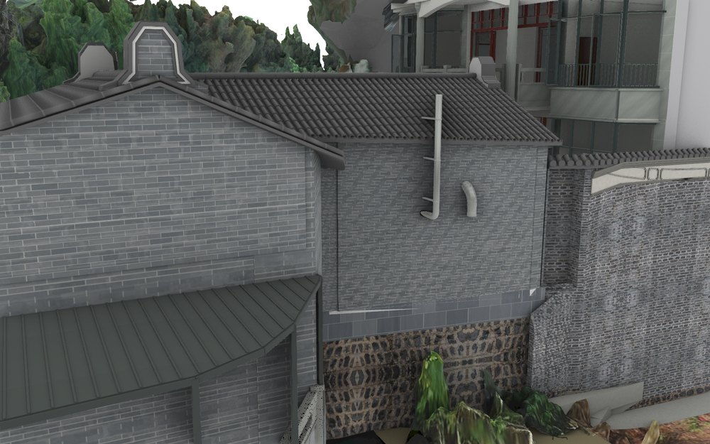
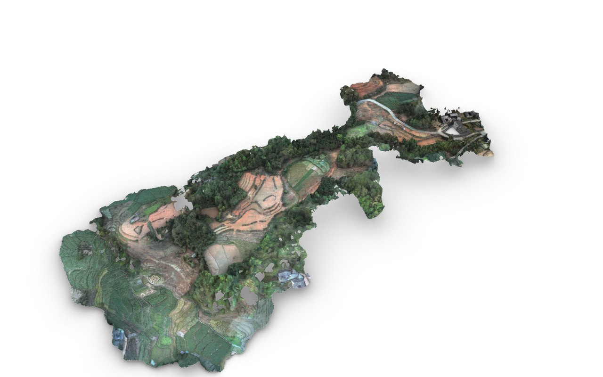

# V25 · 从 Blender 求值网格生成 Rhino 8 双坐标交付

[逐版目录](README.md) · [建筑重建台账](../../reconstruction.md) · [阶段方法汇总](../v24-22-v25.md) · [上一篇 V24.37](v24-37.md) · [下一篇 V26](v26.md)

## 摘要

以 V24.37 生成 Rhino 8 分层可编辑网格，提供 LOCAL 与 ENU 两套对齐文件、贴图和 Blender 安全漫游配套。

## 1. 问题与输入

以 V24.37 的保存版为转换基线，住宅、原场地和 MB7／PTJIA6 外景需要进入可逐层编辑的 Rhino 文件，漫游沿用 Blender 配套。

## 2. 实现方法

1. 逐对象取 Blender 求值网格，按原构件层级、材质和 UV 写 Rhino 图层与网格。对同一来源对象的多材质面拆成可独立选择的网格。
2. 保存 LOCAL 米制文件，再用原项目矩阵生成 ENU 文件，旋转角 19.65°。读取两份模型对照单位、材料、UV、相对位置和外部贴图。
3. 用 Rhino 8 原生文件核验及桌面视图查看图层、纹理和场地，并独立核对 Blender 漫游副本。

## 3. 过程图

*图 1 · Rhino 分层模型中的屋面与墙基。过程文件 `Rebuild_V25/Reports/V25_Rhino_View_3.png`。*

*图 2 · V25 在 Rhino 中重开的分层模型视图。过程文件 `Rebuild_V25/Reports/V25_Rhino_View_2.png`。*

## 4. 验证与适用范围

报告记录 2,661 个来源构件拆为 2,796 个网格、13,793,671 个三角面，Rhino 读回 29 项，配套验证 14 项。原坐标变换继续用于叠合。

| 过程报告 | 原报告读数 |
| --- | --- |
| `Rebuild_V25/Reports/V25_Delivery_QA.json` | 状态 `PASS_FINAL_V25_RHINO_DELIVERY`，原生读回检查数 29。 |
| `Rebuild_V25/Reports/V25_Rhino_Build_QA.json` | 输出网格部件 2,796，报告统计的三角面 13,793,671。 |
| `Rebuild_V25/Reports/V25_Rhino_Readback_QA.json` | 状态 `PASS_NATIVE_RHINO_READBACK`，检查条目 29，失败记录 0，检查总数 29。 |

### 原记录中的关键检查

| 检查项 | 结果与读数 | 原记录位置 |
| --- | --- | --- |
| LOCAL_part_count | 通过，`detail=2796` | `V25_Rhino_Readback_QA.json` 的 `checks[1]` |
| LOCAL_triangle_count | 通过，`detail=13793671` | `V25_Rhino_Readback_QA.json` 的 `checks[7]` |
| LOCAL_exact_mesh_uv_normal_hashes | 通过，`detail=2796` | `V25_Rhino_Readback_QA.json` 的 `checks[8]` |

## 5. 复现入口与出处

过程路径以本地 `JIA` 项目为根，`work/` 指重建项目的历史工作目录。复核时按交付记录打开本轮输入与保存成果，再依方法中的截面、对象或动作采样对照原报告。

- **交付与参考记录**。`Rebuild_V25/使用说明.txt`

- **原实现脚本**。`Rebuild_V25/Conversion_Source/v25_build_rhino.py` · `work/v25_material_probe.py` · `Rebuild_V25/Conversion_Source/v25_prepare_delivery.py` · `Rebuild_V25/Conversion_Source/v25_clean_coplanar_backfaces.py` · `work/v25_gui_probe.py`

过程图校验值

| 图 | 原过程图 SHA-256 | 发布方式 |
| --- | --- | --- |
| 1 | `1485db412d9eba0646323ccbfcf5aa19fe9523b5a1665b989cbd7d977cd9eba3` | 台账发布图，按原图缩放及压缩 |
| 2 | `f5c6acc9502f8c1a3297cffc3bca0c95a94e41a98288ea9e228c0bae4cc820b4` | 保留原画面，发布用 JPEG |

