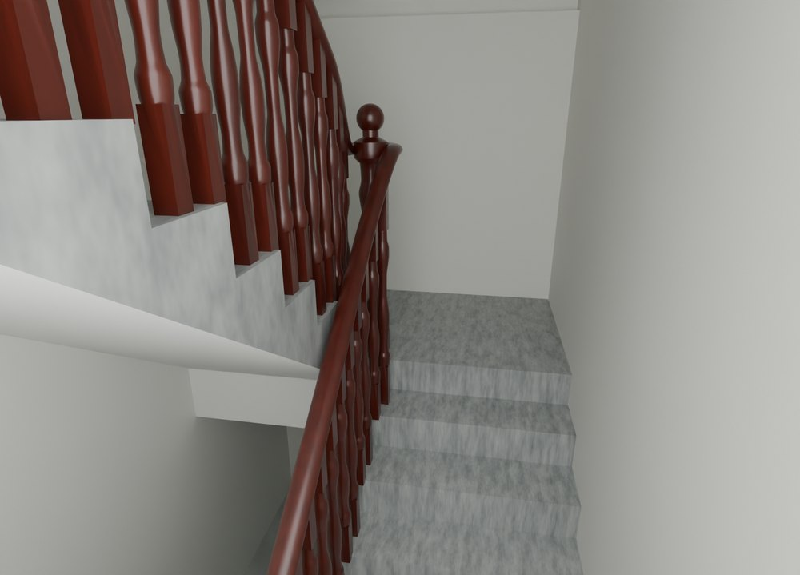
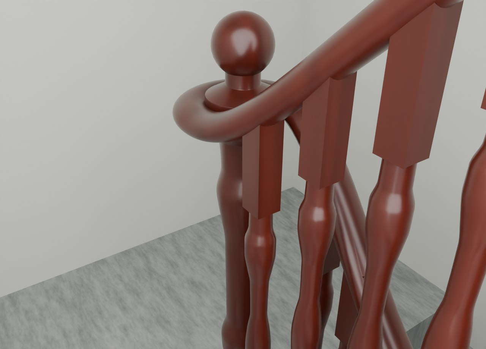

# V26.1 · 局部裁梁、保留踏步并接合车木扶手

[逐版目录](README.md) · [建筑重建台账](../../reconstruction.md) · [阶段方法汇总](../v26-v26-20.md) · [上一篇 V26](v26.md) · [下一篇 V26.2](v26-2.md)

## 摘要

修踏步、半层平台与扶手柱座、露台和玻璃门边，复核照壁、内门地面、外墙与原入口坡。

## 1. 问题与输入

V26 已补平台支承，楼梯踏面和部分墙角仍有梁体凸出、白条与露台表面重叠。扶手需在不改变步高的条件下处理。

## 2. 实现方法

1. 用踏步顶面与楼板截面定位梁的外露体，仅裁入踏步的部分。对露台墙面凸条和玻璃门边按各自完成面清理。
2. 将深红车木扶手改为连续回弯及接柱颈口，以原柱座和踏步为位置约束，原构件存入隐藏集合。
3. 回读保存文件的楼梯、扶手、照壁、门区和原入口坡。踏步抽样对照改前标高，再用原漫游路线复核。

## 3. 过程图

*图 1 · 楼梯踏步和平台修整。过程文件 `Rebuild_V26_1/Reports/V26_1_01_Stair_Flush_Treads.png`。*

*图 2 · V26.1 半层平台扶手的连续回弯。过程文件 `Rebuild_V26_1/Reports/V26_1_02_Half_Landing_Wreath.png`。*

## 4. 验证与适用范围

报告记录 80 处踏面样本、26 项保存几何检查与 97 项交付自动检查。扶手记录 110 根车木杆和 7 根主柱。

| 过程报告 | 原报告读数 |
| --- | --- |
| `Rebuild_V26_1/Reports/V26_1_Saved_Geometry_QA.json` | 状态 `PASS`，检查条目 26，失败记录 0，踏面样本 80。 |
| `Rebuild_V26_1/Reports/V26_1_Delivery_QA.json` | 状态 `PASS`，检查条目 97，自动检查数 97。 |

### 原记录中的关键检查

| 检查项 | 结果与读数 | 原记录位置 |
| --- | --- | --- |
| Saved closed positive-volume geometry: V26_1_Courtyard_West_Wall_Single_Surface | 通过，`positive_components=1`，`volume_m3=12.6538` | `V26_1_Saved_Geometry_QA.json` 的 `checks[3]` |
| All turned spindle feet engage the actual saved treads or slabs | 通过，`checked=110` | `V26_1_Saved_Geometry_QA.json` 的 `checks[6]` |
| Every newel foot has finite bearing on the actual house solid | 通过，`checked=7` | `V26_1_Saved_Geometry_QA.json` 的 `checks[7]` |

## 5. 复现入口与出处

过程路径以本地 `JIA` 项目为根，`work/` 指重建项目的历史工作目录。复核时按交付记录打开本轮输入与保存成果，再依方法中的截面、对象或动作采样对照原报告。

- **交付与参考记录**。`Rebuild_V26_1/README_先看这里.md`

- **原实现脚本**。`Rebuild_V26_1/Sources/Scripts/v26_1_planes.py` · `Rebuild_V26_1/Sources/Scripts/v26_1_probe.py` · `Rebuild_V26_1/Sources/Scripts/v26_1_geometry_qa.py` · `Rebuild_V26_1/Sources/Scripts/v26_1_build.py` · `Rebuild_V26_1/Sources/Scripts/v26_1_extra_probe.py`

过程图校验值

| 图 | 原过程图 SHA-256 | 发布方式 |
| --- | --- | --- |
| 1 | `887224207b4d0cef6d69c77698f4a487d9b781bd156ff55b6179d5e88a9e837a` | 台账发布图，按原图缩放及压缩 |
| 2 | `9f7767e9974757b751f5fc5c112ec13567d40eabc5fbf3fd120dfdd6310e33f3` | 保留原画面，发布用 JPEG |

