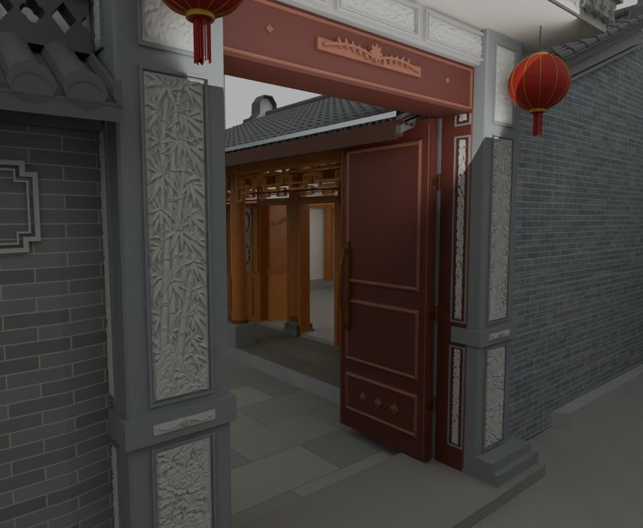
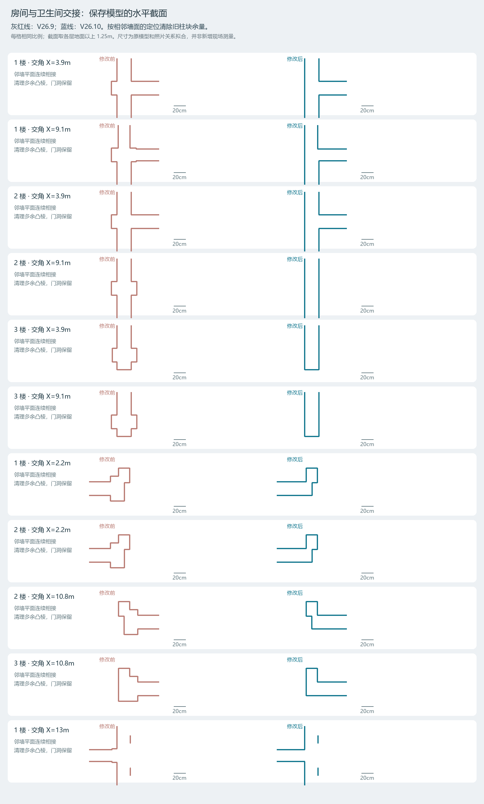

# V26.10 · 按等高截面清墙角凸棱并重组矩形门柱

[逐版目录](README.md) · [建筑重建台账](../../reconstruction.md) · [阶段方法汇总](../v26-v26-20.md)

## 摘要

收平 11 处墙角凸棱，校正三楼水平扶手，内门改矩形石柱并补浮雕、柱础及门前平台。

## 1. 问题与输入

V26.9 回收饰面后仍有旧柱端凸棱。用同一高度比较墙体几何，并以矩形深柱与原雕刻石画调整内大门。

## 2. 实现方法

1. 从各层完成面上方 1.25 m 切 V26.9 和 V26.10 的保存墙体。同一比例比对 11 处凸棱、卫生间隔墙和门洞，再按连续墙平面收角。

2. 门柱采用约 0.524 m 宽、0.576 m 深的模型核心。八块窄侧石画刚体转到新侧面，增加六块闭合花叶，3.60 m 宽平台与柱础接合。

3. 按柱头等高和握柄水平改三楼后栏杆。门柱腰线内端让出门扇运动，在原保存版逐姿态核对。

## 3. 过程图

**图 1** · 内门矩形石柱与雕刻

**图 2** · 两版同高截面中的墙角与门洞对照

## 4. 验证与适用范围

本轮复核记 140 项、63 项软件漫游检查和 80 个门扇姿态。V26.11 进一步修复该轮局部墙裁切影响梁端的遗留问题。

- **原生局部核验** 
  状态 `PASS`，检查条目 5，失败记录 0。

- **几何核验** 
  状态 `PASS`，检查条目 11，失败记录 0，踏面样本 80，墙厚样本 1,717。

### 原记录中的关键检查

- **WC front walls and F1 door head remain closed; photographed F3 west terrace span is open** 
  通过，`samples` = `73` 
  原记录 `V26_10_Geometry_QA.json` 的 `checks[6]`

- **Every audited ordinary wall span is at most 240 mm** 
  通过，`samples` = `1717`，`maximum_m` = `0.240001` 
  原记录 `V26_10_Geometry_QA.json` 的 `checks[2]`

- **All evaluated hinged leaves clear the corrected walls and frames** 
  通过，`poses` = `168` 
  原记录 `V26_10_Geometry_QA.json` 的 `checks[9]`

## 5. 复现入口与出处

过程路径以本地 `JIA` 项目为根，`work/` 指重建项目的历史工作目录。复核时按交付记录打开本轮输入与保存成果，再依方法中的截面、对象或动作采样对照原报告。

交付与参考记录（2 项）

~~~text
Rebuild_V26_10/使用说明.txt
Rebuild_V26_10/Reports/V26_10_实景与修正复核.html
~~~

原实现脚本（5 项）

~~~text
Rebuild_V26_10/Sources/v26_10_wall_probe.py
Rebuild_V26_10/Sources/v26_10_plot_sections.py
Rebuild_V26_10/Sources/v26_10_geometry_qa.py
Rebuild_V26_10/Sources/v26_10_build.py
Rebuild_V26_10/Sources/v26_10_prepare.py
~~~

核验报告路径（2 项）

**原生局部核验**

~~~text
Rebuild_V26_10/Reports/V26_10_Native_Specific_QA.json
~~~

**几何核验**

~~~text
Rebuild_V26_10/Reports/V26_10_Geometry_QA.json
~~~

图源与 SHA-256（2 张）

### 图 1 · 内门矩形石柱与雕刻

~~~text
Rebuild_V26_10/Reports/After_11_Gate_Rectangular_Piers.png
~~~

**原过程图 SHA-256**

~~~text
9ba66e27bd1bdd779ea0dd49b0d260652ce33cad1df45ee65f7846b9a4af9893
~~~

台账发布图，按原图缩放及压缩。

### 图 2 · 两版同高截面中的墙角与门洞对照

~~~text
Rebuild_V26_10/Reports/Wall_Sections_Before_After.png
~~~

**原过程图 SHA-256**

~~~text
cc05430d4da8a7eee9705a13d12bfe8a4514fffdb1b1fdee8bc5f8090f543881
~~~

原文件。

---

上一篇 [V26.9 · 分层窗台、后窗双轨与北山墙恢复](v26-9.md) 
下一篇 [V26.11 · 追溯梁端与白片成因并重建灰度石画](v26-11.md)
