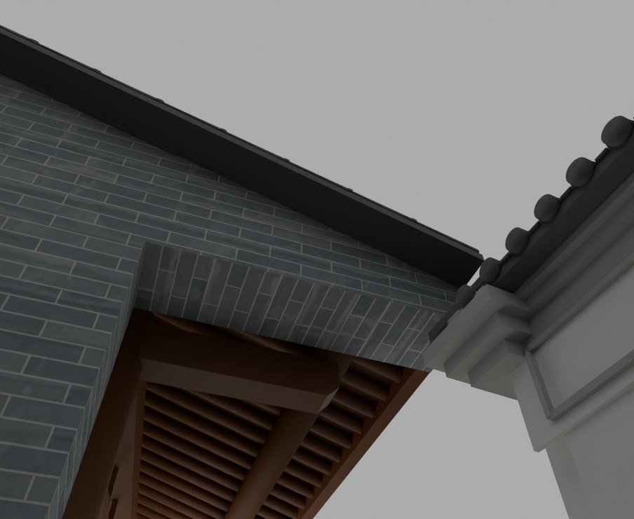
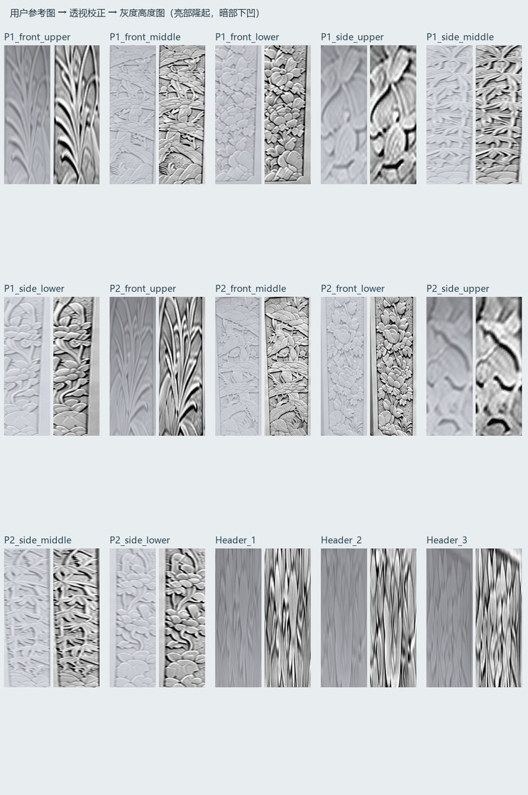
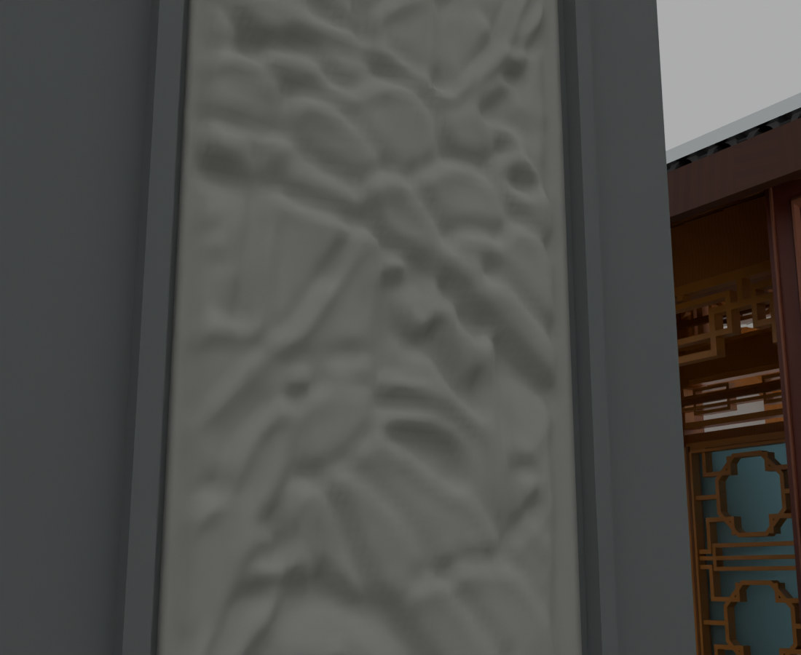

# V26.11 · 追溯梁端与白片成因并重建灰度石画

[逐版目录](README.md) · [建筑重建台账](../../reconstruction.md) · [阶段方法汇总](../v26-v26-20.md)

## 摘要

加储藏房斜顶梯形青砖，补墙梁及四边形平台，用参考灰度图重建内门实体浮雕。

## 1. 问题与输入

V26.10 的墙身裁切进入梁高，柱饰面边界又使楼板留下细缝。储藏房檐下和内门石画依据各自原参考处理。

## 2. 实现方法

1. 用中性预览和局部射线查真实缺口。按原梁底补梁端、以全厚实体封楼板，去地脚 50–200 μm 的误赋墙漆余片，接回地面 UV。按二层阳台边界补约 5.64 × 2.44 m 平台。

2. 储藏房梯形青砖取水平底和屋面斜上边。与山墙并体，砖缝延续邻墙，移除无支承的悬空白饰面。

3. 15 块参考石画逐片透视校正、去整体明暗坡度，生成 16 位高度图。以柱面和门楣局部域烘焙 21 块闭合网格，雕刻谷部入真实凹槽。

### 实现链与源码定位

以下按诊断、处理、保存与复核组织阅读。调用和文件引用来自原脚本，输入输出方向由对应读写调用判断；辅助文件是否在本轮运行，以报告为准。

**1. 定位与诊断** · [`v26_11_native_ray_probe.py`](../source-code/v26-11/project/Sources/v26_11_native_ray_probe.py#L5)

打开保存的 Blender [`bpy.ops.wm.open_mainfile`](../source-code/v26-11/project/Sources/v26_11_native_ray_probe.py#L5)；射线命中检查 [`sc.ray_cast`](../source-code/v26-11/project/Sources/v26_11_native_ray_probe.py#L9)；批量写入属性 [`attr.data.foreach_set`](../source-code/v26-11/project/Sources/v26_11_native_ray_probe.py#L16)。

文件引用：[`Architecture_Complete_V26_11.blend`](../source-code/v26-11/project/Sources/v26_11_native_ray_probe.py#L5) · [`Pixel_Ray_Attribution.json`](../source-code/v26-11/project/Sources/v26_11_native_ray_probe.py#L12) · [`Gray_Relief_Smooth_Test.png`](../source-code/v26-11/project/Sources/v26_11_native_ray_probe.py#L23)。

**2. 定位与诊断** · [`v26_11_probe.py`](../source-code/v26-11/project/Sources/v26_11_probe.py#L4)

叉积／面法线 [`np.cross`](../source-code/v26-11/project/Sources/v26_11_probe.py#L4)；定高剖切 [`m.slice`](../source-code/v26-11/project/Sources/v26_11_probe.py#L20)。

文件引用：[`Geometry_Index.json`](../source-code/v26-11/project/Sources/v26_11_probe.py#L4) · [`Source_Core.json`](../source-code/v26-11/project/Sources/v26_11_probe.py#L5) · [`Prepared_House.json`](../source-code/v26-11/project/Sources/v26_11_probe.py#L5)。

**3. 参数与几何处理** · [`v26_11_gate_relief_prepare.py`](../source-code/v26-11/project/Sources/v26_11_gate_relief_prepare.py#L32)

图像或几何变换 [`im.transform`](../source-code/v26-11/project/Sources/v26_11_gate_relief_prepare.py#L32)；最小二乘求解 [`np.linalg.lstsq`](../source-code/v26-11/project/Sources/v26_11_gate_relief_prepare.py#L34)。

文件引用：[`609fc65b-b63d-4278-bd18-72c45c32925f.png`](../source-code/v26-11/project/Sources/v26_11_gate_relief_prepare.py#L8) · [`Geometry_Index.json`](../source-code/v26-11/project/Sources/v26_11_gate_relief_prepare.py#L8) · [`_Rectified.png`](../source-code/v26-11/project/Sources/v26_11_gate_relief_prepare.py#L34)。

**4. 参数与几何处理** · [`v26_11_storage_prepare.py`](../source-code/v26-11/project/Sources/v26_11_storage_prepare.py#L8)

射线命中检查 [`roof.ray_cast`](../source-code/v26-11/project/Sources/v26_11_storage_prepare.py#L8)；叉积／面法线 [`np.cross`](../source-code/v26-11/project/Sources/v26_11_storage_prepare.py#L9)；图像或几何变换 [`transform`](../source-code/v26-11/project/Sources/v26_11_storage_prepare.py#L19)。

文件引用：[`Geometry_Index.json`](../source-code/v26-11/project/Sources/v26_11_storage_prepare.py#L3) · [`Prepared_Storage.json`](../source-code/v26-11/project/Sources/v26_11_storage_prepare.py#L26)。

**5. 构建或写入** · [`v26_11_build.py`](../source-code/v26-11/project/Sources/v26_11_build.py#L10)

打开保存的 Blender [`bpy.ops.wm.open_mainfile`](../source-code/v26-11/project/Sources/v26_11_build.py#L10)；写入网格拓扑 [`me.from_pydata`](../source-code/v26-11/project/Sources/v26_11_build.py#L18)；批量写入属性 [`me.polygons.foreach_set`](../source-code/v26-11/project/Sources/v26_11_build.py#L20)。

文件引用：[`Architecture_Complete_V26_10.blend`](../source-code/v26-11/project/Sources/v26_11_build.py#L5) · [`Architecture_Complete_V26_11.blend`](../source-code/v26-11/project/Sources/v26_11_build.py#L5) · [`Before_Snapshot.json`](../source-code/v26-11/project/Sources/v26_11_build.py#L11)。

**6. 保存后核验** · [`v26_11_specific_qa.py`](../source-code/v26-11/project/Sources/v26_11_specific_qa.py#L11)

判据与回归检查 [`checks.append`](../source-code/v26-11/project/Sources/v26_11_specific_qa.py#L5)；叉积／面法线 [`np.cross`](../source-code/v26-11/project/Sources/v26_11_specific_qa.py#L11)；射线命中检查 [`house.ray_cast`](../source-code/v26-11/project/Sources/v26_11_specific_qa.py#L29)。

文件引用：[`V26_11_Changes.json`](../source-code/v26-11/project/Sources/v26_11_specific_qa.py#L4) · [`Geometry_Index.json`](../source-code/v26-11/project/Sources/v26_11_specific_qa.py#L4) · [`Pixel_Ray_Attribution.json`](../source-code/v26-11/project/Sources/v26_11_specific_qa.py#L25)。

**7. 保存后核验** · [`v26_11_gate_clearance_qa.py`](../source-code/v26-11/project/Sources/v26_11_gate_clearance_qa.py#L5)

打开保存的 Blender [`bpy.ops.wm.open_mainfile`](../source-code/v26-11/project/Sources/v26_11_gate_clearance_qa.py#L5)；网格与实体转换 [`eo.to_mesh`](../source-code/v26-11/project/Sources/v26_11_gate_clearance_qa.py#L7)；空间加速结构 [`BVHTree.FromPolygons`](../source-code/v26-11/project/Sources/v26_11_gate_clearance_qa.py#L7)。

文件引用：[`Architecture_Complete_V26_11.blend`](../source-code/v26-11/project/Sources/v26_11_gate_clearance_qa.py#L5) · [`V26_11_Changes.json`](../source-code/v26-11/project/Sources/v26_11_gate_clearance_qa.py#L5) · [`V26_11_Gate_Clearance_QA.json`](../source-code/v26-11/project/Sources/v26_11_gate_clearance_qa.py#L34)。

[方法原理：照片、程序材质与高度图](../methodology.md#5-材质与浮雕分别保留什么证据) · [本版完整过程索引](process/v26-11.md)

本版索引汇合 42 幅已归档过程图、58 份交付及历史目录中的报告／说明／中间记录和全部 40 个源码附件。继承文件和本轮新增文件按来源保留，实际完成范围以第 4 节及原报告为准。

## 3. 过程图

**图 1** · 储藏房斜顶梯形青砖

**图 2** · 原过程图中的石画分区和灰度高度图

**图 3** · 保存后的门柱灰度浮雕网格近景

## 4. 验证与适用范围

保存报告记录 80 个门扇姿态和 63 项漫游物理检查。石画深度来自灰度推定，另一侧未拍到的窄面复用相应纹样。

- **原生局部核验** 
  状态 `PASS`，检查条目 7，失败记录 0。

- **局部几何核验** 
  状态 `PASS`，检查条目 13，失败记录 0。

- **Gate Clearance QA** 
  状态 `PASS`，检查条目 1，失败记录 0。

### 原记录中的关键检查

- **All21 photo-derived reliefs are real saved meshes with no displacement or subdivision modifiers** 
  通过，`visible_triangles` = `388446` 
  原记录 `V26_11_Native_Specific_QA.json` 的 `checks[1]`

- **All three F1/F2 open-passage beams are continuous at87 positions, including both former cut-out ends** 
  通过，`samples` = `87` 
  原记录 `V26_11_Specific_Geometry_QA.json` 的 `checks[4]`

- **First-floor porch is a filled four-sided rectangle matching the second-floor edge, bonded into the house** 
  通过，`missing_volume_m3` = `0` 
  原记录 `V26_11_Specific_Geometry_QA.json` 的 `checks[6]`

## 5. 复现入口与出处

过程路径以本地 `JIA` 项目为根，`work/` 指重建项目的历史工作目录。复核时按交付记录打开本轮输入与保存成果，再依方法中的截面、对象或动作采样对照原报告。

交付与参考记录（3 项）

~~~text
Rebuild_V26_11/使用说明.txt
Rebuild_V26_11/Reports/V26_11_实景与修正复核.html
Rebuild_V26_11/Reports/Heightmap_Layout_And_Provenance.json
~~~

### 原实现脚本附件

[浏览本版全部 40 个文件](../source-code/v26-11/README.md) · [原件与公开副本校验值](../source-code/v26-11/manifest.json)

- [`v26_11_gate_relief_prepare.py`](../source-code/v26-11/project/Sources/v26_11_gate_relief_prepare.py)
- [`v26_11_storage_prepare.py`](../source-code/v26-11/project/Sources/v26_11_storage_prepare.py)
- [`v26_11_native_ray_probe.py`](../source-code/v26-11/project/Sources/v26_11_native_ray_probe.py)
- [`v26_11_build.py`](../source-code/v26-11/project/Sources/v26_11_build.py)
- [`v26_11_probe.py`](../source-code/v26-11/project/Sources/v26_11_probe.py)

原脚本本地路径

~~~text
Rebuild_V26_11/Sources/v26_11_gate_relief_prepare.py
Rebuild_V26_11/Sources/v26_11_storage_prepare.py
Rebuild_V26_11/Sources/v26_11_native_ray_probe.py
Rebuild_V26_11/Sources/v26_11_build.py
Rebuild_V26_11/Sources/v26_11_probe.py
~~~

核验报告路径（3 项）

**原生局部核验**

~~~text
Rebuild_V26_11/Reports/V26_11_Native_Specific_QA.json
~~~

**局部几何核验**

~~~text
Rebuild_V26_11/Reports/V26_11_Specific_Geometry_QA.json
~~~

**Gate Clearance QA**

~~~text
Rebuild_V26_11/Reports/V26_11_Gate_Clearance_QA.json
~~~

图源与 SHA-256（3 张）

### 图 1 · 储藏房斜顶梯形青砖

~~~text
Rebuild_V26_11/Reports/After_06_Storage_Trapezoid.png
~~~

**原过程图 SHA-256**

~~~text
612f72e4fc168ef33f06eff1ac586e0b41476d039e87c765a9af14f1bea979df
~~~

台账发布图，按原图缩放及压缩。

### 图 2 · 原过程图中的石画分区和灰度高度图

~~~text
Rebuild_V26_11/Reports/Reference_To_Gray_Overview.png
~~~

**原过程图 SHA-256**

~~~text
f6df6834ddbfdedbaf067e9f1340c3c8a8bf9576c30498a1c2a84264d219a88a
~~~

已有过程图的发布副本。

### 图 3 · 保存后的门柱灰度浮雕网格近景

~~~text
Rebuild_V26_11/Reports/After_08_Gate_Gray_Relief_Close.png
~~~

**原过程图 SHA-256**

~~~text
84228d283ed4a12801a4d12a02ef64d4b25148704b270986e1f199bf28d1ed9e
~~~

已有过程图的发布副本。

---

上一篇 [V26.10 · 按等高截面清墙角凸棱并重组矩形门柱](v26-10.md) 
下一篇 [V26.12 · 恢复 V24 原石画并用固定机位排查白板显示](v26-12.md)
