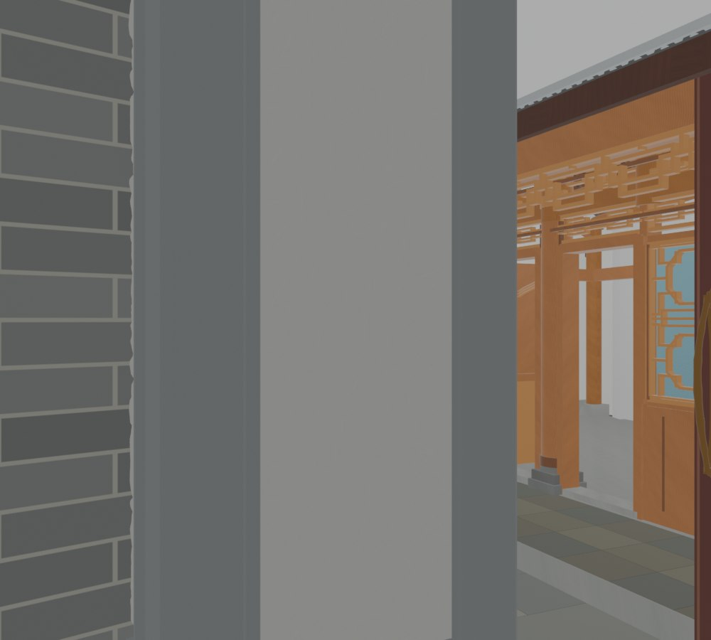
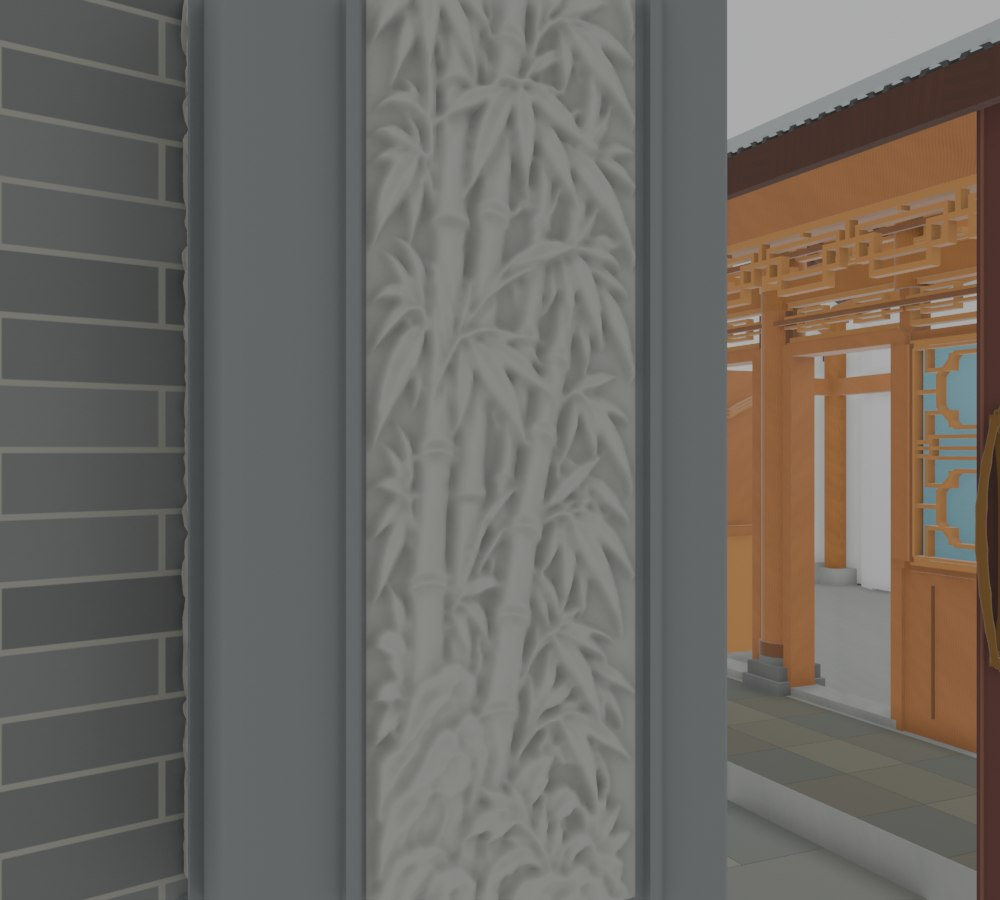
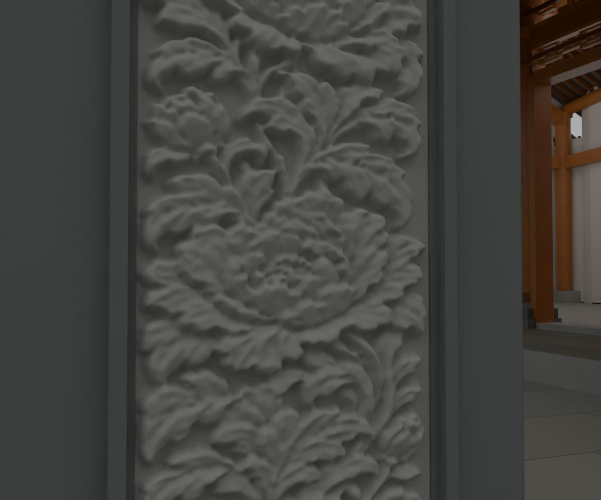

# V26.12 · 恢复 V24 原石画并用固定机位排查白板显示

[逐版目录](README.md) · [建筑重建台账](../../reconstruction.md) · [阶段方法汇总](../v26-v26-20.md)

## 摘要

读取 V24 原雕刻网格和 UV，恢复竹叶花卉纹样，修正浮雕嵌槽及 Fast 视口显示。

## 1. 问题与输入

V26.11 的灰度石画与用户指定纹样有差异。保存网格读回显示实体起伏存在，Fast 视口一度显示成白板。

## 2. 实现方法

1. 从 V24 直接取 15 幅原石画的基础拓扑与 UV，按当前槽位恢复竹叶、花卉及门楣纹样，另六幅上段沿用 V24 高度图纹样。

2. 嵌槽后谷部约低于柱基面 2 mm、隆起最高约 18 mm。背面延长至 16 mm 嵌入原约 14 mm 槽。核对保存几何和门扇净空。

3. 在同网格、同相机和阴天光下比较局部遮蔽关闭和开启。20 cm 局部 AO 用半分辨率、两条光线、八步，写回模型和启动配置。

复核变量是 Eevee 局部遮蔽开关。两张视口截图沿用相同几何、相机和光照。先核对网格凹凸仍在，再通过对照定位白板显示的原因。

## 3. 过程图

 

**图 1** · 局部遮蔽关闭时的原 Fast 视口 
**图 2** · 启用 20 cm 局部遮蔽后的原 Fast 视口

**图 3** · V26.12 恢复的原 V24 花叶石画

## 4. 验证与适用范围

原生、Fast 显示与视觉报告分别核查。两张过程图只改变局部遮蔽设置；几何起伏承自 V24 的灰度雕刻。

- **原生模型核验** 
  状态 `PASS`，检查条目 14，失败记录 0。

- **Fast 显示核验** 
  状态 `PASS`，检查条目 12，失败记录 0。

- **视觉核验** 
  状态 `PASS`，检查条目 6，失败记录 0。

### 原记录中的关键检查

- **Every original V24 relief height difference is preserved after seating** 
  通过，`maximum_error_m` = `7.9886e-07` 
  原记录 `V26_12_Native_QA.json` 的 `checks[6]`

- **21 restored inserts are visible, closed baked meshes with no live subdivision** 
  通过，`active_triangles` = `951058` 
  原记录 `V26_12_Native_QA.json` 的 `checks[5]`

- **All15 active original inserts retain actual V24 reference topology and UV after header registration** 
  通过，`maximum_registration_error_m` = `9.53674e-08` 
  原记录 `V26_12_Native_QA.json` 的 `checks[8]`

## 5. 复现入口与出处

过程路径以本地 `JIA` 项目为根，`work/` 指重建项目的历史工作目录。复核时按交付记录打开本轮输入与保存成果，再依方法中的截面、对象或动作采样对照原报告。

交付与参考记录（2 项）

~~~text
Rebuild_V26_12/使用说明.txt
Rebuild_V26_12/Reports/V26_12_内大门浮雕复核.html
~~~

### 原实现脚本附件

[浏览本版全部 31 个文件](../source-code/v26-12/README.md) · [原件与公开副本校验值](../source-code/v26-12/manifest.json)

- [`v26_12_build.py`](../source-code/v26-12/project/Sources/v26_12_build.py)
- [`v26_12_eevee_compare.py`](../source-code/v26-12/project/Sources/v26_12_eevee_compare.py)
- [`v26_12_native_qa.py`](../source-code/v26-12/project/Sources/v26_12_native_qa.py)
- [`v26_12_probe.py`](../source-code/v26-12/project/Sources/v26_12_probe.py)
- [`v26_12_build_fast.py`](../source-code/v26-12/project/Sources/v26_12_build_fast.py)

原脚本本地路径

~~~text
Rebuild_V26_12/Sources/v26_12_build.py
Rebuild_V26_12/Sources/v26_12_eevee_compare.py
Rebuild_V26_12/Sources/v26_12_native_qa.py
Rebuild_V26_12/Sources/v26_12_probe.py
Rebuild_V26_12/Sources/v26_12_build_fast.py
~~~

核验报告路径（3 项）

**原生模型核验**

~~~text
Rebuild_V26_12/Reports/V26_12_Native_QA.json
~~~

**Fast 显示核验**

~~~text
Rebuild_V26_12/Reports/V26_12_Fast_Display_QA.json
~~~

**视觉核验**

~~~text
Rebuild_V26_12/Reports/V26_12_Visual_QA.json
~~~

图源与 SHA-256（3 张）

### 图 1 · 局部遮蔽关闭时的原 Fast 视口

~~~text
Rebuild_V26_12/Reports/Diagnosis/EEVEE_01_AO_Off.png
~~~

**原过程图 SHA-256**

~~~text
6fee677c7bcdacd4f6b00419d023893561d171d3c1701de5fe0fe62a088660d3
~~~

保留原画面，发布用 JPEG。

### 图 2 · 启用 20 cm 局部遮蔽后的原 Fast 视口

~~~text
Rebuild_V26_12/Reports/Diagnosis/EEVEE_02_Local_AO.png
~~~

**原过程图 SHA-256**

~~~text
c8ed3a0d45b1be0e29ef053483dbcd5bca7566d73c070a78d838855b00f79c68
~~~

保留原画面，发布用 JPEG。

### 图 3 · V26.12 恢复的原 V24 花叶石画

~~~text
Rebuild_V26_12/Reports/V26_12_03_Stone_Flowers.png
~~~

**原过程图 SHA-256**

~~~text
5fdd02a2c5e84b723c593cbee800b6c40f38a029b4a19b261a5a77a618c36df2
~~~

保留原画面，发布用 JPEG。

---

上一篇 [V26.11 · 追溯梁端与白片成因并重建灰度石画](v26-11.md) 
下一篇 [V26.13 · 按实景调门柱折面、腰线、薄柱脚和台阶](v26-13.md)
