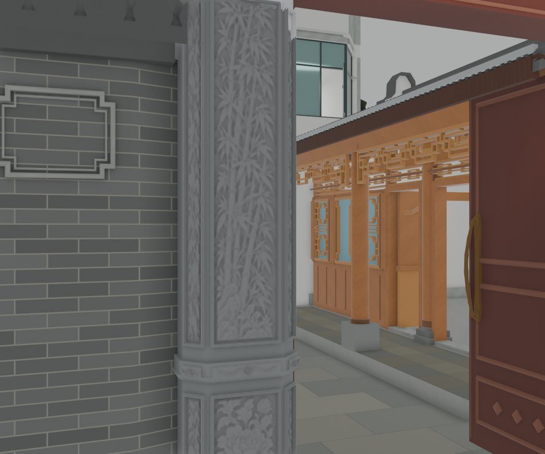
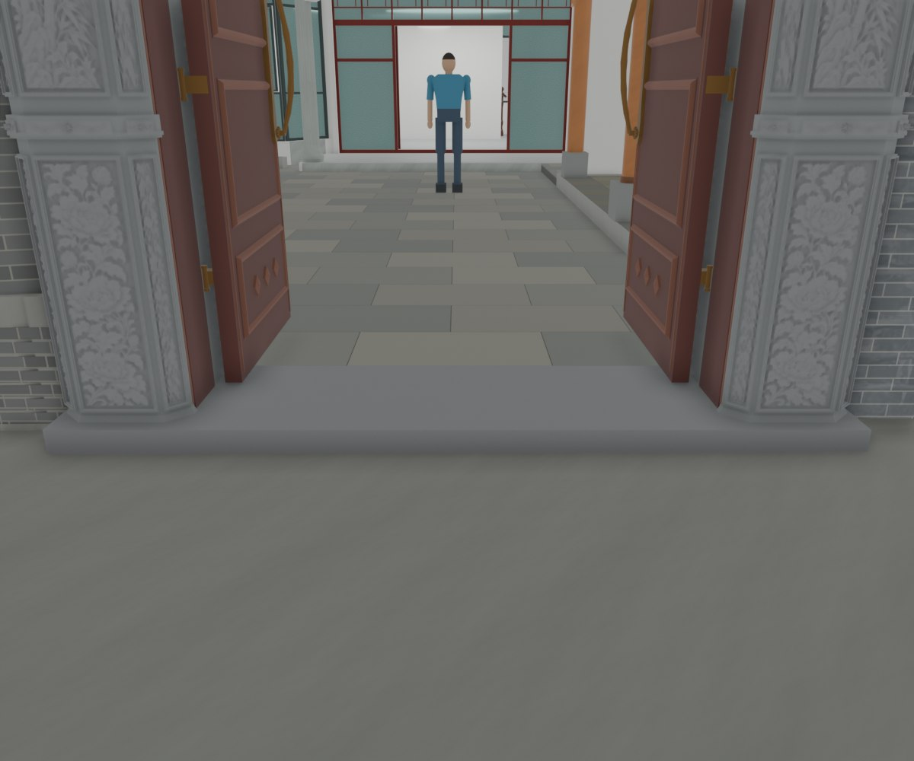

# V26.13 · 按实景调门柱折面、腰线、薄柱脚和台阶

[逐版目录](README.md) · [建筑重建台账](../../reconstruction.md) · [阶段方法汇总](../v26-v26-20.md) · [上一篇 V26.12](v26-12.md) · [下一篇 V26.14](v26-14.md)

## 摘要

按实景调内门柱角、腰线、下段浮雕分格与较薄柱脚，收短门前平台外伸。

## 1. 问题与输入

在 V26.12 已恢复纹样基础上，用两张实景对照识别门柱转面、下段石画、腰线高度和外挑柱脚。

## 2. 实现方法

1. 前角由 12 mm 小倒角改为 90 mm 斜转面，按原柱和门洞定位正面、斜面石画。六幅下段石画向下延长 150 mm，腰线由 130 mm 收至 82 mm。
2. 把两层外凸柱脚替换为 35 mm 高、最大外扩约 20 mm 的薄斜收口。100 mm 高单阶平台前沿从柱前 280 mm 收至 90 mm。
3. 用同部位近景、保存模型及实际材质视口核对纹样、石色和几何层次。复查原门轴、门洞及 Fast 显示。

## 3. 过程图

*图 1 · 内门柱角与浮雕分格。过程文件 `Rebuild_V26_13/Reports/V26_13_02_Left_Three_Faces.png`。*

*图 2 · V26.13 薄柱脚与门前单阶。过程文件 `Rebuild_V26_13/Reports/V26_13_04_Low_Plinth_And_Sill.png`。*

## 4. 验证与适用范围

原生报告 17 项、Fast 显示 12 项。台基与柱角尺寸来自照片和模型拟合，雕刻纹样承自 V24。

| 过程报告 | 原报告读数 |
| --- | --- |
| `Rebuild_V26_13/Reports/V26_13_Native_QA.json` | 状态 `PASS`，检查条目 17，失败记录 0。 |
| `Rebuild_V26_13/Reports/V26_13_Fast_Display_QA.json` | 状态 `PASS`，检查条目 12，失败记录 0。 |

### 原记录中的关键检查

| 检查项 | 结果与读数 | 原记录位置 |
| --- | --- | --- |
| Original door_poses preserved | 通过 | `V26_13_Native_QA.json` 的 `checks[4]` |
| Six lower pictures extend150mm closer to the doorway floor | 通过 | `V26_13_Native_QA.json` 的 `checks[9]` |
| Changed native structural meshes and carved inserts are finite closed positive solids | 通过 | `V26_13_Native_QA.json` 的 `checks[12]` |

## 5. 复现入口与出处

过程路径以本地 `JIA` 项目为根，`work/` 指重建项目的历史工作目录。复核时按交付记录打开本轮输入与保存成果，再依方法中的截面、对象或动作采样对照原报告。

- **交付与参考记录**。`Rebuild_V26_13/使用说明.txt` · `Rebuild_V26_13/Reports/V26_13_实景门柱与台基复核.html`

- **原实现脚本**。`Rebuild_V26_13/Sources/v26_13_probe.py` · `Rebuild_V26_13/Sources/v26_13_prepare.py` · `Rebuild_V26_13/Sources/v26_13_build.py` · `Rebuild_V26_13/Sources/v26_13_build_fast.py` · `Rebuild_V26_13/Sources/v26_13_qa.py`

过程图校验值

| 图 | 原过程图 SHA-256 | 发布方式 |
| --- | --- | --- |
| 1 | `0943eed7248163eb47a701081daf0d1d625c5a4edf474821d33b63f24ec53b1b` | 台账发布图，按原图缩放及压缩 |
| 2 | `5a295d32d9f96d81f8593f81dc26525c1cc5e9c4ccf783d00b37cb81bf509594` | 保留原画面，发布用 JPEG |

