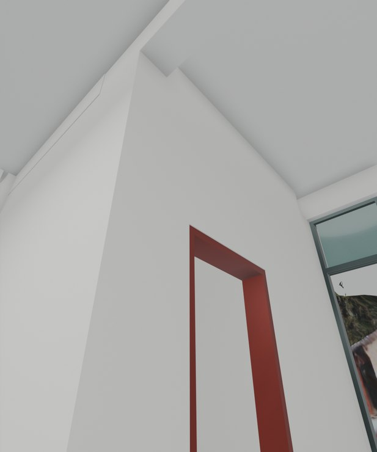
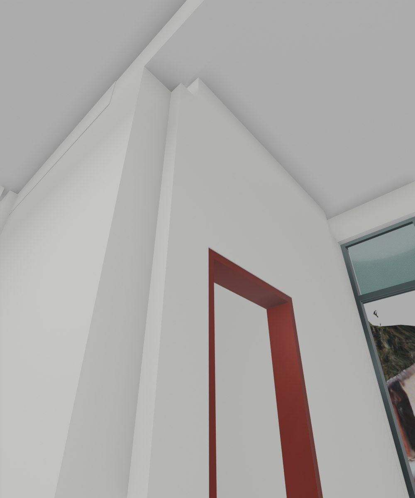

# V26.14 · 用墙角截面闭合卫浴门边及梁后缺口

[逐版目录](README.md) · [建筑重建台账](../../reconstruction.md) · [阶段方法汇总](../v26-v26-20.md) · [上一篇 V26.13](v26-13.md) · [下一篇 V26.15](v26-15.md)

## 摘要

接齐各层卫生间门边 L 形墙角，补梁后墙头至顶板并复核原门洞。

## 1. 问题与输入

保存网格显示，前墙端和侧墙完成面错开约 90 mm，形成通高凸棱；梁后墙头另有约 120 mm 长缺口。

## 2. 实现方法

1. 取一、二楼左侧及二、三楼右侧四个 L 角截面，以邻墙完成面为目标接齐。用原约 180 mm 侧墙厚补梁后墙头到顶板。
2. 将新封合域并入原实体，复核门洞宽度、开合时的净空和截面面积。以同角度渲染对照，并在 Fast 中人眼检查。
3. 对五扇卫浴门逐帧读保存姿态，复核房间通道和楼梯行走。

## 3. 过程图

*图 1 · 卫生间门边墙角收口。过程文件 `Rebuild_V26_14/Reports/V26_14_01_F2_Left_User_Corner.png`。*

*图 2 · V26.14 同机位复核使用的 V26.13 二楼左卫墙角。过程文件 `Rebuild_V26_14/Reports/V26_13_01_F2_Left_User_Corner.png`。*

## 4. 验证与适用范围

原报告记录 200 个卫浴门姿态通过，完整和流畅模型按几何一致性核对。墙角尺寸来自模型截面。

| 过程报告 | 原报告读数 |
| --- | --- |
| `Rebuild_V26_14/Reports/V26_14_Native_QA.json` | 状态 `PASS`，检查条目 13，失败记录 0。 |
| `Rebuild_V26_14/Reports/V26_14_Geometry_QA.json` | 状态 `PASS`，检查条目 3，失败记录 0。 |
| `Rebuild_V26_14/Reports/V26_14_Fast_Display_QA.json` | 状态 `PASS`，检查条目 12，失败记录 0。 |

### 原记录中的关键检查

| 检查项 | 结果与读数 | 原记录位置 |
| --- | --- | --- |
| Actual saved geometry differs only within four wall returns and four partition-head seats | 通过，`outside_change_m3=0`，`added_m3=0.213131`，`removed_m3=-3.32436e-20` | `V26_14_Geometry_QA.json` 的 `checks[0]` |
| Four WC returns are flush from front wall to doorway at112 actual native stations | 通过 | `V26_14_Native_QA.json` 的 `checks[7]` |
| All five existing WC door apertures remain open through the wall depth | 通过 | `V26_14_Native_QA.json` 的 `checks[9]` |

## 5. 复现入口与出处

过程路径以本地 `JIA` 项目为根，`work/` 指重建项目的历史工作目录。复核时按交付记录打开本轮输入与保存成果，再依方法中的截面、对象或动作采样对照原报告。

- **交付与参考记录**。`Rebuild_V26_14/使用说明.txt` · `Rebuild_V26_14/Reports/V26_14_卫浴墙角复核.html`

- **原实现脚本**。`Rebuild_V26_14/Sources/v26_14_sections.py` · `Rebuild_V26_14/Sources/v26_14_prepare.py` · `Rebuild_V26_14/Sources/v26_14_door_clearance_qa.py` · `Rebuild_V26_14/Sources/v26_14_build.py` · `Rebuild_V26_14/Sources/v26_14_probe.py`

过程图校验值

| 图 | 原过程图 SHA-256 | 发布方式 |
| --- | --- | --- |
| 1 | `0904669f3e598105d591f38eddf736a64a0c91a76c35e29c3305ce3771843e05` | 台账发布图，按原图缩放及压缩 |
| 2 | `0e783607988748b6f62280adb8cc599cdfcbc7237047ff0c23edfcd39e3f35c1` | 保留原画面，发布用 JPEG |

