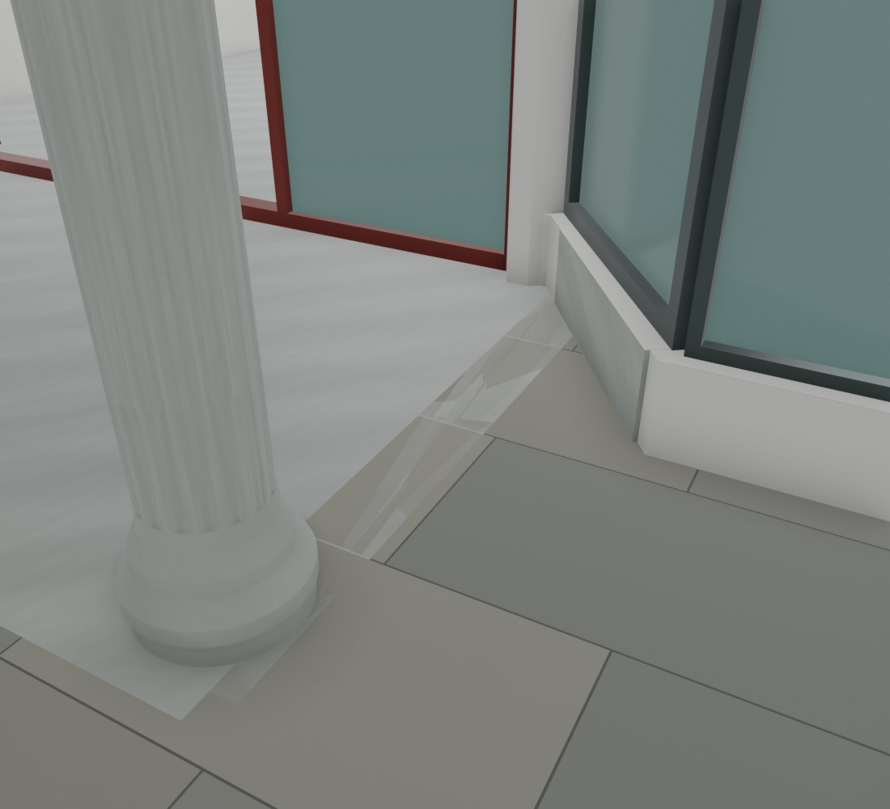
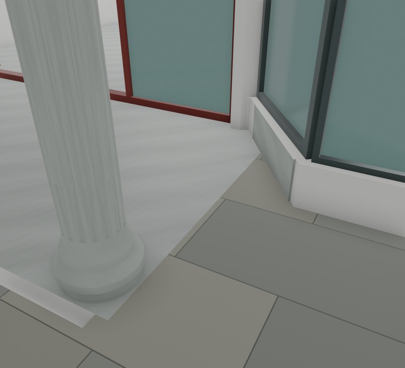

# V26.15 · 去除门廊平台共面争面和墙外凸块

[逐版目录](README.md) · [建筑重建台账](../../reconstruction.md) · [阶段方法汇总](../v26-v26-20.md)

## 摘要

清门廊与地坪重面，修楼梯墙角、储藏房悬空木片和内门后地面。

## 1. 问题与输入

V26.14 后门廊石面闪烁，楼梯角有实体越墙，储藏房与内门后局部有悬空木片和地面空区。

## 2. 实现方法

1. 把旧地面重叠部分并入四边平台实体并从原地面去重，约 80 mm 多余前唇收回新边界，使用原石材与连续 UV。

2. 从两处楼梯补缝体裁去进入梯间的约 190 × 190 × 130 mm 凸块。去掉独立悬空细木片，门后补地延伸到真实墙根并与邻地齐平。

3. 在同相机和阴天光下复核四处改动；读回闭合面、门姿态和 Fast 路径。

## 3. 过程图

 

**图 1** · V26.15 同机位对照中修前门廊的争面现象 
**图 2** · 门廊与地坪重面修复

## 4. 验证与适用范围

原图文报告记 122 项检查、160 个门姿态。重面处理针对实体重叠，平台边沿与下方几何分别核查。

- **原生模型核验** 
  状态 `PASS`，检查条目 17，失败记录 0。

- **几何核验** 
  状态 `PASS`，检查条目 9，失败记录 0。

### 原记录中的关键检查

- **Former gate wall trench filled at the existing adjacent ground level** 
  通过，`native_top_min_m` = `-0.400024`，`native_top_max_m` = `-0.400024` 
  原记录 `V26_15_Geometry_QA.json` 的 `checks[7]`

- **Saved native indexed mesh finite closed and nondegenerate V26_3_House_Connected_Walls_And_Stairs** 
  通过，`minimum_triangle_area_m2` = `8.88178e-16`，`nonmanifold_edges` = `0` 
  原记录 `V26_15_Native_QA.json` 的 `checks[9]`

- **Saved native indexed mesh finite closed and nondegenerate V26_2_Continuous_Ground_And_Perimeter_Shell** 
  通过，`minimum_triangle_area_m2` = `8.88178e-16`，`nonmanifold_edges` = `0` 
  原记录 `V26_15_Native_QA.json` 的 `checks[10]`

## 5. 复现入口与出处

过程路径以本地 `JIA` 项目为根，`work/` 指重建项目的历史工作目录。复核时按交付记录打开本轮输入与保存成果，再依方法中的截面、对象或动作采样对照原报告。

交付与参考记录（2 项）

~~~text
Rebuild_V26_15/使用说明.txt
Rebuild_V26_15/Reports/V26_15_重面墙角与地面复核.html
~~~

### 原实现脚本附件

[浏览本版全部 34 个文件](../source-code/v26-15/README.md) · [原件与公开副本校验值](../source-code/v26-15/manifest.json)

- [`v26_15_probe.py`](../source-code/v26-15/project/Sources/Scripts/v26_15_probe.py)
- [`v26_15_prepare.py`](../source-code/v26-15/project/Sources/Scripts/v26_15_prepare.py)
- [`v26_15_geometry_qa.py`](../source-code/v26-15/project/Sources/Scripts/v26_15_geometry_qa.py)
- [`v26_15_build.py`](../source-code/v26-15/project/Sources/Scripts/v26_15_build.py)
- [`v26_15_build_fast.py`](../source-code/v26-15/project/Sources/Scripts/v26_15_build_fast.py)

原脚本本地路径

~~~text
Rebuild_V26_15/Sources/Scripts/v26_15_probe.py
Rebuild_V26_15/Sources/Scripts/v26_15_prepare.py
Rebuild_V26_15/Sources/Scripts/v26_15_geometry_qa.py
Rebuild_V26_15/Sources/Scripts/v26_15_build.py
Rebuild_V26_15/Sources/Scripts/v26_15_build_fast.py
~~~

核验报告路径（2 项）

**原生模型核验**

~~~text
Rebuild_V26_15/Reports/V26_15_Native_QA.json
~~~

**几何核验**

~~~text
Rebuild_V26_15/Reports/V26_15_Geometry_QA.json
~~~

图源与 SHA-256（2 张）

### 图 1 · V26.15 同机位对照中修前门廊的争面现象

~~~text
Rebuild_V26_15/Reports/Views/V26_14_01_Porch_Right_Z_Fighting.png
~~~

**原过程图 SHA-256**

~~~text
ffdb2b5d660d7ccb00ad004d922e03ce27af0fe2da6cc872d0a09efa63c50ab7
~~~

保留原画面，发布用 JPEG。

### 图 2 · 门廊与地坪重面修复

~~~text
Rebuild_V26_15/Reports/Views/V26_15_01_Porch_Right_Z_Fighting.png
~~~

**原过程图 SHA-256**

~~~text
2b4442d51029e17bfe61b08b44a930949628cfcc3de66d707331eda5af1e8be2
~~~

台账发布图，按原图缩放及压缩。

---

上一篇 [V26.14 · 用墙角截面闭合卫浴门边及梁后缺口](v26-14.md) 
下一篇 [V26.16 · 沿原窗框平面闭合五组窗边和三楼飘窗顶](v26-16.md)
