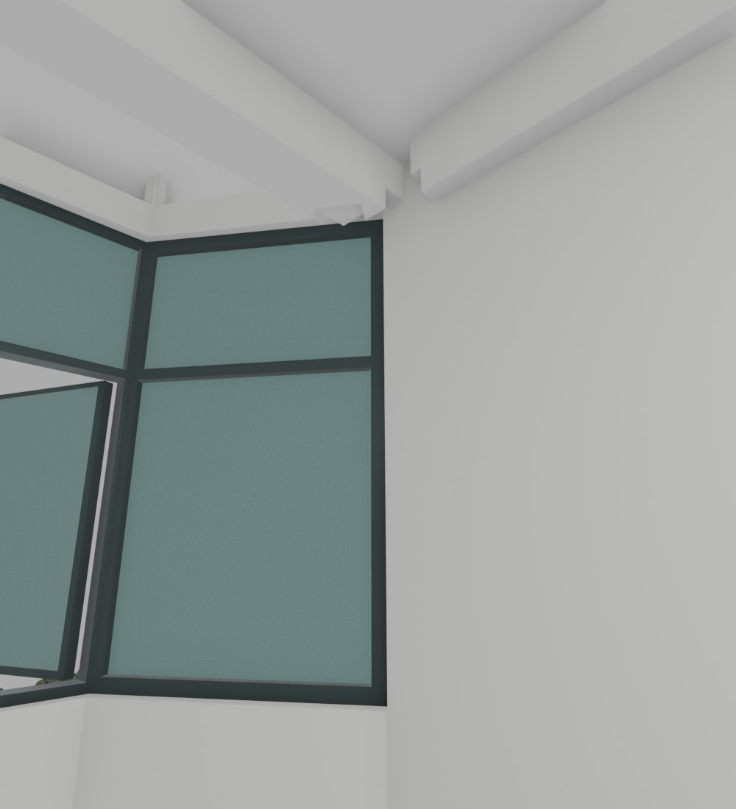
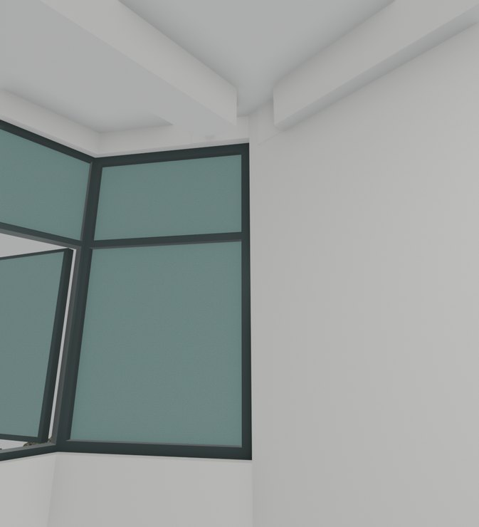

# V26.16 · 沿原窗框平面闭合五组窗边和三楼飘窗顶

[逐版目录](README.md) · [建筑重建台账](../../reconstruction.md) · [阶段方法汇总](../v26-v26-20.md)

## 摘要

修五组前房间窗边、梁端和饰面，补三楼右飘窗的连续封顶。

## 1. 问题与输入

V26.15 后五组前房间窗边仍有梁端割裂、窗台白色凸片和不连续顶面。三楼右飘窗需要接回室内完成顶。

## 2. 实现方法

1. 逐组按窗框端面调整窄墙、梁头和窗台。将窗台凸块裁回，区分窗顶部与侧面材质；窗框、玻璃及原开启扇保留。

2. 一楼两处阳台边板底部局部约低 2 mm，内侧接回原完成顶，保持外部轮廓。三楼右飘窗按原房间顶面闭合并清裁切尖片。

3. 同机位看内侧节点，在保存几何中查封顶、无效三角面和窗扇组件姿态。

## 3. 过程图

 

**图 1** · V26.16 前后对照所用的 V26.15 三楼右窗边 
**图 2** · 三楼右飘窗与梁端

## 4. 验证与适用范围

原报告记录 121 项检查与 800 个窗扇组件姿态样本。2 mm 是保存模型两面高程差，窗边以原洞口为约束。

- **原生模型核验** 
  状态 `PASS`，检查条目 16，失败记录 0。

- **几何核验** 
  状态 `PASS`，检查条目 9，失败记录 0。

### 原记录中的关键检查

- **Saved corrected mesh has finite UVs and closed nondegenerate indexed topology: V26_3_House_Connected_Walls_And_Stairs** 
  通过，`minimum_area_m2` = `8.88178e-16`，`nonmanifold_edges` = `0` 
  原记录 `V26_16_Native_QA.json` 的 `checks[7]`

- **Saved house stays one positive connected closed solid** 
  通过，`components` = `1`，`volume_m3` = `227.272` 
  原记录 `V26_16_Geometry_QA.json` 的 `checks[1]`

- **Five inner window wall returns are continuous at45 saved native stations** 
  通过 
  原记录 `V26_16_Native_QA.json` 的 `checks[10]`

## 5. 复现入口与出处

过程路径以本地 `JIA` 项目为根，`work/` 指重建项目的历史工作目录。复核时按交付记录打开本轮输入与保存成果，再依方法中的截面、对象或动作采样对照原报告。

交付与参考记录（2 项）

~~~text
Rebuild_V26_16/使用说明.txt
Rebuild_V26_16/Reports/V26_16_窗边与梁角收口复核.html
~~~

### 原实现脚本附件

[浏览本版全部 36 个文件](../source-code/v26-16/README.md) · [原件与公开副本校验值](../source-code/v26-16/manifest.json)

- [`v26_16_probe.py`](../source-code/v26-16/project/Sources/Scripts/v26_16_probe.py)
- [`v26_16_prepare.py`](../source-code/v26-16/project/Sources/Scripts/v26_16_prepare.py)
- [`v26_16_geometry_qa.py`](../source-code/v26-16/project/Sources/Scripts/v26_16_geometry_qa.py)
- [`v26_16_build.py`](../source-code/v26-16/project/Sources/Scripts/v26_16_build.py)
- [`v26_16_build_fast.py`](../source-code/v26-16/project/Sources/Scripts/v26_16_build_fast.py)

原脚本本地路径

~~~text
Rebuild_V26_16/Sources/Scripts/v26_16_probe.py
Rebuild_V26_16/Sources/Scripts/v26_16_prepare.py
Rebuild_V26_16/Sources/Scripts/v26_16_geometry_qa.py
Rebuild_V26_16/Sources/Scripts/v26_16_build.py
Rebuild_V26_16/Sources/Scripts/v26_16_build_fast.py
~~~

核验报告路径（2 项）

**原生模型核验**

~~~text
Rebuild_V26_16/Reports/V26_16_Native_QA.json
~~~

**几何核验**

~~~text
Rebuild_V26_16/Reports/V26_16_Geometry_QA.json
~~~

图源与 SHA-256（2 张）

### 图 1 · V26.16 前后对照所用的 V26.15 三楼右窗边

~~~text
Rebuild_V26_16/Reports/Views/V26_15_F3_R_Full_Window_Jamb.png
~~~

**原过程图 SHA-256**

~~~text
aa93ed3493638486808adc1e2c485fdd8a2d5df0d512427d3f93c7cc708be847
~~~

保留原画面，发布用 JPEG。

### 图 2 · 三楼右飘窗与梁端

~~~text
Rebuild_V26_16/Reports/Views/V26_16_F3_R_Full_Window_Jamb.png
~~~

**原过程图 SHA-256**

~~~text
9e97df1bb3af0879917c5c8d753ed2bcae93e30f0be7c8fb4b07f1fb9f49602b
~~~

台账发布图，按原图缩放及压缩。

---

上一篇 [V26.15 · 去除门廊平台共面争面和墙外凸块](v26-15.md) 
下一篇 [V26.17 · 由轴线恢复梁柱板并把固定斜窗收至柱前](v26-17.md)
