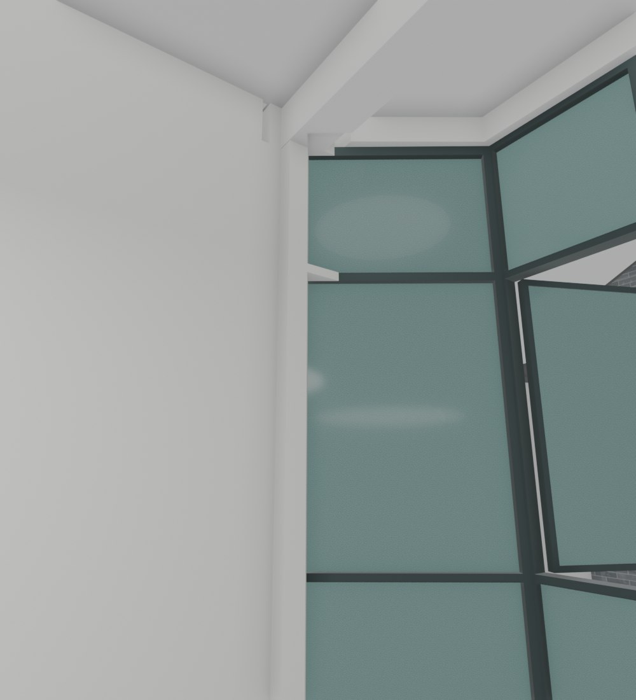
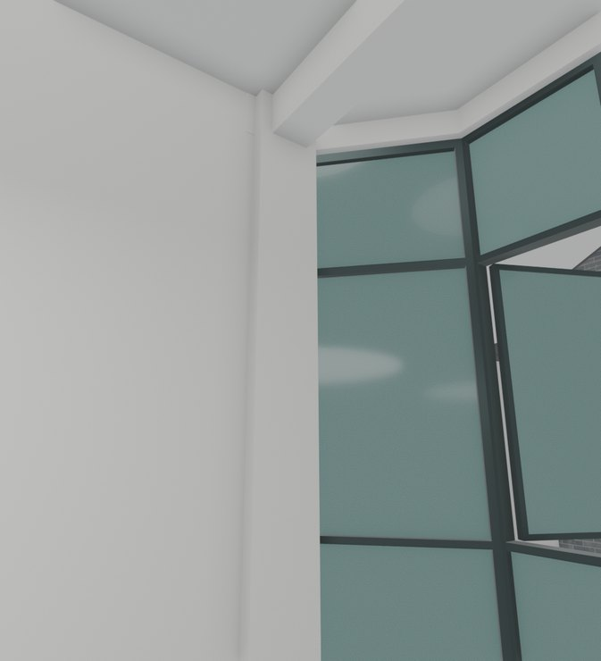

# V26.17 · 由轴线恢复梁柱板并把固定斜窗收至柱前

[逐版目录](README.md) · [建筑重建台账](../../reconstruction.md) · [阶段方法汇总](../v26-v26-20.md)

## 摘要

恢复梁柱板原节点，把十处固定斜窗收至柱前，复核窗脚接原板边。

## 1. 问题与输入

早期为了保留固定斜窗曾反切梁柱。按 3,900 + 5,200 + 3,900 mm 轴线与原结构模型恢复完整截面，再处理窗与结构边界。

## 2. 实现方法

1. 重取原柱身、矩形梁和连续板边，保留实际柱凸出和梁下挂。把五组窗共十处固定斜窗的端点收至柱前，中央活动扇保留。

2. 窗脚与原板边在同一标高合成实体，保持窗台、铺面边界和后侧滑窗。

3. 从保存网格取 65 处梁底、60 处柱面和 60 处板面探测，核对固定窗与原板边接合、窗扇动作和视口显示。

### 实现链与源码定位

以下按诊断、处理、保存与复核组织阅读。调用和文件引用来自原脚本，输入输出方向由对应读写调用判断；辅助文件是否在本轮运行，以报告为准。

**1. 定位与诊断** · [`v26_17_probe.py`](../source-code/v26-17/project/Sources/Scripts/v26_17_probe.py#L9)

打开保存的 Blender [`bpy.ops.wm.open_mainfile`](../source-code/v26-17/project/Sources/Scripts/v26_17_probe.py#L9)。

文件引用：[`Architecture_Complete_V26_16.blend`](../source-code/v26-17/project/Sources/Scripts/v26_17_probe.py#L8) · [`Source_Index.json`](../source-code/v26-17/project/Sources/Scripts/v26_17_probe.py#L19) · [`Before_Snapshot.json`](../source-code/v26-17/project/Sources/Scripts/v26_17_probe.py#L20)。

**2. 参数与几何处理** · [`v26_17_prepare.py`](../source-code/v26-17/project/Sources/Scripts/v26_17_prepare.py#L26)

实体运算对象 [`mf.Manifold`](../source-code/v26-17/project/Sources/Scripts/v26_17_prepare.py#L26)；截面挤出 [`extrude`](../source-code/v26-17/project/Sources/Scripts/v26_17_prepare.py#L27)；定高剖切 [`m.slice`](../source-code/v26-17/project/Sources/Scripts/v26_17_prepare.py#L32)。

文件引用：[`Source_Index.json`](../source-code/v26-17/project/Sources/Scripts/v26_17_prepare.py#L11) · [`Prepared.json`](../source-code/v26-17/project/Sources/Scripts/v26_17_prepare.py#L158)。

**3. 构建或写入** · [`v26_17_build.py`](../source-code/v26-17/project/Sources/Scripts/v26_17_build.py#L10)

打开保存的 Blender [`bpy.ops.wm.open_mainfile`](../source-code/v26-17/project/Sources/Scripts/v26_17_build.py#L10)；写入网格拓扑 [`me.from_pydata`](../source-code/v26-17/project/Sources/Scripts/v26_17_build.py#L15)；批量写入属性 [`me.polygons.foreach_set`](../source-code/v26-17/project/Sources/Scripts/v26_17_build.py#L17)。

文件引用：[`Architecture_Complete_V26_16.blend`](../source-code/v26-17/project/Sources/Scripts/v26_17_build.py#L5) · [`Architecture_Complete_V26_17.blend`](../source-code/v26-17/project/Sources/Scripts/v26_17_build.py#L5) · [`Prepared.json`](../source-code/v26-17/project/Sources/Scripts/v26_17_build.py#L5)。

**4. 构建或写入** · [`v26_17_build_fast.py`](../source-code/v26-17/project/Sources/Scripts/v26_17_build_fast.py#L23)

打开保存的 Blender [`bpy.ops.wm.open_mainfile`](../source-code/v26-17/project/Sources/Scripts/v26_17_build_fast.py#L23)；另存 Blender [`bpy.ops.wm.save_as_mainfile`](../source-code/v26-17/project/Sources/Scripts/v26_17_build_fast.py#L48)。

文件引用：[`Architecture_Complete_V26_17.blend`](../source-code/v26-17/project/Sources/Scripts/v26_17_build_fast.py#L12) · [`Architecture_Complete_V26_17_Fast.blend`](../source-code/v26-17/project/Sources/Scripts/v26_17_build_fast.py#L13) · [`V26_17_Build.json`](../source-code/v26-17/project/Sources/Scripts/v26_17_build_fast.py#L22)。

**5. 保存后核验** · [`v26_17_geometry_qa.py`](../source-code/v26-17/project/Sources/Scripts/v26_17_geometry_qa.py#L6)

判据与回归检查 [`checks.append`](../source-code/v26-17/project/Sources/Scripts/v26_17_geometry_qa.py#L10)。

文件引用：[`Prepared.json`](../source-code/v26-17/project/Sources/Scripts/v26_17_geometry_qa.py#L6) · [`Source_Index.json`](../source-code/v26-17/project/Sources/Scripts/v26_17_geometry_qa.py#L6) · [`Geometry_Index.json`](../source-code/v26-17/project/Sources/Scripts/v26_17_geometry_qa.py#L6)。

**6. 保存后核验** · [`v26_17_native_qa.py`](../source-code/v26-17/project/Sources/Scripts/v26_17_native_qa.py#L7)

打开保存的 Blender [`bpy.ops.wm.open_mainfile`](../source-code/v26-17/project/Sources/Scripts/v26_17_native_qa.py#L7)；判据与回归检查 [`checks.append`](../source-code/v26-17/project/Sources/Scripts/v26_17_native_qa.py#L9)；叉积／面法线 [`np.cross`](../source-code/v26-17/project/Sources/Scripts/v26_17_native_qa.py#L18)。

文件引用：[`Architecture_Complete_V26_17.blend`](../source-code/v26-17/project/Sources/Scripts/v26_17_native_qa.py#L7) · [`V26_17_Changes.json`](../source-code/v26-17/project/Sources/Scripts/v26_17_native_qa.py#L8) · [`Before_Snapshot.json`](../source-code/v26-17/project/Sources/Scripts/v26_17_native_qa.py#L8)。

[方法原理：圈画、对象与剖切定位](../methodology.md#3-从截图圈画定位到对象与剖面) · [本版完整过程索引](process/v26-17.md)

本版索引汇合 43 幅已归档过程图、88 份交付及历史目录中的报告／说明／中间记录和全部 33 个源码附件。继承文件和本轮新增文件按来源保留，实际完成范围以第 4 节及原报告为准。

## 3. 过程图

 

**图 1** · V26.17 同机位对照所用的 V26.16 梁柱窗边 
**图 2** · 固定斜窗和原柱节点

## 4. 验证与适用范围

原图文报告记录 143 项通过。轴线为输入资料，采样验证模型中的矩形截面和相对标高。

- **原生模型核验** 
  状态 `PASS`，检查条目 35，失败记录 0。

- **几何核验** 
  状态 `PASS`，检查条目 12，失败记录 0。

### 原记录中的关键检查

- **Ten complete400mm column shafts and all specified rectangular beams are present** 
  通过 
  原记录 `V26_17_Geometry_QA.json` 的 `checks[2]`

- **Saved mesh has finite UVs, nonzero faces and preserved topology: V26_3_House_Connected_Walls_And_Stairs** 
  通过，`minimum_triangle_m2` = `7.10543e-15` 
  原记录 `V26_17_Native_QA.json` 的 `checks[17]`

- **Saved mesh has finite UVs, nonzero faces and preserved topology: HOUSE_V22_CONTINUOUS_BALCONY_EDGE_Geometry** 
  通过，`minimum_triangle_m2` = `1.47338e-10` 
  原记录 `V26_17_Native_QA.json` 的 `checks[18]`

## 5. 复现入口与出处

过程路径以本地 `JIA` 项目为根，`work/` 指重建项目的历史工作目录。复核时按交付记录打开本轮输入与保存成果，再依方法中的截面、对象或动作采样对照原报告。

交付与参考记录（2 项）

~~~text
Rebuild_V26_17/使用说明.txt
Rebuild_V26_17/Reports/V26_17_梁柱板与窗边复核.html
~~~

### 原实现脚本附件

[浏览本版全部 33 个文件](../source-code/v26-17/README.md) · [原件与公开副本校验值](../source-code/v26-17/manifest.json)

- [`v26_17_probe.py`](../source-code/v26-17/project/Sources/Scripts/v26_17_probe.py)
- [`v26_17_prepare.py`](../source-code/v26-17/project/Sources/Scripts/v26_17_prepare.py)
- [`v26_17_geometry_qa.py`](../source-code/v26-17/project/Sources/Scripts/v26_17_geometry_qa.py)
- [`v26_17_build.py`](../source-code/v26-17/project/Sources/Scripts/v26_17_build.py)
- [`v26_17_build_fast.py`](../source-code/v26-17/project/Sources/Scripts/v26_17_build_fast.py)

原脚本本地路径

~~~text
Rebuild_V26_17/Sources/Scripts/v26_17_probe.py
Rebuild_V26_17/Sources/Scripts/v26_17_prepare.py
Rebuild_V26_17/Sources/Scripts/v26_17_geometry_qa.py
Rebuild_V26_17/Sources/Scripts/v26_17_build.py
Rebuild_V26_17/Sources/Scripts/v26_17_build_fast.py
~~~

核验报告路径（2 项）

**原生模型核验**

~~~text
Rebuild_V26_17/Reports/V26_17_Native_QA.json
~~~

**几何核验**

~~~text
Rebuild_V26_17/Reports/V26_17_Geometry_QA.json
~~~

图源与 SHA-256（2 张）

### 图 1 · V26.17 同机位对照所用的 V26.16 梁柱窗边

~~~text
Rebuild_V26_17/Reports/Views/V26_16_F1_R_Outer_Column.png
~~~

**原过程图 SHA-256**

~~~text
7e6ca30dce76937e3b08d95449c314a5d0106e62ec15052f86beccfcb5698677
~~~

保留原画面，发布用 JPEG。

### 图 2 · 固定斜窗和原柱节点

~~~text
Rebuild_V26_17/Reports/Views/V26_17_F1_R_Outer_Column.png
~~~

**原过程图 SHA-256**

~~~text
8d0391a919fedfe3be8ef6b272ec4b48ed0ddf17c58db1a9d6054f9d27efda2a
~~~

台账发布图，按原图缩放及压缩。

---

上一篇 [V26.16 · 沿原窗框平面闭合五组窗边和三楼飘窗顶](v26-16.md) 
下一篇 [V26.18 · 顺接楼梯斜板底并恢复平台立面材质分界](v26-18.md)
