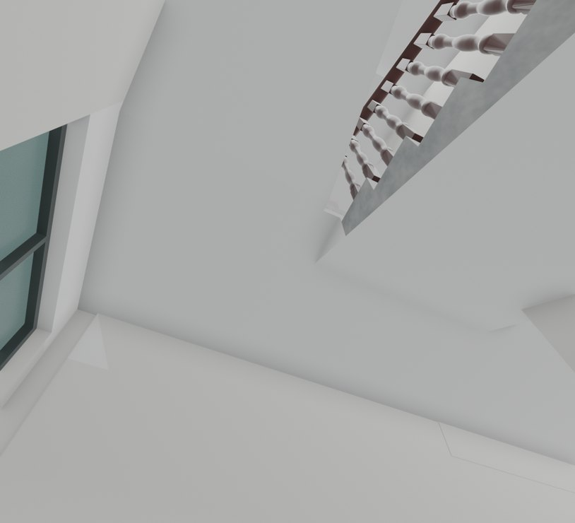
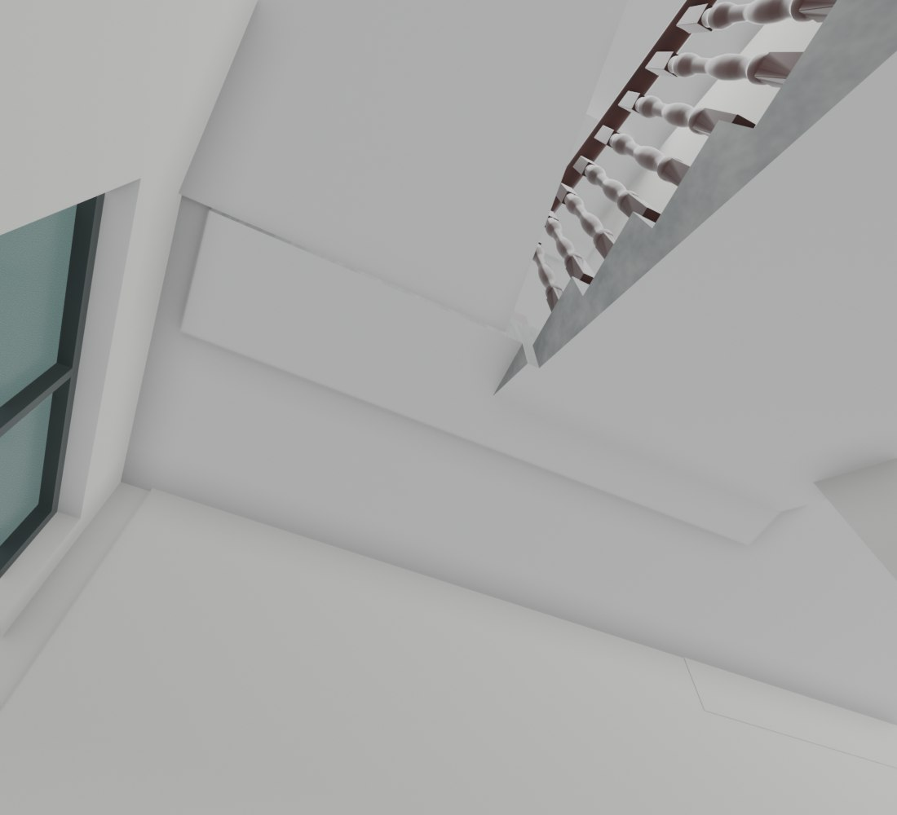

# V26.18 · 顺接楼梯斜板底并恢复平台立面材质分界

[逐版目录](README.md) · [建筑重建台账](../../reconstruction.md) · [阶段方法汇总](../v26-v26-20.md) · [上一篇 V26.17](v26-17.md) · [下一篇 V26.19](v26-19.md)

## 摘要

接平楼梯斜板与板底错台，校正半层平台立面颜色，移除内门后固定红板。

## 1. 问题与输入

V26.17 保存网格显示，楼梯连接片比楼板底低约 65 mm。半层平台侧面被分配为踏步石材，门楼背后另有多余固定红板。

## 2. 实现方法

1. 以楼梯斜板底和楼板底的高程定位下凸连接片，局部整修下表面使其连续相接，同法处理上层。
2. 半层平台、连接梁侧面恢复白色，最后一级踏步仍用原石材；按对象身份移除门楼背后的固定红色装饰板。
3. 重开模型查封闭性、板底、材质分界及楼梯漫游碰撞，检查门叶和正面石雕。

## 3. 过程图

*图 1 · 楼梯斜板与板底接平。过程文件 `Rebuild_V26_18/Reports/Views/V26_18_01_F1_Slab_Join_Underside.png`。*

*图 2 · V26.18 同机位对照所用的旧楼梯板底错台。过程文件 `Rebuild_V26_18/Reports/Views/V26_17_01_F1_Slab_Join_Underside.png`。*

## 4. 验证与适用范围

原生 12 项、几何 9 项、Fast 显示 12 项检查记录为 PASS。约 65 mm 来自原模型板底测量。

| 过程报告 | 原报告读数 |
| --- | --- |
| `Rebuild_V26_18/Reports/V26_18_Native_QA.json` | 状态 `PASS`，检查条目 12，失败记录 0。 |
| `Rebuild_V26_18/Reports/V26_18_Geometry_QA.json` | 状态 `PASS`，检查条目 9，失败记录 0。 |

### 原记录中的关键检查

| 检查项 | 结果与读数 | 原记录位置 |
| --- | --- | --- |
| Native geometry changes stay inside the two stair/slab underside joint volumes | 通过，`outside_delta_m3=[3.14793e-09, 8.59126e-08]` | `V26_18_Geometry_QA.json` 的 `checks[0]` |
| All unrelated objects, window frames, stair railing, doors and front stone reliefs are exact | 通过 | `V26_18_Native_QA.json` 的 `checks[0]` |
| Saved house mesh is closed, has no zero faces, and has finite UVs | 通过，`minimum_face_area_m2=7.10543e-15` | `V26_18_Native_QA.json` 的 `checks[7]` |

## 5. 复现入口与出处

过程路径以本地 `JIA` 项目为根，`work/` 指重建项目的历史工作目录。复核时按交付记录打开本轮输入与保存成果，再依方法中的截面、对象或动作采样对照原报告。

- **交付与参考记录**。`Rebuild_V26_18/使用说明.txt` · `Rebuild_V26_18/Reports/V26_18_楼梯板底与内门后部复核.html`

- **原实现脚本**。`Rebuild_V26_18/Sources/Scripts/v26_18_probe.py` · `Rebuild_V26_18/Sources/Scripts/v26_18_prepare.py` · `Rebuild_V26_18/Sources/Scripts/v26_18_geometry_qa.py` · `Rebuild_V26_18/Sources/Scripts/v26_18_build.py` · `Rebuild_V26_18/Sources/Scripts/v26_18_build_fast.py`

过程图校验值

| 图 | 原过程图 SHA-256 | 发布方式 |
| --- | --- | --- |
| 1 | `ca52e85667f81357d5218fdc16311ce6455501d8be705d775f471959129899ea` | 台账发布图，按原图缩放及压缩 |
| 2 | `22801af815f79e0f952a68c909b362301d42ea899050b36f3ae72981283264a9` | 保留原画面，发布用 JPEG |

