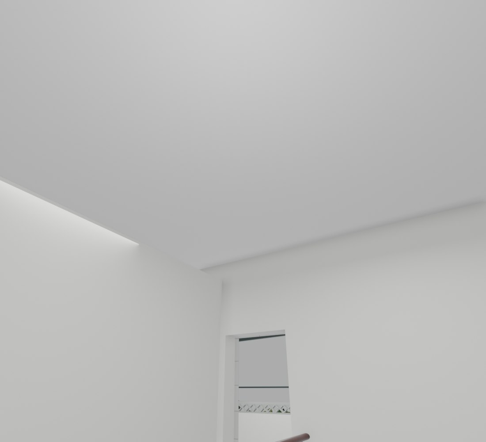

# V26.19 · 由标注视角定位雨水支管、梁端和窗角

[逐版目录](README.md) · [建筑重建台账](../../reconstruction.md) · [阶段方法汇总](../v26-v26-20.md) · [上一篇 V26.18](v26-18.md) · [下一篇 V26.20](v26-20.md)

## 摘要

清除推定雨水支管，修梁端与西侧窗角。过程记录先试作陶盆，V26.20 的输入记录确认已去除该盆。

## 1. 问题与输入

依据三张新标注，检查早期推定支管、梁端包边及窗角柱截面。先识别被圈物体及其相邻几何，再限定裁切域。

## 2. 实现方法

1. 移除罗马柱旁推定 DN100 支管。梁端多余封口按相邻墙面收回，原梁芯保留。西侧窗边补到原矩形柱截面，统一竖面和底面白饰。
2. 过程报告保留由木色实心占位件试作陶盆的步骤，盆口、内壁和土面分开建模。后续实际送入 V26.20 的 V26.19 保存文件确认该盆已移除。
3. 原生读回检查梁端、窗角、原窗扇动作及继承的楼梯和门楼修订。

## 3. 过程图

*图 1 · 三楼西侧梁端和窗角。过程文件 `Rebuild_V26_19/Reports/Views/V26_19_02_F3_West_Window_Head.png`。*

*图 2 · V26.19 三楼通道顶面的梁端收口。过程文件 `Rebuild_V26_19/Reports/Views/V26_19_05_F3_Hall_Ceiling.png`。*

## 4. 验证与适用范围

保存报告列 14 项原生、13 项几何和 12 项 Fast 检查。陶盆为同版阶段性试作，当前继承状态由 V26.20 输入记录确认。

| 过程报告 | 原报告读数 |
| --- | --- |
| `Rebuild_V26_19/Reports/V26_19_Native_QA.json` | 状态 `PASS`，检查条目 14，失败记录 0。 |
| `Rebuild_V26_19/Reports/V26_19_Geometry_QA.json` | 状态 `PASS`，检查条目 13，失败记录 0。 |
| `Rebuild_V26_19/Reports/V26_19_Changes.json` | 修改项 4，新增项 1。 |

### 原记录中的关键检查

| 检查项 | 结果与读数 | 原记录位置 |
| --- | --- | --- |
| House changes are confined to the annotated beam/head zones and continuous window piers | 通过，`outside_delta_m3=[1.77045e-07, 6.59388e-08]` | `V26_19_Geometry_QA.json` 的 `checks[0]` |
| All unrelated objects, window frames, stair railing, doors and front stone reliefs are exact | 通过 | `V26_19_Native_QA.json` 的 `checks[0]` |
| Saved house mesh is closed, has no zero faces, and has finite UVs | 通过，`minimum_face_area_m2=3.55271e-15` | `V26_19_Native_QA.json` 的 `checks[8]` |

## 5. 复现入口与出处

过程路径以本地 `JIA` 项目为根，`work/` 指重建项目的历史工作目录。复核时按交付记录打开本轮输入与保存成果，再依方法中的截面、对象或动作采样对照原报告。

- **交付与参考记录**。`Rebuild_V26_19/使用说明.txt` · `Rebuild_V26_19/Reports/V26_19_梁端窗角与院内构件复核.html` · `Rebuild_V26_20/使用说明.txt`

- **原实现脚本**。`Rebuild_V26_19/Sources/Scripts/v26_19_pixel_probe.py` · `Rebuild_V26_19/Sources/Scripts/v26_19_analyze.py` · `work/v26_19_remove_planter_choice.py` · `Rebuild_V26_19/Sources/Scripts/v26_19_build.py` · `Rebuild_V26_19/Sources/Scripts/v26_19_probe.py`

过程图校验值

| 图 | 原过程图 SHA-256 | 发布方式 |
| --- | --- | --- |
| 1 | `16dc7c81a8cafef3f106d74b36febb26c2650c31ab9c86ce2bfcf1973fef6f7f` | 台账发布图，按原图缩放及压缩 |
| 2 | `f57fd4eba52e64a35ff9037653a02a913a25ddab40235566862f57f907a865fe` | 保留原画面，发布用 JPEG |

