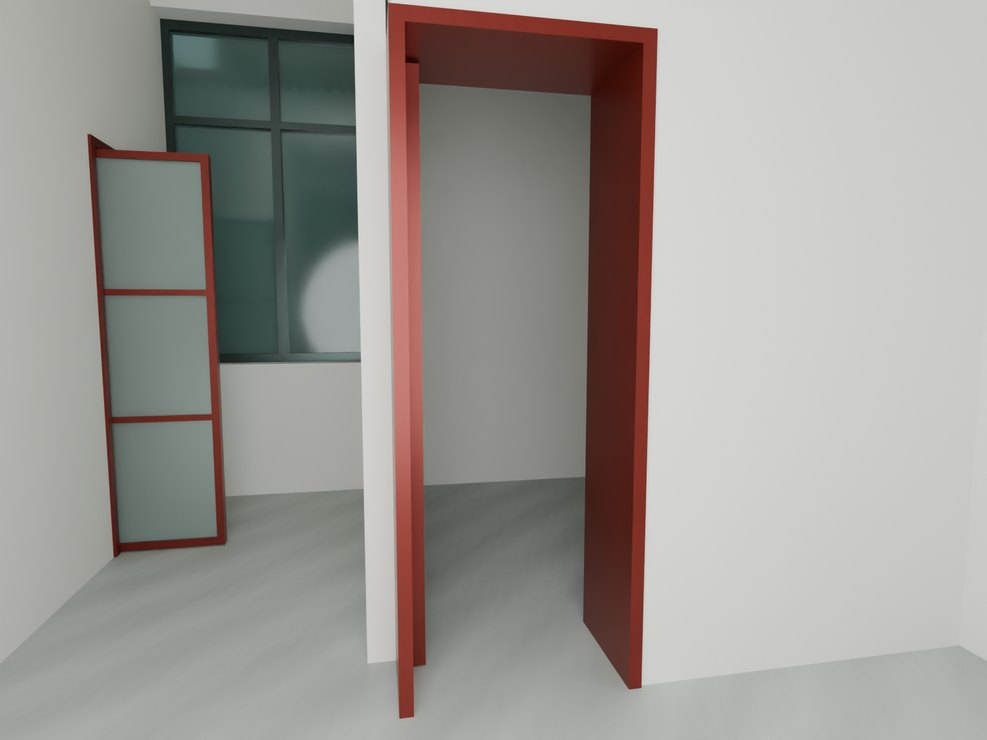
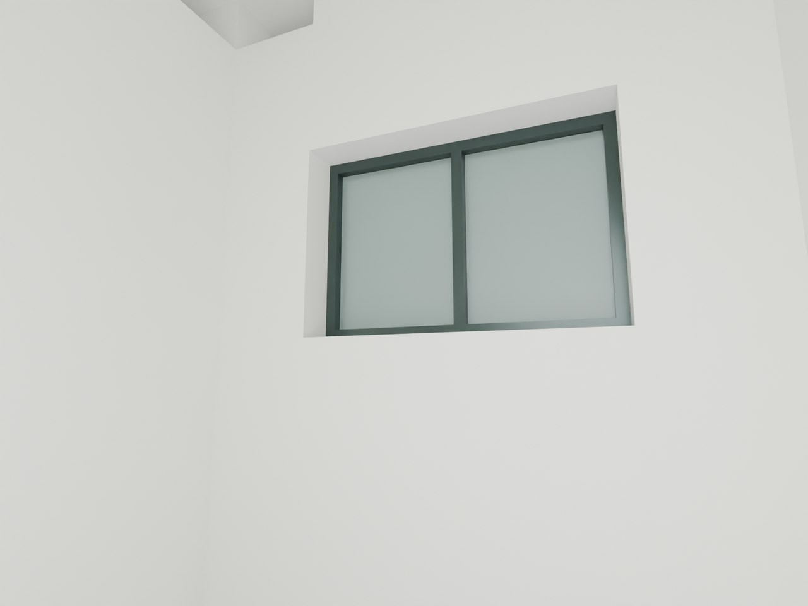

# V26.2 · 用楼层基准收窗头、梁墙及玻璃门门框

[逐版目录](README.md) · [建筑重建台账](../../reconstruction.md) · [阶段方法汇总](../v26-v26-20.md)

## 摘要

收口墙梁与窗头窗下，校正门框厚度、玻璃门标高、廊下饰面和院墙石砖层次。

## 1. 问题与输入

基于 V26.1 和八张圈注，诊断窗下窗头斜补面、梁侧凸条和一层右玻璃门。墙脚材质与构件高程分别取证。

## 2. 实现方法

1. 在同层保存网格读窗框实际上下口，补连续墙面并清除三角斜补片。沿原柱侧、梁侧与门洞边界修面，门框厚度和门底标高按开口约束。

2. 廊下用原石带表达，去掉低位误用青砖和旧饰条；院墙毛石、灰石及白灰按高度带分层。

3. 同相机复核原生模型的窗墙、玻璃门和材质。将门的各采样姿态和窗头、窗下表面探针分别登记。

### 实现链与源码定位

以下按诊断、处理、保存与复核组织阅读。调用和文件引用来自原脚本，输入输出方向由对应读写调用判断；辅助文件是否在本轮运行，以报告为准。

**1. 定位与诊断** · [`v26_2_probe.py`](../source-code/v26-2/history/v26_2_probe.py#L7)

打开保存的 Blender [`bpy.ops.wm.open_mainfile`](../source-code/v26-2/history/v26_2_probe.py#L7)。

文件引用：[`Architecture_Complete_V26_1.blend`](../source-code/v26-2/history/v26_2_probe.py#L6) · [`Before_Snapshot.json`](../source-code/v26-2/history/v26_2_probe.py#L8) · [`Inventory.json`](../source-code/v26-2/history/v26_2_probe.py#L21)。

**2. 构建或写入** · [`v26_2_build.py`](../source-code/v26-2/project/Sources/Scripts/v26_2_build.py#L10)

打开保存的 Blender [`bpy.ops.wm.open_mainfile`](../source-code/v26-2/project/Sources/Scripts/v26_2_build.py#L10)；写入网格拓扑 [`me.from_pydata`](../source-code/v26-2/project/Sources/Scripts/v26_2_build.py#L51)；批量写入属性 [`me.polygons.foreach_set`](../source-code/v26-2/project/Sources/Scripts/v26_2_build.py#L53)。

文件引用：[`Architecture_Complete_V26_1.blend`](../source-code/v26-2/project/Sources/Scripts/v26_2_build.py#L4) · [`Architecture_Complete_V26_2.blend`](../source-code/v26-2/project/Sources/Scripts/v26_2_build.py#L4) · [`V26_1_Collision_Index.json`](../source-code/v26-2/project/Sources/Scripts/v26_2_build.py#L61)。

**3. 辅助实现** · [`v26_2_site.py`](../source-code/v26-2/project/Sources/Scripts/v26_2_site.py#L8)

叉积／面法线 [`np.cross`](../source-code/v26-2/project/Sources/Scripts/v26_2_site.py#L8)。

文件引用：[`Prepared_Geometry.json`](../source-code/v26-2/project/Sources/Scripts/v26_2_site.py#L3) · [`Prepared_Site.json`](../source-code/v26-2/project/Sources/Scripts/v26_2_site.py#L63)。

**4. 过程出图** · [`v26_2_views.py`](../source-code/v26-2/project/Sources/Scripts/v26_2_views.py#L1)

**5. 保存后核验** · [`v26_2_geometry_qa.py`](../source-code/v26-2/project/Sources/Scripts/v26_2_geometry_qa.py#L22)

判据与回归检查 [`checks.append`](../source-code/v26-2/project/Sources/Scripts/v26_2_geometry_qa.py#L8)；叉积／面法线 [`np.cross`](../source-code/v26-2/project/Sources/Scripts/v26_2_geometry_qa.py#L22)；射线命中检查 [`house.ray_cast`](../source-code/v26-2/project/Sources/Scripts/v26_2_geometry_qa.py#L32)。

文件引用：[`Geometry_Index.json`](../source-code/v26-2/project/Sources/Scripts/v26_2_geometry_qa.py#L3) · [`Prepared_House.json`](../source-code/v26-2/project/Sources/Scripts/v26_2_geometry_qa.py#L4) · [`Door_Motion.json`](../source-code/v26-2/project/Sources/Scripts/v26_2_geometry_qa.py#L69)。

**6. 保存后核验** · [`v26_2_readback.py`](../source-code/v26-2/project/Sources/Scripts/v26_2_readback.py#L7)

打开保存的 Blender [`bpy.ops.wm.open_mainfile`](../source-code/v26-2/project/Sources/Scripts/v26_2_readback.py#L7)；判据与回归检查 [`checks.append`](../source-code/v26-2/project/Sources/Scripts/v26_2_readback.py#L8)。

文件引用：[`Architecture_Complete_V26_2.blend`](../source-code/v26-2/project/Sources/Scripts/v26_2_readback.py#L4) · [`Before_Snapshot.json`](../source-code/v26-2/project/Sources/Scripts/v26_2_readback.py#L7) · [`V26_2_Changes.json`](../source-code/v26-2/project/Sources/Scripts/v26_2_readback.py#L7)。

**7. 交付封装** · [`v26_2_package.py`](../source-code/v26-2/project/Sources/Scripts/v26_2_package.py#L6)

文件引用：[`Architecture_Complete_V26_2.blend`](../source-code/v26-2/project/Sources/Scripts/v26_2_package.py#L3) · [`Base.json`](../source-code/v26-2/project/Sources/Scripts/v26_2_package.py#L6) · [`V26_2_Native_Readback_QA.json`](../source-code/v26-2/project/Sources/Scripts/v26_2_package.py#L8)。

[方法原理：圈画、对象与剖切定位](../methodology.md#3-从截图圈画定位到对象与剖面) · [本版完整过程索引](process/v26-2.md)

本版索引汇合 29 幅已归档过程图、46 份交付及历史目录中的报告／说明／中间记录和全部 25 个源码附件。继承文件和本轮新增文件按来源保留，实际完成范围以第 4 节及原报告为准。

## 3. 过程图

**图 1** · 玻璃门与门框标高

**图 2** · V26.2 二楼后窗墙和窗头收口

## 4. 验证与适用范围

原报告记 95 项自动检查，包含 480 个窗头窗下采样点、80 个窗洞采样点和 168 个门动画姿态。采样用于保存模型内部连续性。

- **保存后几何核验** 
  状态 `PASS`，检查条目 13，失败记录 0，踏面样本 80。

- **原生保存与读回** 
  状态 `PASS`，检查条目 20，失败记录 0。

- **交付核验** 
  状态 `PASS`，自动检查数 95，原生读回检查数 20。

### 原记录中的关键检查

- **All seven architectural assemblies are closed positive solids** 
  通过，`components` = `7` 
  原记录 `V26_2_Saved_Geometry_QA.json` 的 `checks[0]`

- **Saved ground and perimeter have only the four existing closed assemblies** 
  通过，`components` = `4`，`volume_m3` = `2682` 
  原记录 `V26_2_Saved_Geometry_QA.json` 的 `checks[1]`

- **The finish repair does not cover any sampled actual window opening** 
  通过，`samples` = `80` 
  原记录 `V26_2_Saved_Geometry_QA.json` 的 `checks[5]`

## 5. 复现入口与出处

过程路径以本地 `JIA` 项目为根，`work/` 指重建项目的历史工作目录。复核时按交付记录打开本轮输入与保存成果，再依方法中的截面、对象或动作采样对照原报告。

交付与参考记录（1 项）

~~~text
Rebuild_V26_2/使用说明.md
~~~

### 原实现脚本附件

[浏览本版全部 25 个文件](../source-code/v26-2/README.md) · [原件与公开副本校验值](../source-code/v26-2/manifest.json)

- [`v26_2_probe.py`](../source-code/v26-2/history/v26_2_probe.py)
- [`v26_2_site.py`](../source-code/v26-2/project/Sources/Scripts/v26_2_site.py)
- [`v26_2_geometry_qa.py`](../source-code/v26-2/project/Sources/Scripts/v26_2_geometry_qa.py)
- [`v26_2_build.py`](../source-code/v26-2/project/Sources/Scripts/v26_2_build.py)
- [`v26_2_views.py`](../source-code/v26-2/project/Sources/Scripts/v26_2_views.py)

原脚本本地路径

~~~text
work/v26_2_probe.py
Rebuild_V26_2/Sources/Scripts/v26_2_site.py
Rebuild_V26_2/Sources/Scripts/v26_2_geometry_qa.py
Rebuild_V26_2/Sources/Scripts/v26_2_build.py
Rebuild_V26_2/Sources/Scripts/v26_2_views.py
~~~

核验报告路径（3 项）

**保存后几何核验**

~~~text
Rebuild_V26_2/Reports/V26_2_Saved_Geometry_QA.json
~~~

**原生保存与读回**

~~~text
Rebuild_V26_2/Reports/V26_2_Native_Readback_QA.json
~~~

**交付核验**

~~~text
Rebuild_V26_2/Reports/V26_2_Delivery_QA.json
~~~

图源与 SHA-256（2 张）

### 图 1 · 玻璃门与门框标高

~~~text
Rebuild_V26_2/Reports/After_11_Corrected_Glazed_Door.png
~~~

**原过程图 SHA-256**

~~~text
025fea9f8f6aadb758651abb74c2655a90c97a7ae0dfa0a806c28560138132a7
~~~

台账发布图，按原图缩放及压缩。

### 图 2 · V26.2 二楼后窗墙和窗头收口

~~~text
Rebuild_V26_2/Reports/After_09_F2_Rear_Window.png
~~~

**原过程图 SHA-256**

~~~text
654886734eff76dc0286edd24ce1204a5315a8a66727c7278c3518326c4af659
~~~

保留原画面，发布用 JPEG。

---

上一篇 [V26.1 · 局部裁梁、保留踏步并接合车木扶手](v26-1.md) 
下一篇 [V26.3 · 用首层卫生间剖面恢复隔墙、上亮与墙顶](v26-3.md)
