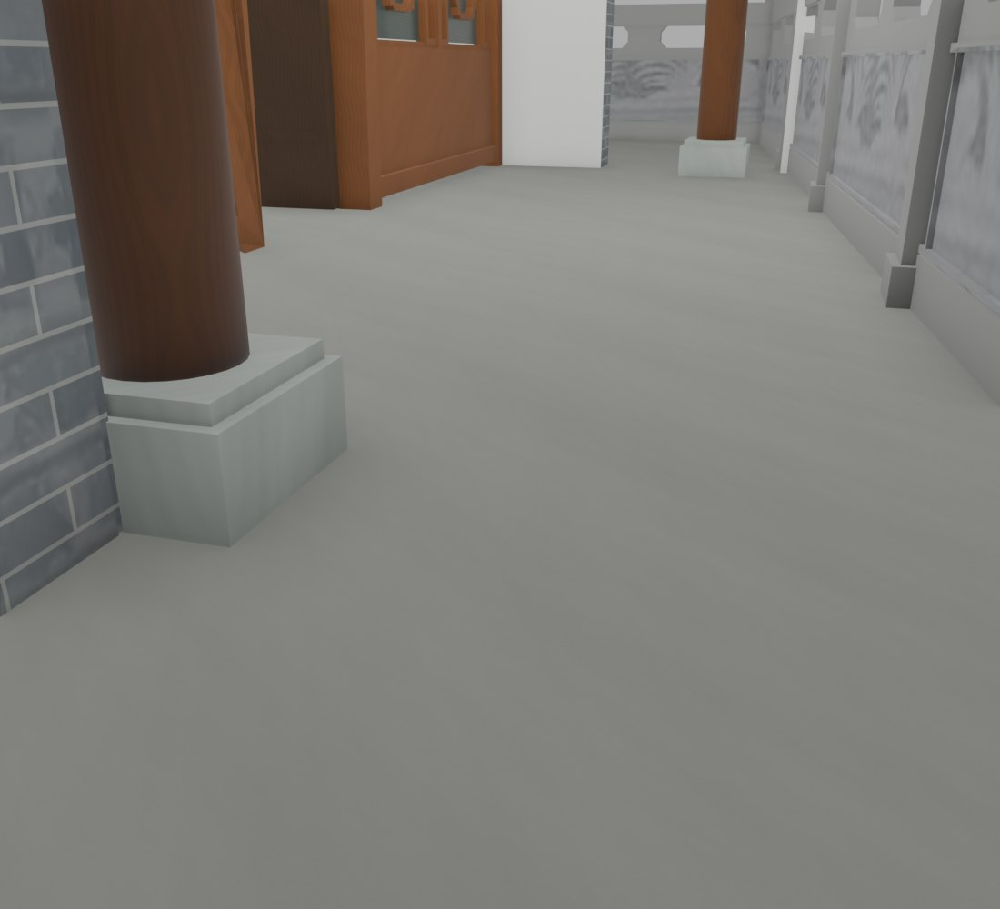
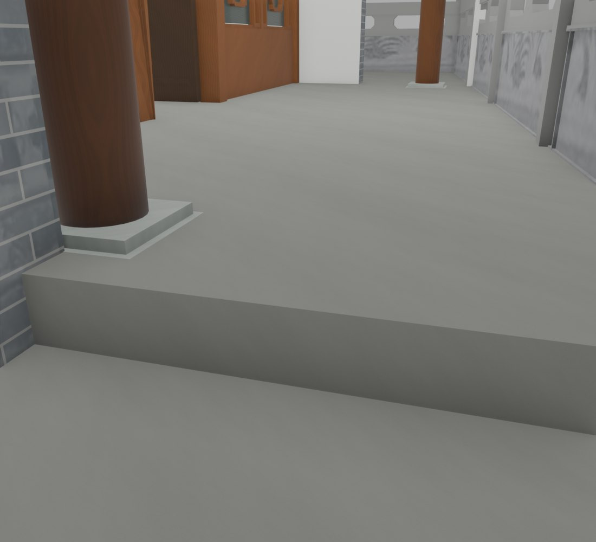
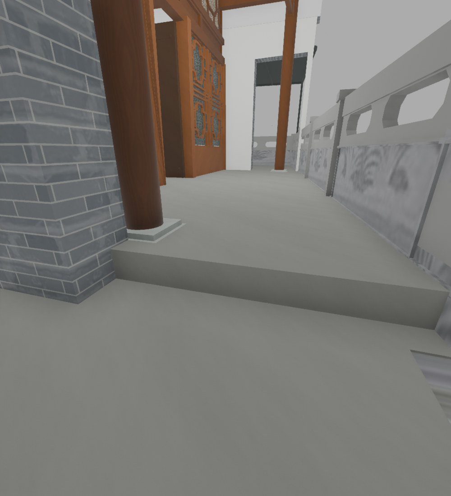

# V26.20 · 在共享厨储基础上局部抬升 150 毫米并复核门扇

[逐版目录](README.md) · [建筑重建台账](../../reconstruction.md) · [阶段方法汇总](../v26-v26-20.md) · [上一篇 V26.19](v26-19.md)

## 摘要

储藏房及相连廊道完成面局部抬高 150 mm，入口形成单阶。厨房和墙体纳入保护，修短门扇后复核开合和通行。

## 1. 问题与输入

当前 V26.19 保存模型是直接底稿，V24.10 的实景地块轮廓提供储藏房边界。厨房与储藏房共享部分基础，须在平面裁切时保护厨房墙、地面、木构及 UV。

## 2. 实现方法

1. 按储藏房域与厨房东侧保护面裁出新增部分，抬高檐廊、后室和外廊至 −0.25 m，外院仍为 −0.40 m。原基础下部保留，入口形成一道 150 mm 台阶。
2. 新顶面沿用世界 XY 贴图尺度和起点，新增竖面继承邻基础 UV 相位。只在新增石材竖带采用连续镜像取样，避免拉伸原照片边缘。
3. 两扇门下沿修短 150 mm 并封底，门顶、铰轴、固定框和开合动画保留。对保存网格查厨房重叠、地面、墙体、门底间隙及主版与 Fast。

保护域先从 V26.19 保存版提取厨房原地面和邻接构件。原下部基础与新增台阶体分开检查。运动核验以两扇门的原铰轴采样，对照新完成面和门底间隙。

## 3. 过程图

*图 1 · V26.19 储藏房西侧入口原状态。过程文件 `Rebuild_V26_20/Reports/Views/V26_19_02_Entry_Step_Close.png`。*

*图 2 · V26.20 入口新增单阶后的同机位视图。过程文件 `Rebuild_V26_20/Reports/Views/V26_20_02_Entry_Step_Close.png`。*

*图 3 · V26.20 储藏房入口台阶的实际 Fast 材质视口。过程文件 `Rebuild_V26_20/Reports/Views/Viewport_02_02_Entry_Step_Close.png`。*

## 4. 验证与适用范围

变更报告记新增平面约 46.97 m²、体积约 7.044 m³，说明记新地面至门底约 8.4 mm。原生、运动和实际 Fast 视口均有报告。这版作为后续智慧家导入的建筑基线。

| 过程报告 | 原报告读数 |
| --- | --- |
| `Rebuild_V26_20/Reports/V26_20_Geometry_QA.json` | 状态 `PASS`，检查条目 15，失败记录 0，几何核验容差（m） 6e-06，UV 核验容差（m） 5e-05。 |
| `Rebuild_V26_20/Reports/V26_20_Door_Clearance_QA.json` | 状态 `PASS`，检查条目 2，失败记录 0，姿态样本 80。 |
| `Rebuild_V26_20/Reports/V26_20_Runtime_Viewport_QA.json` | 状态 `PASS`，检查条目 6，失败记录 0。 |
| `Rebuild_V26_20/Reports/V26_20_Native_QA.json` | 状态 `PASS`，检查条目 18，失败记录 0。 |

### 原记录中的关键检查

| 检查项 | 结果与读数 | 原记录位置 |
| --- | --- | --- |
| Kitchen floor geometry, material and regional UV remain unchanged after triangle subdivision | 通过，`source_faces=509`，`samples=2096`，`maximum_uv_error_m=5.87043e-08` | `V26_20_Geometry_QA.json` 的 `checks[11]` |
| Kitchen floor solid volume is unchanged | 通过，`delta_m3=[1.53561e-09, 1.53561e-09]` | `V26_20_Geometry_QA.json` 的 `checks[3]` |
| Saved indexed floor mesh has closed edges, positive faces and finite coordinates and UVs | 通过，`minimum_triangle_area_m2=8.88178e-16`，`invalid_edges=0` | `V26_20_Geometry_QA.json` 的 `checks[5]` |

## 5. 复现入口与出处

过程路径以本地 `JIA` 项目为根，`work/` 指重建项目的历史工作目录。复核时按交付记录打开本轮输入与保存成果，再依方法中的截面、对象或动作采样对照原报告。

- **交付与参考记录**。`Rebuild_V26_20/使用说明.txt` · `Rebuild_V26_20/Reports/V26_20_储藏房150mm台阶与厨房关系复核.html` · `Rebuild_V26_20/Reports/V26_20_Delivery_Summary.json` · `Rebuild_V26_20/Reports/V26_20_Changes.json`

- **原实现脚本**。`Rebuild_V26_20/Sources/Scripts/v26_20_prepare_floor.py` · `Rebuild_V26_20/Sources/Scripts/v26_20_prepare_doors.py` · `Rebuild_V26_20/Sources/Scripts/v26_20_kitchen_overlap_audit.py` · `Rebuild_V26_20/Sources/Scripts/v26_20_build.py` · `Rebuild_V26_20/Sources/Scripts/v26_20_probe.py`

过程图校验值

| 图 | 原过程图 SHA-256 | 发布方式 |
| --- | --- | --- |
| 1 | `57d393f5febe96cfbe13a7a2a9deabf913474f8aaef59db7e8caf50a64109404` | 保留原画面，发布用 JPEG |
| 2 | `b59579e01845a98290b6cfc06ae2cc1b2c96fde87b365153b9b562be88db278a` | 保留原画面，发布用 JPEG |
| 3 | `591bcd43a1d6dd982bc6ae14440cb2bb98deaf1b3bcfe9dbfa250a54b6eb19fc` | 已有过程图的发布副本 |

