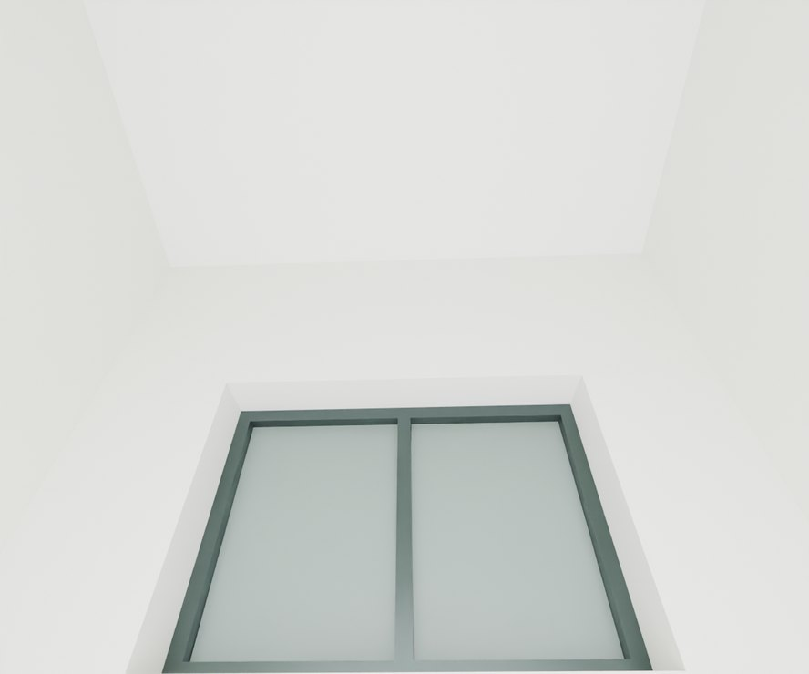
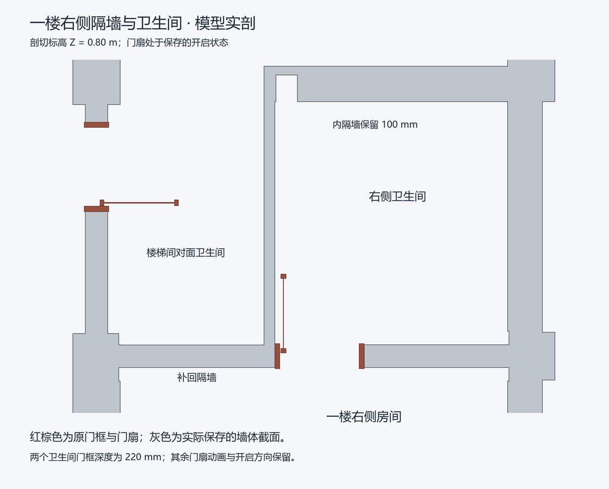

# V26.3 · 用首层卫生间剖面恢复隔墙、上亮与墙顶

[逐版目录](README.md) · [建筑重建台账](../../reconstruction.md) · [阶段方法汇总](../v26-v26-20.md)

## 摘要

补卫生间隔墙及门上亮，收口高窗与墙顶，从 V24.34 恢复原次照壁。

## 1. 问题与输入

V26.2 的卫生间门洞和上亮边界仍需核对。以首层平面确定隔墙与两个空间关系，次照壁另以 V24.34 对应对象为源。

## 2. 实现方法

1. 沿标记补 100 mm 隔墙，接到后窗侧墙。后窗右端按隔墙收回 110 mm，左端与高程保持基准位置。

2. 移去挡住上亮的实体墙段，玻璃顶接既有梁底，保留原红框和梁的下挂。高窗及三层斜屋顶下墙头按实际顶面闭合。

3. 从 V24.34 恢复次照壁原对象与位置。切保存网格核对墙厚、门槛与上亮净空，再跑楼梯和门洞路线。

### 实现链与源码定位

以下按诊断、处理、保存与复核组织阅读。调用和文件引用来自原脚本，输入输出方向由对应读写调用判断；辅助文件是否在本轮运行，以报告为准。

**1. 定位与诊断** · [`v26_3_plan_draft.py`](../source-code/v26-3/project/Sources/v26_3_plan_draft.py#L4)

**2. 定位与诊断** · [`v26_3_joint_probe.py`](../source-code/v26-3/project/Sources/v26_3_joint_probe.py#L5)

射线命中检查 [`m.ray_cast`](../source-code/v26-3/project/Sources/v26_3_joint_probe.py#L5)。

文件引用：[`Geometry_Index.json`](../source-code/v26-3/project/Sources/v26_3_joint_probe.py#L2)。

**3. 定位与诊断** · [`v26_3_probe.py`](../source-code/v26-3/project/Sources/v26_3_probe.py#L7)

打开保存的 Blender [`bpy.ops.wm.open_mainfile`](../source-code/v26-3/project/Sources/v26_3_probe.py#L7)。

文件引用：[`Architecture_Complete_V26_2.blend`](../source-code/v26-3/project/Sources/v26_3_probe.py#L6) · [`Before_Snapshot.json`](../source-code/v26-3/project/Sources/v26_3_probe.py#L8) · [`Components.json`](../source-code/v26-3/project/Sources/v26_3_probe.py#L20)。

**4. 构建或写入** · [`v26_3_build.py`](../source-code/v26-3/project/Sources/v26_3_build.py#L10)

打开保存的 Blender [`bpy.ops.wm.open_mainfile`](../source-code/v26-3/project/Sources/v26_3_build.py#L10)；写入网格拓扑 [`me.from_pydata`](../source-code/v26-3/project/Sources/v26_3_build.py#L29)；批量写入属性 [`me.polygons.foreach_set`](../source-code/v26-3/project/Sources/v26_3_build.py#L33)。

文件引用：[`Architecture_Complete_V26_2.blend`](../source-code/v26-3/project/Sources/v26_3_build.py#L4) · [`Architecture_Complete_V26_3.blend`](../source-code/v26-3/project/Sources/v26_3_build.py#L4) · [`Original_Secondary.json`](../source-code/v26-3/project/Sources/v26_3_build.py#L17)。

**5. 保存后核验** · [`v26_3_geometry_qa.py`](../source-code/v26-3/project/Sources/v26_3_geometry_qa.py#L23)

判据与回归检查 [`checks.append`](../source-code/v26-3/project/Sources/v26_3_geometry_qa.py#L9)；叉积／面法线 [`np.cross`](../source-code/v26-3/project/Sources/v26_3_geometry_qa.py#L23)；射线命中检查 [`house.ray_cast`](../source-code/v26-3/project/Sources/v26_3_geometry_qa.py#L33)。

文件引用：[`Geometry_Index.json`](../source-code/v26-3/project/Sources/v26_3_geometry_qa.py#L4) · [`Prepared_House.json`](../source-code/v26-3/project/Sources/v26_3_geometry_qa.py#L5) · [`Door_Motion.json`](../source-code/v26-3/project/Sources/v26_3_geometry_qa.py#L70)。

**6. 交付封装** · [`v26_3_package.py`](../source-code/v26-3/project/Sources/v26_3_package.py#L18)

定高剖切 [`house.slice`](../source-code/v26-3/project/Sources/v26_3_package.py#L18)。

文件引用：[`Architecture_Complete_V26_3.blend`](../source-code/v26-3/project/Sources/v26_3_package.py#L3) · [`V26_3_Build.json`](../source-code/v26-3/project/Sources/v26_3_package.py#L6) · [`V26_3_Native_Readback_QA.json`](../source-code/v26-3/project/Sources/v26_3_package.py#L8)。

[方法原理：圈画、对象与剖切定位](../methodology.md#3-从截图圈画定位到对象与剖面) · [本版完整过程索引](process/v26-3.md)

本版索引汇合 33 幅已归档过程图、83 份交付及历史目录中的报告／说明／中间记录和全部 23 个源码附件。继承文件和本轮新增文件按来源保留，实际完成范围以第 4 节及原报告为准。

## 3. 过程图

**图 1** · 三楼高窗与墙顶收口

**图 2** · V26.3 保存模型的首层卫生间隔墙和门洞剖面

## 4. 验证与适用范围

交付报告记录 115 项通过，核对原 56 个梁柱核心、80 处踏面和 168 个门姿态。剖面的 100 mm 与 110 mm 是模型参数。

- **保存后几何核验** 
  状态 `PASS`，检查条目 26，失败记录 0，踏面样本 80。

- **交付核验** 
  状态 `PASS`，检查总数 115，原生读回检查数 26。

### 原记录中的关键检查

- **High-window upper wall heads close continuously to slab and hip-roof soffits** 
  通过，`samples` = `30` 
  原记录 `V26_3_Saved_Geometry_QA.json` 的 `checks[14]`

- **All seven architectural assemblies are closed positive solids** 
  通过，`components` = `7` 
  原记录 `V26_3_Saved_Geometry_QA.json` 的 `checks[0]`

- **Saved ground and perimeter have only the four existing closed assemblies** 
  通过，`components` = `4`，`volume_m3` = `2682` 
  原记录 `V26_3_Saved_Geometry_QA.json` 的 `checks[1]`

## 5. 复现入口与出处

过程路径以本地 `JIA` 项目为根，`work/` 指重建项目的历史工作目录。复核时按交付记录打开本轮输入与保存成果，再依方法中的截面、对象或动作采样对照原报告。

交付与参考记录（1 项）

~~~text
Rebuild_V26_3/使用说明.txt
~~~

### 原实现脚本附件

[浏览本版全部 23 个文件](../source-code/v26-3/README.md) · [原件与公开副本校验值](../source-code/v26-3/manifest.json)

- [`v26_3_plan_draft.py`](../source-code/v26-3/project/Sources/v26_3_plan_draft.py)
- [`v26_3_joint_probe.py`](../source-code/v26-3/project/Sources/v26_3_joint_probe.py)
- [`v26_3_geometry_qa.py`](../source-code/v26-3/project/Sources/v26_3_geometry_qa.py)
- [`v26_3_build.py`](../source-code/v26-3/project/Sources/v26_3_build.py)
- [`v26_3_probe.py`](../source-code/v26-3/project/Sources/v26_3_probe.py)

原脚本本地路径

~~~text
Rebuild_V26_3/Sources/v26_3_plan_draft.py
Rebuild_V26_3/Sources/v26_3_joint_probe.py
Rebuild_V26_3/Sources/v26_3_geometry_qa.py
Rebuild_V26_3/Sources/v26_3_build.py
Rebuild_V26_3/Sources/v26_3_probe.py
~~~

核验报告路径（2 项）

**保存后几何核验**

~~~text
Rebuild_V26_3/Reports/V26_3_Saved_Geometry_QA.json
~~~

**交付核验**

~~~text
Rebuild_V26_3/Reports/V26_3_Delivery_QA.json
~~~

图源与 SHA-256（2 张）

### 图 1 · 三楼高窗与墙顶收口

~~~text
Rebuild_V26_3/Reports/After_02_F3_High_Window_Head_Cycles.png
~~~

**原过程图 SHA-256**

~~~text
e0dc33fc5a7708bbb26c8023cd1492267c00bb9e40d0a4c8f23c1b060042fea8
~~~

台账发布图，按原图缩放及压缩。

### 图 2 · V26.3 保存模型的首层卫生间隔墙和门洞剖面

~~~text
Rebuild_V26_3/Reports/F1_WC_Native_Section.png
~~~

**原过程图 SHA-256**

~~~text
76281f7db07b884c13d0305b90bda7b84d2953a8c914bf22afde367cac9d029e
~~~

原文件。

---

上一篇 [V26.2 · 用楼层基准收窗头、梁墙及玻璃门门框](v26-2.md) 
下一篇 [V26.4 · 两卫生间独立入口、普通墙厚与三楼平顶](v26-4.md)
