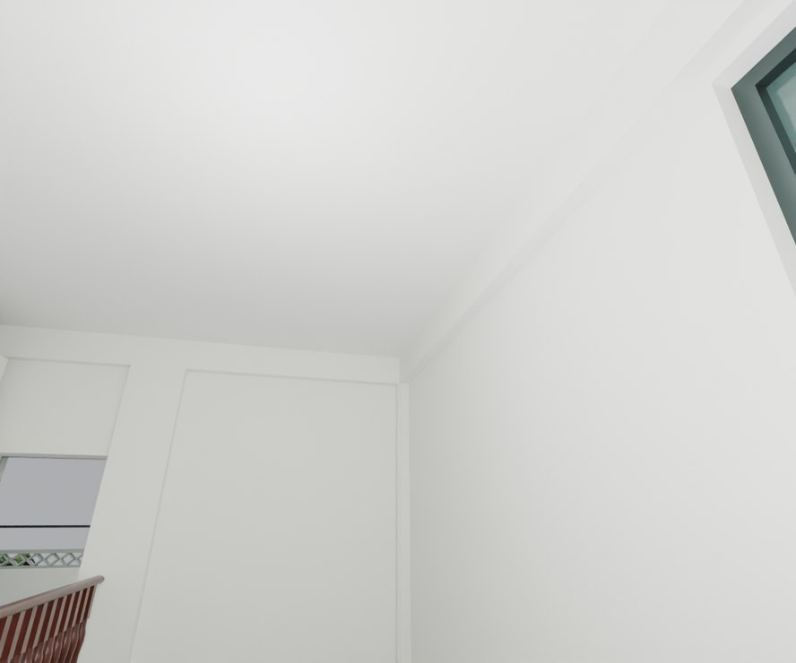
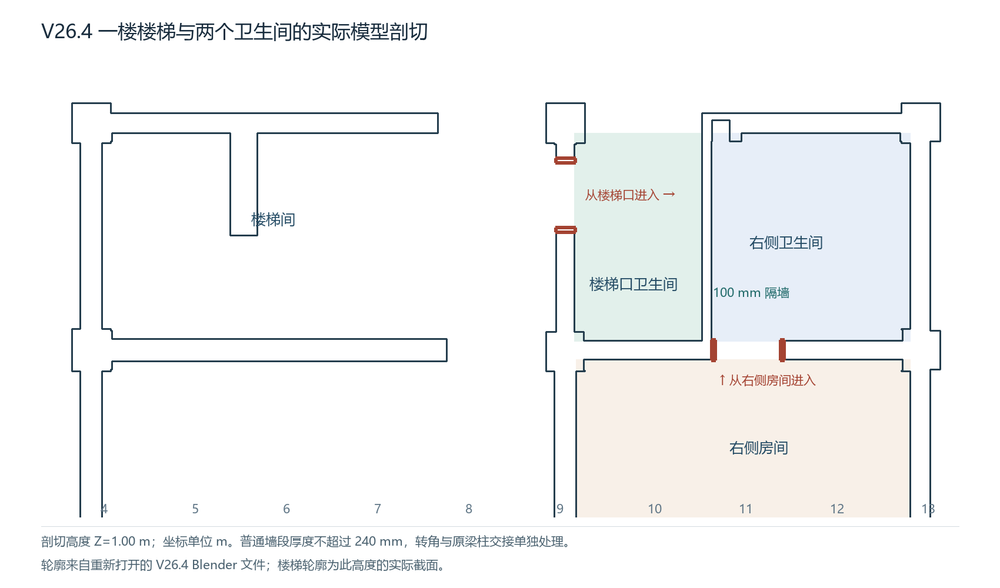

# V26.4 · 两卫生间独立入口、普通墙厚与三楼平顶

[逐版目录](README.md) · [建筑重建台账](../../reconstruction.md) · [阶段方法汇总](../v26-v26-20.md)

## 摘要

保持一楼两个卫生间各有入口，二、三楼卫浴墙收平，封三楼白色平顶并修门框、平台和窗角。

## 1. 问题与输入

在 V26.3 的连通关系上，明确首层楼梯口卫生间与右侧卫生间为两个区域。另检查二、三楼旧封门轮廓、门套和白天花。

## 2. 实现方法

1. 按首层关系图保留两个入口和 100 mm 中隔墙，分别校门套及门头。普通墙段按 240 mm 上限整理，梁柱节点与转角单独读取。

2. 二、三楼卫生间前墙收平，保留侧入口与后窄段。三楼白色平顶以既有完成面标高闭合，保留真实下挂梁轮廓。

3. 在原生文件采普通墙厚、顶板与门窗接头。对楼梯平台、滑门框及上亮、外飘窗与雨棚做局部回查。

## 3. 过程图

**图 1** · 三楼白顶和楼梯井

**图 2** · V26.4 首层两处卫生间及各自入口关系图

## 4. 验证与适用范围

几何报告列 1,746 个墙厚样本、12 项检查，原生报告列 20 项。平顶标高沿用既有模型，墙厚控制适用于指定普通墙段。

- **几何核验** 
  状态 `PASS`，检查条目 12，失败记录 0，踏面样本 80，墙厚样本 1,746。

- **原生保存与读回** 
  状态 `PASS`，检查条目 20，失败记录 0。

### 原记录中的关键检查

- **WC front walls and F1 door head have continuous masonry without a narrow vertical slit** 
  通过，`samples` = `73` 
  原记录 `V26_4_Geometry_QA.json` 的 `checks[6]`

- **Every audited ordinary wall span is at most 240 mm** 
  通过，`samples` = `1746`，`maximum_m` = `0.240001` 
  原记录 `V26_4_Geometry_QA.json` 的 `checks[2]`

- **All evaluated hinged leaves clear the corrected walls and frames** 
  通过，`poses` = `168` 
  原记录 `V26_4_Geometry_QA.json` 的 `checks[10]`

## 5. 复现入口与出处

过程路径以本地 `JIA` 项目为根，`work/` 指重建项目的历史工作目录。复核时按交付记录打开本轮输入与保存成果，再依方法中的截面、对象或动作采样对照原报告。

交付与参考记录（2 项）

~~~text
Rebuild_V26_4/使用说明.txt
Rebuild_V26_4/Reports/V26_4_模型复核.html
~~~

### 原实现脚本附件

[浏览本版全部 24 个文件](../source-code/v26-4/README.md) · [原件与公开副本校验值](../source-code/v26-4/manifest.json)

- [`v26_4_draw_plan.py`](../source-code/v26-4/project/Sources/v26_4_draw_plan.py)
- [`v26_4_prepare.py`](../source-code/v26-4/project/Sources/v26_4_prepare.py)
- [`v26_4_geometry_qa.py`](../source-code/v26-4/project/Sources/v26_4_geometry_qa.py)
- [`v26_4_build.py`](../source-code/v26-4/project/Sources/v26_4_build.py)
- [`v26_4_plan.py`](../source-code/v26-4/history/v26_4_plan.py)

原脚本本地路径

~~~text
Rebuild_V26_4/Sources/v26_4_draw_plan.py
Rebuild_V26_4/Sources/v26_4_prepare.py
Rebuild_V26_4/Sources/v26_4_geometry_qa.py
Rebuild_V26_4/Sources/v26_4_build.py
work/v26_4_plan.py
~~~

核验报告路径（2 项）

**几何核验**

~~~text
Rebuild_V26_4/Reports/V26_4_Geometry_QA.json
~~~

**原生保存与读回**

~~~text
Rebuild_V26_4/Reports/V26_4_Native_Readback_QA.json
~~~

图源与 SHA-256（2 张）

### 图 1 · 三楼白顶和楼梯井

~~~text
Rebuild_V26_4/Reports/After_06_F3_Stair_Ceiling_Cycles.png
~~~

**原过程图 SHA-256**

~~~text
657ac80ed47c5cfad73fda7c96d964b0e772a71cdead4c77cae0247edde0027c
~~~

台账发布图，按原图缩放及压缩。

### 图 2 · V26.4 首层两处卫生间及各自入口关系图

~~~text
Rebuild_V26_4/Reports/V26_4_F1_Room_Relationships.png
~~~

**原过程图 SHA-256**

~~~text
490bd196b42ded67f308d81bef5a0bd4c491385c909cc6084d429c3f18a2e735
~~~

原文件。

---

上一篇 [V26.3 · 用首层卫生间剖面恢复隔墙、上亮与墙顶](v26-3.md) 
下一篇 [V26.5 · 按玻璃与楼板边界裁瓦并清飘窗竖片](v26-5.md)
