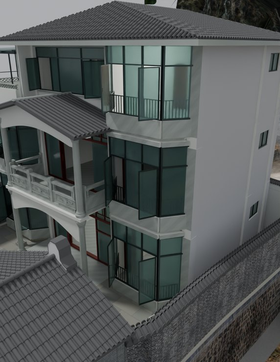
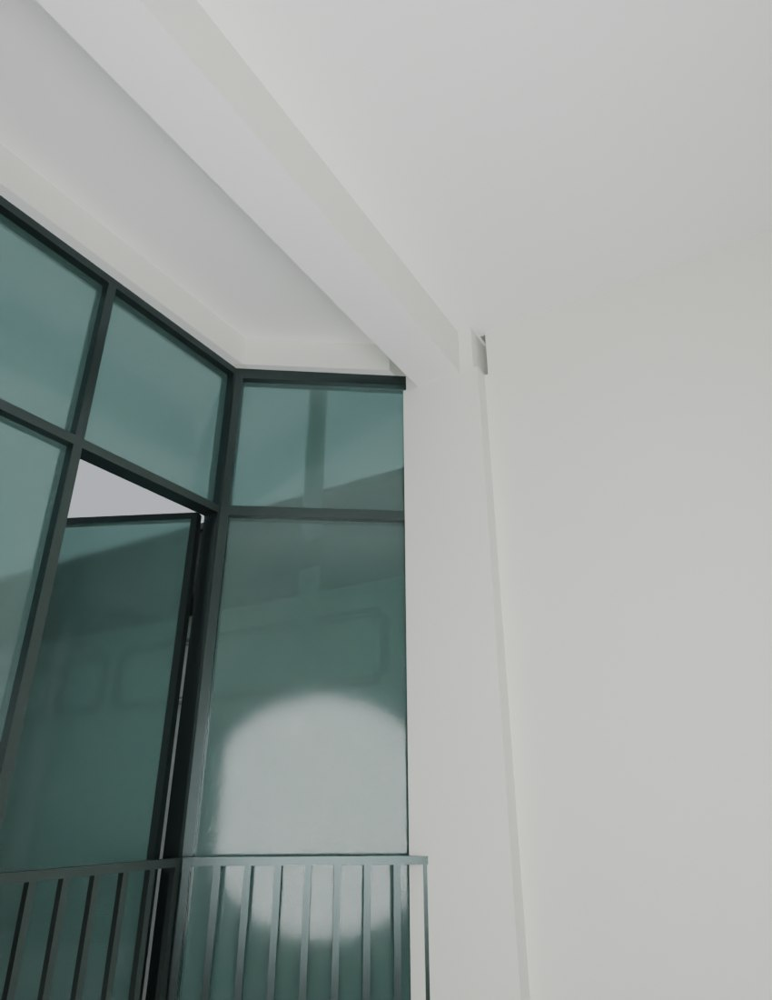

# V26.5 · 按玻璃与楼板边界裁瓦并清飘窗竖片

[逐版目录](README.md) · [建筑重建台账](../../reconstruction.md) · [阶段方法汇总](../v26-v26-20.md)

## 摘要

修首层卫浴隔墙及后高窗，裁穿斜窗玻璃的院墙瓦片，接外墙与楼板边，清五组飘窗转角多余白片。

## 1. 问题与输入

V26.4 后五张截图指出右卫生间后角、后高窗、西院墙穿斜窗、外墙楼板边及飘窗转角白片。

## 2. 实现方法

1. 从窗台、隔墙、框和玻璃轮廓定裁切范围。首层右卫后墙与 100 mm 隔墙连续封口，三个后高窗清错台而保留窗框玻璃。

2. 仅裁掉西院墙瓦顶穿入左房斜玻璃的部分。一二层东、西、后侧外墙接到楼板边，保持楼梯井开口，五组飘窗转角去多余白竖片。

3. 按相同墙板截面与保存图比较收口，读取墙厚、网格闭合和门窗运动。

## 3. 过程图

**图 1** · 右侧飘窗转角

**图 2** · V26.5 西院墙瓦片裁切后的一楼斜窗

## 4. 验证与适用范围

几何报告列 1,749 个墙厚样本；原说明给整理后后墙约 220.2 mm、内隔墙 100 mm。局部切面用于复核穿插。

- **几何核验** 
  状态 `PASS`，检查条目 12，失败记录 0，踏面样本 80，墙厚样本 1,749。

- **原生保存与读回** 
  状态 `PASS`，检查条目 20，失败记录 0。

### 原记录中的关键检查

- **WC front walls and F1 door head have continuous masonry without a narrow vertical slit** 
  通过，`samples` = `73` 
  原记录 `V26_5_Geometry_QA.json` 的 `checks[6]`

- **Every audited ordinary wall span is at most 240 mm** 
  通过，`samples` = `1749`，`maximum_m` = `0.240001` 
  原记录 `V26_5_Geometry_QA.json` 的 `checks[2]`

- **All evaluated hinged leaves clear the corrected walls and frames** 
  通过，`poses` = `168` 
  原记录 `V26_5_Geometry_QA.json` 的 `checks[10]`

## 5. 复现入口与出处

过程路径以本地 `JIA` 项目为根，`work/` 指重建项目的历史工作目录。复核时按交付记录打开本轮输入与保存成果，再依方法中的截面、对象或动作采样对照原报告。

交付与参考记录（2 项）

~~~text
Rebuild_V26_5/使用说明.txt
Rebuild_V26_5/Reports/V26_5_截图问题复核.html
~~~

### 原实现脚本附件

[浏览本版全部 46 个文件](../source-code/v26-5/README.md) · [原件与公开副本校验值](../source-code/v26-5/manifest.json)

- [`v26_5_precision_probe.py`](../source-code/v26-5/history/v26_5_precision_probe.py)
- [`v26_5_prepare.py`](../source-code/v26-5/project/Sources/v26_5_prepare.py)
- [`v26_5_geometry_qa.py`](../source-code/v26-5/project/Sources/v26_5_geometry_qa.py)
- [`v26_5_build.py`](../source-code/v26-5/project/Sources/v26_5_build.py)
- [`probe.py`](../source-code/v26-5/history/v26_5_left_audit/probe.py)

原脚本本地路径

~~~text
work/v26_5_precision_probe.py
Rebuild_V26_5/Sources/v26_5_prepare.py
Rebuild_V26_5/Sources/v26_5_geometry_qa.py
Rebuild_V26_5/Sources/v26_5_build.py
work/v26_5_left_audit/probe.py
~~~

核验报告路径（2 项）

**几何核验**

~~~text
Rebuild_V26_5/Reports/V26_5_Geometry_QA.json
~~~

**原生保存与读回**

~~~text
Rebuild_V26_5/Reports/V26_5_Native_Readback_QA.json
~~~

图源与 SHA-256（2 张）

### 图 1 · 右侧飘窗转角

~~~text
Rebuild_V26_5/Reports/After_12_Exterior_Right_Bay_Joints_Cycles.png
~~~

**原过程图 SHA-256**

~~~text
5e6062223f99121ff8f649d51f0c128552d1efb83ef51128f6c452d9c114b31c
~~~

台账发布图，按原图缩放及压缩。

### 图 2 · V26.5 西院墙瓦片裁切后的一楼斜窗

~~~text
Rebuild_V26_5/Reports/After_04_F1_Left_Room_Tile_Cycles.png
~~~

**原过程图 SHA-256**

~~~text
4eb4d339a0baba12f17b6b030eb5fac354e5e8cdab4dd149c91a5b35a1a2fd42
~~~

保留原画面，发布用 JPEG。

---

上一篇 [V26.4 · 两卫生间独立入口、普通墙厚与三楼平顶](v26-4.md) 
下一篇 [V26.6 · 以全景时间点复核平台石纹、三楼通口和天花颜色](v26-6.md)
