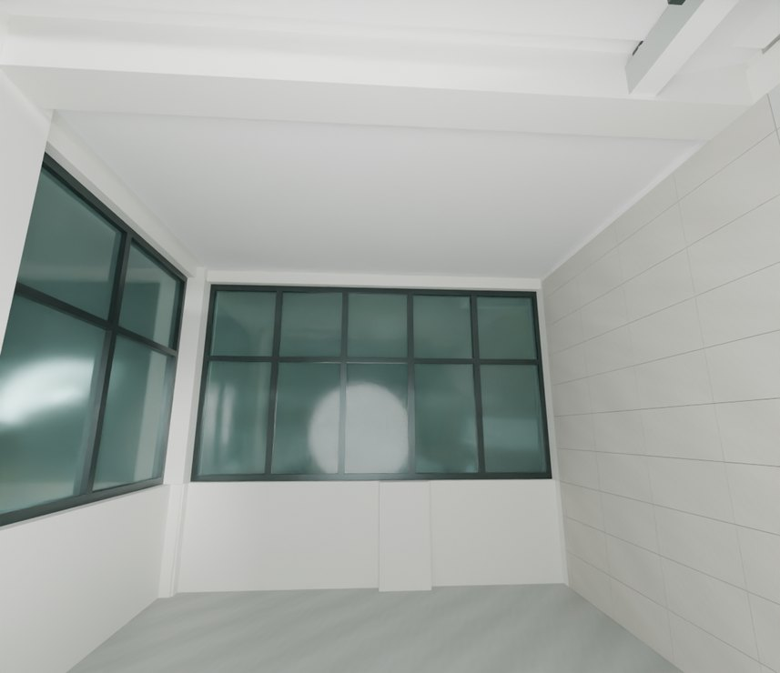
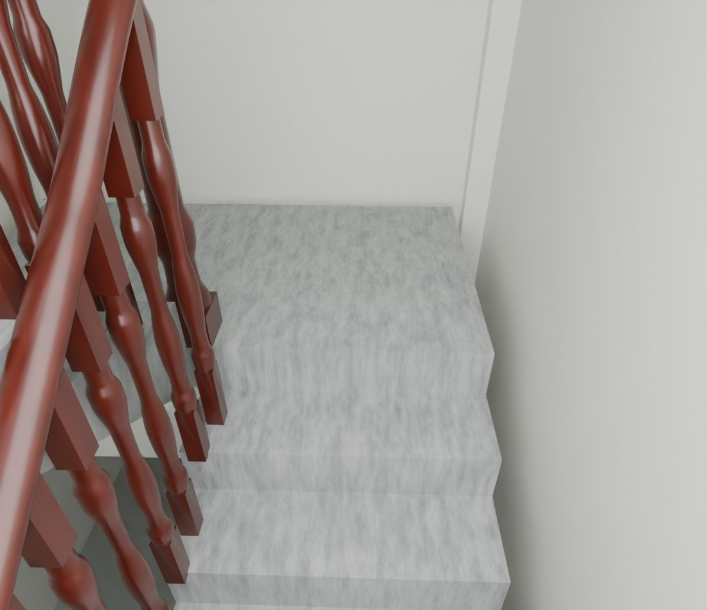

# V26.6 · 以全景时间点复核平台石纹、三楼通口和天花颜色

[逐版目录](README.md) · [建筑重建台账](../../reconstruction.md) · [阶段方法汇总](../v26-v26-20.md)

## 摘要

用原视频校正平台石纹、三楼露台通口与窗头，更新材质预览环境以减轻天花偏色。

## 1. 问题与输入

V26.5 保存模型有平台白条、三楼露台前误补墙以及白天花在材质预览中偏棕。视频与光照对照分别用于定位。

## 2. 实现方法

1. 核对全景 115、125、140、150 s，两中平台和两层到达前缘改用既有灰石纹，只改相应面的材质。

2. 从全景 170–205 s 的多个角度确认三楼露台至窗角开口，去误填墙，保留梁柱、窗框与玻璃。修双窗头和伸进平顶的旧檐板。

3. 保持白天花材质，将预览环境由 forest.exr 改为 studio.exr，另用灰度环境做中性对照。复开分别查模型通口和灯光设置。

### 实现链与源码定位

以下按诊断、处理、保存与复核组织阅读。调用和文件引用来自原脚本，输入输出方向由对应读写调用判断；辅助文件是否在本轮运行，以报告为准。

**1. 参数与几何处理** · [`v26_6_prepare.py`](../source-code/v26-6/project/Sources/v26_6_prepare.py#L11)

网格与实体转换 [`m.to_mesh64`](../source-code/v26-6/project/Sources/v26_6_prepare.py#L11)；叉积／面法线 [`np.cross`](../source-code/v26-6/project/Sources/v26_6_prepare.py#L11)。

文件引用：[`Geometry_Index.json`](../source-code/v26-6/project/Sources/v26_6_prepare.py#L4) · [`Prepared_House.json`](../source-code/v26-6/project/Sources/v26_6_prepare.py#L5) · [`Prepared_Geometry.json`](../source-code/v26-6/project/Sources/v26_6_prepare.py#L49)。

**2. 构建或写入** · [`v26_6_build.py`](../source-code/v26-6/project/Sources/v26_6_build.py#L11)

打开保存的 Blender [`bpy.ops.wm.open_mainfile`](../source-code/v26-6/project/Sources/v26_6_build.py#L11)；写入网格拓扑 [`me.from_pydata`](../source-code/v26-6/project/Sources/v26_6_build.py#L16)；批量写入属性 [`me.polygons.foreach_set`](../source-code/v26-6/project/Sources/v26_6_build.py#L18)。

文件引用：[`Architecture_Complete_V26_5.blend`](../source-code/v26-6/project/Sources/v26_6_build.py#L4) · [`Architecture_Complete_V26_6.blend`](../source-code/v26-6/project/Sources/v26_6_build.py#L4) · [`Before_Snapshot.json`](../source-code/v26-6/project/Sources/v26_6_build.py#L12)。

**3. 辅助实现** · [`extract_terrace.py`](../source-code/v26-6/project/Sources/v26_6_asbuilt_audit/extract_terrace.py#L11)

文件引用：[`_Yaw0_FOV110.jpg`](../source-code/v26-6/project/Sources/v26_6_asbuilt_audit/extract_terrace.py#L9) · [`Frame_Provenance.json`](../source-code/v26-6/project/Sources/v26_6_asbuilt_audit/extract_terrace.py#L11)。

**4. 辅助实现** · [`v26_6_overlap_gate.py`](../source-code/v26-6/project/Sources/v26_6_overlap_gate.py#L4)

判据与回归检查 [`checks.append`](../source-code/v26-6/project/Sources/v26_6_overlap_gate.py#L10)。

文件引用：[`Architecture_Complete_V26_6.blend`](../source-code/v26-6/project/Sources/v26_6_overlap_gate.py#L3) · [`Overlap_Audit_After.json`](../source-code/v26-6/project/Sources/v26_6_overlap_gate.py#L4) · [`V26_6_Native_Readback_QA.json`](../source-code/v26-6/project/Sources/v26_6_overlap_gate.py#L12)。

**5. 保存后核验** · [`v26_6_geometry_qa.py`](../source-code/v26-6/project/Sources/v26_6_geometry_qa.py#L8)

判据与回归检查 [`checks.append`](../source-code/v26-6/project/Sources/v26_6_geometry_qa.py#L5)；叉积／面法线 [`np.cross`](../source-code/v26-6/project/Sources/v26_6_geometry_qa.py#L8)；射线命中检查 [`house.ray_cast`](../source-code/v26-6/project/Sources/v26_6_geometry_qa.py#L40)。

文件引用：[`Geometry_Index.json`](../source-code/v26-6/project/Sources/v26_6_geometry_qa.py#L4) · [`Prepared_House.json`](../source-code/v26-6/project/Sources/v26_6_geometry_qa.py#L25) · [`Door_Motion.json`](../source-code/v26-6/project/Sources/v26_6_geometry_qa.py#L94)。

**6. 保存后核验** · [`final_geometry_qa.py`](../source-code/v26-6/project/Sources/v26_6_ceiling_audit/final_geometry_qa.py#L14)

判据与回归检查 [`checks.append`](../source-code/v26-6/project/Sources/v26_6_ceiling_audit/final_geometry_qa.py#L9)；实体运算对象 [`mf.Manifold`](../source-code/v26-6/project/Sources/v26_6_ceiling_audit/final_geometry_qa.py#L14)；叉积／面法线 [`np.cross`](../source-code/v26-6/project/Sources/v26_6_ceiling_audit/final_geometry_qa.py#L18)。

文件引用：[`Preview_Material_Settings_Partial.json`](../source-code/v26-6/project/Sources/v26_6_ceiling_audit/final_geometry_qa.py#L5) · [`Geometry_Index.json`](../source-code/v26-6/project/Sources/v26_6_ceiling_audit/final_geometry_qa.py#L12) · [`V26_6_Neutral_White_Preview_QA.json`](../source-code/v26-6/project/Sources/v26_6_ceiling_audit/final_geometry_qa.py#L24)。

**7. 保存后核验** · [`v26_6_readback.py`](../source-code/v26-6/project/Sources/v26_6_readback.py#L7)

打开保存的 Blender [`bpy.ops.wm.open_mainfile`](../source-code/v26-6/project/Sources/v26_6_readback.py#L7)；判据与回归检查 [`checks.append`](../source-code/v26-6/project/Sources/v26_6_readback.py#L8)。

文件引用：[`Architecture_Complete_V26_6.blend`](../source-code/v26-6/project/Sources/v26_6_readback.py#L4) · [`Before_Snapshot.json`](../source-code/v26-6/project/Sources/v26_6_readback.py#L7) · [`V26_6_Changes.json`](../source-code/v26-6/project/Sources/v26_6_readback.py#L7)。

[方法原理：照片、程序材质与高度图](../methodology.md#5-材质与浮雕分别保留什么证据) · [本版完整过程索引](process/v26-6.md)

本版索引汇合 57 幅已归档过程图、65 份交付及历史目录中的报告／说明／中间记录和全部 54 个源码附件。继承文件和本轮新增文件按来源保留，实际完成范围以第 4 节及原报告为准。

## 3. 过程图

**图 1** · 三楼露台通口

**图 2** · V26.6 一楼平台前缘延续原灰色石纹

## 4. 验证与适用范围

原生 20 项、几何 12 项。未标定的全景确定构件关系和饰面，预览环境的色温变化用于诊断视口。

- **几何核验** 
  状态 `PASS`，检查条目 12，失败记录 0，踏面样本 80，墙厚样本 1,722。

- **原生保存与读回** 
  状态 `PASS`，检查条目 20，失败记录 0。

### 原记录中的关键检查

- **WC front walls and F1 door head remain closed; photographed F3 west terrace span is open** 
  通过，`samples` = `73` 
  原记录 `V26_6_Geometry_QA.json` 的 `checks[6]`

- **Every audited ordinary wall span is at most 240 mm** 
  通过，`samples` = `1722`，`maximum_m` = `0.240001` 
  原记录 `V26_6_Geometry_QA.json` 的 `checks[2]`

- **All evaluated hinged leaves clear the corrected walls and frames** 
  通过，`poses` = `168` 
  原记录 `V26_6_Geometry_QA.json` 的 `checks[10]`

## 5. 复现入口与出处

过程路径以本地 `JIA` 项目为根，`work/` 指重建项目的历史工作目录。复核时按交付记录打开本轮输入与保存成果，再依方法中的截面、对象或动作采样对照原报告。

交付与参考记录（2 项）

~~~text
Rebuild_V26_6/使用说明.txt
Rebuild_V26_6/Reports/V26_6_实景依据与修正复核.html
~~~

### 原实现脚本附件

[浏览本版全部 54 个文件](../source-code/v26-6/README.md) · [原件与公开副本校验值](../source-code/v26-6/manifest.json)

- [`extract_terrace.py`](../source-code/v26-6/project/Sources/v26_6_asbuilt_audit/extract_terrace.py)
- [`v26_6_prepare.py`](../source-code/v26-6/project/Sources/v26_6_prepare.py)
- [`v26_6_geometry_qa.py`](../source-code/v26-6/project/Sources/v26_6_geometry_qa.py)
- [`v26_6_build.py`](../source-code/v26-6/project/Sources/v26_6_build.py)
- [`final_geometry_qa.py`](../source-code/v26-6/project/Sources/v26_6_ceiling_audit/final_geometry_qa.py)

原脚本本地路径

~~~text
Rebuild_V26_6/Sources/v26_6_asbuilt_audit/extract_terrace.py
Rebuild_V26_6/Sources/v26_6_prepare.py
Rebuild_V26_6/Sources/v26_6_geometry_qa.py
Rebuild_V26_6/Sources/v26_6_build.py
Rebuild_V26_6/Sources/v26_6_ceiling_audit/final_geometry_qa.py
~~~

核验报告路径（2 项）

**几何核验**

~~~text
Rebuild_V26_6/Reports/V26_6_Geometry_QA.json
~~~

**原生保存与读回**

~~~text
Rebuild_V26_6/Reports/V26_6_Native_Readback_QA.json
~~~

图源与 SHA-256（2 张）

### 图 1 · 三楼露台通口

~~~text
Rebuild_V26_6/Reports/After_07_F3_Terrace_Open_Alcove_Cycles.png
~~~

**原过程图 SHA-256**

~~~text
db0259703022093ea35be25b2e12bd57bf6c457bcb66168ebbc2a1f681455526
~~~

台账发布图，按原图缩放及压缩。

### 图 2 · V26.6 一楼平台前缘延续原灰色石纹

~~~text
Rebuild_V26_6/Reports/After_01_F1_Landing_Front_Cycles.png
~~~

**原过程图 SHA-256**

~~~text
3c5018a020e55d22b52c14b4613c4f94b3825a1a67175b6ff7d24a0d877434bc
~~~

保留原画面，发布用 JPEG。

---

上一篇 [V26.5 · 按玻璃与楼板边界裁瓦并清飘窗竖片](v26-5.md) 
下一篇 [V26.7 · 由墙柱截面、扶手节点和门槛高程修局部构件](v26-7.md)
