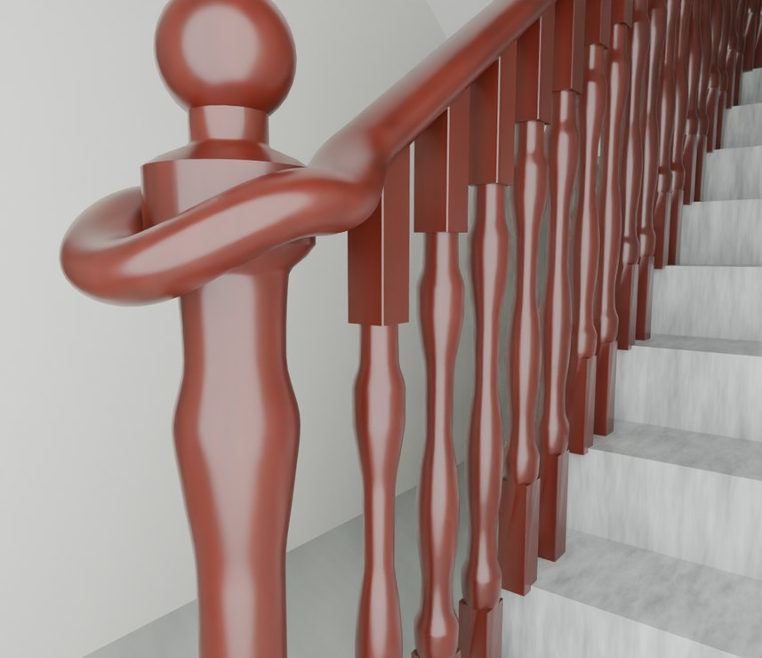
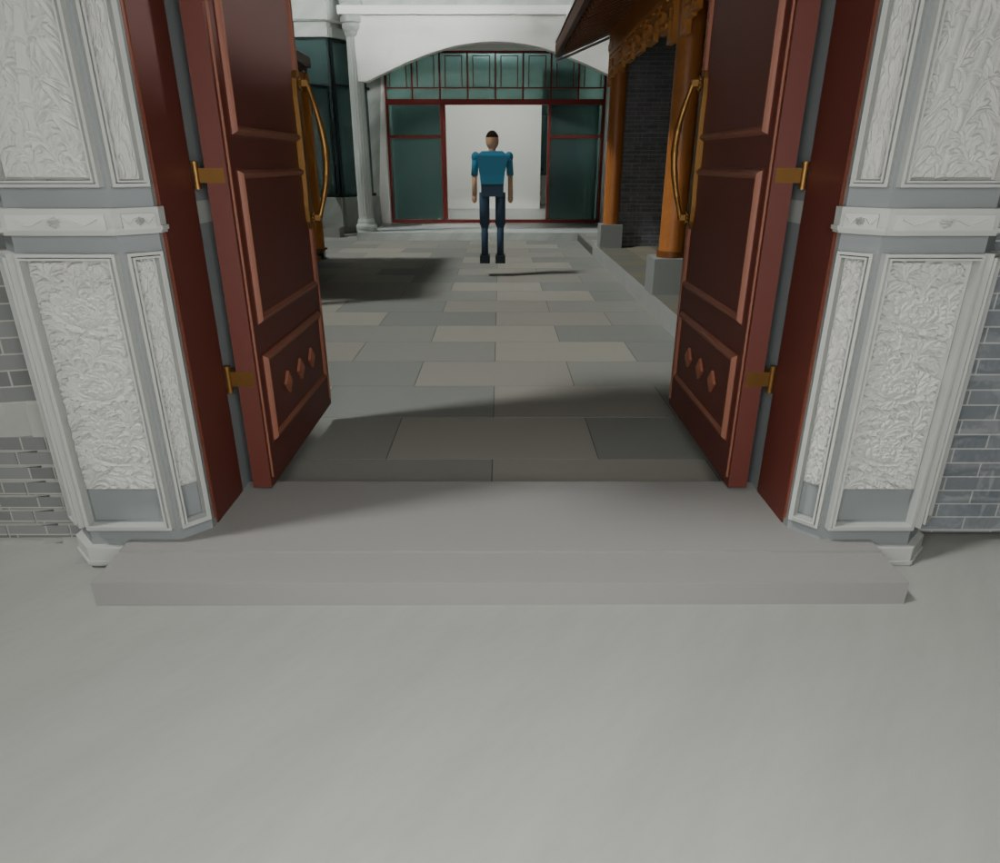

# V26.7 · 由墙柱截面、扶手节点和门槛高程修局部构件

[逐版目录](README.md) · [建筑重建台账](../../reconstruction.md) · [阶段方法汇总](../v26-v26-20.md)

## 摘要

收整墙柱、楼梯凸带和车木扶手，降低内门石槛并补基座，清理院墙重复白带与错材质。

## 1. 问题与输入

根据实景与 V26.6 保存文件定位旧柱芯、楼梯井凸带、扶手回弯、院墙白带及内门石槛。

## 2. 实现方法

1. 检查 35 个旧合成柱节点。以相邻墙面裁室内旧凸块和楼梯井约 92.2 mm 楼层凸带，保留门洞、100 mm 卫浴隔墙和梁下挂。

2. 按车木端柱与球头形态做小 U 形回弯、柱帽和细倒棱。院墙白腰线限于照壁，对其他段恢复青砖。

3. 石槛顶按当前院坪拟合到 −0.50 m，约高于院坪 100 mm；配合门叶下沿和门框，并补门侧后地坪基座。以原门轴复测。

### 实现链与源码定位

以下按诊断、处理、保存与复核组织阅读。调用和文件引用来自原脚本，输入输出方向由对应读写调用判断；辅助文件是否在本轮运行，以报告为准。

**1. 定位与诊断** · [`v26_7_probe.py`](../source-code/v26-7/history/v26_7_probe.py#L13)

射线命中检查 [`m.ray_cast`](../source-code/v26-7/history/v26_7_probe.py#L13)。

文件引用：[`Geometry_Index.json`](../source-code/v26-7/history/v26_7_probe.py#L2) · [`Stair_Wall_Plane_Probe.json`](../source-code/v26-7/history/v26_7_probe.py#L16)。

**2. 参数与几何处理** · [`v26_7_gate_prepare.py`](../source-code/v26-7/project/Sources/v26_7_gate_prepare.py#L3)

文件引用：[`Geometry_Index.json`](../source-code/v26-7/project/Sources/v26_7_gate_prepare.py#L3) · [`Prepared_Geometry.json`](../source-code/v26-7/project/Sources/v26_7_gate_prepare.py#L37) · [`Architecture_Complete_V26_6.blend`](../source-code/v26-7/project/Sources/v26_7_gate_prepare.py#L37)。

**3. 构建或写入** · [`v26_7_build.py`](../source-code/v26-7/project/Sources/v26_7_build.py#L11)

打开保存的 Blender [`bpy.ops.wm.open_mainfile`](../source-code/v26-7/project/Sources/v26_7_build.py#L11)；写入网格拓扑 [`me.from_pydata`](../source-code/v26-7/project/Sources/v26_7_build.py#L20)；批量写入属性 [`me.polygons.foreach_set`](../source-code/v26-7/project/Sources/v26_7_build.py#L22)。

文件引用：[`Architecture_Complete_V26_6.blend`](../source-code/v26-7/project/Sources/v26_7_build.py#L4) · [`Architecture_Complete_V26_7.blend`](../source-code/v26-7/project/Sources/v26_7_build.py#L4) · [`Before_Snapshot.json`](../source-code/v26-7/project/Sources/v26_7_build.py#L12)。

**4. 构建或写入** · [`build_candidate.py`](../source-code/v26-7/project/Sources/v26_7_railing_audit/build_candidate.py#L16)

叉积／面法线 [`np.cross`](../source-code/v26-7/project/Sources/v26_7_railing_audit/build_candidate.py#L16)；图像或几何变换 [`transform`](../source-code/v26-7/project/Sources/v26_7_railing_audit/build_candidate.py#L47)。

文件引用：[`Prepared_Railing.json`](../source-code/v26-7/project/Sources/v26_7_railing_audit/build_candidate.py#L55) · [`Architecture_Complete_V26_6.blend`](../source-code/v26-7/project/Sources/v26_7_railing_audit/build_candidate.py#L119) · [`屏幕截图 2026-10-23 015859.jpg`](../source-code/v26-7/project/Sources/v26_7_railing_audit/build_candidate.py#L119)。

**5. 辅助实现** · [`v26_7_overlap_gate.py`](../source-code/v26-7/project/Sources/v26_7_overlap_gate.py#L4)

判据与回归检查 [`checks.append`](../source-code/v26-7/project/Sources/v26_7_overlap_gate.py#L10)。

文件引用：[`Architecture_Complete_V26_7.blend`](../source-code/v26-7/project/Sources/v26_7_overlap_gate.py#L3) · [`Overlap_Audit_After.json`](../source-code/v26-7/project/Sources/v26_7_overlap_gate.py#L4) · [`V26_7_Native_Readback_QA.json`](../source-code/v26-7/project/Sources/v26_7_overlap_gate.py#L12)。

**6. 保存后核验** · [`v26_7_geometry_qa.py`](../source-code/v26-7/project/Sources/v26_7_geometry_qa.py#L8)

判据与回归检查 [`checks.append`](../source-code/v26-7/project/Sources/v26_7_geometry_qa.py#L5)；叉积／面法线 [`np.cross`](../source-code/v26-7/project/Sources/v26_7_geometry_qa.py#L8)；射线命中检查 [`house.ray_cast`](../source-code/v26-7/project/Sources/v26_7_geometry_qa.py#L40)。

文件引用：[`Geometry_Index.json`](../source-code/v26-7/project/Sources/v26_7_geometry_qa.py#L4) · [`Prepared_House.json`](../source-code/v26-7/project/Sources/v26_7_geometry_qa.py#L25) · [`Door_Motion.json`](../source-code/v26-7/project/Sources/v26_7_geometry_qa.py#L90)。

**7. 保存后核验** · [`v26_7_readback.py`](../source-code/v26-7/project/Sources/v26_7_readback.py#L7)

打开保存的 Blender [`bpy.ops.wm.open_mainfile`](../source-code/v26-7/project/Sources/v26_7_readback.py#L7)；判据与回归检查 [`checks.append`](../source-code/v26-7/project/Sources/v26_7_readback.py#L8)。

文件引用：[`Architecture_Complete_V26_7.blend`](../source-code/v26-7/project/Sources/v26_7_readback.py#L4) · [`Before_Snapshot.json`](../source-code/v26-7/project/Sources/v26_7_readback.py#L7) · [`V26_7_Changes.json`](../source-code/v26-7/project/Sources/v26_7_readback.py#L7)。

[方法原理：局部实体、接合与保护域](../methodology.md#4-局部改模如何限定影响范围) · [本版完整过程索引](process/v26-7.md)

本版索引汇合 98 幅已归档过程图、84 份交付及历史目录中的报告／说明／中间记录和全部 62 个源码附件。继承文件和本轮新增文件按来源保留，实际完成范围以第 4 节及原报告为准。

## 3. 过程图

**图 1** · 车木扶手起步段

**图 2** · V26.7 降低后的石槛和门前地面

## 4. 验证与适用范围

报告列 1,722 个普通墙厚样本与 20 项原生检查。门槛、扶手间距和端部截面来自当前模型与影像关系。

- **几何核验** 
  状态 `PASS`，检查条目 11，失败记录 0，踏面样本 80，墙厚样本 1,722。

- **原生保存与读回** 
  状态 `PASS`，检查条目 20，失败记录 0。

### 原记录中的关键检查

- **WC front walls and F1 door head remain closed; photographed F3 west terrace span is open** 
  通过，`samples` = `73` 
  原记录 `V26_7_Geometry_QA.json` 的 `checks[6]`

- **Every audited ordinary wall span is at most 240 mm** 
  通过，`samples` = `1722`，`maximum_m` = `0.240001` 
  原记录 `V26_7_Geometry_QA.json` 的 `checks[2]`

- **All evaluated hinged leaves clear the corrected walls and frames** 
  通过，`poses` = `168` 
  原记录 `V26_7_Geometry_QA.json` 的 `checks[9]`

## 5. 复现入口与出处

过程路径以本地 `JIA` 项目为根，`work/` 指重建项目的历史工作目录。复核时按交付记录打开本轮输入与保存成果，再依方法中的截面、对象或动作采样对照原报告。

交付与参考记录（2 项）

~~~text
Rebuild_V26_7/使用说明.txt
Rebuild_V26_7/Reports/V26_7_实景与修正复核.html
~~~

### 原实现脚本附件

[浏览本版全部 62 个文件](../source-code/v26-7/README.md) · [原件与公开副本校验值](../source-code/v26-7/manifest.json)

- [`v26_7_gate_prepare.py`](../source-code/v26-7/project/Sources/v26_7_gate_prepare.py)
- [`v26_7_probe.py`](../source-code/v26-7/history/v26_7_probe.py)
- [`v26_7_geometry_qa.py`](../source-code/v26-7/project/Sources/v26_7_geometry_qa.py)
- [`v26_7_build.py`](../source-code/v26-7/project/Sources/v26_7_build.py)
- [`build_candidate.py`](../source-code/v26-7/project/Sources/v26_7_railing_audit/build_candidate.py)

原脚本本地路径

~~~text
Rebuild_V26_7/Sources/v26_7_gate_prepare.py
work/v26_7_probe.py
Rebuild_V26_7/Sources/v26_7_geometry_qa.py
Rebuild_V26_7/Sources/v26_7_build.py
Rebuild_V26_7/Sources/v26_7_railing_audit/build_candidate.py
~~~

核验报告路径（2 项）

**几何核验**

~~~text
Rebuild_V26_7/Reports/V26_7_Geometry_QA.json
~~~

**原生保存与读回**

~~~text
Rebuild_V26_7/Reports/V26_7_Native_Readback_QA.json
~~~

图源与 SHA-256（2 张）

### 图 1 · 车木扶手起步段

~~~text
Rebuild_V26_7/Reports/After_04_F1_Railing_Start_Cycles.png
~~~

**原过程图 SHA-256**

~~~text
e46e5fe0c8f70e734aca31085091f7fc3460338e77a6c45307cfb8219c44ce89
~~~

台账发布图，按原图缩放及压缩。

### 图 2 · V26.7 降低后的石槛和门前地面

~~~text
Rebuild_V26_7/Reports/After_07_Gate_Threshold_Front_Cycles.png
~~~

**原过程图 SHA-256**

~~~text
da4f4a7da86b21dce2891f7818c36e79352cbb22c3f352aded300407fe464dd9
~~~

保留原画面，发布用 JPEG。

---

上一篇 [V26.6 · 以全景时间点复核平台石纹、三楼通口和天花颜色](v26-6.md) 
下一篇 [V26.8 · 收窄楼梯井并以同场景比较 Fast 视口](v26-8.md)
