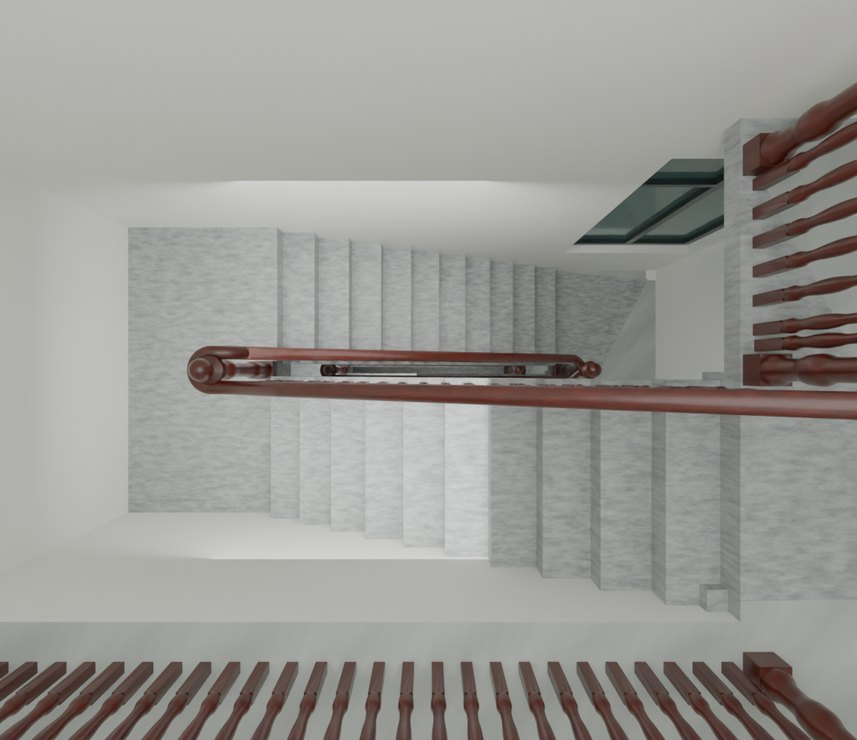
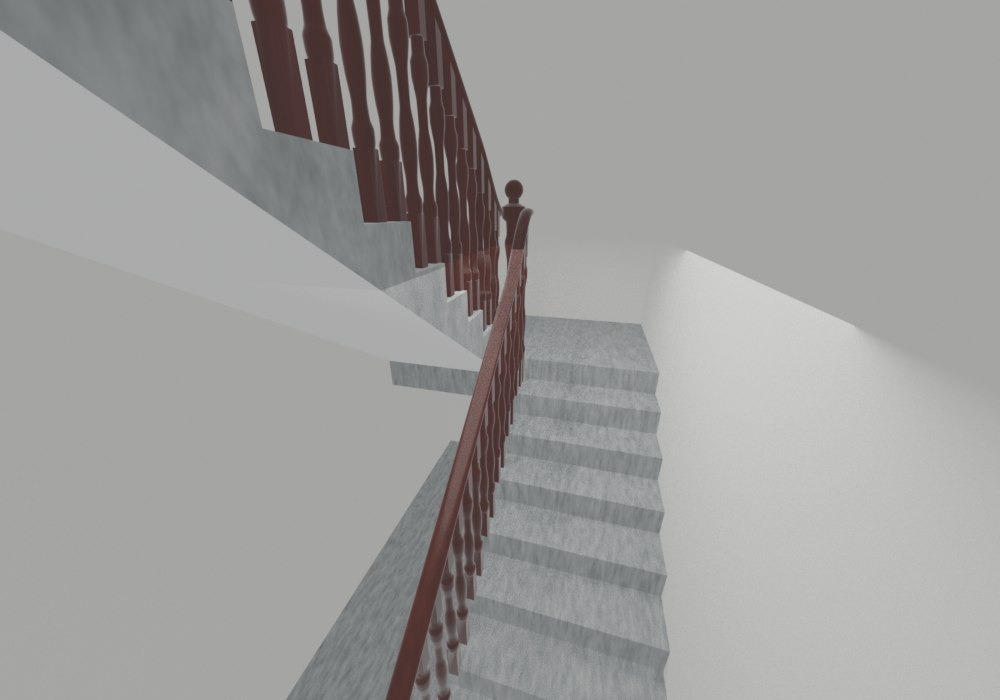
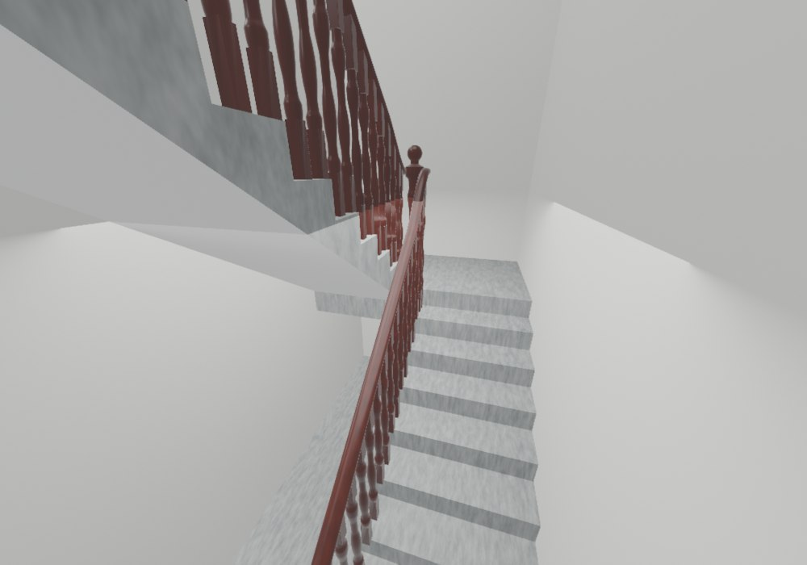
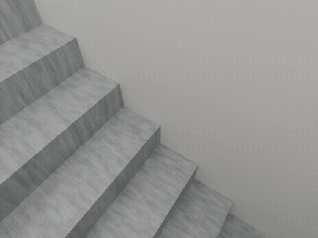

# V26.8 · 收窄楼梯井并以同场景比较 Fast 视口

[逐版目录](README.md) · [建筑重建台账](../../reconstruction.md) · [阶段方法汇总](../v26-v26-20.md)

## 摘要

楼梯井和门窗石材节点按实景收口。引入阴天柔光与独立 Fast 预览，优化贴图、采样及待机更新。

## 1. 问题与输入

V26.7 的楼梯井和扶手转折按最新实景再校正。流畅漫游用独立 Blender 副本，便于比较相同建筑几何下的预览设置。

## 2. 实现方法

1. 保持原 11 级踏步 X/Z 和平台标高，四跑连续贴墙，梯井拟合约 100 mm，扶手内轴随井边调整。窗台按各层约束修正，清除三层误加铁栏。

2. 编辑版另存 Fast，Eevee 限制视口贴图 2K、二像素步长，减少实时阴影。人物静止或窗口失焦时跳过重复更新。

3. 使用 Blender 原生重绘，在 1920 × 1010 视口着色器预热后每项采 16 帧。比较院落和楼梯两视角，另查建筑网格、UV 和碰撞一致性。

### 实现链与源码定位

以下按诊断、处理、保存与复核组织阅读。调用和文件引用来自原脚本，输入输出方向由对应读写调用判断；辅助文件是否在本轮运行，以报告为准。

**1. 定位与诊断** · [`v26_8_perf_audit.py`](../source-code/v26-8/project/Sources/Performance/v26_8_perf_audit.py#L9)

打开保存的 Blender [`bpy.ops.wm.open_mainfile`](../source-code/v26-8/project/Sources/Performance/v26_8_perf_audit.py#L9)。

文件引用：[`Architecture_Complete_V26_8.blend`](../source-code/v26-8/project/Sources/Performance/v26_8_perf_audit.py#L7) · [`Audit_Before.json`](../source-code/v26-8/project/Sources/Performance/v26_8_perf_audit.py#L70)。

**2. 参数与几何处理** · [`v26_8_prepare.py`](../source-code/v26-8/project/Sources/v26_8_prepare.py#L25)

图像或几何变换 [`m.transform`](../source-code/v26-8/project/Sources/v26_8_prepare.py#L25)；叉积／面法线 [`np.cross`](../source-code/v26-8/project/Sources/v26_8_prepare.py#L56)。

文件引用：[`Geometry_Index.json`](../source-code/v26-8/project/Sources/v26_8_prepare.py#L5) · [`屏幕截图 2026-10-24 130324.jpg`](../source-code/v26-8/project/Sources/v26_8_prepare.py#L11) · [`Prepared_House.json`](../source-code/v26-8/project/Sources/v26_8_prepare.py#L15)。

**3. 构建或写入** · [`v26_8_build_fast.py`](../source-code/v26-8/project/Sources/Performance/v26_8_build_fast.py#L23)

打开保存的 Blender [`bpy.ops.wm.open_mainfile`](../source-code/v26-8/project/Sources/Performance/v26_8_build_fast.py#L23)；另存 Blender [`bpy.ops.wm.save_as_mainfile`](../source-code/v26-8/project/Sources/Performance/v26_8_build_fast.py#L47)。

文件引用：[`Architecture_Complete_V26_8.blend`](../source-code/v26-8/project/Sources/Performance/v26_8_build_fast.py#L12) · [`Architecture_Complete_V26_8_Fast.blend`](../source-code/v26-8/project/Sources/Performance/v26_8_build_fast.py#L13) · [`Preservation_Before.json`](../source-code/v26-8/project/Sources/Performance/v26_8_build_fast.py#L26)。

**4. 构建或写入** · [`v26_8_build.py`](../source-code/v26-8/project/Sources/v26_8_build.py#L11)

打开保存的 Blender [`bpy.ops.wm.open_mainfile`](../source-code/v26-8/project/Sources/v26_8_build.py#L11)；写入网格拓扑 [`me.from_pydata`](../source-code/v26-8/project/Sources/v26_8_build.py#L20)；批量写入属性 [`me.polygons.foreach_set`](../source-code/v26-8/project/Sources/v26_8_build.py#L22)。

文件引用：[`Architecture_Complete_V26_7.blend`](../source-code/v26-8/project/Sources/v26_8_build.py#L4) · [`Architecture_Complete_V26_8.blend`](../source-code/v26-8/project/Sources/v26_8_build.py#L4) · [`Before_Snapshot.json`](../source-code/v26-8/project/Sources/v26_8_build.py#L12)。

**5. 保存后核验** · [`v26_8_geometry_qa.py`](../source-code/v26-8/project/Sources/v26_8_geometry_qa.py#L8)

判据与回归检查 [`checks.append`](../source-code/v26-8/project/Sources/v26_8_geometry_qa.py#L5)；叉积／面法线 [`np.cross`](../source-code/v26-8/project/Sources/v26_8_geometry_qa.py#L8)；射线命中检查 [`house.ray_cast`](../source-code/v26-8/project/Sources/v26_8_geometry_qa.py#L40)。

文件引用：[`Geometry_Index.json`](../source-code/v26-8/project/Sources/v26_8_geometry_qa.py#L4) · [`Prepared_House.json`](../source-code/v26-8/project/Sources/v26_8_geometry_qa.py#L25) · [`Door_Motion.json`](../source-code/v26-8/project/Sources/v26_8_geometry_qa.py#L90)。

**6. 保存后核验** · [`v26_8_verify_fast.py`](../source-code/v26-8/project/Sources/Performance/v26_8_verify_fast.py#L15)

打开保存的 Blender [`bpy.ops.wm.open_mainfile`](../source-code/v26-8/project/Sources/Performance/v26_8_verify_fast.py#L15)；判据与回归检查 [`checks.append`](../source-code/v26-8/project/Sources/Performance/v26_8_verify_fast.py#L27)。

文件引用：[`Architecture_Complete_V26_8_Fast.blend`](../source-code/v26-8/project/Sources/Performance/v26_8_verify_fast.py#L8) · [`Preservation_Before.json`](../source-code/v26-8/project/Sources/Performance/v26_8_verify_fast.py#L16) · [`Preservation_After.json`](../source-code/v26-8/project/Sources/Performance/v26_8_verify_fast.py#L18)。

**7. 交付封装** · [`v26_8_package_fast.py`](../source-code/v26-8/project/Sources/Performance/v26_8_package_fast.py#L14)

文件引用：[`V26_8_Performance_QA.json`](../source-code/v26-8/project/Sources/Performance/v26_8_package_fast.py#L14) · [`Architecture_Complete_V26_8.blend`](../source-code/v26-8/project/Sources/Performance/v26_8_package_fast.py#L22) · [`Architecture_Complete_V26_8_Fast.blend`](../source-code/v26-8/project/Sources/Performance/v26_8_package_fast.py#L22)。

[方法原理：门扇运动与漫游碰撞](../methodology.md#7-门窗漫游与-fast-怎样核验) · [本版完整过程索引](process/v26-8.md)

本版索引汇合 71 幅已归档过程图、85 份交付及历史目录中的报告／说明／中间记录和全部 65 个源码附件。继承文件和本轮新增文件按来源保留，实际完成范围以第 4 节及原报告为准。

## 3. 过程图

**图 1** · 楼梯井和栏杆

 

**图 2** · V26.8 测试的楼梯原显示设置 
**图 3** · V26.8 测试的楼梯 Fast 设置

### 原过程动画

12 帧斜视复核短片，用于检查台阶与墙体交接；不是人物步行、碰撞或施工验收。

[查看 MP4](../animations/v26-8-stair-oblique.mp4) · [动画出处与类型](../animations/README.md)

## 4. 验证与适用范围

原机院落从 18.4 到 35.2 FPS，楼梯从 8.4 到 31.2 FPS。测试期间原漫游窗口与其他程序仍在运行，读数适用于记录条件。

- **视口计时记录** 
  状态 `PASS`。

- **预览性能核验** 
  状态 `PASS`，检查条目 17，失败记录 0。

- **几何核验** 
  状态 `PASS`，检查条目 11，失败记录 0，踏面样本 80，墙厚样本 1,717。

### 原记录中的关键检查

- **Native moving viewport faster for stairs** 
  通过，`before_fps` = `8.41159`，`after_fps` = `31.1524` 
  原记录 `V26_8_Performance_QA.json` 的 `checks[16]`

- **All material node graphs unchanged** 
  通过，`materials` = `378` 
  原记录 `V26_8_Performance_QA.json` 的 `checks[2]`

- **All original image pixels and packed bytes unchanged** 
  通过，`images` = `231` 
  原记录 `V26_8_Performance_QA.json` 的 `checks[3]`

## 5. 复现入口与出处

过程路径以本地 `JIA` 项目为根，`work/` 指重建项目的历史工作目录。复核时按交付记录打开本轮输入与保存成果，再依方法中的截面、对象或动作采样对照原报告。

交付与参考记录（2 项）

~~~text
Rebuild_V26_8/使用说明.txt
Rebuild_V26_8/Reports/V26_8_实景与修正复核.html
~~~

### 原实现脚本附件

[浏览本版全部 65 个文件](../source-code/v26-8/README.md) · [原件与公开副本校验值](../source-code/v26-8/manifest.json)

- [`v26_8_prepare.py`](../source-code/v26-8/project/Sources/v26_8_prepare.py)
- [`v26_8_build_fast.py`](../source-code/v26-8/project/Sources/Performance/v26_8_build_fast.py)
- [`v26_8_perf_audit.py`](../source-code/v26-8/project/Sources/Performance/v26_8_perf_audit.py)
- [`v26_8_build.py`](../source-code/v26-8/project/Sources/v26_8_build.py)
- [`v26_8_geometry_qa.py`](../source-code/v26-8/project/Sources/v26_8_geometry_qa.py)

原脚本本地路径

~~~text
Rebuild_V26_8/Sources/v26_8_prepare.py
Rebuild_V26_8/Sources/Performance/v26_8_build_fast.py
Rebuild_V26_8/Sources/Performance/v26_8_perf_audit.py
Rebuild_V26_8/Sources/v26_8_build.py
Rebuild_V26_8/Sources/v26_8_geometry_qa.py
~~~

核验报告路径（3 项）

**视口计时记录**

~~~text
Rebuild_V26_8/Reports/V26_8_Viewport_Benchmark.json
~~~

**预览性能核验**

~~~text
Rebuild_V26_8/Reports/V26_8_Performance_QA.json
~~~

**几何核验**

~~~text
Rebuild_V26_8/Reports/V26_8_Geometry_QA.json
~~~

图源与 SHA-256（3 张）

### 图 1 · 楼梯井和栏杆

~~~text
Rebuild_V26_8/Reports/After_13_Stair_Well_Overhead_Cycles.png
~~~

**原过程图 SHA-256**

~~~text
9482d91d91c189010e282e2793a090eed4d2a48e70f24ade5f8992f9b316aadd
~~~

台账发布图，按原图缩放及压缩。

### 图 2 · V26.8 测试的楼梯原显示设置

~~~text
Rebuild_V26_8/Reports/流畅模式对比/baseline_stairs.png
~~~

**原过程图 SHA-256**

~~~text
5a37e9b65ab7a5826376b31c813dc3b76c4472eb81c8f3fc9226642a5c42a2ec
~~~

保留原画面，发布用 JPEG。

### 图 3 · V26.8 测试的楼梯 Fast 设置

~~~text
Rebuild_V26_8/Reports/流畅模式对比/fast_stairs.png
~~~

**原过程图 SHA-256**

~~~text
1db9cf2bc6ba6eab14dec297d22d0c204f500acd1c235eff65a1afec09120c41
~~~

保留原画面，发布用 JPEG。

---

上一篇 [V26.7 · 由墙柱截面、扶手节点和门槛高程修局部构件](v26-7.md) 
下一篇 [V26.9 · 分层窗台、后窗双轨与北山墙恢复](v26-9.md)
