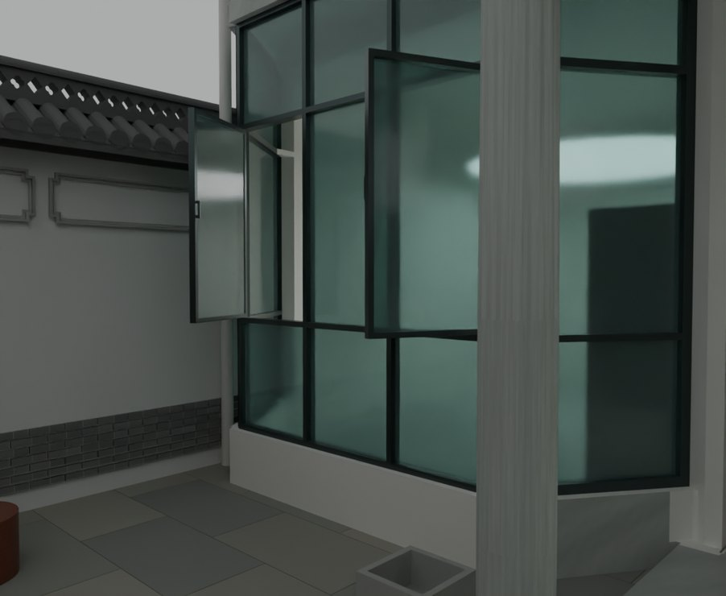
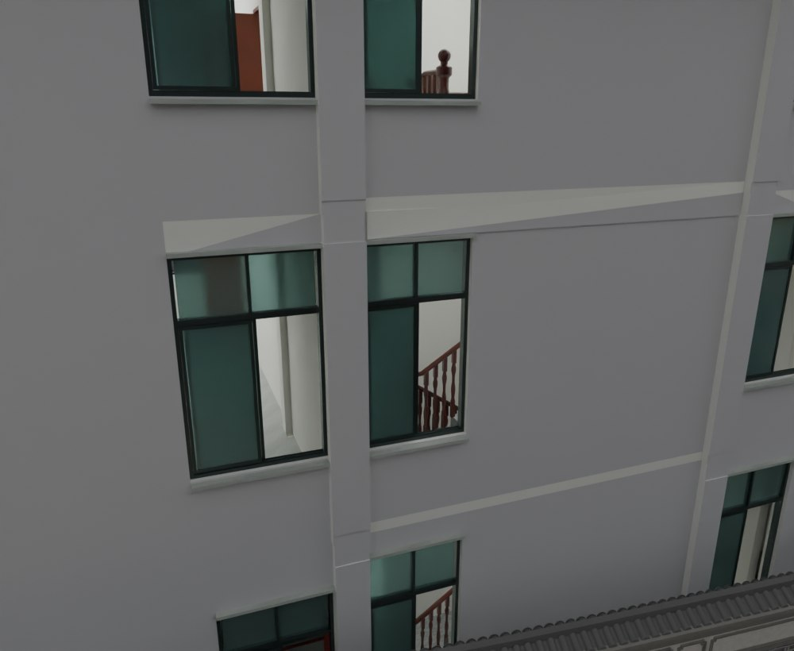

# V26.9 · 分层窗台、后窗双轨与北山墙恢复

[逐版目录](README.md) · [建筑重建台账](../../reconstruction.md) · [阶段方法汇总](../v26-v26-20.md)

## 摘要

修首层固定玻璃和各层窗台，恢复厨房北山墙线并接储藏房栏板，抬内门门楣，后窗改双轨推拉。

## 1. 问题与输入

以 V26.8 为底稿，按首层固定玻璃、上层实体窗脚、后窗滑轨和厨房北端墙线各自取截面。

## 2. 实现方法

1. 首层湾窗分出固定下玻璃，开启扇缩短，保留 30 cm 实墙窗脚。二三楼窗台较原扶手对应位置降低 100 mm，开启扇下方为实墙。

2. 恢复厨房北山墙此前内退 280 mm 的外侧线，按山墙帽下沿封齐青砖并接储藏房栏板。后窗按双轨约束平移，内门抬高后复核石画。

3. 分别读窗台、顶面、门楣及后窗滑动姿态，运行原路线回查新接头。

### 实现链与源码定位

以下按诊断、处理、保存与复核组织阅读。调用和文件引用来自原脚本，输入输出方向由对应读写调用判断；辅助文件是否在本轮运行，以报告为准。

**1. 定位与诊断** · [`v26_9_sections.py`](../source-code/v26-9/project/Sources/v26_9_sections.py#L9)

定高剖切 [`m.slice`](../source-code/v26-9/project/Sources/v26_9_sections.py#L9)。

文件引用：[`Geometry_Index.json`](../source-code/v26-9/project/Sources/v26_9_sections.py#L4) · [`Existing_Bay_Sections.json`](../source-code/v26-9/project/Sources/v26_9_sections.py#L11)。

**2. 定位与诊断** · [`v26_9_roof_probe.py`](../source-code/v26-9/project/Sources/v26_9_roof_probe.py#L2)

文件引用：[`Geometry_Index.json`](../source-code/v26-9/project/Sources/v26_9_roof_probe.py#L2) · [`Roof_White_Fragment_Probe.json`](../source-code/v26-9/project/Sources/v26_9_roof_probe.py#L11)。

**3. 参数与几何处理** · [`v26_9_prepare.py`](../source-code/v26-9/project/Sources/v26_9_prepare.py#L29)

UV 继承或投影 [`uv_project`](../source-code/v26-9/project/Sources/v26_9_prepare.py#L29)；截面提取 [`section`](../source-code/v26-9/project/Sources/v26_9_prepare.py#L69)；叉积／面法线 [`np.cross`](../source-code/v26-9/project/Sources/v26_9_prepare.py#L97)。

文件引用：[`Geometry_Index.json`](../source-code/v26-9/project/Sources/v26_9_prepare.py#L8) · [`Prepared_Geometry.json`](../source-code/v26-9/project/Sources/v26_9_prepare.py#L143)。

**4. 构建或写入** · [`v26_9_build.py`](../source-code/v26-9/project/Sources/v26_9_build.py#L11)

打开保存的 Blender [`bpy.ops.wm.open_mainfile`](../source-code/v26-9/project/Sources/v26_9_build.py#L11)；写入网格拓扑 [`me.from_pydata`](../source-code/v26-9/project/Sources/v26_9_build.py#L21)；批量写入属性 [`me.polygons.foreach_set`](../source-code/v26-9/project/Sources/v26_9_build.py#L23)。

文件引用：[`Architecture_Complete_V26_8.blend`](../source-code/v26-9/project/Sources/v26_9_build.py#L4) · [`Architecture_Complete_V26_9.blend`](../source-code/v26-9/project/Sources/v26_9_build.py#L4) · [`Before_Snapshot.json`](../source-code/v26-9/project/Sources/v26_9_build.py#L12)。

**5. 保存后核验** · [`v26_9_geometry_qa.py`](../source-code/v26-9/project/Sources/v26_9_geometry_qa.py#L8)

判据与回归检查 [`checks.append`](../source-code/v26-9/project/Sources/v26_9_geometry_qa.py#L5)；叉积／面法线 [`np.cross`](../source-code/v26-9/project/Sources/v26_9_geometry_qa.py#L8)；射线命中检查 [`house.ray_cast`](../source-code/v26-9/project/Sources/v26_9_geometry_qa.py#L40)。

文件引用：[`Geometry_Index.json`](../source-code/v26-9/project/Sources/v26_9_geometry_qa.py#L4) · [`Prepared_House.json`](../source-code/v26-9/project/Sources/v26_9_geometry_qa.py#L25) · [`Door_Motion.json`](../source-code/v26-9/project/Sources/v26_9_geometry_qa.py#L90)。

**6. 保存后核验** · [`v26_9_readback.py`](../source-code/v26-9/project/Sources/v26_9_readback.py#L7)

打开保存的 Blender [`bpy.ops.wm.open_mainfile`](../source-code/v26-9/project/Sources/v26_9_readback.py#L7)；判据与回归检查 [`checks.append`](../source-code/v26-9/project/Sources/v26_9_readback.py#L8)。

文件引用：[`Architecture_Complete_V26_9.blend`](../source-code/v26-9/project/Sources/v26_9_readback.py#L4) · [`Before_Snapshot.json`](../source-code/v26-9/project/Sources/v26_9_readback.py#L7) · [`V26_9_Changes.json`](../source-code/v26-9/project/Sources/v26_9_readback.py#L7)。

**7. 保存后核验** · [`v26_9_native_specific_qa.py`](../source-code/v26-9/project/Sources/v26_9_native_specific_qa.py#L4)

打开保存的 Blender [`bpy.ops.wm.open_mainfile`](../source-code/v26-9/project/Sources/v26_9_native_specific_qa.py#L4)；判据与回归检查 [`checks.append`](../source-code/v26-9/project/Sources/v26_9_native_specific_qa.py#L5)。

文件引用：[`Architecture_Complete_V26_9.blend`](../source-code/v26-9/project/Sources/v26_9_native_specific_qa.py#L3) · [`Extra_Source_Index.json`](../source-code/v26-9/project/Sources/v26_9_native_specific_qa.py#L6) · [`V26_9_Changes.json`](../source-code/v26-9/project/Sources/v26_9_native_specific_qa.py#L15)。

[方法原理：局部实体、接合与保护域](../methodology.md#4-局部改模如何限定影响范围) · [本版完整过程索引](process/v26-9.md)

本版索引汇合 24 幅已归档过程图、74 份交付及历史目录中的报告／说明／中间记录和全部 45 个源码附件。继承文件和本轮新增文件按来源保留，实际完成范围以第 4 节及原报告为准。

## 3. 过程图

**图 1** · 首层窗下固定玻璃

**图 2** · V26.9 主楼后窗双轨推拉关系

## 4. 验证与适用范围

原报告记 145 项检查、63 项漫游物理检查和 16 张指定视角图。固定玻璃、墙脚和推拉叶按保存数据区分。

- **原生局部核验** 
  状态 `PASS`，检查条目 6，失败记录 0。

- **原生保存与读回** 
  状态 `PASS`，检查条目 20，失败记录 0。

### 原记录中的关键检查

- **Large gate blank replaced by concealed22mm bearing** 
  通过，`new_height_m` = `0.0220001` 
  原记录 `V26_9_Native_Specific_QA.json` 的 `checks[1]`

- **Full horizontal soft-light disk is below the lowest canopy point** 
  通过，`light_z` = `9.5`，`canopy_low_z` = `9.72` 
  原记录 `V26_9_Native_Specific_QA.json` 的 `checks[2]`

- **UV coordinates of all92 modified meshes are finite, including repaired inherited bad house UVs** 
  通过，`objects` = `92` 
  原记录 `V26_9_Native_Specific_QA.json` 的 `checks[4]`

## 5. 复现入口与出处

过程路径以本地 `JIA` 项目为根，`work/` 指重建项目的历史工作目录。复核时按交付记录打开本轮输入与保存成果，再依方法中的截面、对象或动作采样对照原报告。

交付与参考记录（2 项）

~~~text
Rebuild_V26_9/使用说明.txt
Rebuild_V26_9/Reports/V26_9_实景与修正复核.html
~~~

### 原实现脚本附件

[浏览本版全部 45 个文件](../source-code/v26-9/README.md) · [原件与公开副本校验值](../source-code/v26-9/manifest.json)

- [`v26_9_sections.py`](../source-code/v26-9/project/Sources/v26_9_sections.py)
- [`v26_9_roof_probe.py`](../source-code/v26-9/project/Sources/v26_9_roof_probe.py)
- [`v26_9_geometry_qa.py`](../source-code/v26-9/project/Sources/v26_9_geometry_qa.py)
- [`v26_9_build.py`](../source-code/v26-9/project/Sources/v26_9_build.py)
- [`v26_9_prepare.py`](../source-code/v26-9/project/Sources/v26_9_prepare.py)

原脚本本地路径

~~~text
Rebuild_V26_9/Sources/v26_9_sections.py
Rebuild_V26_9/Sources/v26_9_roof_probe.py
Rebuild_V26_9/Sources/v26_9_geometry_qa.py
Rebuild_V26_9/Sources/v26_9_build.py
Rebuild_V26_9/Sources/v26_9_prepare.py
~~~

核验报告路径（2 项）

**原生局部核验**

~~~text
Rebuild_V26_9/Reports/V26_9_Native_Specific_QA.json
~~~

**原生保存与读回**

~~~text
Rebuild_V26_9/Reports/V26_9_Native_Readback_QA.json
~~~

图源与 SHA-256（2 张）

### 图 1 · 首层窗下固定玻璃

~~~text
Rebuild_V26_9/Reports/After_01_F1_Fixed_Lower_Lights.png
~~~

**原过程图 SHA-256**

~~~text
b4ce7f4716a9763da201e9c00d7fc8c5bbddabc0107985bfa7bd1028ab202a3d
~~~

台账发布图，按原图缩放及压缩。

### 图 2 · V26.9 主楼后窗双轨推拉关系

~~~text
Rebuild_V26_9/Reports/After_14_Back_Sliding_Windows.png
~~~

**原过程图 SHA-256**

~~~text
7b853e2a29b96ab16031db1708b0f00b0f75a9b45804291ce09c39efe7aed7eb
~~~

保留原画面，发布用 JPEG。

---

上一篇 [V26.8 · 收窄楼梯井并以同场景比较 Fast 视口](v26-8.md) 
下一篇 [V26.10 · 按等高截面清墙角凸棱并重组矩形门柱](v26-10.md)
