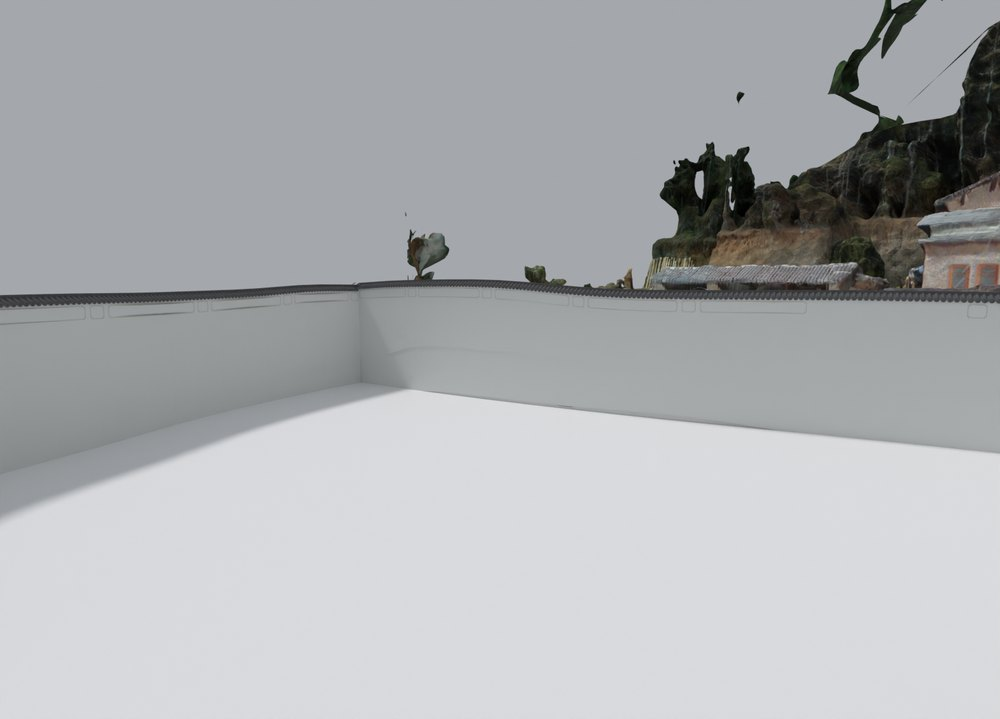
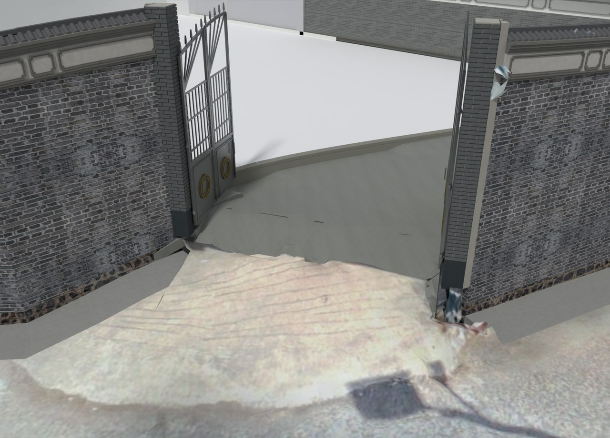
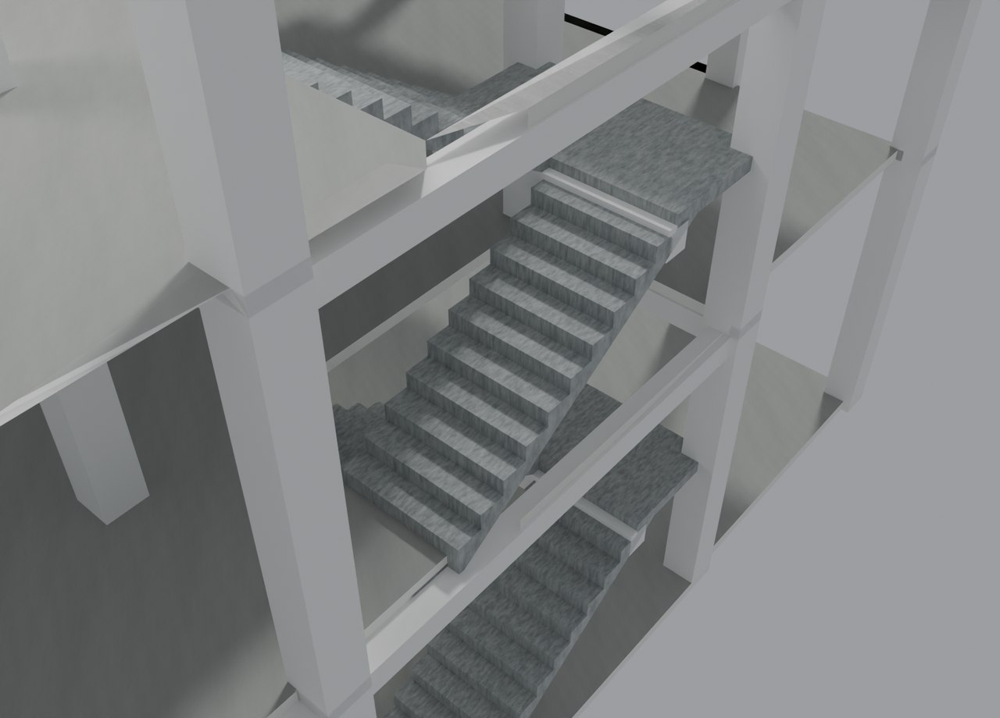

# V26 · 从 V24.34 恢复入口坡面与楼梯平台实体支承

[逐版目录](README.md) · [建筑重建台账](../../reconstruction.md) · [阶段方法汇总](../v26-v26-20.md)

## 摘要

按指定回到 V24.34 底稿，改院墙内侧白面、恢复原入口坡面，接实楼梯与平台并恢复相关柱体。

## 1. 问题与输入

用户指定以 V24.34 为底稿。原实景入口坡保留纹理与起伏，内侧院墙白面、四段楼梯和中间平台采用独立局部操作。

## 2. 实现方法

1. 从原实景坡面提取约 8.34 m² 范围及 UV，按原起伏恢复。建模道路仅在 0.85 m 的接缝带内贴合，不改变远处道路基准。

2. 按原轴网、踏步与平台截面补实支承、梁端和墙角，恢复六根柱的 400 × 400 mm 截面。内侧白面在原院墙表面单独处理。

3. 重开 Blender 保存版，检查坡面接缝、实体支承和人物路线。按 1.65 m 胶囊的实际走行采样读取楼梯头顶净空。

### 实现链与源码定位

以下按诊断、处理、保存与复核组织阅读。调用和文件引用来自原脚本，输入输出方向由对应读写调用判断；辅助文件是否在本轮运行，以报告为准。

**1. 定位与诊断** · [`v26_probe.py`](../source-code/v26/history/v26_probe.py#L8)

打开保存的 Blender [`bpy.ops.wm.open_mainfile`](../source-code/v26/history/v26_probe.py#L8)。

文件引用：[`Architecture_Complete_V24_34.blend`](../source-code/v26/history/v26_probe.py#L7) · [`Before_Snapshot.json`](../source-code/v26/history/v26_probe.py#L11) · [`Inventory.json`](../source-code/v26/history/v26_probe.py#L34)。

**2. 定位与诊断** · [`v26_extra_probe.py`](../source-code/v26/history/v26_extra_probe.py#L6)

打开保存的 Blender [`bpy.ops.wm.open_mainfile`](../source-code/v26/history/v26_extra_probe.py#L6)。

文件引用：[`Geometry_Index.json`](../source-code/v26/history/v26_extra_probe.py#L5) · [`Architecture_Complete_V24_34.blend`](../source-code/v26/history/v26_extra_probe.py#L6)。

**3. 参数与几何处理** · [`v26_prepare_ramp.py`](../source-code/v26/project/Sources/Scripts/v26_prepare_ramp.py#L14)

截面提取 [`section`](../source-code/v26/project/Sources/Scripts/v26_prepare_ramp.py#L14)；叉积／面法线 [`np.cross`](../source-code/v26/project/Sources/Scripts/v26_prepare_ramp.py#L19)；交集限域 [`intersection`](../source-code/v26/project/Sources/Scripts/v26_prepare_ramp.py#L32)。

文件引用：[`Original_Source_Index.json`](../source-code/v26/project/Sources/Scripts/v26_prepare_ramp.py#L9) · [`Geometry_Index.json`](../source-code/v26/project/Sources/Scripts/v26_prepare_ramp.py#L9) · [`RAMP_NEW_APPROACH.npz`](../source-code/v26/project/Sources/Scripts/v26_prepare_ramp.py#L117)。

**4. 参数与几何处理** · [`v26_prepare_structure.py`](../source-code/v26/project/Sources/Scripts/v26_prepare_structure.py#L19)

网格与实体转换 [`m.to_mesh64`](../source-code/v26/project/Sources/Scripts/v26_prepare_structure.py#L19)；截面提取 [`section`](../source-code/v26/project/Sources/Scripts/v26_prepare_structure.py#L31)；定高剖切 [`m.slice`](../source-code/v26/project/Sources/Scripts/v26_prepare_structure.py#L35)。

文件引用：[`Geometry_Index.json`](../source-code/v26/project/Sources/Scripts/v26_prepare_structure.py#L9) · [`Inventory.json`](../source-code/v26/project/Sources/Scripts/v26_prepare_structure.py#L9) · [`Prepared_Structure.json`](../source-code/v26/project/Sources/Scripts/v26_prepare_structure.py#L115)。

**5. 构建或写入** · [`v26_build.py`](../source-code/v26/project/Sources/Scripts/v26_build.py#L11)

打开保存的 Blender [`bpy.ops.wm.open_mainfile`](../source-code/v26/project/Sources/Scripts/v26_build.py#L11)；空间加速结构 [`BVHTree.FromPolygons`](../source-code/v26/project/Sources/Scripts/v26_build.py#L17)；写入网格拓扑 [`me.from_pydata`](../source-code/v26/project/Sources/Scripts/v26_build.py#L31)。

文件引用：[`Architecture_Complete_V26.blend`](../source-code/v26/project/Sources/Scripts/v26_build.py#L5) · [`Architecture_Complete_V24_34.blend`](../source-code/v26/project/Sources/Scripts/v26_build.py#L5) · [`Prepared_Structure.json`](../source-code/v26/project/Sources/Scripts/v26_build.py#L13)。

**6. 保存后核验** · [`v26_surface_verify.py`](../source-code/v26/project/Sources/Scripts/v26_surface_verify.py#L12)

判据与回归检查 [`checks.append`](../source-code/v26/project/Sources/Scripts/v26_surface_verify.py#L10)；叉积／面法线 [`np.cross`](../source-code/v26/project/Sources/Scripts/v26_surface_verify.py#L12)；交集限域 [`pp.intersection`](../source-code/v26/project/Sources/Scripts/v26_surface_verify.py#L15)。

文件引用：[`Prepared_Ramp.json`](../source-code/v26/project/Sources/Scripts/v26_surface_verify.py#L8) · [`Geometry_Index.json`](../source-code/v26/project/Sources/Scripts/v26_surface_verify.py#L8) · [`Prepared_Ramp_Surface_QA.json`](../source-code/v26/project/Sources/Scripts/v26_surface_verify.py#L31)。

**7. 交付封装** · [`v26_package.py`](../source-code/v26/history/v26_package.py#L6)

文件引用：[`Architecture_Complete_V26.blend`](../source-code/v26/history/v26_package.py#L3) · [`V26_Build.json`](../source-code/v26/history/v26_package.py#L6) · [`V26_Native_Readback_QA.json`](../source-code/v26/history/v26_package.py#L7)。

[方法原理：局部实体、接合与保护域](../methodology.md#4-局部改模如何限定影响范围) · [本版完整过程索引](process/v26.md)

本版索引汇合 594 幅已归档过程图、708 份交付及历史目录中的报告／说明／中间记录和全部 22 个源码附件。继承文件和本轮新增文件按来源保留，实际完成范围以第 4 节及原报告为准。

## 3. 过程图

**图 1** · 院墙内侧白色饰面

**图 2** · V26 恢复的原实景入口坡

**图 3** · V26 楼梯与平台支承的模型剖切

## 4. 验证与适用范围

交付说明记录 199 项检查，其中结构几何 134 项、人物通行 45 项通过。226 个楼梯路线记录点的最小垂直净空约 3.153 m。几何检查覆盖模型接触与通行。

- **结构几何连接核验** 
  状态 `PASS_GEOMETRIC_CONNECTIONS`，检查条目 134，失败记录 0。

- **入口坡面核验** 
  状态 `PASS`，检查条目 4，失败记录 0。

- **交付核验** 
  状态 `PASS_MODEL_GEOMETRY_AND_DELIVERY`，检查总数 199。

### 原记录中的关键检查

- **All 83 saved structural meshes are valid closed positive-volume solids** 
  通过，`solids` = `83` 
  原记录 `V26_Structural_Geometry_QA.json` 的 `checks[0]`

- **Vertical column joint KZ_1_1_F1_Geometry** 
  通过，`intersection_m3` = `0`，`contact_area_estimate_m2` = `0.16` 
  原记录 `V26_Structural_Geometry_QA.json` 的 `checks[3]`

- **Vertical column joint KZ_1_2_F1_Geometry** 
  通过，`intersection_m3` = `0`，`contact_area_estimate_m2` = `0.16` 
  原记录 `V26_Structural_Geometry_QA.json` 的 `checks[8]`

## 5. 复现入口与出处

过程路径以本地 `JIA` 项目为根，`work/` 指重建项目的历史工作目录。复核时按交付记录打开本轮输入与保存成果，再依方法中的截面、对象或动作采样对照原报告。

交付与参考记录（1 项）

~~~text
Rebuild_V26/使用说明.txt
~~~

### 原实现脚本附件

[浏览本版全部 22 个文件](../source-code/v26/README.md) · [原件与公开副本校验值](../source-code/v26/manifest.json)

- [`v26_prepare_ramp.py`](../source-code/v26/project/Sources/Scripts/v26_prepare_ramp.py)
- [`v26_prepare_structure.py`](../source-code/v26/project/Sources/Scripts/v26_prepare_structure.py)
- [`v26_build.py`](../source-code/v26/project/Sources/Scripts/v26_build.py)
- [`v26_probe.py`](../source-code/v26/history/v26_probe.py)
- [`v26_extra_probe.py`](../source-code/v26/history/v26_extra_probe.py)

原脚本本地路径

~~~text
Rebuild_V26/Sources/Scripts/v26_prepare_ramp.py
Rebuild_V26/Sources/Scripts/v26_prepare_structure.py
Rebuild_V26/Sources/Scripts/v26_build.py
work/v26_probe.py
work/v26_extra_probe.py
~~~

核验报告路径（3 项）

**结构几何连接核验**

~~~text
Rebuild_V26/Reports/V26_Structural_Geometry_QA.json
~~~

**入口坡面核验**

~~~text
Rebuild_V26/Reports/V26_Ramp_Surface_QA.json
~~~

**交付核验**

~~~text
Rebuild_V26/Reports/V26_Delivery_QA.json
~~~

图源与 SHA-256（3 张）

### 图 1 · 院墙内侧白色饰面

~~~text
Rebuild_V26/Reports/V26_01_White_Courtyard_Inside.png
~~~

**原过程图 SHA-256**

~~~text
9a0becdc214a6b69ff1fa7927ea6968e58c128fe41abe4c01d67cdc10498c207
~~~

台账发布图，按原图缩放及压缩。

### 图 2 · V26 恢复的原实景入口坡

~~~text
Rebuild_V26/Reports/V26_02_Original_Site_Entrance_Ramp.png
~~~

**原过程图 SHA-256**

~~~text
72b1d548d8cdd17bc8ed4b3975afe38cfc1b7b60961ec5583bf6849cecfc94da
~~~

保留原画面，发布用 JPEG。

### 图 3 · V26 楼梯与平台支承的模型剖切

~~~text
Rebuild_V26/Reports/V26_08_Stair_Bearings_Cutaway.png
~~~

**原过程图 SHA-256**

~~~text
a67de91a473b714b0d111776cbaaa2301c32de7e77ccc257880b0cfcb07fc656
~~~

保留原画面，发布用 JPEG。

---

上一篇 [V25 · 从 Blender 求值网格生成 Rhino 8 双坐标交付](v25.md) 
下一篇 [V26.1 · 局部裁梁、保留踏步并接合车木扶手](v26-1.md)
