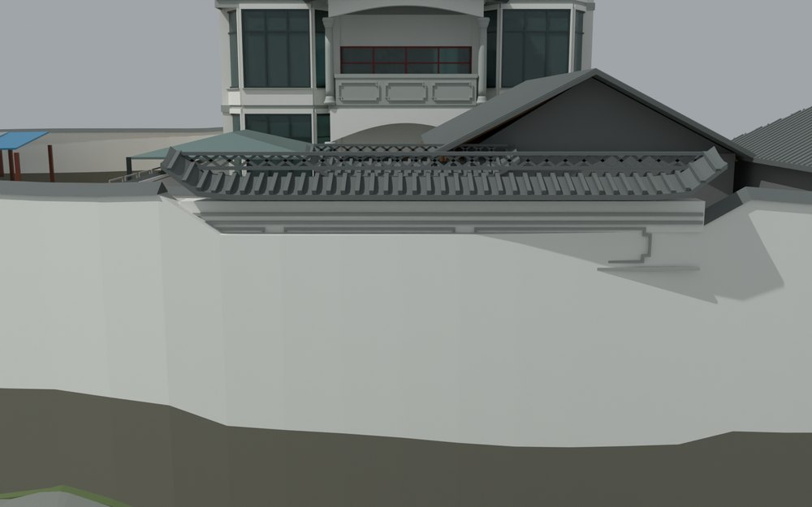
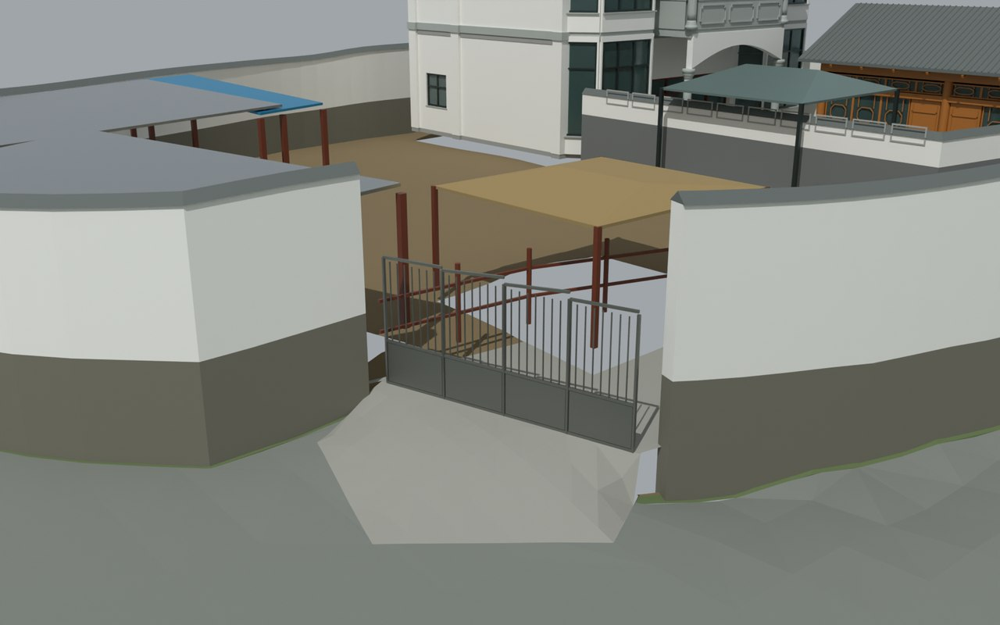

# V3 · 用航拍重判西南入口与南侧照壁

[逐版目录](README.md) · [建筑重建台账](../../reconstruction.md) · [阶段方法汇总](../v01-v23.md)

## 摘要

按航拍修正西南入口、连续南侧照壁、灰色内院门楼、厨房木构、瓦墙和罗马柱比例。

## 1. 问题与输入

V2 把南侧中央一段围墙理解成车辆入口。V3 从航拍俯视辨认真实开口、墙线与屋盖，再以实景侧视确定照壁、院门和厨房的构件类别。

## 2. 实现方法

1. 以西南斜边的通行轮廓定位入口。撤去南侧中央误设的 7 m 红门与坡道，把该段恢复为连续照壁。

2. 分别建立照壁抬升墙身、曲线瓦顶、透空菱形脊和长短边框。按不同材质与标高重建灰色内门楼、木构厨房、瓦墙和金属棚。

3. 用外门、照壁、厨房和内门等命名视图查边界，再回读导出的层级、UV 与相机，检查误设门构件是否已删除。

## 3. 过程图

**图 1** · 南侧照壁与场地接合

**图 2** · 按航拍纠正后的西南入口位置

## 4. 验证与适用范围

原几何报告展开 2,662 个闭合部件。交换读回分别记录完整场地及误设大门移除。V3 的新增开口与标高来自影像判读和模型拟合，报告保留估测项。

- **几何核验** 
  展开后的闭合部件 2,662。

- **Native Model QA** 
  记录本轮参数、对象和处理结果。

- **Exchange Readback QA** 
  记录本轮参数、对象和处理结果。

## 5. 复现入口与出处

过程路径以本地 `JIA` 项目为根，`work/` 指重建项目的历史工作目录。复核时按交付记录打开本轮输入与保存成果，再依方法中的截面、对象或动作采样对照原报告。

交付与参考记录（1 项）

~~~text
Rebuild_V3/README_V3.md
~~~

原实现脚本（5 项）

~~~text
Rebuild_V3/05_Intermediate/Scripts/gate_levels_v3.py
work/cc_reference_probe_v3.py
Rebuild_V3/05_Intermediate/Scripts/prepare_scene_v3.py
Rebuild_V3/05_Intermediate/Scripts/geometry_qa_v3.py
Rebuild_V3/05_Intermediate/Scripts/v3_plan_preview.py
~~~

核验报告路径（3 项）

**几何核验**

~~~text
Rebuild_V3/09_Report/Geometry_QA_V3.json
~~~

**Native Model QA**

~~~text
Rebuild_V3/09_Report/Native_Model_QA.json
~~~

**Exchange Readback QA**

~~~text
Rebuild_V3/09_Report/Exchange_Readback_QA.json
~~~

图源与 SHA-256（2 张）

### 图 1 · 南侧照壁与场地接合

~~~text
Rebuild_V3/09_Report/VIS_CAM_10_Screenwall.png
~~~

**原过程图 SHA-256**

~~~text
9624aaf88b262e8a90a29b2cfd4f1c23ca03844ff982dd8ef9bca5d96e5e5a78
~~~

台账发布图，按原图缩放及压缩。

### 图 2 · 按航拍纠正后的西南入口位置

~~~text
Rebuild_V3/09_Report/VIS_CAM_09_SW_Gate.png
~~~

**原过程图 SHA-256**

~~~text
aed7acd053ba5b5897780f08ba4bc96097b166a6a3afe2bbc2c10d41f2c42292
~~~

保留原画面，发布用 JPEG。

---

上一篇 [V2 · 连续楼板、分层墙和四坡屋面的几何重建](v2.md) 
下一篇 [V4 · 梁墙扣合、柱头接触和楼梯平台协调](v4.md)
