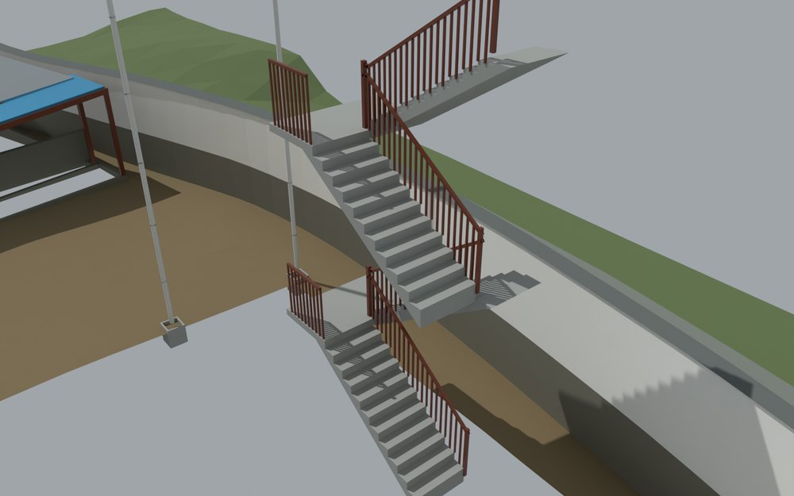
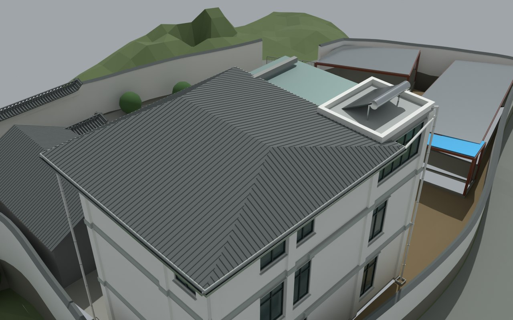

# V4 · 梁墙扣合、柱头接触和楼梯平台协调

[逐版目录](README.md) · [建筑重建台账](../../reconstruction.md) · [阶段方法汇总](../v01-v23.md)

## 摘要

修整梁墙、弧梁柱头和楼梯平台交接，扣除共面梯板。门窗收口、防护和排水构造作为提案分开登记。

## 1. 问题与输入

从 V3 保存模型出发，处理梁与填充墙侵入、弧梁支座和楼梯顶面重叠。防护、门窗收口与排水同时作为可独立选取的深化提案登记。

## 2. 实现方法

1. 按梁底、梁顶切分填充墙，扣除框架核心占位。弧梁从柱头内缘起拱，柱头增加完整的水平接触面。

2. 按图纸的每跑 11 级和 10 段 260 mm 踏步布置楼梯，腰板按法向 140 mm 建模。从梯板扣去已归属平台或楼板的重复混凝土，比较联合体的体积和保留接触面。

3. 为施工提案填写构件状态、宿主与修改登记，利用原生几何检查复核梁墙相交、开口与防护位置。

## 3. 过程图

**图 1** · 楼梯与平台交接

**图 2** · V4 原过程报告的屋面排水深化视图

## 4. 验证与适用范围

梁墙交叉体积复测为 0，梯板扣除前后联合体外形体积差为 0，平台接触约 0.33–0.35 m²。协调清单 155 项中 117 项通过、38 项需设计。几何接触及净高记录的适用范围见待核清单。

- **Construction Geometry QA** 
  检查条目 155，通过项 117，需设计项 38。

- **几何核验** 
  展开后的闭合部件 3,838。

## 5. 复现入口与出处

过程路径以本地 `JIA` 项目为根，`work/` 指重建项目的历史工作目录。复核时按交付记录打开本轮输入与保存成果，再依方法中的截面、对象或动作采样对照原报告。

交付与参考记录（2 项）

~~~text
Rebuild_V4/09_Report/REPORT_V4.md
Rebuild_V4/09_Report/PENDING_ITEMS_V4.md
~~~

原实现脚本（5 项）

~~~text
Rebuild_V4/05_Intermediate/Scripts/build_scene_v4.py
Rebuild_V4/05_Intermediate/Scripts/geometry_qa_v4.py
Rebuild_V4/05_Intermediate/Scripts/prepare_exports_v4.py
Rebuild_V4/11_Construction_Reference/v4_audit_junction/audit.py
Rebuild_V4/11_Construction_Reference/v4_audit_codes/write_audit.py
~~~

核验报告路径（2 项）

**Construction Geometry QA**

~~~text
Rebuild_V4/09_Report/Construction_Geometry_QA_V4.json
~~~

**几何核验**

~~~text
Rebuild_V4/09_Report/Geometry_QA_V4.json
~~~

图源与 SHA-256（2 张）

### 图 1 · 楼梯与平台交接

~~~text
Rebuild_V4/09_Report/VIS_CAM_13_Stair_Coordination.png
~~~

**原过程图 SHA-256**

~~~text
4788ed21567155180d4cc99735c30c9d13b942c3536099ec2fd5c3ed8de083f6
~~~

台账发布图，按原图缩放及压缩。

### 图 2 · V4 原过程报告的屋面排水深化视图

~~~text
Rebuild_V4/09_Report/VIS_CAM_14_Roof_Drainage.png
~~~

**原过程图 SHA-256**

~~~text
1133aa92d5eba31812e76aa32bc02cc39a8bf356fea344fefc3b252b6dc00024
~~~

保留原画面，发布用 JPEG。

---

上一篇 [V3 · 用航拍重判西南入口与南侧照壁](v3.md) 
下一篇 [V5 · 从双鱼眼全景纠正房间连通和门轴](v5.md)
