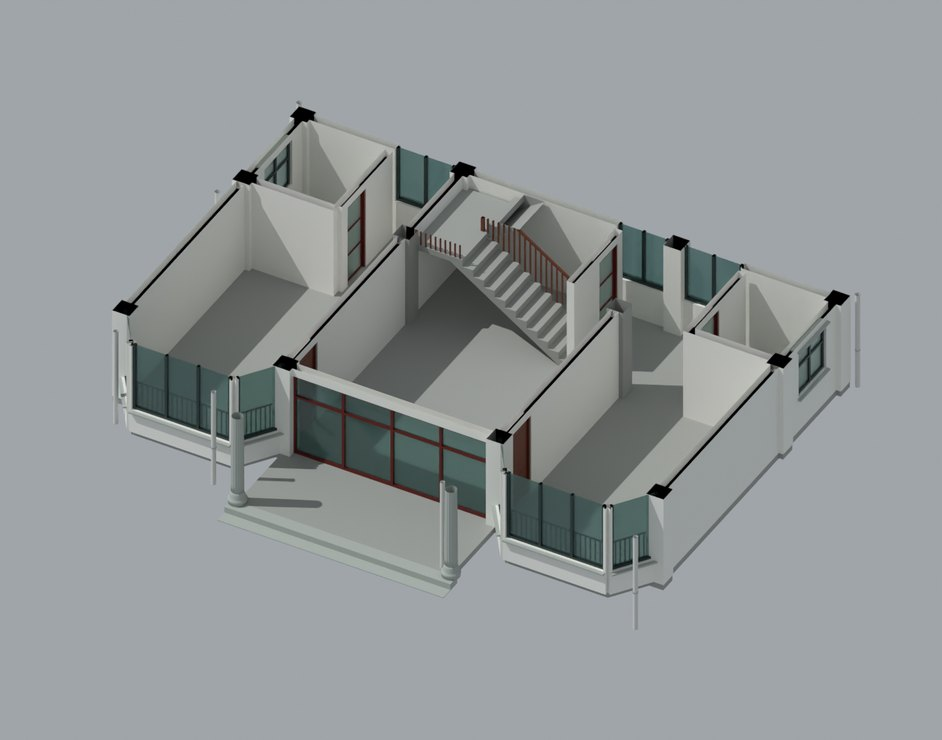
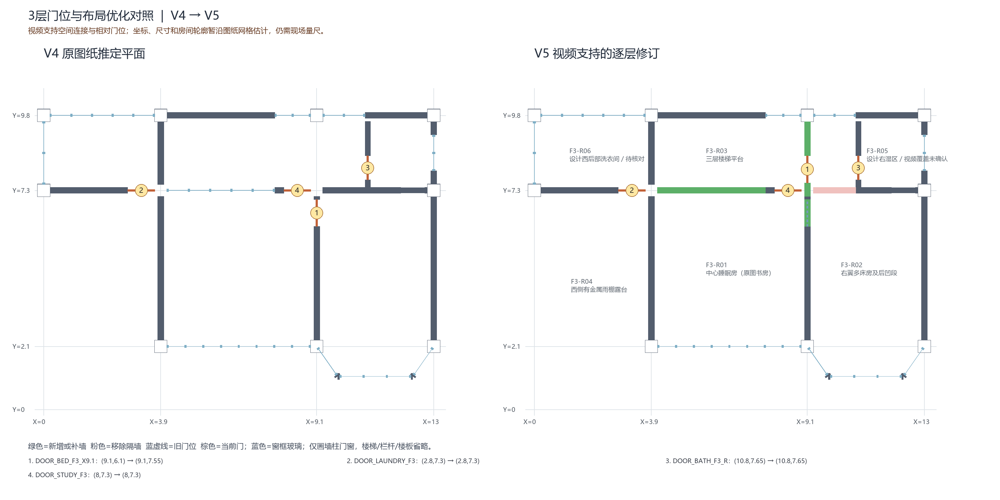

# V5 · 从双鱼眼全景纠正房间连通和门轴

[逐版目录](README.md) · [建筑重建台账](../../reconstruction.md) · [阶段方法汇总](../v01-v23.md)

## 摘要

按全景视频修正各层房间用途、卧室门与湿区连通。补旧门洞并为 13 樘平开门拆分固定框和活动扇。

## 1. 问题与输入

V4 的门位以设计资料为起点。V5 用全景视频判定真实房间用途、开门一侧及连通拓扑，位置暂用图纸和米制模型估计。

## 2. 实现方法

1. 用 FFmpeg v360 按时间、双鱼眼镜头和观察方向抽取透视帧。先以楼梯、阳台和门框判前后，再建立楼层、房间、入口和相邻空间的对应关系。

2. 将一、二层四樘卧室门从楼梯侧移向入口或阳台侧，同时补旧洞、扣新洞。三层卧室门转向平台一侧，按视频分别保留后段与中部房间的连接。

3. 每樘平开门保留共同 door_id，门框与门扇拆分，活动块的原点落在铰轴。对 19 个房间或核对区登记用途和连通关系。

### 实现链与源码定位

以下按诊断、处理、保存与复核组织阅读。调用和文件引用来自原脚本，输入输出方向由对应读写调用判断；辅助文件是否在本轮运行，以报告为准。

**1. 定位与诊断** · [`audit.py`](../source-code/v5/history/v5_model_audit/audit.py#L11)

坐标或构件旋转 [`rotate`](../source-code/v5/history/v5_model_audit/audit.py#L11)；交集限域 [`P.intersection`](../source-code/v5/history/v5_model_audit/audit.py#L32)。

文件引用：[`Architecture_Scene.json`](../source-code/v5/history/v5_model_audit/audit.py#L9) · [`Door_Wall_Audit.json`](../source-code/v5/history/v5_model_audit/audit.py#L39) · [`Door_Wall_Audit.csv`](../source-code/v5/history/v5_model_audit/audit.py#L40)。

**2. 参数与几何处理** · [`prepare_v5.py`](../source-code/v5/project/05_Intermediate/Scripts/prepare_v5.py#L5)

**3. 构建或写入** · [`build_scene_v5.py`](../source-code/v5/project/05_Intermediate/Scripts/build_scene_v5.py#L61)

差集裁切 [`p.difference`](../source-code/v5/project/05_Intermediate/Scripts/build_scene_v5.py#L61)。

文件引用：[`Architecture_Scene.json`](../source-code/v5/project/05_Intermediate/Scripts/build_scene_v5.py#L12) · [`Production_1QK_Rebuild.3dm`](../source-code/v5/project/05_Intermediate/Scripts/build_scene_v5.py#L154) · [`V4_Baseline_SHA256.json`](../source-code/v5/project/05_Intermediate/Scripts/build_scene_v5.py#L155)。

**4. 过程出图** · [`extract_views.py`](../source-code/v5/history/v5_video_plan/extract_views.py#L24)

文件引用：[`View_Index.json`](../source-code/v5/history/v5_video_plan/extract_views.py#L24)。

**5. 保存后核验** · [`geometry_qa_v5.py`](../source-code/v5/project/05_Intermediate/Scripts/geometry_qa_v5.py#L14)

叉积／面法线 [`np.cross`](../source-code/v5/project/05_Intermediate/Scripts/geometry_qa_v5.py#L14)。

文件引用：[`Geometry_QA_V5.json`](../source-code/v5/project/05_Intermediate/Scripts/geometry_qa_v5.py#L22)。

[方法原理：三角面采样、坐标与拟合](../methodology.md#2-坐标采样与拟合的数学含义) · [本版完整过程索引](process/v5.md)

本版索引汇合 108 幅已归档过程图、43 份交付及历史目录中的报告／说明／中间记录和全部 55 个源码附件。继承文件和本轮新增文件按来源保留，实际完成范围以第 4 节及原报告为准。

## 3. 过程图

**图 1** · 首层室内布局剖切

**图 2** · V5 原报告的三层门位与墙体平面前后对照

## 4. 验证与适用范围

原记录包含 13 樘平开门与 5 樘可辨的湿区磨砂玻璃门，核验日志的 107 项检查均为 PASS。卧室门 2.4 m 偏距是模型暂定值，未标定视频的价值主要在连通关系和可见材质。

- **QA Run Log** 
  检查条目 107，PASS 项 107。

- **几何核验** 
  展开后的闭合部件 3,888。

### 原记录中的关键检查

- **New_door_clear_opening_DOOR_BACKROOM_F1_R** 
  通过 
  原记录 `V5_QA_Run_Log.json` 的 `checks[37]`

- **Door_assembly_DOOR_BACKROOM_F1_R** 
  通过 
  原记录 `V5_QA_Run_Log.json` 的 `checks[33]`

- **Door_frame_role_DOOR_BACKROOM_F1_R** 
  通过 
  原记录 `V5_QA_Run_Log.json` 的 `checks[34]`

## 5. 复现入口与出处

过程路径以本地 `JIA` 项目为根，`work/` 指重建项目的历史工作目录。复核时按交付记录打开本轮输入与保存成果，再依方法中的截面、对象或动作采样对照原报告。

交付与参考记录（1 项）

~~~text
Rebuild_V5/V5_使用说明.md
~~~

### 原实现脚本附件

[浏览本版全部 55 个文件](../source-code/v5/README.md) · [原件与公开副本校验值](../source-code/v5/manifest.json)

- [`extract_views.py`](../source-code/v5/history/v5_video_plan/extract_views.py)
- [`build_scene_v5.py`](../source-code/v5/project/05_Intermediate/Scripts/build_scene_v5.py)
- [`prepare_v5.py`](../source-code/v5/project/05_Intermediate/Scripts/prepare_v5.py)
- [`geometry_qa_v5.py`](../source-code/v5/project/05_Intermediate/Scripts/geometry_qa_v5.py)
- [`audit.py`](../source-code/v5/history/v5_model_audit/audit.py)

原脚本本地路径

~~~text
work/v5_video_plan/extract_views.py
Rebuild_V5/05_Intermediate/Scripts/build_scene_v5.py
Rebuild_V5/05_Intermediate/Scripts/prepare_v5.py
Rebuild_V5/05_Intermediate/Scripts/geometry_qa_v5.py
work/v5_model_audit/audit.py
~~~

核验报告路径（2 项）

**QA Run Log**

~~~text
Rebuild_V5/09_Report/V5_QA_Run_Log.json
~~~

**几何核验**

~~~text
Rebuild_V5/09_Report/Geometry_QA_V5.json
~~~

图源与 SHA-256（2 张）

### 图 1 · 首层室内布局剖切

~~~text
Rebuild_V5/09_Report/V5_F1_Interior_Cutaway.png
~~~

**原过程图 SHA-256**

~~~text
7cf9c7293156fef2edacdfcc166e4a87903968a9a7612399224e70e263990211
~~~

台账发布图，按原图缩放及压缩。

### 图 2 · V5 原报告的三层门位与墙体平面前后对照

~~~text
Rebuild_V5/09_Report/V5_F3_Before_After_Plan.png
~~~

**原过程图 SHA-256**

~~~text
e1ffb223e052153f8a2c65bfd453cbbc8db90f958102cbf9d2efa215f82e811b
~~~

原文件。

---

上一篇 [V4 · 梁墙扣合、柱头接触和楼梯平台协调](v4.md) 
下一篇 [V6 · 用主空洞边界融合实景网格与可编辑建筑](v6.md)
