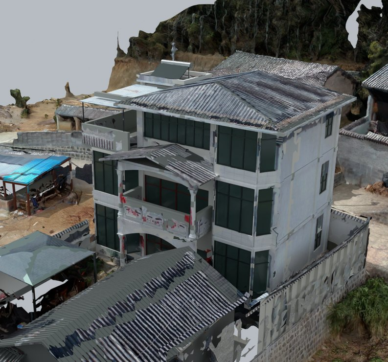
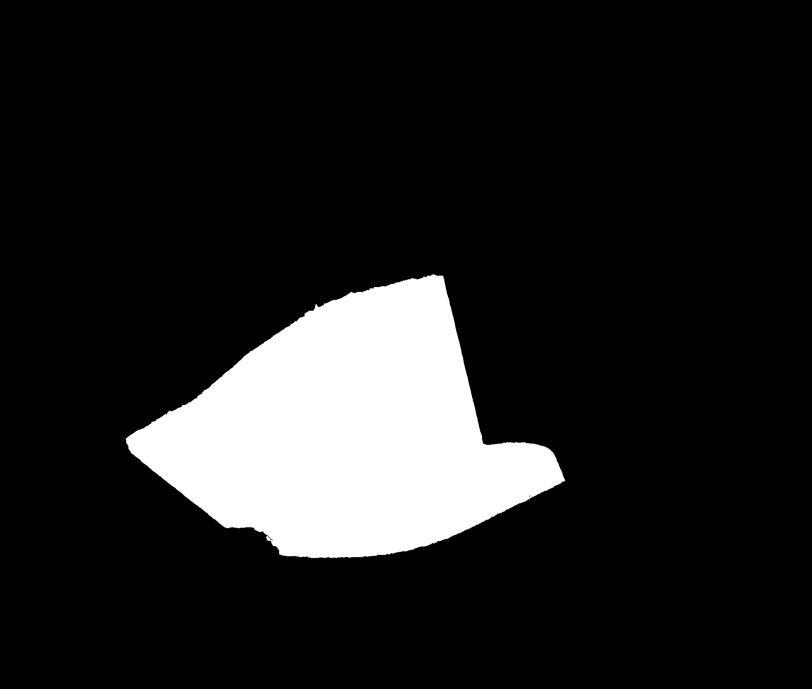

# V6 · 用主空洞边界融合实景网格与可编辑建筑

[逐版目录](README.md) · [建筑重建台账](../../reconstruction.md) · [阶段方法汇总](../v01-v23.md)

## 摘要

把 V5 建筑补入新实景场地的主空洞。保留五块原实景网格及 UV，分别交付融合模型和 ENU 对齐的可编辑副本。

## 1. 问题与输入

新纯场地摄影网格缺失住宅主体。V6 以 V5 的完整建筑补洞，同时让原场地与模型各自保有可回查的几何、材质和坐标。

## 2. 实现方法

1. 清点原五块网格并提取主空洞外圈、内环和原面边线。以原已核对的旋转和平移将 V5 米制局部坐标对齐到 ENU。

2. 用空洞多边形对补建几何做平面裁切，保留内环内的原实景岛。仅在孔洞侧生成窄过渡面，沿相邻原摄影面插值延伸 UV，瓦片依据屋面包络选取照片投影。

3. 分别保存含 PATCH 图层的融合主文件和对齐后的 Rhino 可编辑实体副本。沿实际原源切边每 0.10 m 采样，用三维距离查过渡面到源边的接近程度。

裁剪域可写为主空洞外环减去保留岛。将补块三角形与该域求交，新增边点的 UV 随邻近原实景三角面插值。复核时把平面越界面积和原切边的三维距离分开计算。切边距离保留分位数和超过 5 mm 的个数。

## 3. 过程图

**图 1** · 补建模型与实景底座融合

**图 2** · V6 主空洞平面栅格掩码

## 4. 验证与适用范围

切边检查记录 P95 约 1.16 mm，另有 2 个样本超过 5 mm。原生融合回读记录五块底网格和材质保留。这个距离检验拼接，配准精度和室内尺寸的误差需由对应证据分别判断。

- **Actual Source Rim 3D QA** 
  状态 `PASS`，源切边距离 P95（m） 0.00115649，采样步距（m） 0.1。

- **Native Hybrid QA** 
  无效对象记录 0，实景底网格 5。

- **Patch Clip And Photo QA** 
  记录本轮参数、对象和处理结果。

## 5. 复现入口与出处

过程路径以本地 `JIA` 项目为根，`work/` 指重建项目的历史工作目录。复核时按交付记录打开本轮输入与保存成果，再依方法中的截面、对象或动作采样对照原报告。

交付与参考记录（1 项）

~~~text
Rebuild_V6_Hybrid/使用说明.md
~~~

### 原实现脚本附件

[浏览本版全部 32 个文件](../source-code/v6/README.md) · [原件与公开副本校验值](../source-code/v6/manifest.json)

- [`prepare_v6_base.py`](../source-code/v6/history/prepare_v6_base.py)
- [`build_v6_patch.py`](../source-code/v6/history/build_v6_patch.py)
- [`stitch_v6_rim.py`](../source-code/v6/history/stitch_v6_rim.py)
- [`probe_v6_embed.py`](../source-code/v6/history/probe_v6_embed.py)
- [`export_v6_native.py`](../source-code/v6/history/export_v6_native.py) · 站点坐标脱敏

本版 3 个文件含站点坐标，公开副本已标记脱敏位置并阻断直接执行，原字节保留在本机。其余附件与原件逐字节一致。

原脚本本地路径

~~~text
work/prepare_v6_base.py
work/build_v6_patch.py
work/stitch_v6_rim.py
work/probe_v6_embed.py
work/export_v6_native.py
~~~

核验报告路径（3 项）

**Actual Source Rim 3D QA**

~~~text
Rebuild_V6_Hybrid/06_Report/Actual_Source_Rim_3D_QA.json
~~~

**Native Hybrid QA**

~~~text
Rebuild_V6_Hybrid/06_Report/Native_Hybrid_QA.json
~~~

**Patch Clip And Photo QA**

~~~text
Rebuild_V6_Hybrid/06_Report/Patch_Clip_And_Photo_QA.json
~~~

图源与 SHA-256（2 张）

### 图 1 · 补建模型与实景底座融合

~~~text
Rebuild_V6_Hybrid/06_Report/Hybrid_Building.png
~~~

**原过程图 SHA-256**

~~~text
bffde801f0fbaafcb7f00676be207fc6858c179dd597a1817e0815fcf6b073d8
~~~

台账发布图，按原图局部裁切及压缩。

### 图 2 · V6 主空洞平面栅格掩码

~~~text
Rebuild_V6_Hybrid/06_Report/Main_Hole_Raster_Mask.png
~~~

**原过程图 SHA-256**

~~~text
3076fbe56e0c0a89e5566b74500d9c0e0d381fddd57d4be3f66972f33bcb42d8
~~~

原文件。

---

上一篇 [V5 · 从双鱼眼全景纠正房间连通和门轴](v5.md) 
下一篇 [V7 · 把山墙圈画定位到坡面和拱梁](v7.md)
