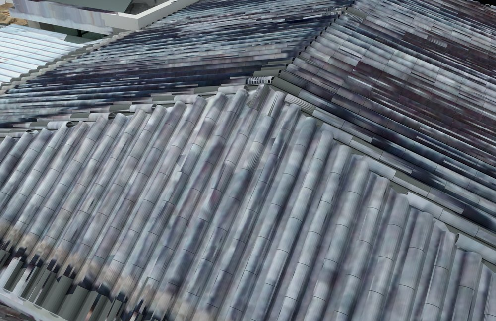
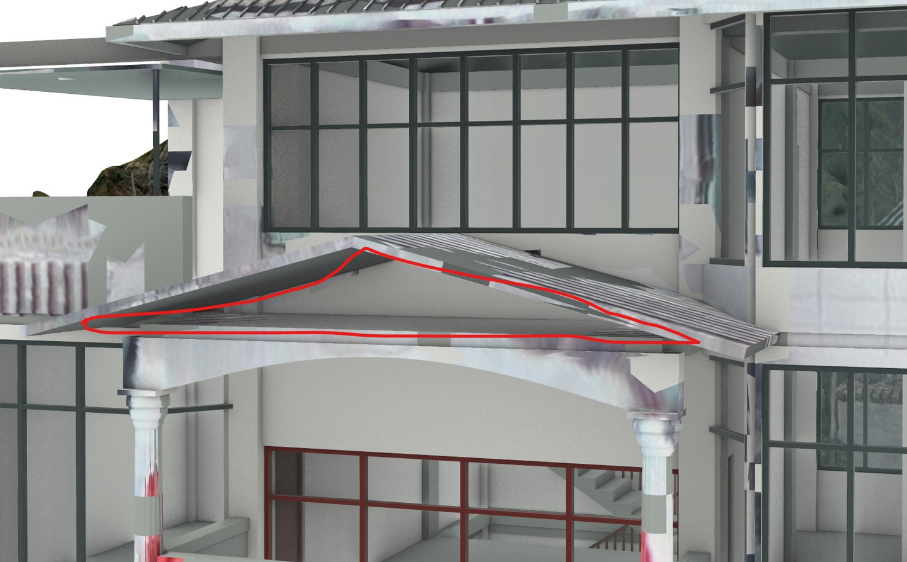
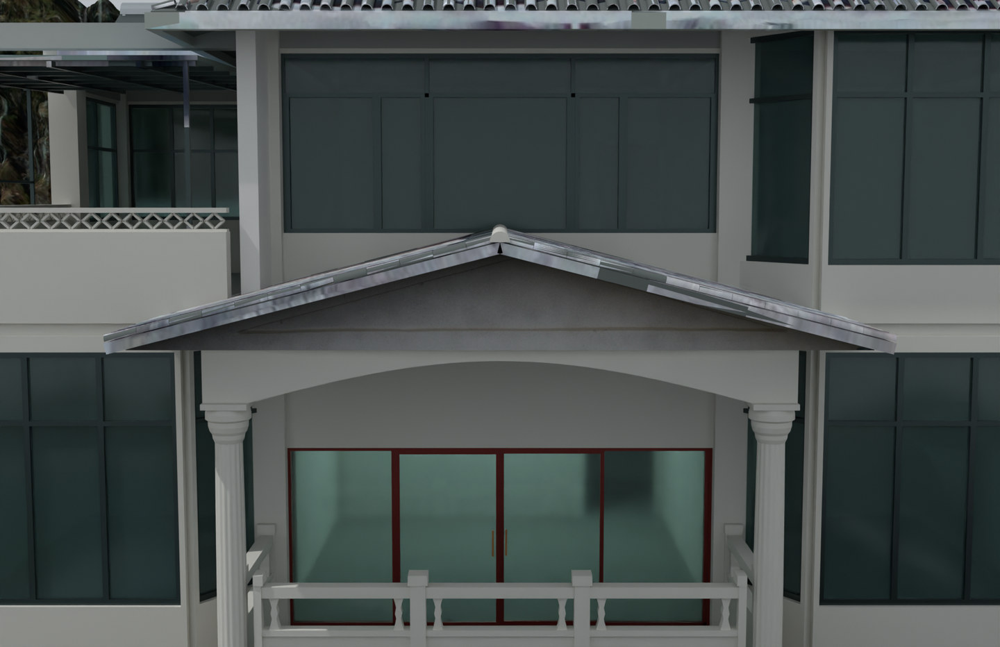

# V7 · 把山墙圈画定位到坡面和拱梁

[逐版目录](README.md) · [建筑重建台账](../../reconstruction.md) · [阶段方法汇总](../v01-v23.md)

## 摘要

继续按照片与标注改墙门，增补盖瓦、灰砖、陶砖和栏带。完整实体与空洞裁切补块分别保存。

## 1. 问题与输入

以 V6 融合模型为基线，红线标记指向坡屋面、拱梁上方的缺面。依据构件轮廓在完整参数场景内修订，同时保持孔洞裁切补块的交付链。

## 2. 实现方法

1. 由标注中的楼层、拱梁和两坡瓦檐识别目标。以屋面底线为上界、弧梁顶为下界闭合山墙，并在同一位置检查层间墙边。

2. 全景时间点为门位和开向提供证据，墙体开洞与门轴同步更新。分别构建盖瓦、灰砖、陶砖与栏带，局部 UV 从航拍获得。

3. 将完整实体变换到实景坐标并对空洞裁切。独立核验读取补块、边界与交换文件，区分候选源几何和最终融合产物。

### 实现链与源码定位

以下按诊断、处理、保存与复核组织阅读。调用和文件引用来自原脚本，输入输出方向由对应读写调用判断；辅助文件是否在本轮运行，以报告为准。

**1. 参数与几何处理** · [`prepare_v7_exports.py`](../source-code/v7/history/prepare_v7_exports.py#L3)

**2. 构建或写入** · [`build_scene_v7.py`](../source-code/v7/history/build_scene_v7.py#L41)

差集裁切 [`q.difference`](../source-code/v7/history/build_scene_v7.py#L41)；叉积／面法线 [`np.cross`](../source-code/v7/history/build_scene_v7.py#L143)。

文件引用：[`DJI_0623.JPG`](../source-code/v7/history/build_scene_v7.py#L21) · [`DJI_0100.JPG`](../source-code/v7/history/build_scene_v7.py#L21) · [`DJI_0429.JPG`](../source-code/v7/history/build_scene_v7.py#L68)。

**3. 构建或写入** · [`build_v7_patch.py`](../source-code/v7/history/build_v7_patch.py#L39)

叉积／面法线 [`np.cross`](../source-code/v7/history/build_v7_patch.py#L39)。

文件引用：[`Architecture_Scene.json`](../source-code/v7/history/build_v7_patch.py#L10) · [`V7_Incremental_Nodes.json`](../source-code/v7/history/build_v7_patch.py#L12) · [`V7_Changed_Nodes.json`](../source-code/v7/history/build_v7_patch.py#L12)。

**4. 辅助实现** · [`finish_v7_ridge.py`](../source-code/v7/history/finish_v7_ridge.py#L3)

文件引用：[`Architecture_Scene.json`](../source-code/v7/history/finish_v7_ridge.py#L3) · [`DJI_0429.JPG`](../source-code/v7/history/finish_v7_ridge.py#L6) · [`Changes_V7.json`](../source-code/v7/history/finish_v7_ridge.py#L7)。

**5. 保存后核验** · [`prepare_v7_final_qa.py`](../source-code/v7/history/prepare_v7_final_qa.py#L11)

Rhino 原生读写 [`rh.File3dm.Read`](../source-code/v7/history/prepare_v7_final_qa.py#L11)。

文件引用：[`V6_Exchange_Photo_Readback.json`](../source-code/v7/history/prepare_v7_final_qa.py#L8) · [`V7_Exchange_Photo_Readback.json`](../source-code/v7/history/prepare_v7_final_qa.py#L8) · [`Reality_Hybrid_V7.3dm`](../source-code/v7/history/prepare_v7_final_qa.py#L11)。

**6. 保存后核验** · [`check_v7_delivery.py`](../source-code/v7/history/check_v7_delivery.py#L12)

判据与回归检查 [`checks.append`](../source-code/v7/history/check_v7_delivery.py#L10)；Rhino 原生读写 [`rh.File3dm.Read`](../source-code/v7/history/check_v7_delivery.py#L12)；叉积／面法线 [`np.cross`](../source-code/v7/history/check_v7_delivery.py#L30)。

文件引用：[`纯场地版本.3dm`](../source-code/v7/history/check_v7_delivery.py#L8) · [`Reality_Hybrid_V7.3dm`](../source-code/v7/history/check_v7_delivery.py#L8) · [`Pure_Site_UNMODIFIED.3dm`](../source-code/v7/history/check_v7_delivery.py#L13)。

**7. 交付封装** · [`package_v7_rhino.py`](../source-code/v7/history/package_v7_rhino.py#L23)

文件引用：[`Independent_V7_QA.json`](../source-code/v7/history/package_v7_rhino.py#L24) · [`Reality_Hybrid_V7.3dm`](../source-code/v7/history/package_v7_rhino.py#L26) · [`Native_Hybrid_QA.json`](../source-code/v7/history/package_v7_rhino.py#L27)。

[方法原理：圈画、对象与剖切定位](../methodology.md#3-从截图圈画定位到对象与剖面) · [本版完整过程索引](process/v7.md)

本版索引汇合 45 幅已归档过程图、22 份交付及历史目录中的报告／说明／中间记录和全部 26 个源码附件。继承文件和本轮新增文件按来源保留，实际完成范围以第 4 节及原报告为准。

## 3. 过程图

**图 1** · 瓦件与墙面细化

 

**图 2** · 用户红线标出的山墙缺面 
**图 3** · V7 保存后的闭合山墙

## 4. 验证与适用范围

独立核验记录 1,301 项通过，补块在主空洞外的平面面积为 0。该统计核对原空洞掩码及保存结果，精度认定限于报告记录的检查范围。

- **Independent V7 QA** 
  检查条目 1,301，PASS 项 1,301。

- **Delivery Preflight QA** 
  状态 `PASS`，无效原生对象 0。

### 原记录中的关键检查

- **patch_finite_WINDOW_LEFT_C1212_F1** 
  通过 
  原记录 `Independent_V7_QA.json` 的 `checks[342]`

- **scope_WINDOW_LEFT_C1212_F1** 
  通过 
  原记录 `Independent_V7_QA.json` 的 `checks[343]`

- **all_vertices_in_hole_WINDOW_LEFT_C1212_F1** 
  通过 
  原记录 `Independent_V7_QA.json` 的 `checks[344]`

## 5. 复现入口与出处

过程路径以本地 `JIA` 项目为根，`work/` 指重建项目的历史工作目录。复核时按交付记录打开本轮输入与保存成果，再依方法中的截面、对象或动作采样对照原报告。

交付与参考记录（1 项）

~~~text
Rebuild_V7_Hybrid/使用说明.md
~~~

### 原实现脚本附件

[浏览本版全部 26 个文件](../source-code/v7/README.md) · [原件与公开副本校验值](../source-code/v7/manifest.json)

- [`build_scene_v7.py`](../source-code/v7/history/build_scene_v7.py)
- [`build_v7_patch.py`](../source-code/v7/history/build_v7_patch.py)
- [`prepare_v7_final_qa.py`](../source-code/v7/history/prepare_v7_final_qa.py)
- [`prepare_v7_exports.py`](../source-code/v7/history/prepare_v7_exports.py)
- [`finish_v7_ridge.py`](../source-code/v7/history/finish_v7_ridge.py)

本版 2 个文件含站点坐标，公开副本已标记脱敏位置并阻断直接执行，原字节保留在本机。其余附件与原件逐字节一致。

原脚本本地路径

~~~text
work/build_scene_v7.py
work/build_v7_patch.py
work/prepare_v7_final_qa.py
work/prepare_v7_exports.py
work/finish_v7_ridge.py
~~~

核验报告路径（2 项）

**Independent V7 QA**

~~~text
Rebuild_V7_Hybrid/06_Report/Independent_V7_QA.json
~~~

**Delivery Preflight QA**

~~~text
Rebuild_V7_Hybrid/06_Report/Delivery_Preflight_QA.json
~~~

图源与 SHA-256（3 张）

### 图 1 · 瓦件与墙面细化

~~~text
Rebuild_V7_Hybrid/06_Report/V7_Individual_Tiles.png
~~~

**原过程图 SHA-256**

~~~text
de4407e939cd927e18c9d5722b63c64f4a1c8ba627921d5a00087b80a5d7b402
~~~

台账发布图，按原图缩放及压缩。

### 图 2 · 用户红线标出的山墙缺面

~~~text
Rebuild_V7_Hybrid/07_Evidence/User_Annotations/屏幕截图 2026-10-08 211428.jpg
~~~

**原过程图 SHA-256**

~~~text
d4c2629174c1b47dedf8e36cf15fbf76b1c179229c882c1f3e030482c84958ad
~~~

已有过程图的发布副本。

### 图 3 · V7 保存后的闭合山墙

~~~text
Rebuild_V7_Hybrid/06_Report/V7_Closed_Gable.png
~~~

**原过程图 SHA-256**

~~~text
fbfab5f6a2aa247d964060e2e21e495011956404942bfa3b836b884d90f9d8e9
~~~

已有过程图的发布副本。

---

上一篇 [V6 · 用主空洞边界融合实景网格与可编辑建筑](v6.md) 
下一篇 [V8 · 西侧清场、楼梯镜像及门和房间登记](v8.md)
